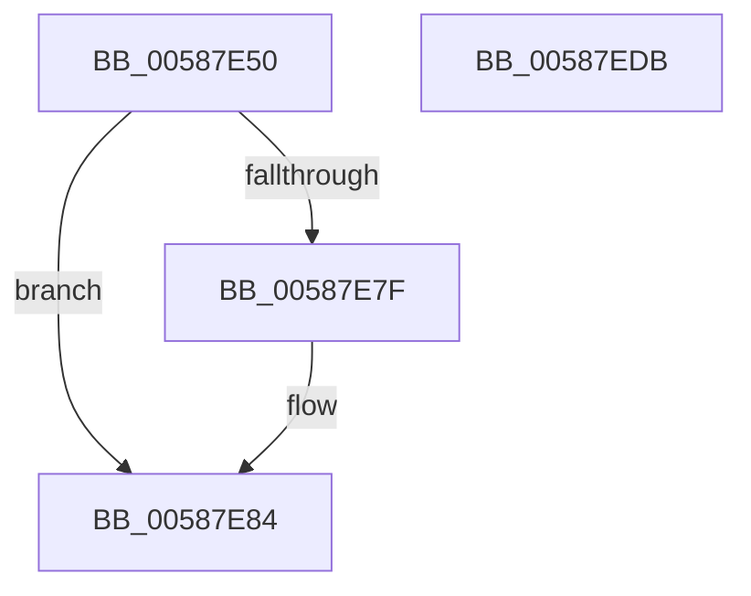

# HvlEnterSleepState

- RVA: `0x00587E50`–`0x00587EDC` (길이 `140` bytes)
- VA: `0x0000000140587E50`
- 실행 섹션: `.text`
- PDB 이름 있음: `예`; PDB Function 태그: `아니요`
- unwind 정보 RVA: `0x0005F638`
- 디코드: `37`개 명령, `140/140` bytes 표시
- 미해석 바이트: `0` (있으면 어셈블리에 `.byte`로 보존)

> 이 문서는 커널 이미지의 기계어와 PDB 기호를 분석해 생성했습니다. 4번과 5번은 함수 원형과 자료형을 바이너리 사용 방식에서 추정한 C 해석이며 원본 소스 복구 결과는 아닙니다.

## 1. Dependencies

- 직접 호출 지점: **5**; 고유 호출 대상: **5**
- 직접 호출자로 확인된 함수: **0**
- RIP 상대 이미지 참조: **1**

### Outgoing calls
- `0x00587E7F` → [VslTerminateSecureServices](VslTerminateSecureServices_function_0058F83C.md) (function, `0x0058F83C`)
- `0x00587E98` → [HvlpAcquireHypercallPage](../47/HvlpAcquireHypercallPage_function_00471410.md) (function, `0x00471410`)
- `0x00587EAC` → [HvcallInitiateHypercall](../31/HvcallInitiateHypercall_function_00313630.md) (function, `0x00313630`)
- `0x00587EB9` → [HvlpReleaseHypercallPage](../31/HvlpReleaseHypercallPage_function_00313480.md) (function, `0x00313480`)
- `0x00587ED0` → [_security_check_cookie](../6A/_security_check_cookie_function_006AC640.md) (function, `0x006AC640`)

### Direct callers
- 이 함수 시작 RVA로 연결되는 직접 call은 확인되지 않았습니다. 간접 호출은 완전히 역산할 수 없습니다.

### Static image references
- `0x00587E56` → RVA `0x00E0A740` (`.data`; read)

## 2. Other-region calls and transfers

- 다른 실행 섹션으로 향하는 call: **0**
- 별도 외부 분기/꼬리 이동을 확인하지 못했습니다.

## 3. Assembly (complete function range)

```asm
00587E50  40 53                           push rbx
00587E52  48 83 EC 60                     sub rsp, 0x60
00587E56  48 8B 05 E3 28 88 00            mov rax, qword ptr [rip + 0x8828e3]
00587E5D  48 33 C4                        xor rax, rsp
00587E60  48 89 44 24 50                  mov qword ptr [rsp + 0x50], rax
00587E65  33 C0                           xor eax, eax
00587E67  0F 57 C0                        xorps xmm0, xmm0
00587E6A  48 89 44 24 30                  mov qword ptr [rsp + 0x30], rax
00587E6F  8B D9                           mov ebx, ecx
00587E71  89 44 24 38                     mov dword ptr [rsp + 0x38], eax
00587E75  0F 11 44 24 20                  movups xmmword ptr [rsp + 0x20], xmm0
00587E7A  83 F9 04                        cmp ecx, 4
00587E7D  72 05                           jb 0x140587e84
00587E7F  E8 B8 79 00 00                  call 0x14058f83c
00587E84  41 B9 08 00 00 00               mov r9d, 8
00587E8A  4C 8D 44 24 40                  lea r8, [rsp + 0x40]
00587E8F  48 8D 4C 24 20                  lea rcx, [rsp + 0x20]
00587E94  41 8D 51 F9                     lea edx, [r9 - 7]
00587E98  E8 73 95 EE FF                  call 0x140471410
00587E9D  48 8B 54 24 38                  mov rdx, qword ptr [rsp + 0x38]
00587EA2  45 33 C0                        xor r8d, r8d
00587EA5  B9 84 00 00 00                  mov ecx, 0x84
00587EAA  89 18                           mov dword ptr [rax], ebx
00587EAC  E8 7F B7 D8 FF                  call 0x140313630
00587EB1  48 8D 4C 24 20                  lea rcx, [rsp + 0x20]
00587EB6  48 8B D8                        mov rbx, rax
00587EB9  E8 C2 B5 D8 FF                  call 0x140313480
00587EBE  66 F7 DB                        neg bx
00587EC1  1B C0                           sbb eax, eax
00587EC3  25 01 00 00 C0                  and eax, 0xc0000001
00587EC8  48 8B 4C 24 50                  mov rcx, qword ptr [rsp + 0x50]
00587ECD  48 33 CC                        xor rcx, rsp
00587ED0  E8 6B 47 12 00                  call 0x1406ac640
00587ED5  48 83 C4 60                     add rsp, 0x60
00587ED9  5B                              pop rbx
00587EDA  C3                              ret
00587EDB  CC                              int3
```

## 4. C-style interpretation (structured pseudocode)

```c
__int64 __fastcall HvlEnterSleepState(int a1)
{
    __int64 result;
    __int64 v_rbx;
    __int64 v_rsp;
    unsigned __int64 v_stack_m18;
    unsigned __int64 v_stack_m28;
    unsigned int v_stack_m30;
    unsigned __int64 v_stack_m38;
    unsigned __int64 v_stack_m48;

    v_rsp = (v_rsp) - (96);
    result = (*(unsigned __int64 *)(v_rip + 8923363)) ^ (v_rsp);
    v_stack_m18 = result;
    result = 0;
    v_stack_m38 = 0;
    v_stack_m30 = 0;
    v_stack_m48 = v_xmm0;
    if (a1 >= 4) {
        result = VslTerminateSecureServices(a1, a2, a3, a4);
    }
    result = HvlpAcquireHypercallPage(v_stack_m48, 8 - 7, v_stack_m28, 8);
    a3 = 0;
    *(unsigned int *)(result) = (unsigned int)((unsigned int)(a1));
    result = HvcallInitiateHypercall(132, v_stack_m30, a3, 8);
    result = HvlpReleaseHypercallPage(v_stack_m48, v_stack_m30, a3, 8);
    v_rbx = (unsigned __int16)(-(result));
    result = (unsigned int)((result) & (0xC0000001ULL));
    a1 = (v_stack_m18) ^ (v_rsp);
    result = _security_check_cookie(a1, v_stack_m30, a3, 8);
    v_rsp = (v_rsp) + (96);
    return result;
}
```

## 5. (Beta) C Style

```c
int64_t HvlEnterSleepState(int32_t Arg1)
{
    int64_t result;
    int64_t local_rbx;
    int64_t local_rsp;
    uint64_t v_stack_m18;
    uint64_t v_stack_m28;
    uint32_t v_stack_m30;
    uint64_t v_stack_m38;
    uint64_t v_stack_m48;

    local_rsp = (local_rsp) - (96);
    result = (*(uint64_t *)(v_rip + 0x8828E3)) ^ (local_rsp);
    v_stack_m18 = result;
    result = 0;
    v_stack_m38 = 0;
    v_stack_m30 = 0;
    v_stack_m48 = v_xmm0;
    if (Arg1 >= 4) {
        result = VslTerminateSecureServices(Arg1, a2, a3, a4);
    }
    result = HvlpAcquireHypercallPage(v_stack_m48, 8 - 7, v_stack_m28, 8);
    a3 = 0;
    *(uint32_t *)(result) = (uint32_t)((uint32_t)(Arg1));
    result = HvcallInitiateHypercall(132, v_stack_m30, a3, 8);
    result = HvlpReleaseHypercallPage(v_stack_m48, v_stack_m30, a3, 8);
    local_rbx = (uint16_t)(-(result));
    result = (uint32_t)((result) & (0xC0000001ULL));
    Arg1 = (v_stack_m18) ^ (local_rsp);
    result = _security_check_cookie(Arg1, v_stack_m30, a3, 8);
    local_rsp = (local_rsp) + (96);
    return result;
}
```

## 6. Execution-region graph

[열기: 2D/3D 그래프와 함수 탐색 컨트롤 패널](../../../control-panel.html?section=text&rva=0x00587E50&view=graph)

- 2D 그래프는 위에서 아래로 흐르고, 3D 그래프는 빈 공간을 드래그해 회전합니다. Shift+드래그는 이동, 휠은 확대·축소, 함수 노드 선택은 대상 보고서 이동입니다.

### Static fallback


