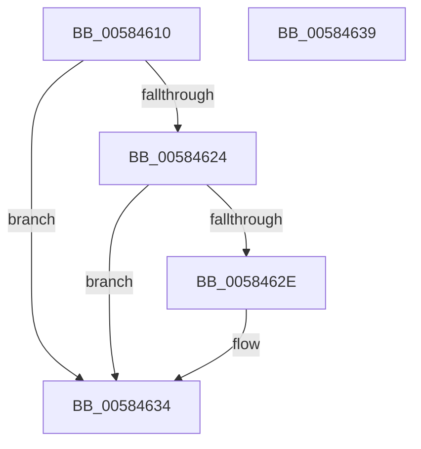

# HvlGetApicIdFromLpIndex

- RVA: `0x00584610`–`0x0058463A` (길이 `42` bytes)
- VA: `0x0000000140584610`
- 실행 섹션: `.text`
- PDB 이름 있음: `예`; PDB Function 태그: `아니요`
- unwind 정보 RVA: `0x0005C788`
- 디코드: `14`개 명령, `42/42` bytes 표시
- 미해석 바이트: `0` (있으면 어셈블리에 `.byte`로 보존)

> 이 문서는 커널 이미지의 기계어와 PDB 기호를 분석해 생성했습니다. 4번과 5번은 함수 원형과 자료형을 바이너리 사용 방식에서 추정한 C 해석이며 원본 소스 복구 결과는 아닙니다.

## 1. Dependencies

- 직접 호출 지점: **1**; 고유 호출 대상: **1**
- 직접 호출자로 확인된 함수: **1**
- RIP 상대 이미지 참조: **1**

### Outgoing calls
- `0x00584624` → [HvlpGetLpcbByLpIndex](../44/HvlpGetLpcbByLpIndex_function_0044FFA0.md) (function, `0x0044FFA0`)

### Direct callers
- [KiQueryProcessorNode](../5B/KiQueryProcessorNode_function_005BCC70.md) at `0x005BCD8B`

### Static image references
- `0x0058461A` → RVA `0x00FC6A90` (`ALMOSTRO`; read)

## 2. Other-region calls and transfers

- 다른 실행 섹션으로 향하는 call: **0**
- 별도 외부 분기/꼬리 이동을 확인하지 못했습니다.

## 3. Assembly (complete function range)

```asm
00584610  48 83 EC 28                     sub rsp, 0x28
00584614  83 0A FF                        or dword ptr [rdx], 0xffffffff
00584617  4C 8B D2                        mov r10, rdx
0058461A  8B 05 70 24 A4 00               mov eax, dword ptr [rip + 0xa42470]
00584620  A8 02                           test al, 2
00584622  74 10                           je 0x140584634
00584624  E8 77 B9 EC FF                  call 0x14044ffa0
00584629  48 85 C0                        test rax, rax
0058462C  74 06                           je 0x140584634
0058462E  8B 40 08                        mov eax, dword ptr [rax + 8]
00584631  41 89 02                        mov dword ptr [r10], eax
00584634  48 83 C4 28                     add rsp, 0x28
00584638  C3                              ret
00584639  CC                              int3
```

## 4. C-style interpretation (structured pseudocode)

```c
__int64 __fastcall HvlGetApicIdFromLpIndex(__int64 a1, __int64 a2)
{
    __int64 result;
    __int64 v_rsp;

    v_rsp = (v_rsp) - (40);
    if ((((unsigned __int8)((unsigned int)(*(unsigned int *)(v_rip + 10757232)))) & (2)) == 0) goto loc_00584634;
    result = HvlpGetLpcbByLpIndex(a1, a2, a3, a4);
    if (result != 0) {
        result = *(unsigned int *)(result + 8);
        *(unsigned int *)(a2) = (unsigned int)(result);
    }
    v_rsp = (v_rsp) + (40);
    return result;
}
```

## 5. (Beta) C Style

```c
int64_t HvlGetApicIdFromLpIndex(int64_t Arg1, void *Arg2)
{
    uint8_t *arg2 = (uint8_t *)Arg2;

    int64_t result;
    int64_t local_rsp;

    local_rsp = (local_rsp) - (40);
    if ((((uint8_t)((uint32_t)(*(uint32_t *)(v_rip + 0xA42470)))) & (2)) == 0) goto loc_00584634;
    result = HvlpGetLpcbByLpIndex(Arg1, Arg2, a3, a4);
    if (result != 0) {
        result = *(uint32_t *)(result + 0x8);
        *(uint32_t *)(arg2) = (uint32_t)(result);
    }
    local_rsp = (local_rsp) + (40);
    return result;
}
```

### 관측된 메모리 오프셋

구조체 형식이 확인되지 않은 접근은 인자 기준의 오프셋으로만 기록했습니다.

| 기준 인자 | 오프셋 표현 | 폭 (bit) | 접근 |
|---|---:|---:|---|
| `Arg2` | `+ 0x0` | `32` | `R/W` |

## 6. Execution-region graph

[열기: 2D/3D 그래프와 함수 탐색 컨트롤 패널](../../../control-panel.html?section=text&rva=0x00584610&view=graph)

- 2D 그래프는 위에서 아래로 흐르고, 3D 그래프는 빈 공간을 드래그해 회전합니다. Shift+드래그는 이동, 휠은 확대·축소, 함수 노드 선택은 대상 보고서 이동입니다.

### Static fallback


