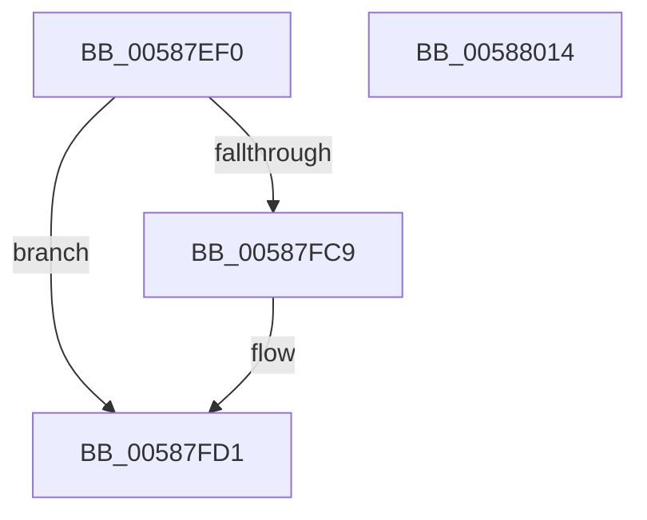

# HvlGetDeviceCapabilities

- RVA: `0x00587EF0`–`0x00588015` (길이 `293` bytes)
- VA: `0x0000000140587EF0`
- 실행 섹션: `.text`
- PDB 이름 있음: `예`; PDB Function 태그: `아니요`
- unwind 정보 RVA: `0x000C66E0`
- 디코드: `78`개 명령, `293/293` bytes 표시
- 미해석 바이트: `0` (있으면 어셈블리에 `.byte`로 보존)

> 이 문서는 커널 이미지의 기계어와 PDB 기호를 분석해 생성했습니다. 4번과 5번은 함수 원형과 자료형을 바이너리 사용 방식에서 추정한 C 해석이며 원본 소스 복구 결과는 아닙니다.

## 1. Dependencies

- 직접 호출 지점: **7**; 고유 호출 대상: **5**
- 직접 호출자로 확인된 함수: **0**
- RIP 상대 이미지 참조: **1**

### Outgoing calls
- `0x00587F50` → [HvlpAcquireHypercallPage](../47/HvlpAcquireHypercallPage_function_00471410.md) (function, `0x00471410`)
- `0x00587F6A` → [HvlpAcquireHypercallPage](../47/HvlpAcquireHypercallPage_function_00471410.md) (function, `0x00471410`)
- `0x00587FBC` → [HvcallInitiateHypercall](../31/HvcallInitiateHypercall_function_00313630.md) (function, `0x00313630`)
- `0x00587FD5` → [HvlpReleaseHypercallPage](../31/HvlpReleaseHypercallPage_function_00313480.md) (function, `0x00313480`)
- `0x00587FDE` → [HvlpReleaseHypercallPage](../31/HvlpReleaseHypercallPage_function_00313480.md) (function, `0x00313480`)
- `0x00587FE6` → [HvlpHvToNtStatus](../30/HvlpHvToNtStatus_function_00307BD8.md) (function, `0x00307BD8`)
- `0x00587FF2` → [_security_check_cookie](../6A/_security_check_cookie_function_006AC640.md) (function, `0x006AC640`)

### Direct callers
- 이 함수 시작 RVA로 연결되는 직접 call은 확인되지 않았습니다. 간접 호출은 완전히 역산할 수 없습니다.

### Static image references
- `0x00587F0F` → RVA `0x00E0A740` (`.data`; read)

## 2. Other-region calls and transfers

- 다른 실행 섹션으로 향하는 call: **0**
- 별도 외부 분기/꼬리 이동을 확인하지 못했습니다.

## 3. Assembly (complete function range)

```asm
00587EF0  48 8B C4                        mov rax, rsp
00587EF3  48 89 58 08                     mov qword ptr [rax + 8], rbx
00587EF7  48 89 70 18                     mov qword ptr [rax + 0x18], rsi
00587EFB  48 89 78 20                     mov qword ptr [rax + 0x20], rdi
00587EFF  55                              push rbp
00587F00  41 56                           push r14
00587F02  41 57                           push r15
00587F04  48 8D 68 A1                     lea rbp, [rax - 0x5f]
00587F08  48 81 EC C0 00 00 00            sub rsp, 0xc0
00587F0F  48 8B 05 2A 28 88 00            mov rax, qword ptr [rip + 0x88282a]
00587F16  48 33 C4                        xor rax, rsp
00587F19  48 89 45 37                     mov qword ptr [rbp + 0x37], rax
00587F1D  33 C0                           xor eax, eax
00587F1F  4C 8D 45 07                     lea r8, [rbp + 7]
00587F23  0F 57 C0                        xorps xmm0, xmm0
00587F26  48 89 45 D7                     mov qword ptr [rbp - 0x29], rax
00587F2A  48 8B F2                        mov rsi, rdx
00587F2D  89 45 DF                        mov dword ptr [rbp - 0x21], eax
00587F30  48 8B F9                        mov rdi, rcx
00587F33  48 89 45 B7                     mov qword ptr [rbp - 0x49], rax
00587F37  0F 11 02                        movups xmmword ptr [rdx], xmm0
00587F3A  44 8D 48 18                     lea r9d, [rax + 0x18]
00587F3E  89 45 BF                        mov dword ptr [rbp - 0x41], eax
00587F41  8D 50 01                        lea edx, [rax + 1]
00587F44  48 8D 4D C7                     lea rcx, [rbp - 0x39]
00587F48  0F 11 45 C7                     movups xmmword ptr [rbp - 0x39], xmm0
00587F4C  0F 11 45 A7                     movups xmmword ptr [rbp - 0x59], xmm0
00587F50  E8 BB 94 EE FF                  call 0x140471410
00587F55  41 B9 10 00 00 00               mov r9d, 0x10
00587F5B  4C 8D 45 E7                     lea r8, [rbp - 0x19]
00587F5F  48 8D 4D A7                     lea rcx, [rbp - 0x59]
00587F63  48 8B D8                        mov rbx, rax
00587F66  41 8D 51 F2                     lea edx, [r9 - 0xe]
00587F6A  E8 A1 94 EE FF                  call 0x140471410
00587F6F  45 33 FF                        xor r15d, r15d
00587F72  4C 8B F0                        mov r14, rax
00587F75  4C 89 7B 08                     mov qword ptr [rbx + 8], r15
00587F79  48 B8 00 00 00 00 00 00 00 40   movabs rax, 0x4000000000000000
00587F83  4C 89 7B 10                     mov qword ptr [rbx + 0x10], r15
00587F87  4C 8B 45 BF                     mov r8, qword ptr [rbp - 0x41]
00587F8B  48 89 03                        mov qword ptr [rbx], rax
00587F8E  0F B7 4F 08                     movzx ecx, word ptr [rdi + 8]
00587F92  66 89 4B 02                     mov word ptr [rbx + 2], cx
00587F96  0F B7 4F 0C                     movzx ecx, word ptr [rdi + 0xc]
00587F9A  66 89 0B                        mov word ptr [rbx], cx
00587F9D  0F B7 4B 06                     movzx ecx, word ptr [rbx + 6]
00587FA1  0F B7 D1                        movzx edx, cx
00587FA4  66 33 57 0A                     xor dx, word ptr [rdi + 0xa]
00587FA8  66 83 E2 03                     and dx, 3
00587FAC  66 33 D1                        xor dx, cx
00587FAF  B9 AA 00 00 00                  mov ecx, 0xaa
00587FB4  66 89 53 06                     mov word ptr [rbx + 6], dx
00587FB8  48 8B 55 DF                     mov rdx, qword ptr [rbp - 0x21]
00587FBC  E8 6F B6 D8 FF                  call 0x140313630
00587FC1  48 8B D8                        mov rbx, rax
00587FC4  66 85 C0                        test ax, ax
00587FC7  75 08                           jne 0x140587fd1
00587FC9  41 0F 10 06                     movups xmm0, xmmword ptr [r14]
00587FCD  F3 0F 7F 06                     movdqu xmmword ptr [rsi], xmm0
00587FD1  48 8D 4D A7                     lea rcx, [rbp - 0x59]
00587FD5  E8 A6 B4 D8 FF                  call 0x140313480
00587FDA  48 8D 4D C7                     lea rcx, [rbp - 0x39]
00587FDE  E8 9D B4 D8 FF                  call 0x140313480
00587FE3  0F B7 CB                        movzx ecx, bx
00587FE6  E8 ED FB D7 FF                  call 0x140307bd8
00587FEB  48 8B 4D 37                     mov rcx, qword ptr [rbp + 0x37]
00587FEF  48 33 CC                        xor rcx, rsp
00587FF2  E8 49 46 12 00                  call 0x1406ac640
00587FF7  4C 8D 9C 24 C0 00 00 00         lea r11, [rsp + 0xc0]
00587FFF  49 8B 5B 20                     mov rbx, qword ptr [r11 + 0x20]
00588003  49 8B 73 30                     mov rsi, qword ptr [r11 + 0x30]
00588007  49 8B 7B 38                     mov rdi, qword ptr [r11 + 0x38]
0058800B  49 8B E3                        mov rsp, r11
0058800E  41 5F                           pop r15
00588010  41 5E                           pop r14
00588012  5D                              pop rbp
00588013  C3                              ret
00588014  CC                              int3
```

## 4. C-style interpretation (structured pseudocode)

```c
__int64 __fastcall HvlGetDeviceCapabilities(__int64 a1, __int64 a2)
{
    __int64 result;
    __int64 v_r15;
    __int64 v_rsp;
    unsigned __int64 v_stack_m18;

    *(unsigned __int64 *)(v_rsp + 8) = v_rbx;
    *(unsigned __int64 *)(v_rsp + 24) = v_rsi;
    *(unsigned __int64 *)(v_rsp + 32) = v_rdi;
    v_rsp = (v_rsp) - (192);
    result = (*(unsigned __int64 *)(v_rip + 8923178)) ^ (v_rsp);
    *(unsigned __int64 *)(v_rsp - 95 + 55) = result;
    result = 0;
    *(unsigned __int64 *)(v_rsp - 95 - 41) = 0;
    *(unsigned int *)(v_rsp - 95 - 33) = 0;
    *(unsigned __int64 *)(v_rsp - 95 - 73) = 0;
    *(unsigned __int64 *)(a2) = v_xmm0;
    *(unsigned int *)(v_rsp - 95 - 65) = 0;
    *(unsigned __int64 *)(v_rsp - 95 - 57) = v_xmm0;
    *(unsigned __int64 *)(v_rsp - 95 - 89) = v_xmm0;
    result = HvlpAcquireHypercallPage(v_rsp - 95 - 57, result + 1, v_rsp - 95 + 7, result + 24);
    result = HvlpAcquireHypercallPage(v_rsp - 95 - 89, 16 - 14, v_rsp - 95 - 25, 16);
    v_r15 = 0;
    *(unsigned __int64 *)(result + 8) = 0;
    *(unsigned __int64 *)(result + 16) = 0;
    *(unsigned __int64 *)(result) = result;
    *(unsigned __int16 *)(result + 2) = (unsigned __int16)(*(unsigned __int16 *)(a1 + 8));
    *(unsigned __int16 *)(result) = (unsigned __int16)(*(unsigned __int16 *)(a1 + 12));
    a2 = (unsigned __int16)(((unsigned __int16)(*(unsigned __int16 *)(result + 6))) ^ (*(unsigned __int16 *)(a1 + 10)));
    a2 = (unsigned __int16)((a2) & (3));
    a2 = (unsigned __int16)((a2) ^ ((unsigned __int16)(*(unsigned __int16 *)(result + 6))));
    *(unsigned __int16 *)(result + 6) = (unsigned __int16)(a2);
    result = HvcallInitiateHypercall(170, *(unsigned __int64 *)(v_rsp - 95 - 33), *(unsigned __int64 *)(v_rsp - 95 - 65), 16);
    if ((unsigned __int16)(result) == 0) {
        *(unsigned __int64 *)(a2) = v_xmm0;
    }
    result = HvlpReleaseHypercallPage(v_rsp - 95 - 89, *(unsigned __int64 *)(v_rsp - 95 - 33), *(unsigned __int64 *)(v_rsp - 95 - 65), 16);
    result = HvlpReleaseHypercallPage(v_rsp - 95 - 57, *(unsigned __int64 *)(v_rsp - 95 - 33), *(unsigned __int64 *)(v_rsp - 95 - 65), 16);
    result = HvlpHvToNtStatus((unsigned __int16)(result), *(unsigned __int64 *)(v_rsp - 95 - 33), *(unsigned __int64 *)(v_rsp - 95 - 65), 16);
    a1 = (*(unsigned __int64 *)(v_rsp - 95 + 55)) ^ (v_rsp);
    result = _security_check_cookie(a1, *(unsigned __int64 *)(v_rsp - 95 - 33), *(unsigned __int64 *)(v_rsp - 95 - 65), 16);
    return result;
}
```

## 5. (Beta) C Style

```c
int64_t HvlGetDeviceCapabilities(void *Arg1, void *Arg2)
{
    uint8_t *arg1 = (uint8_t *)Arg1;
    uint8_t *arg2 = (uint8_t *)Arg2;

    int64_t result;
    int64_t local_r15;
    int64_t local_rsp;
    uint64_t v_stack_m18;

    *(uint64_t *)(local_rsp + 0x8) = local_rbx;
    *(uint64_t *)(local_rsp + 0x18) = local_rsi;
    *(uint64_t *)(local_rsp + 0x20) = local_rdi;
    local_rsp = (local_rsp) - (192);
    result = (*(uint64_t *)(v_rip + 0x88282A)) ^ (local_rsp);
    *(uint64_t *)(local_rsp - 0x5F + 0x37) = result;
    result = 0;
    *(uint64_t *)(local_rsp - 0x5F - 0x29) = 0;
    *(uint32_t *)(local_rsp - 0x5F - 0x21) = 0;
    *(uint64_t *)(local_rsp - 0x5F - 0x49) = 0;
    *(uint64_t *)(arg2) = v_xmm0;
    *(uint32_t *)(local_rsp - 0x5F - 0x41) = 0;
    *(uint64_t *)(local_rsp - 0x5F - 0x39) = v_xmm0;
    *(uint64_t *)(local_rsp - 0x5F - 0x59) = v_xmm0;
    result = HvlpAcquireHypercallPage(local_rsp - 95 - 57, result + 1, local_rsp - 95 + 7, result + 24);
    result = HvlpAcquireHypercallPage(local_rsp - 95 - 89, 16 - 14, local_rsp - 95 - 25, 16);
    local_r15 = 0;
    *(uint64_t *)(result + 0x8) = 0;
    *(uint64_t *)(result + 0x10) = 0;
    *(uint64_t *)(result) = result;
    *(uint16_t *)(result + 0x2) = (uint16_t)(*(uint16_t *)(arg1 + 0x8));
    *(uint16_t *)(result) = (uint16_t)(*(uint16_t *)(arg1 + 0xC));
    Arg2 = (uint16_t)(((uint16_t)(*(uint16_t *)(result + 0x6))) ^ (*(uint16_t *)(arg1 + 0xA)));
    Arg2 = (uint16_t)((Arg2) & (3));
    Arg2 = (uint16_t)((Arg2) ^ ((uint16_t)(*(uint16_t *)(result + 0x6))));
    *(uint16_t *)(result + 0x6) = (uint16_t)(Arg2);
    result = HvcallInitiateHypercall(170, *(uint64_t *)(local_rsp - 0x5F - 0x21), *(uint64_t *)(local_rsp - 0x5F - 0x41), 16);
    if ((uint16_t)(result) == 0) {
        *(uint64_t *)(arg2) = v_xmm0;
    }
    result = HvlpReleaseHypercallPage(local_rsp - 95 - 89, *(uint64_t *)(local_rsp - 0x5F - 0x21), *(uint64_t *)(local_rsp - 0x5F - 0x41), 16);
    result = HvlpReleaseHypercallPage(local_rsp - 95 - 57, *(uint64_t *)(local_rsp - 0x5F - 0x21), *(uint64_t *)(local_rsp - 0x5F - 0x41), 16);
    result = HvlpHvToNtStatus((uint16_t)(result), *(uint64_t *)(local_rsp - 0x5F - 0x21), *(uint64_t *)(local_rsp - 0x5F - 0x41), 16);
    Arg1 = (*(uint64_t *)(local_rsp - 0x5F + 0x37)) ^ (local_rsp);
    result = _security_check_cookie(Arg1, *(uint64_t *)(local_rsp - 0x5F - 0x21), *(uint64_t *)(local_rsp - 0x5F - 0x41), 16);
    return result;
}
```

### 관측된 메모리 오프셋

구조체 형식이 확인되지 않은 접근은 인자 기준의 오프셋으로만 기록했습니다.

| 기준 인자 | 오프셋 표현 | 폭 (bit) | 접근 |
|---|---:|---:|---|
| `Arg1` | `+ 0x8` | `16` | `R` |
| `Arg1` | `+ 0xA` | `16` | `R` |
| `Arg1` | `+ 0xC` | `16` | `R` |
| `Arg2` | `+ 0x0` | `128` | `R` |
| `Arg2` | `+ 0x0` | `128` | `W` |

## 6. Execution-region graph

[열기: 2D/3D 그래프와 함수 탐색 컨트롤 패널](../../../control-panel.html?section=text&rva=0x00587EF0&view=graph)

- 2D 그래프는 위에서 아래로 흐르고, 3D 그래프는 빈 공간을 드래그해 회전합니다. Shift+드래그는 이동, 휠은 확대·축소, 함수 노드 선택은 대상 보고서 이동입니다.

### Static fallback


