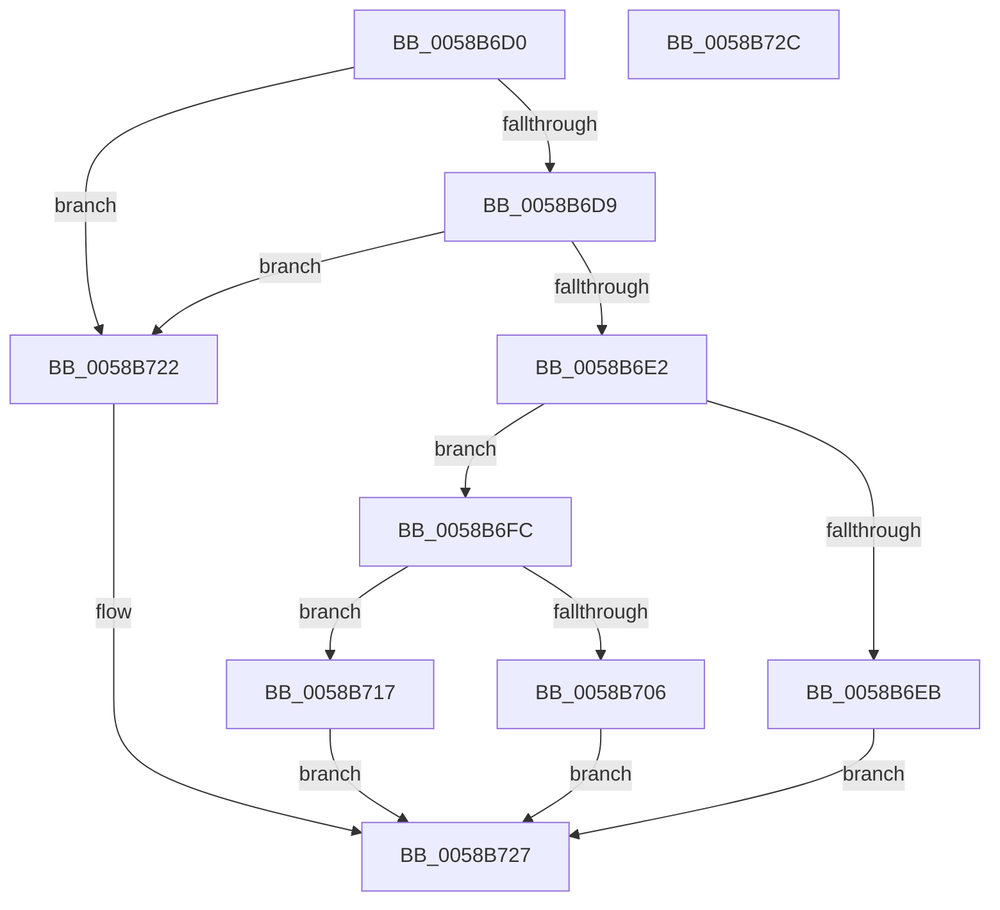

# HvlGetEncryptedData

- RVA: `0x0058B6D0`–`0x0058B72D` (길이 `93` bytes)
- VA: `0x000000014058B6D0`
- 실행 섹션: `.text`
- PDB 이름 있음: `예`; PDB Function 태그: `아니요`
- unwind 정보 RVA: `0x0005D2F4`
- 디코드: `25`개 명령, `93/93` bytes 표시
- 미해석 바이트: `0` (있으면 어셈블리에 `.byte`로 보존)

> 이 문서는 커널 이미지의 기계어와 PDB 기호를 분석해 생성했습니다. 4번과 5번은 함수 원형과 자료형을 바이너리 사용 방식에서 추정한 C 해석이며 원본 소스 복구 결과는 아닙니다.

## 1. Dependencies

- 직접 호출 지점: **2**; 고유 호출 대상: **2**
- 직접 호출자로 확인된 함수: **0**
- RIP 상대 이미지 참조: **2**

### Outgoing calls
- `0x0058B6F5` → [HvlpGetEncryptedDataFromSecureKernel](HvlpGetEncryptedDataFromSecureKernel_function_0058BB98.md) (function, `0x0058BB98`)
- `0x0058B710` → [HvlpGetEncryptedDataFromHypervisor](HvlpGetEncryptedDataFromHypervisor_function_0058B984.md) (function, `0x0058B984`)

### Direct callers
- 이 함수 시작 RVA로 연결되는 직접 call은 확인되지 않았습니다. 간접 호출은 완전히 역산할 수 없습니다.

### Static image references
- `0x0058B6E2` → RVA `0x00FC6A84` (`ALMOSTRO`; read)
- `0x0058B6FC` → RVA `0x00FC6A90` (`ALMOSTRO`; read)

## 2. Other-region calls and transfers

- 다른 실행 섹션으로 향하는 call: **0**
- 별도 외부 분기/꼬리 이동을 확인하지 못했습니다.

## 3. Assembly (complete function range)

```asm
0058B6D0  48 83 EC 38                     sub rsp, 0x38
0058B6D4  45 85 C0                        test r8d, r8d
0058B6D7  74 49                           je 0x14058b722
0058B6D9  41 F7 C0 FF 0F 00 00            test r8d, 0xfff
0058B6E0  75 40                           jne 0x14058b722
0058B6E2  80 3D 9B B3 A3 00 00            cmp byte ptr [rip + 0xa3b39b], 0
0058B6E9  74 11                           je 0x14058b6fc
0058B6EB  4C 89 4C 24 20                  mov qword ptr [rsp + 0x20], r9
0058B6F0  4C 8B 4C 24 60                  mov r9, qword ptr [rsp + 0x60]
0058B6F5  E8 9E 04 00 00                  call 0x14058bb98
0058B6FA  EB 2B                           jmp 0x14058b727
0058B6FC  8B 05 8E B3 A3 00               mov eax, dword ptr [rip + 0xa3b38e]
0058B702  A8 02                           test al, 2
0058B704  74 11                           je 0x14058b717
0058B706  4C 89 4C 24 20                  mov qword ptr [rsp + 0x20], r9
0058B70B  4C 8B 4C 24 60                  mov r9, qword ptr [rsp + 0x60]
0058B710  E8 6F 02 00 00                  call 0x14058b984
0058B715  EB 10                           jmp 0x14058b727
0058B717  41 83 21 00                     and dword ptr [r9], 0
0058B71B  B8 25 02 00 C0                  mov eax, 0xc0000225
0058B720  EB 05                           jmp 0x14058b727
0058B722  B8 0D 00 00 C0                  mov eax, 0xc000000d
0058B727  48 83 C4 38                     add rsp, 0x38
0058B72B  C3                              ret
0058B72C  CC                              int3
```

## 4. C-style interpretation (structured pseudocode)

```c
__int64 __fastcall HvlGetEncryptedData(__int64 a1, __int64 a2, int a3, __int64 a4, __int64 a5)
{
    __int64 result;
    __int64 v_rsp;
    unsigned __int64 v_stack_m18;

    v_rsp = (v_rsp) - (56);
    if (a3 == 0) goto loc_0058B722;
    if (((a3) & (0xFFFULL)) != 0) goto loc_0058B722;
    if ((*(unsigned __int8 *)(v_rip + 10728347)) == 0) goto loc_0058B6FC;
    v_stack_m18 = a4;
    result = HvlpGetEncryptedDataFromSecureKernel(a1, a2, a3, a5);
    goto loc_0058B727;
loc_0058B6FC:
    if ((((unsigned __int8)((unsigned int)(*(unsigned int *)(v_rip + 10728334)))) & (2)) == 0) goto loc_0058B717;
    v_stack_m18 = a5;
    result = HvlpGetEncryptedDataFromHypervisor(a1, a2, a3, a5);
    goto loc_0058B727;
loc_0058B717:
    goto loc_0058B727;
loc_0058B722:
loc_0058B727:
    v_rsp = (v_rsp) + (56);
    return (unsigned int)(0xC000000DULL);
}
```

## 5. (Beta) C Style

```c
int64_t HvlGetEncryptedData(int64_t Arg1, int64_t Arg2, int32_t Arg3, void *Arg4, int64_t Arg5)
{
    uint8_t *arg4 = (uint8_t *)Arg4;

    int64_t result;
    int64_t local_rsp;
    uint64_t v_stack_m18;

    local_rsp = (local_rsp) - (56);
    if (Arg3 == 0) goto loc_0058B722;
    if (((Arg3) & (0xFFFULL)) != 0) goto loc_0058B722;
    if ((*(uint8_t *)(v_rip + 0xA3B39B)) == 0) goto loc_0058B6FC;
    v_stack_m18 = Arg4;
    result = HvlpGetEncryptedDataFromSecureKernel(Arg1, Arg2, Arg3, Arg5);
    goto loc_0058B727;
loc_0058B6FC:
    if ((((uint8_t)((uint32_t)(*(uint32_t *)(v_rip + 0xA3B38E)))) & (2)) == 0) goto loc_0058B717;
    v_stack_m18 = Arg5;
    result = HvlpGetEncryptedDataFromHypervisor(Arg1, Arg2, Arg3, Arg5);
    goto loc_0058B727;
loc_0058B717:
    goto loc_0058B727;
loc_0058B722:
loc_0058B727:
    local_rsp = (local_rsp) + (56);
    return (uint32_t)(0xC000000DULL);
}
```

### 관측된 메모리 오프셋

구조체 형식이 확인되지 않은 접근은 인자 기준의 오프셋으로만 기록했습니다.

| 기준 인자 | 오프셋 표현 | 폭 (bit) | 접근 |
|---|---:|---:|---|
| `Arg4` | `+ 0x0` | `32` | `R/W` |

## 6. Execution-region graph

[열기: 2D/3D 그래프와 함수 탐색 컨트롤 패널](../../../control-panel.html?section=text&rva=0x0058B6D0&view=graph)

- 2D 그래프는 위에서 아래로 흐르고, 3D 그래프는 빈 공간을 드래그해 회전합니다. Shift+드래그는 이동, 휠은 확대·축소, 함수 노드 선택은 대상 보고서 이동입니다.

### Static fallback


