# HvlGetEnlightenmentInfo

- RVA: `0x00588020`–`0x005884F8` (길이 `1,240` bytes)
- VA: `0x0000000140588020`
- 실행 섹션: `.text`
- PDB 이름 있음: `예`; PDB Function 태그: `아니요`
- unwind 정보 RVA: `0x0005CF00`
- 디코드: `206`개 명령, `1,240/1,240` bytes 표시
- 미해석 바이트: `0` (있으면 어셈블리에 `.byte`로 보존)

> 이 문서는 커널 이미지의 기계어와 PDB 기호를 분석해 생성했습니다. 4번과 5번은 함수 원형과 자료형을 바이너리 사용 방식에서 추정한 C 해석이며 원본 소스 복구 결과는 아닙니다.

## 1. Dependencies

- 직접 호출 지점: **3**; 고유 호출 대상: **3**
- 직접 호출자로 확인된 함수: **0**
- RIP 상대 이미지 참조: **80**

### Outgoing calls
- `0x00588031` → [memset](../6C/memset_function_006C6C40.md) (function, `0x006C6C40`)
- `0x005884A5` → [VslGetNestedPageProtectionFlags](../2F/VslGetNestedPageProtectionFlags_function_002F2164.md) (function, `0x002F2164`)
- `0x005884AE` → [VslGetSecurePciEnabled](VslGetSecurePciEnabled_function_0058E770.md) (function, `0x0058E770`)

### Direct callers
- 이 함수 시작 RVA로 연결되는 직접 call은 확인되지 않았습니다. 간접 호출은 완전히 역산할 수 없습니다.

### Static image references
- `0x00588036` → RVA `0x00FC6AB8` (`ALMOSTRO`; read)
- `0x00588040` → RVA `0x00FC6A97` (`ALMOSTRO`; read)
- `0x0058804C` → RVA `0x00FC52AC` (`ALMOSTRO`; read)
- `0x0058805F` → RVA `0x0030F460` (`HvlNotifyLongSpinWait`; read)
- `0x00588074` → RVA `0x002DDBC0` (`HvlGetReferenceTimeUsingTscPage`; read)
- `0x0058808B` → RVA `0x00304E50` (`HvlSendSyntheticClusterIpi`; read)
- `0x005880A5` → RVA `0x00589970` (`HvlSetSystemSleepProperty`; read)
- `0x005880B0` → RVA `0x00587E50` (`HvlEnterSleepState`; read)
- `0x005880BB` → RVA `0x00588D80` (`HvlNotifyDebugDeviceAvailable`; read)
- `0x005880C6` → RVA `0x00588740` (`HvlHalVpStartEnabled`; read)
- `0x005880E0` → RVA `0x00588710` (`HvlHalStartVirtualProcessor`; read)
- `0x005880EE` → RVA `0x005886E0` (`HvlHalGetVpIndexFromApicId`; read)
- `0x00588106` → RVA `0x006ACEB0` (`HvlEndSystemInterrupt`; read)
- `0x00588111` → RVA `0x00439170` (`HvlWriteApicCommandRegister`; read)
- `0x0058811C` → RVA `0x005891C0` (`HvlRegisterDeviceId`; read)
- `0x0058812A` → RVA `0x00589B90` (`HvlUnregisterDeviceId`; read)
- `0x00588138` → RVA `0x00587630` (`HvlDmaAllocateDeviceDomain`; read)
- `0x00588146` → RVA `0x00587700` (`HvlDmaAttachDeviceDomain`; read)
- `0x00588154` → RVA `0x00587910` (`HvlDmaDetachDeviceDomain`; read)
- `0x00588162` → RVA `0x00587880` (`HvlDmaDeleteDeviceDomain`; read)
- `0x00588170` → RVA `0x00587A50` (`HvlDmaGetDmaGuardEnabled`; read)
- `0x0058817E` → RVA `0x00589840` (`HvlSetRootFaultReportingReady`; read)
- `0x0058818C` → RVA `0x00589A50` (`HvlUnblockDefaultDma`; read)
- `0x0058819A` → RVA `0x00587EF0` (`HvlGetDeviceCapabilities`; read)
- `0x005881A8` → RVA `0x00587B50` (`HvlDmaGetHybridPassthroughReservedRegions`; read)
- `0x005881B6` → RVA `0x00588520` (`HvlGetSystemPasidCapabilities`; read)
- `0x005881C4` → RVA `0x00587300` (`HvlCreatePasidSpace`; read)
- `0x005881D2` → RVA `0x00589790` (`HvlSetPasidAddressSpace`; read)
- `0x005881E0` → RVA `0x004A1C30` (`HvlFlushPasid`; read)
- `0x005881EE` → RVA `0x00587140` (`HvlAttachPasidSpace`; read)
- `0x005881FC` → RVA `0x00587510` (`HvlDetachPasidSpace`; read)
- `0x0058820A` → RVA `0x00587DA0` (`HvlEnablePasid`; read)
- `0x00588218` → RVA `0x005875B0` (`HvlDisablePasid`; read)
- `0x00588226` → RVA `0x005870A0` (`HvlAcknowledgePageRequest`; read)
- `0x00588234` → RVA `0x005873C0` (`HvlCreatePrQueue`; read)
- `0x00588242` → RVA `0x005874B0` (`HvlDeletePrQueue`; read)
- `0x00588250` → RVA `0x005872A0` (`HvlClearPrqStalled`; read)
- `0x0058825E` → RVA `0x004DD300` (`HvlSetDeviceDmaEnabled`; read)
- `0x0058826C` → RVA `0x005894C0` (`HvlSetDeviceCapabilities`; read)
- `0x0058827A` → RVA `0x005871F0` (`HvlAttachPrQueue`; read)
- `0x00588288` → RVA `0x00587560` (`HvlDetachPrQueue`; read)
- `0x00588296` → RVA `0x00588770` (`HvlHvDebuggerPowerHandler`; read)
- `0x005882B0` → RVA `0x00589350` (`HvlRestoreTime`; read)
- `0x005882CA` → RVA `0x0058AA80` (`HvlWakeVirtualProcessors`; read)
- `0x005882D8` → RVA `0x003077D0` (`HvlDmaMapDeviceLogicalRange`; read)
- `0x005882E6` → RVA `0x00307390` (`HvlDmaUnmapDeviceLogicalRange`; read)
- `0x005882F4` → RVA `0x0047A390` (`HvlDmaMapDeviceSparsePages`; read)
- `0x00588302` → RVA `0x004844C0` (`HvlDmaUnmapDeviceSparsePages`; read)
- `0x00588310` → RVA `0x005877C0` (`HvlDmaConfigureDeviceDomain`; read)
- `0x0058831E` → RVA `0x00587970` (`HvlDmaFlushDeviceDomain`; read)
- `0x0058832C` → RVA `0x00587A00` (`HvlDmaFlushDeviceDomainVaList`; read)
- `0x0058833A` → RVA `0x00584760` (`HvlGetVpSintMessagePage`; read)
- `0x00588348` → RVA `0x00587C90` (`HvlDmaReserveDeviceDomainAttachment`; read)
- `0x00588356` → RVA `0x00587D50` (`HvlDmaUnreserveDeviceDomainAttachment`; read)
- `0x00588364` → RVA `0x00589FD0` (`HvlChangeIsolatedMemoryVisibility`; read)
- `0x00588372` → RVA `0x00FC6AD8` (`ALMOSTRO`; read)
- `0x00588380` → RVA `0x00589060` (`HvlQueryAssociatedProcessors`; read)
- `0x0058838B` → RVA `0x00588890` (`HvlLpGetMachineCheckContext`; read)
- `0x00588399` → RVA `0x00589A30` (`HvlSuspendPartition`; read)
- `0x005883A7` → RVA `0x005894A0` (`HvlResumePartition`; read)
- `0x005883B5` → RVA `0x005898D0` (`HvlSetSystemMachineCheckProperty`; read)
- `0x005883C3` → RVA `0x00588810` (`HvlInvokeWheaErrorNotificationCallback`; read)
- `0x005883D1` → RVA `0x0058D370` (`HvlGetProcessorIndexFromVpIndex`; read)
- `0x005883DF` → RVA `0x004BC3B0` (`HvlLpReadMultipleMsr`; read)
- `0x005883EA` → RVA `0x004A35E0` (`HvlLpWriteMultipleMsr`; read)
- `0x005883F8` → RVA `0x00588900` (`HvlLpReadCpuid`; read)
- `0x00588406` → RVA `0x00588A00` (`HvlLpWritebackInvalidate`; read)
- `0x00588414` → RVA `0x00588840` (`HvlLpGetLogicalProcessorHwId`; read)
- `0x0058842C` → RVA `0x00588A90` (`HvlMapDeviceInterrupt`; read)
- `0x00588437` → RVA `0x00589AE0` (`HvlUnmapDeviceInterrupt`; read)
- `0x00588442` → RVA `0x003062A0` (`HvlRetargetDeviceInterrupt`; read)
- `0x00588457` → RVA `0x00589560` (`HvlSetHpetConfig`; read)
- `0x00588462` → RVA `0x00588E60` (`HvlNotifyHpetEnabled`; read)
- `0x0058846D` → RVA `0x007185D0` (`HvlUpdateMicrocodeDatabase`; read)
- `0x0058847B` → RVA `0x007184E0` (`HvlGetMicrocodeLatency`; read)
- `0x00588495` → RVA `0x004F8EF0` (`HvlSetQpcBias`; read)
- `0x005884B5` → RVA `0x004393E0` (`VslAccessPciDevice`; read)
- `0x005884C2` → RVA `0x0049C0C0` (`VslIumEfiRuntimeService`; read)
- `0x005884D7` → RVA `0x00FC6A90` (`ALMOSTRO`; read)
- `0x005884E3` → RVA `0x00588500` (`HvlGetQpcBias`; read)

## 2. Other-region calls and transfers

- 다른 실행 섹션으로 향하는 call: **0**
- 별도 외부 분기/꼬리 이동을 확인하지 못했습니다.

## 3. Assembly (complete function range)

```asm
00588020  40 53                           push rbx
00588022  48 83 EC 20                     sub rsp, 0x20
00588026  33 D2                           xor edx, edx
00588028  41 B8 70 02 00 00               mov r8d, 0x270
0058802E  48 8B D9                        mov rbx, rcx
00588031  E8 0A EC 13 00                  call 0x1406c6c40
00588036  8B 05 7C EA A3 00               mov eax, dword ptr [rip + 0xa3ea7c]
0058803C  89 03                           mov dword ptr [rbx], eax
0058803E  33 C0                           xor eax, eax
00588040  38 05 51 EA A3 00               cmp byte ptr [rip + 0xa3ea51], al
00588046  0F 95 C0                        setne al
00588049  89 43 04                        mov dword ptr [rbx + 4], eax
0058804C  8B 05 5A D2 A3 00               mov eax, dword ptr [rip + 0xa3d25a]
00588052  89 43 1C                        mov dword ptr [rbx + 0x1c], eax
00588055  8B 05 5D EA A3 00               mov eax, dword ptr [rip + 0xa3ea5d]
0058805B  A8 40                           test al, 0x40
0058805D  74 0B                           je 0x14058806a
0058805F  48 8D 05 FA 73 D8 FF            lea rax, [rip - 0x278c06]
00588066  48 89 43 20                     mov qword ptr [rbx + 0x20], rax
0058806A  0F BA 25 46 EA A3 00 08         bt dword ptr [rip + 0xa3ea46], 8
00588072  73 0B                           jae 0x14058807f
00588074  48 8D 05 45 5B D5 FF            lea rax, [rip - 0x2aa4bb]
0058807B  48 89 43 28                     mov qword ptr [rbx + 0x28], rax
0058807F  F7 05 2F EA A3 00 00 40 00 00   test dword ptr [rip + 0xa3ea2f], 0x4000
00588089  74 0E                           je 0x140588099
0058808B  48 8D 05 BE CD D7 FF            lea rax, [rip - 0x283242]
00588092  48 89 83 C8 00 00 00            mov qword ptr [rbx + 0xc8], rax
00588099  F7 05 15 EA A3 00 00 00 01 00   test dword ptr [rip + 0xa3ea15], 0x10000
005880A3  74 21                           je 0x1405880c6
005880A5  48 8D 05 C4 18 00 00            lea rax, [rip + 0x18c4]
005880AC  48 89 43 30                     mov qword ptr [rbx + 0x30], rax
005880B0  48 8D 05 99 FD FF FF            lea rax, [rip - 0x267]
005880B7  48 89 43 38                     mov qword ptr [rbx + 0x38], rax
005880BB  48 8D 05 BE 0C 00 00            lea rax, [rip + 0xcbe]
005880C2  48 89 43 40                     mov qword ptr [rbx + 0x40], rax
005880C6  48 8D 05 73 06 00 00            lea rax, [rip + 0x673]
005880CD  48 89 83 D0 00 00 00            mov qword ptr [rbx + 0xd0], rax
005880D4  F7 05 DA E9 A3 00 00 80 00 00   test dword ptr [rip + 0xa3e9da], 0x8000
005880DE  74 1C                           je 0x1405880fc
005880E0  48 8D 05 29 06 00 00            lea rax, [rip + 0x629]
005880E7  48 89 83 D8 00 00 00            mov qword ptr [rbx + 0xd8], rax
005880EE  48 8D 05 EB 05 00 00            lea rax, [rip + 0x5eb]
005880F5  48 89 83 E0 00 00 00            mov qword ptr [rbx + 0xe0], rax
005880FC  8B 05 B6 E9 A3 00               mov eax, dword ptr [rip + 0xa3e9b6]
00588102  A8 10                           test al, 0x10
00588104  74 16                           je 0x14058811c
00588106  48 8D 05 A3 4D 12 00            lea rax, [rip + 0x124da3]
0058810D  48 89 43 08                     mov qword ptr [rbx + 8], rax
00588111  48 8D 05 58 10 EB FF            lea rax, [rip - 0x14efa8]
00588118  48 89 43 10                     mov qword ptr [rbx + 0x10], rax
0058811C  48 8D 05 9D 10 00 00            lea rax, [rip + 0x109d]
00588123  48 89 83 98 01 00 00            mov qword ptr [rbx + 0x198], rax
0058812A  48 8D 05 5F 1A 00 00            lea rax, [rip + 0x1a5f]
00588131  48 89 83 A0 01 00 00            mov qword ptr [rbx + 0x1a0], rax
00588138  48 8D 05 F1 F4 FF FF            lea rax, [rip - 0xb0f]
0058813F  48 89 83 A8 01 00 00            mov qword ptr [rbx + 0x1a8], rax
00588146  48 8D 05 B3 F5 FF FF            lea rax, [rip - 0xa4d]
0058814D  48 89 83 B0 01 00 00            mov qword ptr [rbx + 0x1b0], rax
00588154  48 8D 05 B5 F7 FF FF            lea rax, [rip - 0x84b]
0058815B  48 89 83 B8 01 00 00            mov qword ptr [rbx + 0x1b8], rax
00588162  48 8D 05 17 F7 FF FF            lea rax, [rip - 0x8e9]
00588169  48 89 83 C0 01 00 00            mov qword ptr [rbx + 0x1c0], rax
00588170  48 8D 05 D9 F8 FF FF            lea rax, [rip - 0x727]
00588177  48 89 83 E8 01 00 00            mov qword ptr [rbx + 0x1e8], rax
0058817E  48 8D 05 BB 16 00 00            lea rax, [rip + 0x16bb]
00588185  48 89 83 28 02 00 00            mov qword ptr [rbx + 0x228], rax
0058818C  48 8D 05 BD 18 00 00            lea rax, [rip + 0x18bd]
00588193  48 89 83 38 02 00 00            mov qword ptr [rbx + 0x238], rax
0058819A  48 8D 05 4F FD FF FF            lea rax, [rip - 0x2b1]
005881A1  48 89 83 00 01 00 00            mov qword ptr [rbx + 0x100], rax
005881A8  48 8D 05 A1 F9 FF FF            lea rax, [rip - 0x65f]
005881AF  48 89 83 50 02 00 00            mov qword ptr [rbx + 0x250], rax
005881B6  48 8D 05 63 03 00 00            lea rax, [rip + 0x363]
005881BD  48 89 83 F8 00 00 00            mov qword ptr [rbx + 0xf8], rax
005881C4  48 8D 05 35 F1 FF FF            lea rax, [rip - 0xecb]
005881CB  48 89 83 08 01 00 00            mov qword ptr [rbx + 0x108], rax
005881D2  48 8D 05 B7 15 00 00            lea rax, [rip + 0x15b7]
005881D9  48 89 83 10 01 00 00            mov qword ptr [rbx + 0x110], rax
005881E0  48 8D 05 49 9A F1 FF            lea rax, [rip - 0xe65b7]
005881E7  48 89 83 18 01 00 00            mov qword ptr [rbx + 0x118], rax
005881EE  48 8D 05 4B EF FF FF            lea rax, [rip - 0x10b5]
005881F5  48 89 83 20 01 00 00            mov qword ptr [rbx + 0x120], rax
005881FC  48 8D 05 0D F3 FF FF            lea rax, [rip - 0xcf3]
00588203  48 89 83 28 01 00 00            mov qword ptr [rbx + 0x128], rax
0058820A  48 8D 05 8F FB FF FF            lea rax, [rip - 0x471]
00588211  48 89 83 30 01 00 00            mov qword ptr [rbx + 0x130], rax
00588218  48 8D 05 91 F3 FF FF            lea rax, [rip - 0xc6f]
0058821F  48 89 83 38 01 00 00            mov qword ptr [rbx + 0x138], rax
00588226  48 8D 05 73 EE FF FF            lea rax, [rip - 0x118d]
0058822D  48 89 83 40 01 00 00            mov qword ptr [rbx + 0x140], rax
00588234  48 8D 05 85 F1 FF FF            lea rax, [rip - 0xe7b]
0058823B  48 89 83 48 01 00 00            mov qword ptr [rbx + 0x148], rax
00588242  48 8D 05 67 F2 FF FF            lea rax, [rip - 0xd99]
00588249  48 89 83 50 01 00 00            mov qword ptr [rbx + 0x150], rax
00588250  48 8D 05 49 F0 FF FF            lea rax, [rip - 0xfb7]
00588257  48 89 83 58 01 00 00            mov qword ptr [rbx + 0x158], rax
0058825E  48 8D 05 9B 50 F5 FF            lea rax, [rip - 0xaaf65]
00588265  48 89 83 60 01 00 00            mov qword ptr [rbx + 0x160], rax
0058826C  48 8D 05 4D 12 00 00            lea rax, [rip + 0x124d]
00588273  48 89 83 68 01 00 00            mov qword ptr [rbx + 0x168], rax
0058827A  48 8D 05 6F EF FF FF            lea rax, [rip - 0x1091]
00588281  48 89 83 70 01 00 00            mov qword ptr [rbx + 0x170], rax
00588288  48 8D 05 D1 F2 FF FF            lea rax, [rip - 0xd2f]
0058828F  48 89 83 78 01 00 00            mov qword ptr [rbx + 0x178], rax
00588296  48 8D 05 D3 04 00 00            lea rax, [rip + 0x4d3]
0058829D  48 89 83 80 01 00 00            mov qword ptr [rbx + 0x180], rax
005882A4  F7 05 0A E8 A3 00 00 00 00 20   test dword ptr [rip + 0xa3e80a], 0x20000000
005882AE  74 0E                           je 0x1405882be
005882B0  48 8D 05 99 10 00 00            lea rax, [rip + 0x1099]
005882B7  48 89 83 10 02 00 00            mov qword ptr [rbx + 0x210], rax
005882BE  F7 05 F0 E7 A3 00 00 00 00 40   test dword ptr [rip + 0xa3e7f0], 0x40000000
005882C8  74 0E                           je 0x1405882d8
005882CA  48 8D 05 AF 27 00 00            lea rax, [rip + 0x27af]
005882D1  48 89 83 20 02 00 00            mov qword ptr [rbx + 0x220], rax
005882D8  48 8D 05 F1 F4 D7 FF            lea rax, [rip - 0x280b0f]
005882DF  48 89 83 C8 01 00 00            mov qword ptr [rbx + 0x1c8], rax
005882E6  48 8D 05 A3 F0 D7 FF            lea rax, [rip - 0x280f5d]
005882ED  48 89 83 D0 01 00 00            mov qword ptr [rbx + 0x1d0], rax
005882F4  48 8D 05 95 20 EF FF            lea rax, [rip - 0x10df6b]
005882FB  48 89 83 D8 01 00 00            mov qword ptr [rbx + 0x1d8], rax
00588302  48 8D 05 B7 C1 EF FF            lea rax, [rip - 0x103e49]
00588309  48 89 83 E0 01 00 00            mov qword ptr [rbx + 0x1e0], rax
00588310  48 8D 05 A9 F4 FF FF            lea rax, [rip - 0xb57]
00588317  48 89 83 30 02 00 00            mov qword ptr [rbx + 0x230], rax
0058831E  48 8D 05 4B F6 FF FF            lea rax, [rip - 0x9b5]
00588325  48 89 83 40 02 00 00            mov qword ptr [rbx + 0x240], rax
0058832C  48 8D 05 CD F6 FF FF            lea rax, [rip - 0x933]
00588333  48 89 83 48 02 00 00            mov qword ptr [rbx + 0x248], rax
0058833A  48 8D 05 1F C4 FF FF            lea rax, [rip - 0x3be1]
00588341  48 89 83 08 02 00 00            mov qword ptr [rbx + 0x208], rax
00588348  48 8D 05 41 F9 FF FF            lea rax, [rip - 0x6bf]
0058834F  48 89 83 58 02 00 00            mov qword ptr [rbx + 0x258], rax
00588356  48 8D 05 F3 F9 FF FF            lea rax, [rip - 0x60d]
0058835D  48 89 83 60 02 00 00            mov qword ptr [rbx + 0x260], rax
00588364  48 8D 05 65 1C 00 00            lea rax, [rip + 0x1c65]
0058836B  48 89 83 68 02 00 00            mov qword ptr [rbx + 0x268], rax
00588372  8B 05 60 E7 A3 00               mov eax, dword ptr [rip + 0xa3e760]
00588378  84 C0                           test al, al
0058837A  0F 89 A2 00 00 00               jns 0x140588422
00588380  48 8D 05 D9 0C 00 00            lea rax, [rip + 0xcd9]
00588387  48 89 43 70                     mov qword ptr [rbx + 0x70], rax
0058838B  48 8D 05 FE 04 00 00            lea rax, [rip + 0x4fe]
00588392  48 89 83 98 00 00 00            mov qword ptr [rbx + 0x98], rax
00588399  48 8D 05 90 16 00 00            lea rax, [rip + 0x1690]
005883A0  48 89 83 A0 00 00 00            mov qword ptr [rbx + 0xa0], rax
005883A7  48 8D 05 F2 10 00 00            lea rax, [rip + 0x10f2]
005883AE  48 89 83 A8 00 00 00            mov qword ptr [rbx + 0xa8], rax
005883B5  48 8D 05 14 15 00 00            lea rax, [rip + 0x1514]
005883BC  48 89 83 B0 00 00 00            mov qword ptr [rbx + 0xb0], rax
005883C3  48 8D 05 46 04 00 00            lea rax, [rip + 0x446]
005883CA  48 89 83 B8 00 00 00            mov qword ptr [rbx + 0xb8], rax
005883D1  48 8D 05 98 4F 00 00            lea rax, [rip + 0x4f98]
005883D8  48 89 83 C0 00 00 00            mov qword ptr [rbx + 0xc0], rax
005883DF  48 8D 05 CA 3F F3 FF            lea rax, [rip - 0xcc036]
005883E6  48 89 43 78                     mov qword ptr [rbx + 0x78], rax
005883EA  48 8D 05 EF B1 F1 FF            lea rax, [rip - 0xe4e11]
005883F1  48 89 83 80 00 00 00            mov qword ptr [rbx + 0x80], rax
005883F8  48 8D 05 01 05 00 00            lea rax, [rip + 0x501]
005883FF  48 89 83 88 00 00 00            mov qword ptr [rbx + 0x88], rax
00588406  48 8D 05 F3 05 00 00            lea rax, [rip + 0x5f3]
0058840D  48 89 83 90 00 00 00            mov qword ptr [rbx + 0x90], rax
00588414  48 8D 05 25 04 00 00            lea rax, [rip + 0x425]
0058841B  48 89 83 18 02 00 00            mov qword ptr [rbx + 0x218], rax
00588422  0F BA 25 AE E6 A3 00 08         bt dword ptr [rip + 0xa3e6ae], 8
0058842A  73 21                           jae 0x14058844d
0058842C  48 8D 05 5D 06 00 00            lea rax, [rip + 0x65d]
00588433  48 89 43 48                     mov qword ptr [rbx + 0x48], rax
00588437  48 8D 05 A2 16 00 00            lea rax, [rip + 0x16a2]
0058843E  48 89 43 50                     mov qword ptr [rbx + 0x50], rax
00588442  48 8D 05 57 DE D7 FF            lea rax, [rip - 0x2821a9]
00588449  48 89 43 58                     mov qword ptr [rbx + 0x58], rax
0058844D  8B 05 85 E6 A3 00               mov eax, dword ptr [rip + 0xa3e685]
00588453  A8 01                           test al, 1
00588455  74 4C                           je 0x1405884a3
00588457  48 8D 05 02 11 00 00            lea rax, [rip + 0x1102]
0058845E  48 89 43 60                     mov qword ptr [rbx + 0x60], rax
00588462  48 8D 05 F7 09 00 00            lea rax, [rip + 0x9f7]
00588469  48 89 43 68                     mov qword ptr [rbx + 0x68], rax
0058846D  48 8D 05 5C 01 19 00            lea rax, [rip + 0x19015c]
00588474  48 89 83 F0 01 00 00            mov qword ptr [rbx + 0x1f0], rax
0058847B  48 8D 05 5E 00 19 00            lea rax, [rip + 0x19005e]
00588482  48 89 83 F8 01 00 00            mov qword ptr [rbx + 0x1f8], rax
00588489  F7 05 45 E6 A3 00 00 02 00 00   test dword ptr [rip + 0xa3e645], 0x200
00588493  74 0E                           je 0x1405884a3
00588495  48 8D 05 54 0A F7 FF            lea rax, [rip - 0x8f5ac]
0058849C  48 89 83 88 01 00 00            mov qword ptr [rbx + 0x188], rax
005884A3  33 C9                           xor ecx, ecx
005884A5  E8 BA 9C D6 FF                  call 0x1402f2164
005884AA  A8 04                           test al, 4
005884AC  74 29                           je 0x1405884d7
005884AE  E8 BD 62 00 00                  call 0x14058e770
005884B3  F6 D8                           neg al
005884B5  48 8D 05 24 0F EB FF            lea rax, [rip - 0x14f0dc]
005884BC  48 1B C9                        sbb rcx, rcx
005884BF  48 23 C8                        and rcx, rax
005884C2  48 8D 05 F7 3B F1 FF            lea rax, [rip - 0xec409]
005884C9  48 89 8B E8 00 00 00            mov qword ptr [rbx + 0xe8], rcx
005884D0  48 89 83 F0 00 00 00            mov qword ptr [rbx + 0xf0], rax
005884D7  F7 05 AF E5 A3 00 00 40 00 00   test dword ptr [rip + 0xa3e5af], 0x4000
005884E1  74 0E                           je 0x1405884f1
005884E3  48 8D 05 16 00 00 00            lea rax, [rip + 0x16]
005884EA  48 89 83 90 01 00 00            mov qword ptr [rbx + 0x190], rax
005884F1  48 83 C4 20                     add rsp, 0x20
005884F5  5B                              pop rbx
005884F6  C3                              ret
005884F7  CC                              int3
```

## 4. C-style interpretation (structured pseudocode)

```c
__int64 __fastcall HvlGetEnlightenmentInfo(__int64 a1, int a2)
{
    __int64 result;
    __int64 v_rsp;

    v_rsp = (v_rsp) - (32);
    a2 = 0;
    result = memset(a1, a2, 624, a4);
    *(unsigned int *)(a1) = (unsigned int)((unsigned int)(*(unsigned int *)(v_rip + 10742396)));
    result = 0;
    result = ((*(unsigned __int8 *)(v_rip + 10742353)) != 0) ? 1 : 0;
    *(unsigned int *)(a1 + 4) = (unsigned int)(result);
    *(unsigned int *)(a1 + 28) = (unsigned int)((unsigned int)(*(unsigned int *)(v_rip + 10736218)));
    result = (unsigned int)(*(unsigned int *)(v_rip + 10742365));
    if ((((unsigned __int8)((unsigned int)(*(unsigned int *)(v_rip + 10742365)))) & (64)) != 0) {
        result = v_rip - 2591750;
        *(unsigned __int64 *)(a1 + 32) = result;
    }
    if (!(condition_is_above_or_equal)) {
        result = v_rip - 2794683;
        *(unsigned __int64 *)(a1 + 40) = result;
    }
    if (((*(unsigned int *)(v_rip + 10742319)) & (0x4000ULL)) != 0) {
        result = v_rip - 2634306;
        *(unsigned __int64 *)(a1 + 200) = result;
    }
    if (((*(unsigned int *)(v_rip + 10742293)) & (0x10000ULL)) != 0) {
        result = v_rip + 6340;
        *(unsigned __int64 *)(a1 + 48) = result;
        result = v_rip - 615;
        *(unsigned __int64 *)(a1 + 56) = result;
        result = v_rip + 3262;
        *(unsigned __int64 *)(a1 + 64) = result;
    }
    *(unsigned __int64 *)(a1 + 208) = v_rip + 1651;
    result = v_rip + 1651;
    if (((*(unsigned int *)(v_rip + 10742234)) & (0x8000ULL)) != 0) {
        result = v_rip + 1577;
        *(unsigned __int64 *)(a1 + 216) = result;
        result = v_rip + 1515;
        *(unsigned __int64 *)(a1 + 224) = result;
    }
    result = (unsigned int)(*(unsigned int *)(v_rip + 10742198));
    if ((((unsigned __int8)((unsigned int)(*(unsigned int *)(v_rip + 10742198)))) & (16)) != 0) {
        result = v_rip + 1199523;
        *(unsigned __int64 *)(a1 + 8) = result;
        result = v_rip - 1372072;
        *(unsigned __int64 *)(a1 + 16) = result;
    }
    *(unsigned __int64 *)(a1 + 408) = v_rip + 4253;
    *(unsigned __int64 *)(a1 + 416) = v_rip + 6751;
    *(unsigned __int64 *)(a1 + 424) = v_rip - 2831;
    *(unsigned __int64 *)(a1 + 432) = v_rip - 2637;
    *(unsigned __int64 *)(a1 + 440) = v_rip - 2123;
    *(unsigned __int64 *)(a1 + 448) = v_rip - 2281;
    *(unsigned __int64 *)(a1 + 488) = v_rip - 1831;
    *(unsigned __int64 *)(a1 + 552) = v_rip + 5819;
    *(unsigned __int64 *)(a1 + 568) = v_rip + 6333;
    *(unsigned __int64 *)(a1 + 256) = v_rip - 689;
    *(unsigned __int64 *)(a1 + 592) = v_rip - 1631;
    *(unsigned __int64 *)(a1 + 248) = v_rip + 867;
    *(unsigned __int64 *)(a1 + 264) = v_rip - 3787;
    *(unsigned __int64 *)(a1 + 272) = v_rip + 5559;
    *(unsigned __int64 *)(a1 + 280) = v_rip - 943543;
    *(unsigned __int64 *)(a1 + 288) = v_rip - 4277;
    *(unsigned __int64 *)(a1 + 296) = v_rip - 3315;
    *(unsigned __int64 *)(a1 + 304) = v_rip - 1137;
    *(unsigned __int64 *)(a1 + 312) = v_rip - 3183;
    *(unsigned __int64 *)(a1 + 320) = v_rip - 4493;
    *(unsigned __int64 *)(a1 + 328) = v_rip - 3707;
    *(unsigned __int64 *)(a1 + 336) = v_rip - 3481;
    *(unsigned __int64 *)(a1 + 344) = v_rip - 4023;
    *(unsigned __int64 *)(a1 + 352) = v_rip - 700261;
    *(unsigned __int64 *)(a1 + 360) = v_rip + 4685;
    *(unsigned __int64 *)(a1 + 368) = v_rip - 4241;
    *(unsigned __int64 *)(a1 + 376) = v_rip - 3375;
    *(unsigned __int64 *)(a1 + 384) = v_rip + 1235;
    result = v_rip + 1235;
    if (((*(unsigned int *)(v_rip + 10741770)) & (0x20000000ULL)) != 0) {
        result = v_rip + 4249;
        *(unsigned __int64 *)(a1 + 528) = result;
    }
    if (((*(unsigned int *)(v_rip + 10741744)) & (0x40000000ULL)) != 0) {
        result = v_rip + 10159;
        *(unsigned __int64 *)(a1 + 544) = result;
    }
    *(unsigned __int64 *)(a1 + 456) = v_rip - 2624271;
    *(unsigned __int64 *)(a1 + 464) = v_rip - 2625373;
    *(unsigned __int64 *)(a1 + 472) = v_rip - 1105771;
    *(unsigned __int64 *)(a1 + 480) = v_rip - 1064521;
    *(unsigned __int64 *)(a1 + 560) = v_rip - 2903;
    *(unsigned __int64 *)(a1 + 576) = v_rip - 2485;
    *(unsigned __int64 *)(a1 + 584) = v_rip - 2355;
    *(unsigned __int64 *)(a1 + 520) = v_rip - 15329;
    *(unsigned __int64 *)(a1 + 600) = v_rip - 1727;
    *(unsigned __int64 *)(a1 + 608) = v_rip - 1549;
    *(unsigned __int64 *)(a1 + 616) = v_rip + 7269;
    result = (unsigned int)(*(unsigned int *)(v_rip + 10741600));
    if (sign_flag) {
        result = v_rip + 3289;
        *(unsigned __int64 *)(a1 + 112) = result;
        result = v_rip + 1278;
        *(unsigned __int64 *)(a1 + 152) = result;
        result = v_rip + 5776;
        *(unsigned __int64 *)(a1 + 160) = result;
        result = v_rip + 4338;
        *(unsigned __int64 *)(a1 + 168) = result;
        result = v_rip + 5396;
        *(unsigned __int64 *)(a1 + 176) = result;
        result = v_rip + 1094;
        *(unsigned __int64 *)(a1 + 184) = result;
        result = v_rip + 20376;
        *(unsigned __int64 *)(a1 + 192) = result;
        result = v_rip - 835638;
        *(unsigned __int64 *)(a1 + 120) = result;
        result = v_rip - 937489;
        *(unsigned __int64 *)(a1 + 128) = result;
        result = v_rip + 1281;
        *(unsigned __int64 *)(a1 + 136) = result;
        result = v_rip + 1523;
        *(unsigned __int64 *)(a1 + 144) = result;
        result = v_rip + 1061;
        *(unsigned __int64 *)(a1 + 536) = result;
    }
    if (!(condition_is_above_or_equal)) {
        result = v_rip + 1629;
        *(unsigned __int64 *)(a1 + 72) = result;
        result = v_rip + 5794;
        *(unsigned __int64 *)(a1 + 80) = result;
        result = v_rip - 2630057;
        *(unsigned __int64 *)(a1 + 88) = result;
    }
    if ((((unsigned __int8)((unsigned int)(*(unsigned int *)(v_rip + 10741381)))) & (1)) == 0) goto loc_005884A3;
    *(unsigned __int64 *)(a1 + 96) = v_rip + 4354;
    *(unsigned __int64 *)(a1 + 104) = v_rip + 2551;
    *(unsigned __int64 *)(a1 + 496) = v_rip + 1638748;
    *(unsigned __int64 *)(a1 + 504) = v_rip + 1638494;
    result = v_rip + 1638494;
    if (((*(unsigned int *)(v_rip + 10741317)) & (512)) != 0) {
        result = v_rip - 587180;
        *(unsigned __int64 *)(a1 + 392) = result;
    }
    a1 = 0;
    result = VslGetNestedPageProtectionFlags(a1, a2, 624, a4);
    if ((((unsigned __int8)(result)) & (4)) != 0) {
        result = VslGetSecurePciEnabled(a1, a2, 624, a4);
        result = (unsigned __int8)(-(result));
        result = v_rip - 1372380;
        a1 = (a1) & (result);
        result = v_rip - 967689;
        *(unsigned __int64 *)(a1 + 232) = a1;
        *(unsigned __int64 *)(a1 + 240) = result;
    }
    if (((*(unsigned int *)(v_rip + 10741167)) & (0x4000ULL)) != 0) {
        result = v_rip + 22;
        *(unsigned __int64 *)(a1 + 400) = result;
    }
    v_rsp = (v_rsp) + (32);
    return result;
}
```

## 5. (Beta) C Style

```c
int64_t HvlGetEnlightenmentInfo(void *Arg1, int32_t Arg2)
{
    uint8_t *arg1 = (uint8_t *)Arg1;

    int64_t result;
    int64_t local_rsp;

    local_rsp = (local_rsp) - (32);
    Arg2 = 0;
    result = memset(Arg1, Arg2, 624, a4);
    *(uint32_t *)(arg1) = (uint32_t)((uint32_t)(*(uint32_t *)(v_rip + 0xA3EA7C)));
    result = 0;
    result = ((*(uint8_t *)(v_rip + 0xA3EA51)) != 0) ? 1 : 0;
    *(uint32_t *)(arg1 + 0x4) = (uint32_t)(result);
    *(uint32_t *)(arg1 + 0x1C) = (uint32_t)((uint32_t)(*(uint32_t *)(v_rip + 0xA3D25A)));
    result = (uint32_t)(*(uint32_t *)(v_rip + 0xA3EA5D));
    if ((((uint8_t)((uint32_t)(*(uint32_t *)(v_rip + 0xA3EA5D)))) & (64)) != 0) {
        result = v_rip - 2591750;
        *(uint64_t *)(arg1 + 0x20) = result;
    }
    if (!(condition_is_above_or_equal)) {
        result = v_rip - 2794683;
        *(uint64_t *)(arg1 + 0x28) = result;
    }
    if (((*(uint32_t *)(v_rip + 0xA3EA2F)) & (0x4000ULL)) != 0) {
        result = v_rip - 2634306;
        *(uint64_t *)(arg1 + 0xC8) = result;
    }
    if (((*(uint32_t *)(v_rip + 0xA3EA15)) & (0x10000ULL)) != 0) {
        result = v_rip + 6340;
        *(uint64_t *)(arg1 + 0x30) = result;
        result = v_rip - 615;
        *(uint64_t *)(arg1 + 0x38) = result;
        result = v_rip + 3262;
        *(uint64_t *)(arg1 + 0x40) = result;
    }
    *(uint64_t *)(arg1 + 0xD0) = v_rip + 1651;
    result = v_rip + 1651;
    if (((*(uint32_t *)(v_rip + 0xA3E9DA)) & (0x8000ULL)) != 0) {
        result = v_rip + 1577;
        *(uint64_t *)(arg1 + 0xD8) = result;
        result = v_rip + 1515;
        *(uint64_t *)(arg1 + 0xE0) = result;
    }
    result = (uint32_t)(*(uint32_t *)(v_rip + 0xA3E9B6));
    if ((((uint8_t)((uint32_t)(*(uint32_t *)(v_rip + 0xA3E9B6)))) & (16)) != 0) {
        result = v_rip + 1199523;
        *(uint64_t *)(arg1 + 0x8) = result;
        result = v_rip - 1372072;
        *(uint64_t *)(arg1 + 0x10) = result;
    }
    *(uint64_t *)(arg1 + 0x198) = v_rip + 4253;
    *(uint64_t *)(arg1 + 0x1A0) = v_rip + 6751;
    *(uint64_t *)(arg1 + 0x1A8) = v_rip - 2831;
    *(uint64_t *)(arg1 + 0x1B0) = v_rip - 2637;
    *(uint64_t *)(arg1 + 0x1B8) = v_rip - 2123;
    *(uint64_t *)(arg1 + 0x1C0) = v_rip - 2281;
    *(uint64_t *)(arg1 + 0x1E8) = v_rip - 1831;
    *(uint64_t *)(arg1 + 0x228) = v_rip + 5819;
    *(uint64_t *)(arg1 + 0x238) = v_rip + 6333;
    *(uint64_t *)(arg1 + 0x100) = v_rip - 689;
    *(uint64_t *)(arg1 + 0x250) = v_rip - 1631;
    *(uint64_t *)(arg1 + 0xF8) = v_rip + 867;
    *(uint64_t *)(arg1 + 0x108) = v_rip - 3787;
    *(uint64_t *)(arg1 + 0x110) = v_rip + 5559;
    *(uint64_t *)(arg1 + 0x118) = v_rip - 943543;
    *(uint64_t *)(arg1 + 0x120) = v_rip - 4277;
    *(uint64_t *)(arg1 + 0x128) = v_rip - 3315;
    *(uint64_t *)(arg1 + 0x130) = v_rip - 1137;
    *(uint64_t *)(arg1 + 0x138) = v_rip - 3183;
    *(uint64_t *)(arg1 + 0x140) = v_rip - 4493;
    *(uint64_t *)(arg1 + 0x148) = v_rip - 3707;
    *(uint64_t *)(arg1 + 0x150) = v_rip - 3481;
    *(uint64_t *)(arg1 + 0x158) = v_rip - 4023;
    *(uint64_t *)(arg1 + 0x160) = v_rip - 700261;
    *(uint64_t *)(arg1 + 0x168) = v_rip + 4685;
    *(uint64_t *)(arg1 + 0x170) = v_rip - 4241;
    *(uint64_t *)(arg1 + 0x178) = v_rip - 3375;
    *(uint64_t *)(arg1 + 0x180) = v_rip + 1235;
    result = v_rip + 1235;
    if (((*(uint32_t *)(v_rip + 0xA3E80A)) & (0x20000000ULL)) != 0) {
        result = v_rip + 4249;
        *(uint64_t *)(arg1 + 0x210) = result;
    }
    if (((*(uint32_t *)(v_rip + 0xA3E7F0)) & (0x40000000ULL)) != 0) {
        result = v_rip + 10159;
        *(uint64_t *)(arg1 + 0x220) = result;
    }
    *(uint64_t *)(arg1 + 0x1C8) = v_rip - 2624271;
    *(uint64_t *)(arg1 + 0x1D0) = v_rip - 2625373;
    *(uint64_t *)(arg1 + 0x1D8) = v_rip - 1105771;
    *(uint64_t *)(arg1 + 0x1E0) = v_rip - 1064521;
    *(uint64_t *)(arg1 + 0x230) = v_rip - 2903;
    *(uint64_t *)(arg1 + 0x240) = v_rip - 2485;
    *(uint64_t *)(arg1 + 0x248) = v_rip - 2355;
    *(uint64_t *)(arg1 + 0x208) = v_rip - 15329;
    *(uint64_t *)(arg1 + 0x258) = v_rip - 1727;
    *(uint64_t *)(arg1 + 0x260) = v_rip - 1549;
    *(uint64_t *)(arg1 + 0x268) = v_rip + 7269;
    result = (uint32_t)(*(uint32_t *)(v_rip + 0xA3E760));
    if (sign_flag) {
        result = v_rip + 3289;
        *(uint64_t *)(arg1 + 0x70) = result;
        result = v_rip + 1278;
        *(uint64_t *)(arg1 + 0x98) = result;
        result = v_rip + 5776;
        *(uint64_t *)(arg1 + 0xA0) = result;
        result = v_rip + 4338;
        *(uint64_t *)(arg1 + 0xA8) = result;
        result = v_rip + 5396;
        *(uint64_t *)(arg1 + 0xB0) = result;
        result = v_rip + 1094;
        *(uint64_t *)(arg1 + 0xB8) = result;
        result = v_rip + 20376;
        *(uint64_t *)(arg1 + 0xC0) = result;
        result = v_rip - 835638;
        *(uint64_t *)(arg1 + 0x78) = result;
        result = v_rip - 937489;
        *(uint64_t *)(arg1 + 0x80) = result;
        result = v_rip + 1281;
        *(uint64_t *)(arg1 + 0x88) = result;
        result = v_rip + 1523;
        *(uint64_t *)(arg1 + 0x90) = result;
        result = v_rip + 1061;
        *(uint64_t *)(arg1 + 0x218) = result;
    }
    if (!(condition_is_above_or_equal)) {
        result = v_rip + 1629;
        *(uint64_t *)(arg1 + 0x48) = result;
        result = v_rip + 5794;
        *(uint64_t *)(arg1 + 0x50) = result;
        result = v_rip - 2630057;
        *(uint64_t *)(arg1 + 0x58) = result;
    }
    if ((((uint8_t)((uint32_t)(*(uint32_t *)(v_rip + 0xA3E685)))) & (1)) == 0) goto loc_005884A3;
    *(uint64_t *)(arg1 + 0x60) = v_rip + 4354;
    *(uint64_t *)(arg1 + 0x68) = v_rip + 2551;
    *(uint64_t *)(arg1 + 0x1F0) = v_rip + 1638748;
    *(uint64_t *)(arg1 + 0x1F8) = v_rip + 1638494;
    result = v_rip + 1638494;
    if (((*(uint32_t *)(v_rip + 0xA3E645)) & (512)) != 0) {
        result = v_rip - 587180;
        *(uint64_t *)(arg1 + 0x188) = result;
    }
    Arg1 = 0;
    result = VslGetNestedPageProtectionFlags(Arg1, Arg2, 624, a4);
    if ((((uint8_t)(result)) & (4)) != 0) {
        result = VslGetSecurePciEnabled(Arg1, Arg2, 624, a4);
        result = (uint8_t)(-(result));
        result = v_rip - 1372380;
        Arg1 = (Arg1) & (result);
        result = v_rip - 967689;
        *(void **)(arg1 + 0xE8) = Arg1;
        *(uint64_t *)(arg1 + 0xF0) = result;
    }
    if (((*(uint32_t *)(v_rip + 0xA3E5AF)) & (0x4000ULL)) != 0) {
        result = v_rip + 22;
        *(uint64_t *)(arg1 + 0x190) = result;
    }
    local_rsp = (local_rsp) + (32);
    return result;
}
```

### 관측된 메모리 오프셋

구조체 형식이 확인되지 않은 접근은 인자 기준의 오프셋으로만 기록했습니다.

| 기준 인자 | 오프셋 표현 | 폭 (bit) | 접근 |
|---|---:|---:|---|
| `Arg1` | `+ 0x0` | `32` | `W` |
| `Arg1` | `+ 0x4` | `32` | `W` |
| `Arg1` | `+ 0x8` | `64` | `W` |
| `Arg1` | `+ 0x10` | `64` | `W` |
| `Arg1` | `+ 0x1C` | `32` | `W` |
| `Arg1` | `+ 0x20` | `64` | `W` |
| `Arg1` | `+ 0x28` | `64` | `W` |
| `Arg1` | `+ 0x30` | `64` | `W` |
| `Arg1` | `+ 0x38` | `64` | `W` |
| `Arg1` | `+ 0x40` | `64` | `W` |
| `Arg1` | `+ 0x48` | `64` | `W` |
| `Arg1` | `+ 0x50` | `64` | `W` |
| `Arg1` | `+ 0x58` | `64` | `W` |
| `Arg1` | `+ 0x60` | `64` | `W` |
| `Arg1` | `+ 0x68` | `64` | `W` |
| `Arg1` | `+ 0x70` | `64` | `W` |
| `Arg1` | `+ 0x78` | `64` | `W` |
| `Arg1` | `+ 0x80` | `64` | `W` |
| `Arg1` | `+ 0x88` | `64` | `W` |
| `Arg1` | `+ 0x90` | `64` | `W` |
| `Arg1` | `+ 0x98` | `64` | `W` |
| `Arg1` | `+ 0xA0` | `64` | `W` |
| `Arg1` | `+ 0xA8` | `64` | `W` |
| `Arg1` | `+ 0xB0` | `64` | `W` |
| `Arg1` | `+ 0xB8` | `64` | `W` |
| `Arg1` | `+ 0xC0` | `64` | `W` |
| `Arg1` | `+ 0xC8` | `64` | `W` |
| `Arg1` | `+ 0xD0` | `64` | `W` |
| `Arg1` | `+ 0xD8` | `64` | `W` |
| `Arg1` | `+ 0xE0` | `64` | `W` |
| `Arg1` | `+ 0xE8` | `64` | `W` |
| `Arg1` | `+ 0xF0` | `64` | `W` |

추가 오프셋 46개는 표에서 생략했습니다.

## 6. Execution-region graph

[열기: 2D/3D 그래프와 함수 탐색 컨트롤 패널](../../../control-panel.html?section=text&rva=0x00588020&view=graph)

- 2D 그래프는 위에서 아래로 흐르고, 3D 그래프는 빈 공간을 드래그해 회전합니다. Shift+드래그는 이동, 휠은 확대·축소, 함수 노드 선택은 대상 보고서 이동입니다.

### Static fallback

```mermaid
flowchart TD
  bb_00588020[BB_00588020]
  bb_0058805F[BB_0058805F]
  bb_0058806A[BB_0058806A]
  bb_00588074[BB_00588074]
  bb_0058807F[BB_0058807F]
  bb_0058808B[BB_0058808B]
  bb_00588099[BB_00588099]
  bb_005880A5[BB_005880A5]
  bb_005880C6[BB_005880C6]
  bb_005880E0[BB_005880E0]
  bb_005880FC[BB_005880FC]
  bb_00588106[BB_00588106]
  bb_0058811C[BB_0058811C]
  bb_005882B0[BB_005882B0]
  bb_005882BE[BB_005882BE]
  bb_005882CA[BB_005882CA]
  bb_005882D8[BB_005882D8]
  bb_00588380[BB_00588380]
  bb_00588422[BB_00588422]
  bb_0058842C[BB_0058842C]
  bb_0058844D[BB_0058844D]
  bb_00588457[BB_00588457]
  bb_00588495[BB_00588495]
  bb_005884A3[BB_005884A3]
  bb_005884AE[BB_005884AE]
  bb_005884D7[BB_005884D7]
  bb_005884E3[BB_005884E3]
  bb_005884F1[BB_005884F1]
  bb_005884F7[BB_005884F7]
  bb_00588020 -->|branch| bb_0058806A
  bb_00588020 -->|fallthrough| bb_0058805F
  bb_0058805F -->|flow| bb_0058806A
  bb_0058806A -->|branch| bb_0058807F
  bb_0058806A -->|fallthrough| bb_00588074
  bb_00588074 -->|flow| bb_0058807F
  bb_0058807F -->|branch| bb_00588099
  bb_0058807F -->|fallthrough| bb_0058808B
  bb_0058808B -->|flow| bb_00588099
  bb_00588099 -->|branch| bb_005880C6
  bb_00588099 -->|fallthrough| bb_005880A5
  bb_005880A5 -->|flow| bb_005880C6
  bb_005880C6 -->|branch| bb_005880FC
  bb_005880C6 -->|fallthrough| bb_005880E0
  bb_005880E0 -->|flow| bb_005880FC
  bb_005880FC -->|branch| bb_0058811C
  bb_005880FC -->|fallthrough| bb_00588106
  bb_00588106 -->|flow| bb_0058811C
  bb_0058811C -->|branch| bb_005882BE
  bb_0058811C -->|fallthrough| bb_005882B0
  bb_005882B0 -->|flow| bb_005882BE
  bb_005882BE -->|branch| bb_005882D8
  bb_005882BE -->|fallthrough| bb_005882CA
  bb_005882CA -->|flow| bb_005882D8
  bb_005882D8 -->|branch| bb_00588422
  bb_005882D8 -->|fallthrough| bb_00588380
  bb_00588380 -->|flow| bb_00588422
  bb_00588422 -->|branch| bb_0058844D
  bb_00588422 -->|fallthrough| bb_0058842C
  bb_0058842C -->|flow| bb_0058844D
  bb_0058844D -->|branch| bb_005884A3
  bb_0058844D -->|fallthrough| bb_00588457
  bb_00588457 -->|branch| bb_005884A3
  bb_00588457 -->|fallthrough| bb_00588495
  bb_00588495 -->|flow| bb_005884A3
  bb_005884A3 -->|branch| bb_005884D7
  bb_005884A3 -->|fallthrough| bb_005884AE
  bb_005884AE -->|flow| bb_005884D7
  bb_005884D7 -->|branch| bb_005884F1
  bb_005884D7 -->|fallthrough| bb_005884E3
  bb_005884E3 -->|flow| bb_005884F1
```


