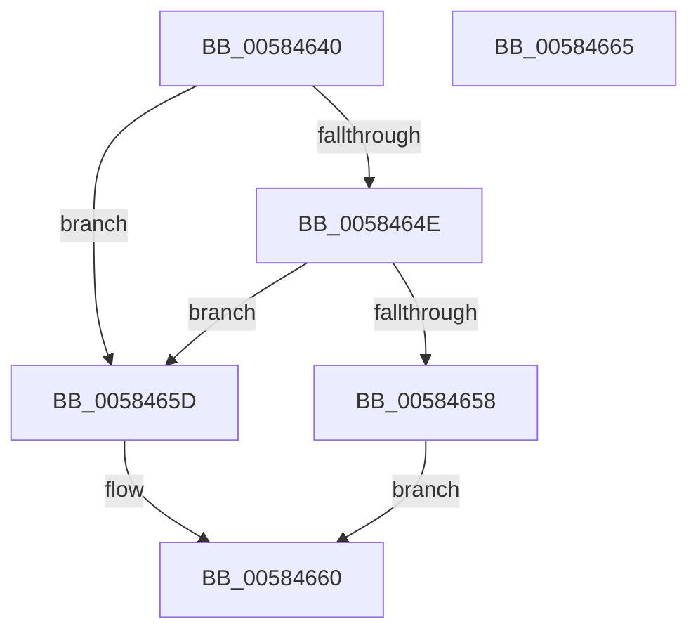

# HvlGetLpIndexFromApicId

- RVA: `0x00584640`–`0x00584666` (길이 `38` bytes)
- VA: `0x0000000140584640`
- 실행 섹션: `.text`
- PDB 이름 있음: `예`; PDB Function 태그: `아니요`
- unwind 정보 RVA: `0x0005C788`
- 디코드: `13`개 명령, `38/38` bytes 표시
- 미해석 바이트: `0` (있으면 어셈블리에 `.byte`로 보존)

> 이 문서는 커널 이미지의 기계어와 PDB 기호를 분석해 생성했습니다. 4번과 5번은 함수 원형과 자료형을 바이너리 사용 방식에서 추정한 C 해석이며 원본 소스 복구 결과는 아닙니다.

## 1. Dependencies

- 직접 호출 지점: **1**; 고유 호출 대상: **1**
- 직접 호출자로 확인된 함수: **1**
- RIP 상대 이미지 참조: **1**

### Outgoing calls
- `0x0058464E` → [HvlpGetLpcbByApicId](HvlpGetLpcbByApicId_function_00585858.md) (function, `0x00585858`)

### Direct callers
- [PpmIdleUpdateHvStates](../../page/77/PpmIdleUpdateHvStates_function_00770BF0.md) at `0x00770C0F`

### Static image references
- `0x00584644` → RVA `0x00FC6A90` (`ALMOSTRO`; read)

## 2. Other-region calls and transfers

- 다른 실행 섹션으로 향하는 call: **0**
- 별도 외부 분기/꼬리 이동을 확인하지 못했습니다.

## 3. Assembly (complete function range)

```asm
00584640  48 83 EC 28                     sub rsp, 0x28
00584644  8B 05 46 24 A4 00               mov eax, dword ptr [rip + 0xa42446]
0058464A  A8 02                           test al, 2
0058464C  74 0F                           je 0x14058465d
0058464E  E8 05 12 00 00                  call 0x140585858
00584653  48 85 C0                        test rax, rax
00584656  74 05                           je 0x14058465d
00584658  8B 40 04                        mov eax, dword ptr [rax + 4]
0058465B  EB 03                           jmp 0x140584660
0058465D  83 C8 FF                        or eax, 0xffffffff
00584660  48 83 C4 28                     add rsp, 0x28
00584664  C3                              ret
00584665  CC                              int3
```

## 4. C-style interpretation (structured pseudocode)

```c
__int64 __fastcall HvlGetLpIndexFromApicId(void)
{
    __int64 result;
    __int64 v_rsp;

    v_rsp = (v_rsp) - (40);
    if ((((unsigned __int8)((unsigned int)(*(unsigned int *)(v_rip + 10757190)))) & (2)) == 0) goto loc_0058465D;
    result = HvlpGetLpcbByApicId(a1, a2, a3, a4);
    if (result == 0) goto loc_0058465D;
    goto loc_00584660;
loc_0058465D:
    result = (unsigned int)(((unsigned int)(*(unsigned int *)(result + 4))) | (0xFFFFFFFFULL));
loc_00584660:
    v_rsp = (v_rsp) + (40);
    return result;
}
```

## 5. (Beta) C Style

```c
void HvlGetLpIndexFromApicId(void)
{
    int64_t result;
    int64_t local_rsp;

    local_rsp = (local_rsp) - (40);
    if ((((uint8_t)((uint32_t)(*(uint32_t *)(v_rip + 0xA42446)))) & (2)) == 0) goto loc_0058465D;
    result = HvlpGetLpcbByApicId(a1, a2, a3, a4);
    if (result == 0) goto loc_0058465D;
    goto loc_00584660;
loc_0058465D:
    result = (uint32_t)(((uint32_t)(*(uint32_t *)(result + 0x4))) | (0xFFFFFFFFULL));
loc_00584660:
    local_rsp = (local_rsp) + (40);
    return result;
}
```

## 6. Execution-region graph

[열기: 2D/3D 그래프와 함수 탐색 컨트롤 패널](../../../control-panel.html?section=text&rva=0x00584640&view=graph)

- 2D 그래프는 위에서 아래로 흐르고, 3D 그래프는 빈 공간을 드래그해 회전합니다. Shift+드래그는 이동, 휠은 확대·축소, 함수 노드 선택은 대상 보고서 이동입니다.

### Static fallback


