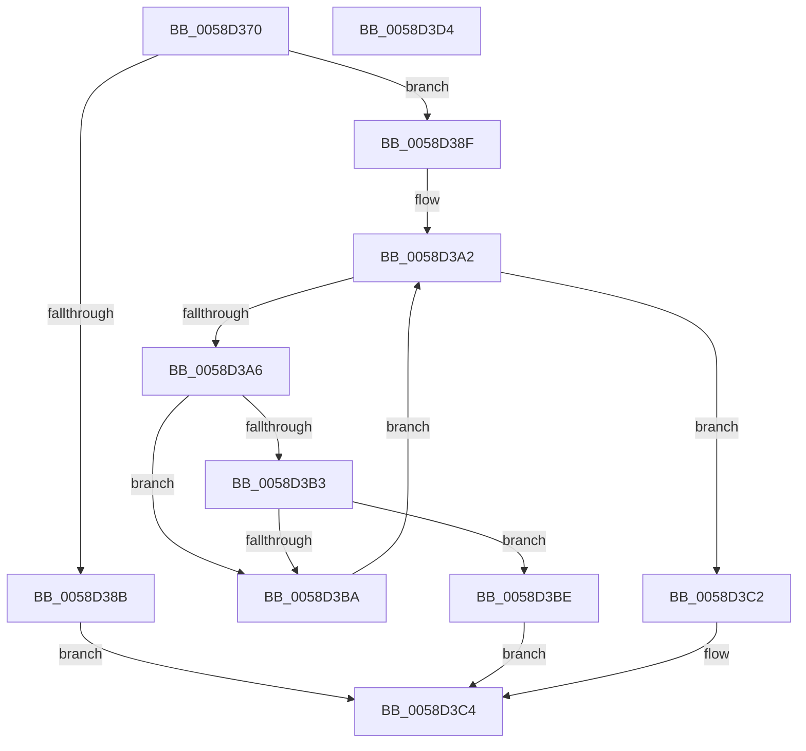

# HvlGetProcessorIndexFromVpIndex

- RVA: `0x0058D370`–`0x0058D3D5` (길이 `101` bytes)
- VA: `0x000000014058D370`
- 실행 섹션: `.text`
- PDB 이름 있음: `예`; PDB Function 태그: `아니요`
- unwind 정보 RVA: `0x00060BC4`
- 디코드: `33`개 명령, `101/101` bytes 표시
- 미해석 바이트: `0` (있으면 어셈블리에 `.byte`로 보존)

> 이 문서는 커널 이미지의 기계어와 PDB 기호를 분석해 생성했습니다. 4번과 5번은 함수 원형과 자료형을 바이너리 사용 방식에서 추정한 C 해석이며 원본 소스 복구 결과는 아닙니다.

## 1. Dependencies

- 직접 호출 지점: **1**; 고유 호출 대상: **1**
- 직접 호출자로 확인된 함수: **0**
- RIP 상대 이미지 참조: **2**

### Outgoing calls
- `0x0058D39D` → [KeQueryActiveProcessorCountEx](../24/KeQueryActiveProcessorCountEx_function_00249EF0.md) (function, `0x00249EF0`)

### Direct callers
- 이 함수 시작 RVA로 연결되는 직접 call은 확인되지 않았습니다. 간접 호출은 완전히 역산할 수 없습니다.

### Static image references
- `0x0058D383` → RVA `0x00FC5007` (`ALMOSTRO`; read)
- `0x0058D3A6` → RVA `0x00FCD260` (`ALMOSTRO`; read)

## 2. Other-region calls and transfers

- 다른 실행 섹션으로 향하는 call: **0**
- 별도 외부 분기/꼬리 이동을 확인하지 못했습니다.

## 3. Assembly (complete function range)

```asm
0058D370  48 89 5C 24 08                  mov qword ptr [rsp + 8], rbx
0058D375  48 89 74 24 10                  mov qword ptr [rsp + 0x10], rsi
0058D37A  57                              push rdi
0058D37B  48 83 EC 20                     sub rsp, 0x20
0058D37F  33 DB                           xor ebx, ebx
0058D381  8B F9                           mov edi, ecx
0058D383  38 1D 7E 7C A3 00               cmp byte ptr [rip + 0xa37c7e], bl
0058D389  74 04                           je 0x14058d38f
0058D38B  8B C1                           mov eax, ecx
0058D38D  EB 35                           jmp 0x14058d3c4
0058D38F  8B F7                           mov esi, edi
0058D391  B9 FF FF 00 00                  mov ecx, 0xffff
0058D396  C1 EE 06                        shr esi, 6
0058D399  40 80 E7 3F                     and dil, 0x3f
0058D39D  E8 4E CB CB FF                  call 0x140249ef0
0058D3A2  3B D8                           cmp ebx, eax
0058D3A4  73 1C                           jae 0x14058d3c2
0058D3A6  48 8D 15 B3 FE A3 00            lea rdx, [rip + 0xa3feb3]
0058D3AD  40 38 34 5A                     cmp byte ptr [rdx + rbx*2], sil
0058D3B1  75 07                           jne 0x14058d3ba
0058D3B3  40 38 7C 5A 01                  cmp byte ptr [rdx + rbx*2 + 1], dil
0058D3B8  74 04                           je 0x14058d3be
0058D3BA  FF C3                           inc ebx
0058D3BC  EB E4                           jmp 0x14058d3a2
0058D3BE  8B C3                           mov eax, ebx
0058D3C0  EB 02                           jmp 0x14058d3c4
0058D3C2  33 C0                           xor eax, eax
0058D3C4  48 8B 5C 24 30                  mov rbx, qword ptr [rsp + 0x30]
0058D3C9  48 8B 74 24 38                  mov rsi, qword ptr [rsp + 0x38]
0058D3CE  48 83 C4 20                     add rsp, 0x20
0058D3D2  5F                              pop rdi
0058D3D3  C3                              ret
0058D3D4  CC                              int3
```

## 4. C-style interpretation (structured pseudocode)

```c
__int64 __fastcall HvlGetProcessorIndexFromVpIndex(int a1)
{
    __int64 result;
    __int64 v_rbx;
    __int64 v_rdi;
    __int64 v_rsi;
    __int64 v_rsp;
    unsigned __int64 v_stack_p10;
    unsigned __int64 v_stack_p8;

    v_stack_p8 = v_rbx;
    v_stack_p10 = v_rsi;
    v_rsp = (v_rsp) - (32);
    v_rbx = 0;
    if ((*(unsigned __int8 *)(v_rip + 10714238)) == 0) goto loc_0058D38F;
    goto loc_0058D3C4;
loc_0058D38F:
    v_rsi = (unsigned int)(((unsigned int)((unsigned int)((unsigned int)(a1)))) >> (6));
    v_rdi = (unsigned __int8)(((unsigned int)(a1)) & (63));
    result = KeQueryActiveProcessorCountEx((unsigned int)(0xFFFFULL), a2, a3, a4);
loc_0058D3A2:
    if (0 >= ((unsigned int)(result))) goto loc_0058D3C2;
    if ((*(unsigned __int8 *)(v_rip + 10747571 + v_rbx * 2)) != ((unsigned __int8)(v_rsi))) goto loc_0058D3BA;
    if ((*(unsigned __int8 *)(v_rip + 10747571 + v_rbx * 2 + 1)) == ((unsigned __int8)(v_rdi))) goto loc_0058D3BE;
loc_0058D3BA:
    v_rbx = (unsigned int)((v_rbx) + 1);
    goto loc_0058D3A2;
loc_0058D3BE:
    goto loc_0058D3C4;
loc_0058D3C2:
    result = 0;
loc_0058D3C4:
    v_rsp = (v_rsp) + (32);
    return result;
}
```

## 5. (Beta) C Style

```c
int64_t HvlGetProcessorIndexFromVpIndex(int32_t Arg1)
{
    int64_t result;
    int64_t local_rbx;
    int64_t local_rdi;
    int64_t local_rsi;
    int64_t local_rsp;
    uint64_t v_stack_p10;
    uint64_t v_stack_p8;

    v_stack_p8 = local_rbx;
    v_stack_p10 = local_rsi;
    local_rsp = (local_rsp) - (32);
    local_rbx = 0;
    if ((*(uint8_t *)(v_rip + 0xA37C7E)) == 0) goto loc_0058D38F;
    goto loc_0058D3C4;
loc_0058D38F:
    local_rsi = (uint32_t)(((uint32_t)((uint32_t)((uint32_t)(Arg1)))) >> (6));
    local_rdi = (uint8_t)(((uint32_t)(Arg1)) & (63));
    result = KeQueryActiveProcessorCountEx((uint32_t)(0xFFFFULL), a2, a3, a4);
loc_0058D3A2:
    if (0 >= ((uint32_t)(result))) goto loc_0058D3C2;
    if ((*(uint8_t *)(v_rip + 0xA3FEB3 + local_rbx * 2)) != ((uint8_t)(local_rsi))) goto loc_0058D3BA;
    if ((*(uint8_t *)(v_rip + 0xA3FEB3 + local_rbx * 2 + 0x1)) == ((uint8_t)(local_rdi))) goto loc_0058D3BE;
loc_0058D3BA:
    local_rbx = (uint32_t)((local_rbx) + 1);
    goto loc_0058D3A2;
loc_0058D3BE:
    goto loc_0058D3C4;
loc_0058D3C2:
    result = 0;
loc_0058D3C4:
    local_rsp = (local_rsp) + (32);
    return result;
}
```

## 6. Execution-region graph

[열기: 2D/3D 그래프와 함수 탐색 컨트롤 패널](../../../control-panel.html?section=text&rva=0x0058D370&view=graph)

- 2D 그래프는 위에서 아래로 흐르고, 3D 그래프는 빈 공간을 드래그해 회전합니다. Shift+드래그는 이동, 휠은 확대·축소, 함수 노드 선택은 대상 보고서 이동입니다.

### Static fallback


