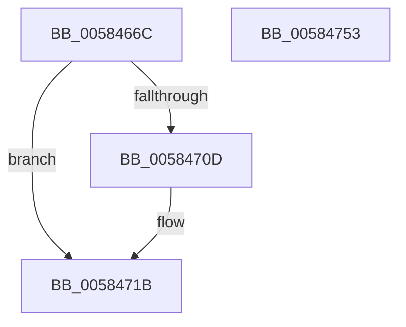

# HvlGetRootVpSharedPages

- RVA: `0x0058466C`–`0x00584754` (길이 `232` bytes)
- VA: `0x000000014058466C`
- 실행 섹션: `.text`
- PDB 이름 있음: `예`; PDB Function 태그: `아니요`
- unwind 정보 RVA: `0x00092598`
- 디코드: `65`개 명령, `232/232` bytes 표시
- 미해석 바이트: `0` (있으면 어셈블리에 `.byte`로 보존)

> 이 문서는 커널 이미지의 기계어와 PDB 기호를 분석해 생성했습니다. 4번과 5번은 함수 원형과 자료형을 바이너리 사용 방식에서 추정한 C 해석이며 원본 소스 복구 결과는 아닙니다.

## 1. Dependencies

- 직접 호출 지점: **6**; 고유 호출 대상: **4**
- 직접 호출자로 확인된 함수: **1**
- RIP 상대 이미지 참조: **1**

### Outgoing calls
- `0x005846BC` → [HvlpAcquireHypercallPage](../47/HvlpAcquireHypercallPage_function_00471410.md) (function, `0x00471410`)
- `0x005846D5` → [HvlpAcquireHypercallPage](../47/HvlpAcquireHypercallPage_function_00471410.md) (function, `0x00471410`)
- `0x00584700` → [HvcallInitiateHypercall](../31/HvcallInitiateHypercall_function_00313630.md) (function, `0x00313630`)
- `0x0058471F` → [HvlpReleaseHypercallPage](../31/HvlpReleaseHypercallPage_function_00313480.md) (function, `0x00313480`)
- `0x00584728` → [HvlpReleaseHypercallPage](../31/HvlpReleaseHypercallPage_function_00313480.md) (function, `0x00313480`)
- `0x00584730` → [HvlpHvToNtStatus](../30/HvlpHvToNtStatus_function_00307BD8.md) (function, `0x00307BD8`)

### Direct callers
- [HvlInitializeProcessor](../../page/71/HvlInitializeProcessor_function_0071804C.md) at `0x007180F9`

### Static image references
- `0x005846DA` → RVA `0x00FC6F80` (`ALMOSTRO`; read)

## 2. Other-region calls and transfers

- 다른 실행 섹션으로 향하는 call: **0**
- 별도 외부 분기/꼬리 이동을 확인하지 못했습니다.

## 3. Assembly (complete function range)

```asm
0058466C  48 8B C4                        mov rax, rsp
0058466F  48 89 58 08                     mov qword ptr [rax + 8], rbx
00584673  48 89 70 10                     mov qword ptr [rax + 0x10], rsi
00584677  48 89 78 18                     mov qword ptr [rax + 0x18], rdi
0058467B  4C 89 60 20                     mov qword ptr [rax + 0x20], r12
0058467F  55                              push rbp
00584680  41 56                           push r14
00584682  41 57                           push r15
00584684  48 8B EC                        mov rbp, rsp
00584687  48 83 EC 60                     sub rsp, 0x60
0058468B  33 C0                           xor eax, eax
0058468D  8B F9                           mov edi, ecx
0058468F  0F 57 C0                        xorps xmm0, xmm0
00584692  48 89 45 F0                     mov qword ptr [rbp - 0x10], rax
00584696  4D 8B F0                        mov r14, r8
00584699  89 45 F8                        mov dword ptr [rbp - 8], eax
0058469C  4C 8B FA                        mov r15, rdx
0058469F  48 89 45 D0                     mov qword ptr [rbp - 0x30], rax
005846A3  44 8D 48 18                     lea r9d, [rax + 0x18]
005846A7  89 45 D8                        mov dword ptr [rbp - 0x28], eax
005846AA  8D 50 01                        lea edx, [rax + 1]
005846AD  45 33 C0                        xor r8d, r8d
005846B0  48 8D 4D E0                     lea rcx, [rbp - 0x20]
005846B4  0F 11 45 E0                     movups xmmword ptr [rbp - 0x20], xmm0
005846B8  0F 11 45 C0                     movups xmmword ptr [rbp - 0x40], xmm0
005846BC  E8 4F CD EE FF                  call 0x140471410
005846C1  45 33 C0                        xor r8d, r8d
005846C4  48 8D 4D C0                     lea rcx, [rbp - 0x40]
005846C8  41 B9 E8 0F 00 00               mov r9d, 0xfe8
005846CE  48 8B D8                        mov rbx, rax
005846D1  41 8D 50 02                     lea edx, [r8 + 2]
005846D5  E8 36 CD EE FF                  call 0x140471410
005846DA  48 8B 0D 9F 28 A4 00            mov rcx, qword ptr [rip + 0xa4289f]
005846E1  48 8B F0                        mov rsi, rax
005846E4  4C 8B 45 D8                     mov r8, qword ptr [rbp - 0x28]
005846E8  48 8B 55 F8                     mov rdx, qword ptr [rbp - 8]
005846EC  48 89 0B                        mov qword ptr [rbx], rcx
005846EF  B9 01 01 00 00                  mov ecx, 0x101
005846F4  48 C7 43 08 05 00 09 00         mov qword ptr [rbx + 8], 0x90005
005846FC  48 89 7B 10                     mov qword ptr [rbx + 0x10], rdi
00584700  E8 2B EF D8 FF                  call 0x140313630
00584705  48 8B D8                        mov rbx, rax
00584708  66 85 C0                        test ax, ax
0058470B  75 0E                           jne 0x14058471b
0058470D  48 8B 46 08                     mov rax, qword ptr [rsi + 8]
00584711  49 89 07                        mov qword ptr [r15], rax
00584714  48 8B 46 10                     mov rax, qword ptr [rsi + 0x10]
00584718  49 89 06                        mov qword ptr [r14], rax
0058471B  48 8D 4D C0                     lea rcx, [rbp - 0x40]
0058471F  E8 5C ED D8 FF                  call 0x140313480
00584724  48 8D 4D E0                     lea rcx, [rbp - 0x20]
00584728  E8 53 ED D8 FF                  call 0x140313480
0058472D  0F B7 CB                        movzx ecx, bx
00584730  E8 A3 34 D8 FF                  call 0x140307bd8
00584735  4C 8D 5C 24 60                  lea r11, [rsp + 0x60]
0058473A  49 8B 5B 20                     mov rbx, qword ptr [r11 + 0x20]
0058473E  49 8B 73 28                     mov rsi, qword ptr [r11 + 0x28]
00584742  49 8B 7B 30                     mov rdi, qword ptr [r11 + 0x30]
00584746  4D 8B 63 38                     mov r12, qword ptr [r11 + 0x38]
0058474A  49 8B E3                        mov rsp, r11
0058474D  41 5F                           pop r15
0058474F  41 5E                           pop r14
00584751  5D                              pop rbp
00584752  C3                              ret
00584753  CC                              int3
```

## 4. C-style interpretation (structured pseudocode)

```c
__int64 __fastcall HvlGetRootVpSharedPages(int a1, __int64 a2, __int64 a3)
{
    __int64 result;
    __int64 v_rsp;
    unsigned __int64 v_stack_m18;
    unsigned int v_stack_m20;
    unsigned __int64 v_stack_m28;
    unsigned __int64 v_stack_m38;
    unsigned int v_stack_m40;
    unsigned __int64 v_stack_m48;
    unsigned __int64 v_stack_m58;

    *(unsigned __int64 *)(v_rsp + 8) = v_rbx;
    *(unsigned __int64 *)(v_rsp + 16) = v_rsi;
    *(unsigned __int64 *)(v_rsp + 24) = v_rdi;
    *(unsigned __int64 *)(v_rsp + 32) = v_r12;
    v_rsp = (v_rsp) - (96);
    result = 0;
    v_stack_m28 = 0;
    v_stack_m20 = 0;
    v_stack_m48 = 0;
    v_stack_m40 = 0;
    a3 = 0;
    v_stack_m38 = v_xmm0;
    v_stack_m58 = v_xmm0;
    result = HvlpAcquireHypercallPage(v_stack_m38, result + 1, a3, result + 24);
    a3 = 0;
    result = HvlpAcquireHypercallPage(v_stack_m58, a3 + 2, a3, (unsigned int)(0xFE8ULL));
    *(unsigned __int64 *)(result) = *(unsigned __int64 *)(v_rip + 10758303);
    *(unsigned __int64 *)(result + 8) = 0x90005ULL;
    *(unsigned __int64 *)(result + 16) = (unsigned int)(a1);
    result = HvcallInitiateHypercall(257, v_stack_m20, v_stack_m40, (unsigned int)(0xFE8ULL));
    if ((unsigned __int16)(result) == 0) {
        result = *(unsigned __int64 *)(result + 8);
        *(unsigned __int64 *)(a2) = result;
        result = *(unsigned __int64 *)(result + 16);
        *(unsigned __int64 *)(a3) = result;
    }
    result = HvlpReleaseHypercallPage(v_stack_m58, v_stack_m20, v_stack_m40, (unsigned int)(0xFE8ULL));
    result = HvlpReleaseHypercallPage(v_stack_m38, v_stack_m20, v_stack_m40, (unsigned int)(0xFE8ULL));
    result = HvlpHvToNtStatus((unsigned __int16)(result), v_stack_m20, v_stack_m40, (unsigned int)(0xFE8ULL));
    return result;
}
```

## 5. (Beta) C Style

```c
int64_t HvlGetRootVpSharedPages(int32_t Arg1, void *Arg2, void *Arg3)
{
    uint8_t *arg2 = (uint8_t *)Arg2;
    uint8_t *arg3 = (uint8_t *)Arg3;

    int64_t result;
    int64_t local_rsp;
    uint64_t v_stack_m18;
    uint32_t v_stack_m20;
    uint64_t v_stack_m28;
    uint64_t v_stack_m38;
    uint32_t v_stack_m40;
    uint64_t v_stack_m48;
    uint64_t v_stack_m58;

    *(uint64_t *)(local_rsp + 0x8) = local_rbx;
    *(uint64_t *)(local_rsp + 0x10) = local_rsi;
    *(uint64_t *)(local_rsp + 0x18) = local_rdi;
    *(uint64_t *)(local_rsp + 0x20) = local_r12;
    local_rsp = (local_rsp) - (96);
    result = 0;
    v_stack_m28 = 0;
    v_stack_m20 = 0;
    v_stack_m48 = 0;
    v_stack_m40 = 0;
    Arg3 = 0;
    v_stack_m38 = v_xmm0;
    v_stack_m58 = v_xmm0;
    result = HvlpAcquireHypercallPage(v_stack_m38, result + 1, Arg3, result + 24);
    Arg3 = 0;
    result = HvlpAcquireHypercallPage(v_stack_m58, Arg3 + 2, Arg3, (uint32_t)(0xFE8ULL));
    *(uint64_t *)(result) = *(uint64_t *)(v_rip + 0xA4289F);
    *(uint64_t *)(result + 0x8) = 0x90005ULL;
    *(uint64_t *)(result + 0x10) = (uint32_t)(Arg1);
    result = HvcallInitiateHypercall(257, v_stack_m20, v_stack_m40, (uint32_t)(0xFE8ULL));
    if ((uint16_t)(result) == 0) {
        result = *(uint64_t *)(result + 0x8);
        *(uint64_t *)(arg2) = result;
        result = *(uint64_t *)(result + 0x10);
        *(uint64_t *)(arg3) = result;
    }
    result = HvlpReleaseHypercallPage(v_stack_m58, v_stack_m20, v_stack_m40, (uint32_t)(0xFE8ULL));
    result = HvlpReleaseHypercallPage(v_stack_m38, v_stack_m20, v_stack_m40, (uint32_t)(0xFE8ULL));
    result = HvlpHvToNtStatus((uint16_t)(result), v_stack_m20, v_stack_m40, (uint32_t)(0xFE8ULL));
    return result;
}
```

### 관측된 메모리 오프셋

구조체 형식이 확인되지 않은 접근은 인자 기준의 오프셋으로만 기록했습니다.

| 기준 인자 | 오프셋 표현 | 폭 (bit) | 접근 |
|---|---:|---:|---|
| `Arg2` | `+ 0x0` | `64` | `W` |
| `Arg3` | `+ 0x0` | `64` | `W` |

## 6. Execution-region graph

[열기: 2D/3D 그래프와 함수 탐색 컨트롤 패널](../../../control-panel.html?section=text&rva=0x0058466C&view=graph)

- 2D 그래프는 위에서 아래로 흐르고, 3D 그래프는 빈 공간을 드래그해 회전합니다. Shift+드래그는 이동, 휠은 확대·축소, 함수 노드 선택은 대상 보고서 이동입니다.

### Static fallback


