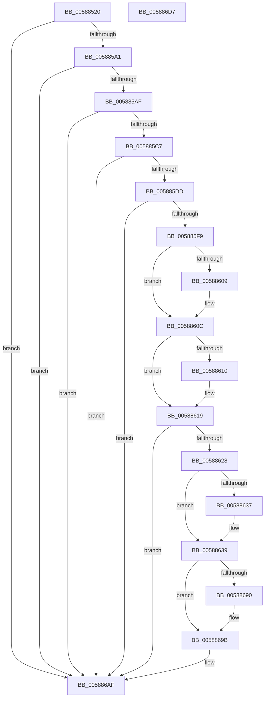

# HvlGetSystemPasidCapabilities

- RVA: `0x00588520`–`0x005886D8` (길이 `440` bytes)
- VA: `0x0000000140588520`
- 실행 섹션: `.text`
- PDB 이름 있음: `예`; PDB Function 태그: `아니요`
- unwind 정보 RVA: `0x000C66BC`
- 디코드: `107`개 명령, `440/440` bytes 표시
- 미해석 바이트: `0` (있으면 어셈블리에 `.byte`로 보존)

> 이 문서는 커널 이미지의 기계어와 PDB 기호를 분석해 생성했습니다. 4번과 5번은 함수 원형과 자료형을 바이너리 사용 방식에서 추정한 C 해석이며 원본 소스 복구 결과는 아닙니다.

## 1. Dependencies

- 직접 호출 지점: **10**; 고유 호출 대상: **8**
- 직접 호출자로 확인된 함수: **1**
- RIP 상대 이미지 참조: **4**

### Outgoing calls
- `0x005885B4` → [HviGetHypervisorFeatures](../66/HviGetHypervisorFeatures_function_00666630.md) (function, `0x00666630`)
- `0x005885CB` → [HviGetHypervisorVendorAndMaxFunction](../4A/HviGetHypervisorVendorAndMaxFunction_function_004ADB6C.md) (function, `0x004ADB6C`)
- `0x005885E7` → [HvlpGetRegister128](HvlpGetRegister128_function_0058CA30.md) (function, `0x0058CA30`)
- `0x0058862C` → [HviGetHardwareFeatures](../4A/HviGetHardwareFeatures_function_004ADBC0.md) (function, `0x004ADBC0`)
- `0x0058864A` → [HvlpAcquireHypercallPage](../47/HvlpAcquireHypercallPage_function_00471410.md) (function, `0x00471410`)
- `0x00588663` → [HvlpAcquireHypercallPage](../47/HvlpAcquireHypercallPage_function_00471410.md) (function, `0x00471410`)
- `0x00588686` → [HvcallInitiateHypercall](../31/HvcallInitiateHypercall_function_00313630.md) (function, `0x00313630`)
- `0x005886A0` → [HvlpReleaseHypercallPage](../31/HvlpReleaseHypercallPage_function_00313480.md) (function, `0x00313480`)
- `0x005886AA` → [HvlpReleaseHypercallPage](../31/HvlpReleaseHypercallPage_function_00313480.md) (function, `0x00313480`)
- `0x005886B9` → [_security_check_cookie](../6A/_security_check_cookie_function_006AC640.md) (function, `0x006AC640`)

### Direct callers
- [HvlpInitializeSvmIommuSupport](HvlpInitializeSvmIommuSupport_function_0058C188.md) at `0x0058C1AA`

### Static image references
- `0x0058853E` → RVA `0x00E0A740` (`.data`; read)
- `0x00588577` → RVA `0x00FC6AD8` (`ALMOSTRO`; read)
- `0x005885A1` → RVA `0x00FC6AB8` (`ALMOSTRO`; read)
- `0x00588619` → RVA `0x00FC6A90` (`ALMOSTRO`; read)

## 2. Other-region calls and transfers

- 다른 실행 섹션으로 향하는 call: **0**
- 별도 외부 분기/꼬리 이동을 확인하지 못했습니다.

## 3. Assembly (complete function range)

```asm
00588520  48 8B C4                        mov rax, rsp
00588523  48 89 58 10                     mov qword ptr [rax + 0x10], rbx
00588527  48 89 70 18                     mov qword ptr [rax + 0x18], rsi
0058852B  48 89 78 20                     mov qword ptr [rax + 0x20], rdi
0058852F  55                              push rbp
00588530  48 8D A8 18 F8 FF FF            lea rbp, [rax - 0x7e8]
00588537  48 81 EC E0 08 00 00            sub rsp, 0x8e0
0058853E  48 8B 05 FB 21 88 00            mov rax, qword ptr [rip + 0x8821fb]
00588545  48 33 C4                        xor rax, rsp
00588548  48 89 85 D0 07 00 00            mov qword ptr [rbp + 0x7d0], rax
0058854F  33 C0                           xor eax, eax
00588551  0F 57 C0                        xorps xmm0, xmm0
00588554  0F 57 C9                        xorps xmm1, xmm1
00588557  48 89 44 24 50                  mov qword ptr [rsp + 0x50], rax
0058855C  0F 11 09                        movups xmmword ptr [rcx], xmm1
0058855F  89 41 10                        mov dword ptr [rcx + 0x10], eax
00588562  BB 01 00 00 00                  mov ebx, 1
00588567  89 44 24 58                     mov dword ptr [rsp + 0x58], eax
0058856B  48 8B F9                        mov rdi, rcx
0058856E  48 89 44 24 30                  mov qword ptr [rsp + 0x30], rax
00588573  89 44 24 38                     mov dword ptr [rsp + 0x38], eax
00588577  8B 05 5B E5 A3 00               mov eax, dword ptr [rip + 0xa3e55b]
0058857D  0F 11 45 90                     movups xmmword ptr [rbp - 0x70], xmm0
00588581  0F 11 4C 24 70                  movups xmmword ptr [rsp + 0x70], xmm1
00588586  0F 11 45 80                     movups xmmword ptr [rbp - 0x80], xmm0
0058858A  0F 11 44 24 40                  movups xmmword ptr [rsp + 0x40], xmm0
0058858F  0F 11 44 24 20                  movups xmmword ptr [rsp + 0x20], xmm0
00588594  0F 11 44 24 60                  movups xmmword ptr [rsp + 0x60], xmm0
00588599  84 C3                           test bl, al
0058859B  0F 84 0E 01 00 00               je 0x1405886af
005885A1  8B 05 11 E5 A3 00               mov eax, dword ptr [rip + 0xa3e511]
005885A7  84 C0                           test al, al
005885A9  0F 89 00 01 00 00               jns 0x1405886af
005885AF  48 8D 4C 24 70                  lea rcx, [rsp + 0x70]
005885B4  E8 77 E0 0D 00                  call 0x140666630
005885B9  F7 44 24 7C 00 00 01 00         test dword ptr [rsp + 0x7c], 0x10000
005885C1  0F 84 E8 00 00 00               je 0x1405886af
005885C7  48 8D 4D 80                     lea rcx, [rbp - 0x80]
005885CB  E8 9C 55 F2 FF                  call 0x1404adb6c
005885D0  81 7D 80 08 00 00 40            cmp dword ptr [rbp - 0x80], 0x40000008
005885D7  0F 82 D2 00 00 00               jb 0x1405886af
005885DD  48 8D 54 24 60                  lea rdx, [rsp + 0x60]
005885E2  B9 05 02 00 00                  mov ecx, 0x205
005885E7  E8 44 44 00 00                  call 0x14058ca30
005885EC  8B 4C 24 60                     mov ecx, dword ptr [rsp + 0x60]
005885F0  F6 C1 03                        test cl, 3
005885F3  0F 84 B6 00 00 00               je 0x1405886af
005885F9  8B C1                           mov eax, ecx
005885FB  8D 73 01                        lea esi, [rbx + 1]
005885FE  C1 E8 0B                        shr eax, 0xb
00588601  89 47 04                        mov dword ptr [rdi + 4], eax
00588604  40 84 CE                        test sil, cl
00588607  74 03                           je 0x14058860c
00588609  83 0F 04                        or dword ptr [rdi], 4
0058860C  84 CB                           test bl, cl
0058860E  74 09                           je 0x140588619
00588610  8B 44 24 64                     mov eax, dword ptr [rsp + 0x64]
00588614  09 1F                           or dword ptr [rdi], ebx
00588616  89 47 08                        mov dword ptr [rdi + 8], eax
00588619  8B 05 71 E4 A3 00               mov eax, dword ptr [rip + 0xa3e471]
0058861F  40 84 C6                        test sil, al
00588622  0F 84 87 00 00 00               je 0x1405886af
00588628  48 8D 4D 90                     lea rcx, [rbp - 0x70]
0058862C  E8 8F 55 F2 FF                  call 0x1404adbc0
00588631  F6 45 90 80                     test byte ptr [rbp - 0x70], 0x80
00588635  75 02                           jne 0x140588639
00588637  09 37                           or dword ptr [rdi], esi
00588639  41 B9 10 00 00 00               mov r9d, 0x10
0058863F  4C 8D 45 A0                     lea r8, [rbp - 0x60]
00588643  8B D3                           mov edx, ebx
00588645  48 8D 4C 24 40                  lea rcx, [rsp + 0x40]
0058864A  E8 C1 8D EE FF                  call 0x140471410
0058864F  41 B9 08 04 00 00               mov r9d, 0x408
00588655  4C 8D 45 C0                     lea r8, [rbp - 0x40]
00588659  8B D6                           mov edx, esi
0058865B  48 8D 4C 24 20                  lea rcx, [rsp + 0x20]
00588660  48 8B D8                        mov rbx, rax
00588663  E8 A8 8D EE FF                  call 0x140471410
00588668  4C 8B 44 24 38                  mov r8, qword ptr [rsp + 0x38]
0058866D  0F 57 C0                        xorps xmm0, xmm0
00588670  48 8B 54 24 58                  mov rdx, qword ptr [rsp + 0x58]
00588675  B9 7B 00 00 00                  mov ecx, 0x7b
0058867A  0F 11 03                        movups xmmword ptr [rbx], xmm0
0058867D  C7 03 0B 00 00 00               mov dword ptr [rbx], 0xb
00588683  48 8B F0                        mov rsi, rax
00588686  E8 A5 AF D8 FF                  call 0x140313630
0058868B  66 85 C0                        test ax, ax
0058868E  75 0B                           jne 0x14058869b
00588690  8B 0E                           mov ecx, dword ptr [rsi]
00588692  89 4F 0C                        mov dword ptr [rdi + 0xc], ecx
00588695  8B 46 04                        mov eax, dword ptr [rsi + 4]
00588698  89 47 10                        mov dword ptr [rdi + 0x10], eax
0058869B  48 8D 4C 24 20                  lea rcx, [rsp + 0x20]
005886A0  E8 DB AD D8 FF                  call 0x140313480
005886A5  48 8D 4C 24 40                  lea rcx, [rsp + 0x40]
005886AA  E8 D1 AD D8 FF                  call 0x140313480
005886AF  48 8B 8D D0 07 00 00            mov rcx, qword ptr [rbp + 0x7d0]
005886B6  48 33 CC                        xor rcx, rsp
005886B9  E8 82 3F 12 00                  call 0x1406ac640
005886BE  4C 8D 9C 24 E0 08 00 00         lea r11, [rsp + 0x8e0]
005886C6  49 8B 5B 18                     mov rbx, qword ptr [r11 + 0x18]
005886CA  49 8B 73 20                     mov rsi, qword ptr [r11 + 0x20]
005886CE  49 8B 7B 28                     mov rdi, qword ptr [r11 + 0x28]
005886D2  49 8B E3                        mov rsp, r11
005886D5  5D                              pop rbp
005886D6  C3                              ret
005886D7  CC                              int3
```

## 4. C-style interpretation (structured pseudocode)

```c
__int64 __fastcall HvlGetSystemPasidCapabilities(__int64 a1)
{
    __int64 result;
    __int64 v_rsp;
    unsigned __int64 v_stack_m8;
    unsigned int v_stack_m86C;
    unsigned __int64 v_stack_m878;
    unsigned int v_stack_m884;
    unsigned __int64 v_stack_m888;
    unsigned int v_stack_m890;
    unsigned __int64 v_stack_m898;
    unsigned __int64 v_stack_m8A8;
    unsigned int v_stack_m8B0;
    unsigned __int64 v_stack_m8B8;
    unsigned __int64 v_stack_m8C8;

    *(unsigned __int64 *)(v_rsp + 16) = v_rbx;
    *(unsigned __int64 *)(v_rsp + 24) = v_rsi;
    *(unsigned __int64 *)(v_rsp + 32) = v_rdi;
    v_rsp = (v_rsp) - (0x8E0ULL);
    result = (*(unsigned __int64 *)(v_rip + 8921595)) ^ (v_rsp);
    *(unsigned __int64 *)(v_rsp - 2024 + 2000) = result;
    result = 0;
    v_stack_m898 = 0;
    *(unsigned __int64 *)(a1) = v_xmm1;
    *(unsigned int *)(a1 + 16) = 0;
    v_stack_m890 = 0;
    v_stack_m8B8 = 0;
    v_stack_m8B0 = 0;
    *(unsigned __int64 *)(v_rsp - 2024 - 112) = v_xmm0;
    v_stack_m878 = v_xmm1;
    *(unsigned __int64 *)(v_rsp - 2024 - 128) = v_xmm0;
    v_stack_m8A8 = v_xmm0;
    v_stack_m8C8 = v_xmm0;
    v_stack_m888 = v_xmm0;
    if (((1) & ((unsigned __int8)((unsigned int)(*(unsigned int *)(v_rip + 10741083))))) == 0) goto loc_005886AF;
    if (!sign_flag) goto loc_005886AF;
    result = HviGetHypervisorFeatures(v_stack_m878, a2, a3, a4);
    if (((v_stack_m86C) & (0x10000ULL)) == 0) goto loc_005886AF;
    result = HviGetHypervisorVendorAndMaxFunction(v_rsp - 2024 - 128, a2, a3, a4);
    if ((*(unsigned int *)(v_rsp - 2024 - 128)) < 0x40000008ULL) goto loc_005886AF;
    result = HvlpGetRegister128(517, v_stack_m888, a3, a4);
    if ((((unsigned __int8)((unsigned int)(v_stack_m888))) & (3)) == 0) goto loc_005886AF;
    result = (unsigned int)(((unsigned int)((unsigned int)((unsigned int)(v_stack_m888)))) >> (11));
    *(unsigned int *)(a1 + 4) = (unsigned int)(result);
    if ((((unsigned __int8)(1 + 1)) & ((unsigned __int8)((unsigned int)(v_stack_m888)))) != 0) {
    }
    if (((1) & ((unsigned __int8)((unsigned int)(v_stack_m888)))) != 0) {
        result = v_stack_m884;
        *(unsigned int *)(a1 + 8) = (unsigned int)(result);
    }
    if ((((unsigned __int8)(1 + 1)) & ((unsigned __int8)((unsigned int)(*(unsigned int *)(v_rip + 10740849))))) == 0) goto loc_005886AF;
    result = HviGetHardwareFeatures(v_rsp - 2024 - 112, v_stack_m888, a3, a4);
    if (((*(unsigned __int8 *)(v_rsp - 2024 - 112)) & (128)) == 0) {
    }
    result = HvlpAcquireHypercallPage(v_stack_m8A8, 1, v_rsp - 2024 - 96, 16);
    result = HvlpAcquireHypercallPage(v_stack_m8C8, (unsigned int)((unsigned int)(1 + 1)), v_rsp - 2024 - 64, (unsigned int)(0x408ULL));
    *(unsigned __int64 *)(result) = v_xmm0;
    *(unsigned int *)(result) = 11;
    result = HvcallInitiateHypercall(123, v_stack_m890, v_stack_m8B0, (unsigned int)(0x408ULL));
    if ((unsigned __int16)(result) == 0) {
        a1 = *(unsigned int *)(result);
        *(unsigned int *)(a1 + 12) = (unsigned int)(a1);
        result = *(unsigned int *)(result + 4);
        *(unsigned int *)(a1 + 16) = (unsigned int)(result);
    }
    result = HvlpReleaseHypercallPage(v_stack_m8C8, v_stack_m890, v_stack_m8B0, (unsigned int)(0x408ULL));
    result = HvlpReleaseHypercallPage(v_stack_m8A8, v_stack_m890, v_stack_m8B0, (unsigned int)(0x408ULL));
loc_005886AF:
    a1 = (*(unsigned __int64 *)(v_rsp - 2024 + 2000)) ^ (v_rsp);
    result = _security_check_cookie(a1, v_stack_m890, v_stack_m8B0, (unsigned int)(0x408ULL));
    return result;
}
```

## 5. (Beta) C Style

```c
int64_t HvlGetSystemPasidCapabilities(void *Arg1)
{
    uint8_t *arg1 = (uint8_t *)Arg1;

    int64_t result;
    int64_t local_rsp;
    uint64_t v_stack_m8;
    uint32_t v_stack_m86C;
    uint64_t v_stack_m878;
    uint32_t v_stack_m884;
    uint64_t v_stack_m888;
    uint32_t v_stack_m890;
    uint64_t v_stack_m898;
    uint64_t v_stack_m8A8;
    uint32_t v_stack_m8B0;
    uint64_t v_stack_m8B8;
    uint64_t v_stack_m8C8;

    *(uint64_t *)(local_rsp + 0x10) = local_rbx;
    *(uint64_t *)(local_rsp + 0x18) = local_rsi;
    *(uint64_t *)(local_rsp + 0x20) = local_rdi;
    local_rsp = (local_rsp) - (0x8E0ULL);
    result = (*(uint64_t *)(v_rip + 0x8821FB)) ^ (local_rsp);
    *(uint64_t *)(local_rsp - 0x7E8 + 0x7D0) = result;
    result = 0;
    v_stack_m898 = 0;
    *(uint64_t *)(arg1) = v_xmm1;
    *(uint32_t *)(arg1 + 0x10) = 0;
    v_stack_m890 = 0;
    v_stack_m8B8 = 0;
    v_stack_m8B0 = 0;
    *(uint64_t *)(local_rsp - 0x7E8 - 0x70) = v_xmm0;
    v_stack_m878 = v_xmm1;
    *(uint64_t *)(local_rsp - 0x7E8 - 0x80) = v_xmm0;
    v_stack_m8A8 = v_xmm0;
    v_stack_m8C8 = v_xmm0;
    v_stack_m888 = v_xmm0;
    if (((1) & ((uint8_t)((uint32_t)(*(uint32_t *)(v_rip + 0xA3E55B))))) == 0) goto loc_005886AF;
    if (!sign_flag) goto loc_005886AF;
    result = HviGetHypervisorFeatures(v_stack_m878, a2, a3, a4);
    if (((v_stack_m86C) & (0x10000ULL)) == 0) goto loc_005886AF;
    result = HviGetHypervisorVendorAndMaxFunction(local_rsp - 2024 - 128, a2, a3, a4);
    if ((*(uint32_t *)(local_rsp - 0x7E8 - 0x80)) < 0x40000008ULL) goto loc_005886AF;
    result = HvlpGetRegister128(517, v_stack_m888, a3, a4);
    if ((((uint8_t)((uint32_t)(v_stack_m888))) & (3)) == 0) goto loc_005886AF;
    result = (uint32_t)(((uint32_t)((uint32_t)((uint32_t)(v_stack_m888)))) >> (11));
    *(uint32_t *)(arg1 + 0x4) = (uint32_t)(result);
    if ((((uint8_t)(1 + 1)) & ((uint8_t)((uint32_t)(v_stack_m888)))) != 0) {
    }
    if (((1) & ((uint8_t)((uint32_t)(v_stack_m888)))) != 0) {
        result = v_stack_m884;
        *(uint32_t *)(arg1 + 0x8) = (uint32_t)(result);
    }
    if ((((uint8_t)(1 + 1)) & ((uint8_t)((uint32_t)(*(uint32_t *)(v_rip + 0xA3E471))))) == 0) goto loc_005886AF;
    result = HviGetHardwareFeatures(local_rsp - 2024 - 112, v_stack_m888, a3, a4);
    if (((*(uint8_t *)(local_rsp - 0x7E8 - 0x70)) & (128)) == 0) {
    }
    result = HvlpAcquireHypercallPage(v_stack_m8A8, 1, local_rsp - 2024 - 96, 16);
    result = HvlpAcquireHypercallPage(v_stack_m8C8, (uint32_t)((uint32_t)(1 + 1)), local_rsp - 2024 - 64, (uint32_t)(0x408ULL));
    *(uint64_t *)(result) = v_xmm0;
    *(uint32_t *)(result) = 11;
    result = HvcallInitiateHypercall(123, v_stack_m890, v_stack_m8B0, (uint32_t)(0x408ULL));
    if ((uint16_t)(result) == 0) {
        Arg1 = *(uint32_t *)(result);
        *(uint32_t *)(arg1 + 0xC) = (uint32_t)(Arg1);
        result = *(uint32_t *)(result + 0x4);
        *(uint32_t *)(arg1 + 0x10) = (uint32_t)(result);
    }
    result = HvlpReleaseHypercallPage(v_stack_m8C8, v_stack_m890, v_stack_m8B0, (uint32_t)(0x408ULL));
    result = HvlpReleaseHypercallPage(v_stack_m8A8, v_stack_m890, v_stack_m8B0, (uint32_t)(0x408ULL));
loc_005886AF:
    Arg1 = (*(uint64_t *)(local_rsp - 0x7E8 + 0x7D0)) ^ (local_rsp);
    result = _security_check_cookie(Arg1, v_stack_m890, v_stack_m8B0, (uint32_t)(0x408ULL));
    return result;
}
```

### 관측된 메모리 오프셋

구조체 형식이 확인되지 않은 접근은 인자 기준의 오프셋으로만 기록했습니다.

| 기준 인자 | 오프셋 표현 | 폭 (bit) | 접근 |
|---|---:|---:|---|
| `Arg1` | `+ 0x0` | `32` | `R/W` |
| `Arg1` | `+ 0x0` | `128` | `R` |
| `Arg1` | `+ 0x4` | `32` | `W` |
| `Arg1` | `+ 0x8` | `32` | `W` |
| `Arg1` | `+ 0xC` | `32` | `W` |
| `Arg1` | `+ 0x10` | `32` | `W` |

## 6. Execution-region graph

[열기: 2D/3D 그래프와 함수 탐색 컨트롤 패널](../../../control-panel.html?section=text&rva=0x00588520&view=graph)

- 2D 그래프는 위에서 아래로 흐르고, 3D 그래프는 빈 공간을 드래그해 회전합니다. Shift+드래그는 이동, 휠은 확대·축소, 함수 노드 선택은 대상 보고서 이동입니다.

### Static fallback


