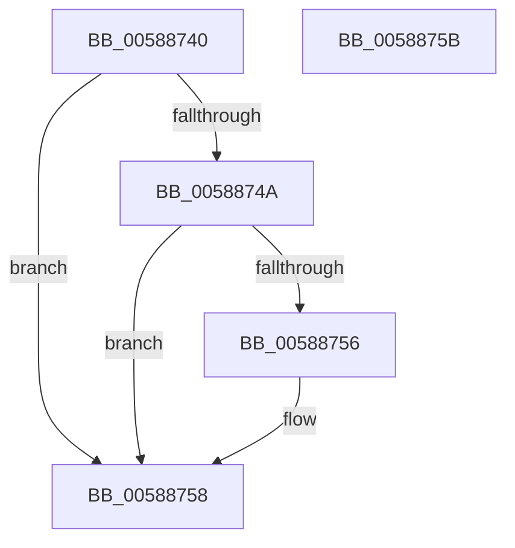

# HvlHalVpStartEnabled

- RVA: `0x00588740`–`0x0058875C` (길이 `28` bytes)
- VA: `0x0000000140588740`
- 실행 섹션: `.text`
- PDB 이름 있음: `예`; PDB Function 태그: `아니요`
- unwind 정보 RVA: `0x000DB714`
- 디코드: `9`개 명령, `28/28` bytes 표시
- 미해석 바이트: `0` (있으면 어셈블리에 `.byte`로 보존)

> 이 문서는 커널 이미지의 기계어와 PDB 기호를 분석해 생성했습니다. 4번과 5번은 함수 원형과 자료형을 바이너리 사용 방식에서 추정한 C 해석이며 원본 소스 복구 결과는 아닙니다.

## 1. Dependencies

- 직접 호출 지점: **0**; 고유 호출 대상: **0**
- 직접 호출자로 확인된 함수: **0**
- RIP 상대 이미지 참조: **2**

### Outgoing calls
- 직접 디코드된 call 명령이 없습니다.

### Direct callers
- 이 함수 시작 RVA로 연결되는 직접 call은 확인되지 않았습니다. 간접 호출은 완전히 역산할 수 없습니다.

### Static image references
- `0x00588742` → RVA `0x00F8EDFC` (`.data`; read)
- `0x0058874A` → RVA `0x00FC6AB8` (`ALMOSTRO`; read)

## 2. Other-region calls and transfers

- 다른 실행 섹션으로 향하는 call: **0**
- 별도 외부 분기/꼬리 이동을 확인하지 못했습니다.

## 3. Assembly (complete function range)

```asm
00588740  33 C9                           xor ecx, ecx
00588742  39 0D B4 66 A0 00               cmp dword ptr [rip + 0xa066b4], ecx
00588748  75 0E                           jne 0x140588758
0058874A  F7 05 64 E3 A3 00 00 80 00 00   test dword ptr [rip + 0xa3e364], 0x8000
00588754  74 02                           je 0x140588758
00588756  B1 01                           mov cl, 1
00588758  8A C1                           mov al, cl
0058875A  C3                              ret
0058875B  CC                              int3
```

## 4. C-style interpretation (structured pseudocode)

```c
__int64 __fastcall HvlHalVpStartEnabled(int a1)
{
    a1 = 0;
    if ((*(unsigned int *)(v_rip + 10512052)) != 0) goto loc_00588758;
    if (((*(unsigned int *)(v_rip + 10740580)) & (0x8000ULL)) != 0) {
        a1 = 1;
    }
    return (unsigned __int8)(a1);
}
```

## 5. (Beta) C Style

```c
int64_t HvlHalVpStartEnabled(int32_t Arg1)
{
    Arg1 = 0;
    if ((*(uint32_t *)(v_rip + 0xA066B4)) != 0) goto loc_00588758;
    if (((*(uint32_t *)(v_rip + 0xA3E364)) & (0x8000ULL)) != 0) {
        Arg1 = 1;
    }
    return (uint8_t)(Arg1);
}
```

## 6. Execution-region graph

[열기: 2D/3D 그래프와 함수 탐색 컨트롤 패널](../../../control-panel.html?section=text&rva=0x00588740&view=graph)

- 2D 그래프는 위에서 아래로 흐르고, 3D 그래프는 빈 공간을 드래그해 회전합니다. Shift+드래그는 이동, 휠은 확대·축소, 함수 노드 선택은 대상 보고서 이동입니다.

### Static fallback


