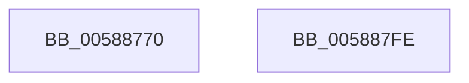

# HvlHvDebuggerPowerHandler

- RVA: `0x00588770`–`0x005887FF` (길이 `143` bytes)
- VA: `0x0000000140588770`
- 실행 섹션: `.text`
- PDB 이름 있음: `예`; PDB Function 태그: `아니요`
- unwind 정보 RVA: `0x000AF554`
- 디코드: `34`개 명령, `143/143` bytes 표시
- 미해석 바이트: `0` (있으면 어셈블리에 `.byte`로 보존)

> 이 문서는 커널 이미지의 기계어와 PDB 기호를 분석해 생성했습니다. 4번과 5번은 함수 원형과 자료형을 바이너리 사용 방식에서 추정한 C 해석이며 원본 소스 복구 결과는 아닙니다.

## 1. Dependencies

- 직접 호출 지점: **5**; 고유 호출 대상: **5**
- 직접 호출자로 확인된 함수: **0**
- RIP 상대 이미지 참조: **1**

### Outgoing calls
- `0x005887B1` → [HvlpAcquireHypercallPage](../47/HvlpAcquireHypercallPage_function_00471410.md) (function, `0x00471410`)
- `0x005887CB` → [HvcallInitiateHypercall](../31/HvcallInitiateHypercall_function_00313630.md) (function, `0x00313630`)
- `0x005887D8` → [HvlpReleaseHypercallPage](../31/HvlpReleaseHypercallPage_function_00313480.md) (function, `0x00313480`)
- `0x005887E0` → [HvlpHvToNtStatus](../30/HvlpHvToNtStatus_function_00307BD8.md) (function, `0x00307BD8`)
- `0x005887F0` → [_security_check_cookie](../6A/_security_check_cookie_function_006AC640.md) (function, `0x006AC640`)

### Direct callers
- 이 함수 시작 RVA로 연결되는 직접 call은 확인되지 않았습니다. 간접 호출은 완전히 역산할 수 없습니다.

### Static image references
- `0x00588779` → RVA `0x00E0A740` (`.data`; read)

## 2. Other-region calls and transfers

- 다른 실행 섹션으로 향하는 call: **0**
- 별도 외부 분기/꼬리 이동을 확인하지 못했습니다.

## 3. Assembly (complete function range)

```asm
00588770  40 53                           push rbx
00588772  48 81 EC A0 00 00 00            sub rsp, 0xa0
00588779  48 8B 05 C0 1F 88 00            mov rax, qword ptr [rip + 0x881fc0]
00588780  48 33 C4                        xor rax, rsp
00588783  48 89 84 24 90 00 00 00         mov qword ptr [rsp + 0x90], rax
0058878B  33 C0                           xor eax, eax
0058878D  4C 8D 44 24 40                  lea r8, [rsp + 0x40]
00588792  8A D9                           mov bl, cl
00588794  48 89 44 24 30                  mov qword ptr [rsp + 0x30], rax
00588799  0F 57 C0                        xorps xmm0, xmm0
0058879C  89 44 24 38                     mov dword ptr [rsp + 0x38], eax
005887A0  48 8D 4C 24 20                  lea rcx, [rsp + 0x20]
005887A5  44 8D 48 28                     lea r9d, [rax + 0x28]
005887A9  8D 50 01                        lea edx, [rax + 1]
005887AC  0F 11 44 24 20                  movups xmmword ptr [rsp + 0x20], xmm0
005887B1  E8 5A 8C EE FF                  call 0x140471410
005887B6  48 8B 54 24 38                  mov rdx, qword ptr [rsp + 0x38]
005887BB  45 33 C0                        xor r8d, r8d
005887BE  C7 00 0A 00 00 00               mov dword ptr [rax], 0xa
005887C4  41 8D 48 6F                     lea ecx, [r8 + 0x6f]
005887C8  88 58 08                        mov byte ptr [rax + 8], bl
005887CB  E8 60 AE D8 FF                  call 0x140313630
005887D0  48 8D 4C 24 20                  lea rcx, [rsp + 0x20]
005887D5  48 8B D8                        mov rbx, rax
005887D8  E8 A3 AC D8 FF                  call 0x140313480
005887DD  0F B7 CB                        movzx ecx, bx
005887E0  E8 F3 F3 D7 FF                  call 0x140307bd8
005887E5  48 8B 8C 24 90 00 00 00         mov rcx, qword ptr [rsp + 0x90]
005887ED  48 33 CC                        xor rcx, rsp
005887F0  E8 4B 3E 12 00                  call 0x1406ac640
005887F5  48 81 C4 A0 00 00 00            add rsp, 0xa0
005887FC  5B                              pop rbx
005887FD  C3                              ret
005887FE  CC                              int3
```

## 4. C-style interpretation (structured pseudocode)

```c
__int64 __fastcall HvlHvDebuggerPowerHandler(unsigned __int8 a1)
{
    __int64 result;
    __int64 v_rsp;
    unsigned __int64 v_stack_m18;
    unsigned __int64 v_stack_m68;
    unsigned int v_stack_m70;
    unsigned __int64 v_stack_m78;
    unsigned __int64 v_stack_m88;

    v_rsp = (v_rsp) - (160);
    result = (*(unsigned __int64 *)(v_rip + 8921024)) ^ (v_rsp);
    v_stack_m18 = result;
    result = 0;
    v_stack_m78 = 0;
    v_stack_m70 = 0;
    v_stack_m88 = v_xmm0;
    result = HvlpAcquireHypercallPage(v_stack_m88, result + 1, v_stack_m68, result + 40);
    a3 = 0;
    *(unsigned int *)(result) = 10;
    *(unsigned __int8 *)(result + 8) = a1;
    result = HvcallInitiateHypercall(a3 + 111, v_stack_m70, a3, result + 40);
    result = HvlpReleaseHypercallPage(v_stack_m88, v_stack_m70, a3, result + 40);
    result = HvlpHvToNtStatus((unsigned __int16)(result), v_stack_m70, a3, result + 40);
    a1 = (v_stack_m18) ^ (v_rsp);
    result = _security_check_cookie(a1, v_stack_m70, a3, result + 40);
    v_rsp = (v_rsp) + (160);
    return result;
}
```

## 5. (Beta) C Style

```c
int64_t HvlHvDebuggerPowerHandler(uint8_t Arg1)
{
    int64_t result;
    int64_t local_rsp;
    uint64_t v_stack_m18;
    uint64_t v_stack_m68;
    uint32_t v_stack_m70;
    uint64_t v_stack_m78;
    uint64_t v_stack_m88;

    local_rsp = (local_rsp) - (160);
    result = (*(uint64_t *)(v_rip + 0x881FC0)) ^ (local_rsp);
    v_stack_m18 = result;
    result = 0;
    v_stack_m78 = 0;
    v_stack_m70 = 0;
    v_stack_m88 = v_xmm0;
    result = HvlpAcquireHypercallPage(v_stack_m88, result + 1, v_stack_m68, result + 40);
    a3 = 0;
    *(uint32_t *)(result) = 10;
    *(uint8_t *)(result + 0x8) = Arg1;
    result = HvcallInitiateHypercall(a3 + 111, v_stack_m70, a3, result + 40);
    result = HvlpReleaseHypercallPage(v_stack_m88, v_stack_m70, a3, result + 40);
    result = HvlpHvToNtStatus((uint16_t)(result), v_stack_m70, a3, result + 40);
    Arg1 = (v_stack_m18) ^ (local_rsp);
    result = _security_check_cookie(Arg1, v_stack_m70, a3, result + 40);
    local_rsp = (local_rsp) + (160);
    return result;
}
```

## 6. Execution-region graph

[열기: 2D/3D 그래프와 함수 탐색 컨트롤 패널](../../../control-panel.html?section=text&rva=0x00588770&view=graph)

- 2D 그래프는 위에서 아래로 흐르고, 3D 그래프는 빈 공간을 드래그해 회전합니다. Shift+드래그는 이동, 휠은 확대·축소, 함수 노드 선택은 대상 보고서 이동입니다.

### Static fallback


