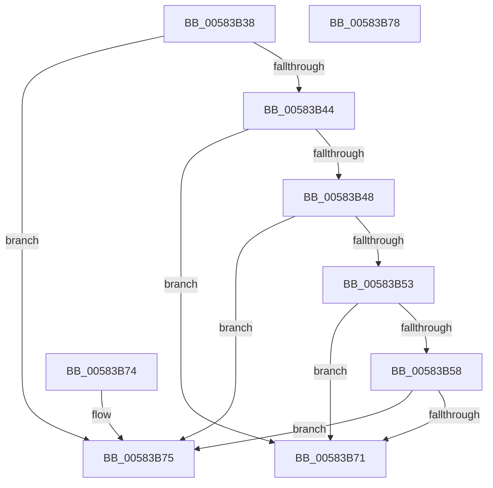

# HvlIsCoreSharingPossible

- RVA: `0x00583B38`–`0x00583B79` (길이 `65` bytes)
- VA: `0x0000000140583B38`
- 실행 섹션: `.text`
- PDB 이름 있음: `예`; PDB Function 태그: `아니요`
- unwind 정보 RVA: `0x000DB714`
- 디코드: `21`개 명령, `65/65` bytes 표시
- 미해석 바이트: `0` (있으면 어셈블리에 `.byte`로 보존)

> 이 문서는 커널 이미지의 기계어와 PDB 기호를 분석해 생성했습니다. 4번과 5번은 함수 원형과 자료형을 바이너리 사용 방식에서 추정한 C 해석이며 원본 소스 복구 결과는 아닙니다.

## 1. Dependencies

- 직접 호출 지점: **0**; 고유 호출 대상: **0**
- 직접 호출자로 확인된 함수: **2**
- RIP 상대 이미지 참조: **2**

### Outgoing calls
- 직접 디코드된 call 명령이 없습니다.

### Direct callers
- [KiOptimizeSpecCtrlSettingsWorker](../5B/KiOptimizeSpecCtrlSettingsWorker_function_005BF5A0.md) at `0x005BF5EE`
- [KiOptimizeSpecCtrlSettingsWorker](../5B/KiOptimizeSpecCtrlSettingsWorker_function_005BF5A0.md) at `0x005BF6F9`
- [KiOptimizeSpecCtrlSettingsWorker](../5B/KiOptimizeSpecCtrlSettingsWorker_function_005BF5A0.md) at `0x005BFE72`
- [KiOptimizeSpecCtrlSettingsWorker](../5B/KiOptimizeSpecCtrlSettingsWorker_function_005BF5A0.md) at `0x005BFF6B`
- [VslConnectSwInterrupt](../../init/C7/VslConnectSwInterrupt_function_00C75C70.md) at `0x00C75E71`

### Static image references
- `0x00583B38` → RVA `0x00FC6A90` (`ALMOSTRO`; read)
- `0x00583B48` → RVA `0x00FC6CEC` (`ALMOSTRO`; read)

## 2. Other-region calls and transfers

- 다른 실행 섹션으로 향하는 call: **0**
- 별도 외부 분기/꼬리 이동을 확인하지 못했습니다.

## 3. Assembly (complete function range)

```asm
00583B38  8B 05 52 2F A4 00               mov eax, dword ptr [rip + 0xa42f52]
00583B3E  0F BA E0 16                     bt eax, 0x16
00583B42  73 31                           jae 0x140583b75
00583B44  A8 02                           test al, 2
00583B46  74 29                           je 0x140583b71
00583B48  8B 05 9E 31 A4 00               mov eax, dword ptr [rip + 0xa4319e]
00583B4E  83 F8 02                        cmp eax, 2
00583B51  74 22                           je 0x140583b75
00583B53  83 F8 04                        cmp eax, 4
00583B56  75 19                           jne 0x140583b71
00583B58  65 48 8B 04 25 20 00 00 00      mov rax, qword ptr gs:[0x20]
00583B61  48 8B 88 60 8E 00 00            mov rcx, qword ptr [rax + 0x8e60]
00583B68  48 8D 41 FF                     lea rax, [rcx - 1]
00583B6C  48 85 C1                        test rcx, rax
00583B6F  75 04                           jne 0x140583b75
00583B71  32 C0                           xor al, al
00583B73  C3                              ret
00583B74  CC                              int3
00583B75  B0 01                           mov al, 1
00583B77  C3                              ret
00583B78  CC                              int3
```

## 4. C-style interpretation (structured pseudocode)

```c
__int64 __fastcall HvlIsCoreSharingPossible(void)
{
    __int64 result;

    if (condition_is_above_or_equal) goto loc_00583B75;
    if ((((unsigned __int8)((unsigned int)(*(unsigned int *)(v_rip + 10760018)))) & (2)) == 0) goto loc_00583B71;
    if (((unsigned int)((unsigned int)(*(unsigned int *)(v_rip + 10760606)))) == 2) goto loc_00583B75;
    if (((unsigned int)((unsigned int)(*(unsigned int *)(v_rip + 10760606)))) != 4) goto loc_00583B71;
    if (((*(unsigned __int64 *)(*(unsigned __int64 *)(gs_base + (0 + 32)) + 36448)) & (*(unsigned __int64 *)(*(unsigned __int64 *)(gs_base + (0 + 32)) + 36448) - 1)) != 0) goto loc_00583B75;
loc_00583B71:
    result = 0;
    return result;
loc_00583B75:
    return 1;
}
```

## 5. (Beta) C Style

```c
void HvlIsCoreSharingPossible(void)
{
    int64_t result;

    if (condition_is_above_or_equal) goto loc_00583B75;
    if ((((uint8_t)((uint32_t)(*(uint32_t *)(v_rip + 0xA42F52)))) & (2)) == 0) goto loc_00583B71;
    if (((uint32_t)((uint32_t)(*(uint32_t *)(v_rip + 0xA4319E)))) == 2) goto loc_00583B75;
    if (((uint32_t)((uint32_t)(*(uint32_t *)(v_rip + 0xA4319E)))) != 4) goto loc_00583B71;
    if (((*(uint64_t *)(*(uint64_t *)(gs_base + (0 + 0x20)) + 0x8E60)) & (*(uint64_t *)(*(uint64_t *)(gs_base + (0 + 0x20)) + 0x8E60) - 1)) != 0) goto loc_00583B75;
loc_00583B71:
    result = 0;
    return result;
loc_00583B75:
    return 1;
}
```

## 6. Execution-region graph

[열기: 2D/3D 그래프와 함수 탐색 컨트롤 패널](../../../control-panel.html?section=text&rva=0x00583B38&view=graph)

- 2D 그래프는 위에서 아래로 흐르고, 3D 그래프는 빈 공간을 드래그해 회전합니다. Shift+드래그는 이동, 휠은 확대·축소, 함수 노드 선택은 대상 보고서 이동입니다.

### Static fallback


