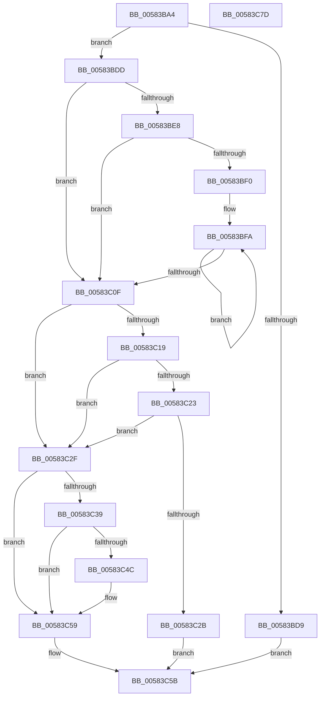

# HvlIsSingleGroupRequired

- RVA: `0x00583BA4`–`0x00583C7E` (길이 `218` bytes)
- VA: `0x0000000140583BA4`
- 실행 섹션: `.text`
- PDB 이름 있음: `예`; PDB Function 태그: `아니요`
- unwind 정보 RVA: `0x000C63F0`
- 디코드: `59`개 명령, `218/218` bytes 표시
- 미해석 바이트: `0` (있으면 어셈블리에 `.byte`로 보존)

> 이 문서는 커널 이미지의 기계어와 PDB 기호를 분석해 생성했습니다. 4번과 5번은 함수 원형과 자료형을 바이너리 사용 방식에서 추정한 C 해석이며 원본 소스 복구 결과는 아닙니다.

## 1. Dependencies

- 직접 호출 지점: **3**; 고유 호출 대상: **3**
- 직접 호출자로 확인된 함수: **2**
- RIP 상대 이미지 참조: **9**

### Outgoing calls
- `0x00583BFD` → [RtlNumberOfSetBitsEx](../41/RtlNumberOfSetBitsEx_function_00418CA0.md) (function, `0x00418CA0`)
- `0x00583C3E` → [HviGetImplementationLimits](../66/HviGetImplementationLimits_function_00666708.md) (function, `0x00666708`)
- `0x00583C63` → [_security_check_cookie](../6A/_security_check_cookie_function_006AC640.md) (function, `0x006AC640`)

### Direct callers
- [HvlpSelectVpSet](HvlpSelectVpSet_function_0058616C.md) at `0x00586392`
- [HvlpSelectVpSet](HvlpSelectVpSet_function_0058616C.md) at `0x0058648E`
- [KiPerformGroupConfiguration](../../init/C3/KiPerformGroupConfiguration_function_00C38FB0.md) at `0x00C38FD5`

### Static image references
- `0x00583BB8` → RVA `0x00E0A740` (`.data`; read)
- `0x00583BCC` → RVA `0x00FC6A97` (`ALMOSTRO`; read)
- `0x00583BDD` → RVA `0x00FC6BC0` (`ALMOSTRO`; read)
- `0x00583BE8` → RVA `0x00FC6AA7` (`ALMOSTRO`; read)
- `0x00583BF0` → RVA `0x00FCCC40` (`ALMOSTRO`; read)
- `0x00583C0F` → RVA `0x00FC6AD8` (`ALMOSTRO`; read)
- `0x00583C23` → RVA `0x00FC6AA4` (`ALMOSTRO`; read)
- `0x00583C2F` → RVA `0x00FC6A90` (`ALMOSTRO`; read)
- `0x00583C4C` → RVA `0x00FC6AB8` (`ALMOSTRO`; read)

## 2. Other-region calls and transfers

- 다른 실행 섹션으로 향하는 call: **0**
- 별도 외부 분기/꼬리 이동을 확인하지 못했습니다.

## 3. Assembly (complete function range)

```asm
00583BA4  48 89 5C 24 08                  mov qword ptr [rsp + 8], rbx
00583BA9  48 89 6C 24 10                  mov qword ptr [rsp + 0x10], rbp
00583BAE  48 89 74 24 18                  mov qword ptr [rsp + 0x18], rsi
00583BB3  57                              push rdi
00583BB4  48 83 EC 40                     sub rsp, 0x40
00583BB8  48 8B 05 81 6B 88 00            mov rax, qword ptr [rip + 0x886b81]
00583BBF  48 33 C4                        xor rax, rsp
00583BC2  48 89 44 24 30                  mov qword ptr [rsp + 0x30], rax
00583BC7  33 DB                           xor ebx, ebx
00583BC9  0F 57 C0                        xorps xmm0, xmm0
00583BCC  38 1D C5 2E A4 00               cmp byte ptr [rip + 0xa42ec5], bl
00583BD2  0F 11 44 24 20                  movups xmmword ptr [rsp + 0x20], xmm0
00583BD7  75 04                           jne 0x140583bdd
00583BD9  32 C0                           xor al, al
00583BDB  EB 7E                           jmp 0x140583c5b
00583BDD  8B 3D DD 2F A4 00               mov edi, dword ptr [rip + 0xa42fdd]
00583BE3  48 85 FF                        test rdi, rdi
00583BE6  75 27                           jne 0x140583c0f
00583BE8  38 1D B9 2E A4 00               cmp byte ptr [rip + 0xa42eb9], bl
00583BEE  74 1F                           je 0x140583c0f
00583BF0  48 8D 35 49 90 A4 00            lea rsi, [rip + 0xa49049]
00583BF7  8D 6F 40                        lea ebp, [rdi + 0x40]
00583BFA  48 8B CE                        mov rcx, rsi
00583BFD  E8 9E 50 E9 FF                  call 0x140418ca0
00583C02  48 03 F8                        add rdi, rax
00583C05  48 83 C6 10                     add rsi, 0x10
00583C09  48 83 ED 01                     sub rbp, 1
00583C0D  75 EB                           jne 0x140583bfa
00583C0F  8B 05 C3 2E A4 00               mov eax, dword ptr [rip + 0xa42ec3]
00583C15  A8 01                           test al, 1
00583C17  74 16                           je 0x140583c2f
00583C19  48 8D 47 FF                     lea rax, [rdi - 1]
00583C1D  48 83 F8 3F                     cmp rax, 0x3f
00583C21  77 0C                           ja 0x140583c2f
00583C23  38 1D 7B 2E A4 00               cmp byte ptr [rip + 0xa42e7b], bl
00583C29  75 04                           jne 0x140583c2f
00583C2B  B0 01                           mov al, 1
00583C2D  EB 2C                           jmp 0x140583c5b
00583C2F  8B 05 5B 2E A4 00               mov eax, dword ptr [rip + 0xa42e5b]
00583C35  84 C0                           test al, al
00583C37  78 20                           js 0x140583c59
00583C39  48 8D 4C 24 20                  lea rcx, [rsp + 0x20]
00583C3E  E8 C5 2A 0E 00                  call 0x140666708
00583C43  83 7C 24 20 FF                  cmp dword ptr [rsp + 0x20], -1
00583C48  B3 01                           mov bl, 1
00583C4A  75 0D                           jne 0x140583c59
00583C4C  F7 05 62 2E A4 00 04 40 00 00   test dword ptr [rip + 0xa42e62], 0x4004
00583C56  0F 95 C3                        setne bl
00583C59  8A C3                           mov al, bl
00583C5B  48 8B 4C 24 30                  mov rcx, qword ptr [rsp + 0x30]
00583C60  48 33 CC                        xor rcx, rsp
00583C63  E8 D8 89 12 00                  call 0x1406ac640
00583C68  48 8B 5C 24 50                  mov rbx, qword ptr [rsp + 0x50]
00583C6D  48 8B 6C 24 58                  mov rbp, qword ptr [rsp + 0x58]
00583C72  48 8B 74 24 60                  mov rsi, qword ptr [rsp + 0x60]
00583C77  48 83 C4 40                     add rsp, 0x40
00583C7B  5F                              pop rdi
00583C7C  C3                              ret
00583C7D  CC                              int3
```

## 4. C-style interpretation (structured pseudocode)

```c
__int64 __fastcall HvlIsSingleGroupRequired(void)
{
    __int64 result;
    __int64 v_rbp;
    __int64 v_rbx;
    __int64 v_rdi;
    __int64 v_rsi;
    __int64 v_rsp;
    unsigned __int64 v_stack_m18;
    unsigned __int64 v_stack_m28;
    unsigned __int64 v_stack_p10;
    unsigned __int64 v_stack_p18;
    unsigned __int64 v_stack_p8;

    v_stack_p8 = v_rbx;
    v_stack_p10 = v_rbp;
    v_stack_p18 = v_rsi;
    v_rsp = (v_rsp) - (64);
    result = (*(unsigned __int64 *)(v_rip + 8940417)) ^ (v_rsp);
    v_stack_m18 = result;
    v_rbx = 0;
    v_stack_m28 = v_xmm0;
    if ((*(unsigned __int8 *)(v_rip + 10759877)) != 0) goto loc_00583BDD;
    result = 0;
    goto loc_00583C5B;
loc_00583BDD:
    if ((unsigned int)(*(unsigned int *)(v_rip + 10760157)) != 0) goto loc_00583C0F;
    if ((*(unsigned __int8 *)(v_rip + 10759865)) == 0) goto loc_00583C0F;
loc_00583BFA:
    result = RtlNumberOfSetBitsEx(v_rip + 10784841, a2, a3, a4);
    v_rdi = ((unsigned int)(*(unsigned int *)(v_rip + 10760157))) + (result);
    v_rsi = (v_rip + 10784841) + (16);
    v_rbp = ((unsigned int)(*(unsigned int *)(v_rip + 10760157)) + 64) - (1);
    if (condition_is_not_equal) goto loc_00583BFA;
loc_00583C0F:
    if ((((unsigned __int8)((unsigned int)(*(unsigned int *)(v_rip + 10759875)))) & (1)) == 0) goto loc_00583C2F;
    if ((v_rdi - 1) > 63) goto loc_00583C2F;
    if ((*(unsigned __int8 *)(v_rip + 10759803)) != 0) goto loc_00583C2F;
    goto loc_00583C5B;
loc_00583C2F:
    if (sign_flag) goto loc_00583C59;
    result = HviGetImplementationLimits(v_stack_m28, a2, a3, a4);
    v_rbx = 1;
    if (v_stack_m28 == -1) {
        v_rbx = (((*(unsigned int *)(v_rip + 10759778)) & (0x4004ULL)) != 0) ? 1 : 0;
    }
loc_00583C5B:
    a1 = (v_stack_m18) ^ (v_rsp);
    result = _security_check_cookie(a1, a2, a3, a4);
    v_rsp = (v_rsp) + (64);
    return result;
}
```

## 5. (Beta) C Style

```c
void HvlIsSingleGroupRequired(void)
{
    int64_t result;
    int64_t local_rbp;
    int64_t local_rbx;
    int64_t local_rdi;
    int64_t local_rsi;
    int64_t local_rsp;
    uint64_t v_stack_m18;
    uint64_t v_stack_m28;
    uint64_t v_stack_p10;
    uint64_t v_stack_p18;
    uint64_t v_stack_p8;

    v_stack_p8 = local_rbx;
    v_stack_p10 = local_rbp;
    v_stack_p18 = local_rsi;
    local_rsp = (local_rsp) - (64);
    result = (*(uint64_t *)(v_rip + 0x886B81)) ^ (local_rsp);
    v_stack_m18 = result;
    local_rbx = 0;
    v_stack_m28 = v_xmm0;
    if ((*(uint8_t *)(v_rip + 0xA42EC5)) != 0) goto loc_00583BDD;
    result = 0;
    goto loc_00583C5B;
loc_00583BDD:
    if ((uint32_t)(*(uint32_t *)(v_rip + 0xA42FDD)) != 0) goto loc_00583C0F;
    if ((*(uint8_t *)(v_rip + 0xA42EB9)) == 0) goto loc_00583C0F;
loc_00583BFA:
    result = RtlNumberOfSetBitsEx(v_rip + 10784841, a2, a3, a4);
    local_rdi = ((uint32_t)(*(uint32_t *)(v_rip + 0xA42FDD))) + (result);
    local_rsi = (v_rip + 10784841) + (16);
    local_rbp = ((uint32_t)(*(uint32_t *)(v_rip + 0xA42FDD)) + 64) - (1);
    if (condition_is_not_equal) goto loc_00583BFA;
loc_00583C0F:
    if ((((uint8_t)((uint32_t)(*(uint32_t *)(v_rip + 0xA42EC3)))) & (1)) == 0) goto loc_00583C2F;
    if ((local_rdi - 1) > 63) goto loc_00583C2F;
    if ((*(uint8_t *)(v_rip + 0xA42E7B)) != 0) goto loc_00583C2F;
    goto loc_00583C5B;
loc_00583C2F:
    if (sign_flag) goto loc_00583C59;
    result = HviGetImplementationLimits(v_stack_m28, a2, a3, a4);
    local_rbx = 1;
    if (v_stack_m28 == -1) {
        local_rbx = (((*(uint32_t *)(v_rip + 0xA42E62)) & (0x4004ULL)) != 0) ? 1 : 0;
    }
loc_00583C5B:
    a1 = (v_stack_m18) ^ (local_rsp);
    result = _security_check_cookie(a1, a2, a3, a4);
    local_rsp = (local_rsp) + (64);
    return result;
}
```

## 6. Execution-region graph

[열기: 2D/3D 그래프와 함수 탐색 컨트롤 패널](../../../control-panel.html?section=text&rva=0x00583BA4&view=graph)

- 2D 그래프는 위에서 아래로 흐르고, 3D 그래프는 빈 공간을 드래그해 회전합니다. Shift+드래그는 이동, 휠은 확대·축소, 함수 노드 선택은 대상 보고서 이동입니다.

### Static fallback


