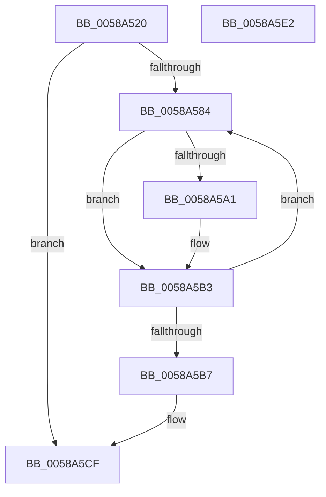

# HvlIterateSecurePagesForHibernation

- RVA: `0x0058A520`–`0x0058A5E3` (길이 `195` bytes)
- VA: `0x000000014058A520`
- 실행 섹션: `.text`
- PDB 이름 있음: `예`; PDB Function 태그: `아니요`
- unwind 정보 RVA: `0x000C6880`
- 디코드: `59`개 명령, `195/195` bytes 표시
- 미해석 바이트: `0` (있으면 어셈블리에 `.byte`로 보존)

> 이 문서는 커널 이미지의 기계어와 PDB 기호를 분석해 생성했습니다. 4번과 5번은 함수 원형과 자료형을 바이너리 사용 방식에서 추정한 C 해석이며 원본 소스 복구 결과는 아닙니다.

## 1. Dependencies

- 직접 호출 지점: **4**; 고유 호출 대상: **4**
- 직접 호출자로 확인된 함수: **1**
- RIP 상대 이미지 참조: **2**

### Outgoing calls
- `0x0058A57B` → [HvlpStartSecurePageListIteration](HvlpStartSecurePageListIteration_function_0058D908.md) (function, `0x0058D908`)
- `0x0058A596` → [VslGetSecurePageList](VslGetSecurePageList_function_0058E504.md) (function, `0x0058E504`)
- `0x0058A5AE` → [PopWriteSecurePagesCallback](../5D/PopWriteSecurePagesCallback_function_005D5048.md) (function, `0x005D5048`)
- `0x0058A5BF` → [HvlpEndSecurePageListIteration](HvlpEndSecurePageListIteration_function_0058D610.md) (function, `0x0058D610`)

### Direct callers
- [PopWriteSecurePages](../5D/PopWriteSecurePages_function_005D4F94.md) at `0x005D4FF4`

### Static image references
- `0x0058A537` → RVA `0x00F8EDF8` (`.data`; read)
- `0x0058A540` → RVA `0x00F8EDF0` (`.data`; read)

## 2. Other-region calls and transfers

- 다른 실행 섹션으로 향하는 call: **0**
- 별도 외부 분기/꼬리 이동을 확인하지 못했습니다.

## 3. Assembly (complete function range)

```asm
0058A520  4C 8B DC                        mov r11, rsp
0058A523  49 89 5B 10                     mov qword ptr [r11 + 0x10], rbx
0058A527  49 89 6B 18                     mov qword ptr [r11 + 0x18], rbp
0058A52B  49 89 4B 08                     mov qword ptr [r11 + 8], rcx
0058A52F  56                              push rsi
0058A530  57                              push rdi
0058A531  41 56                           push r14
0058A533  48 83 EC 40                     sub rsp, 0x40
0058A537  8B 05 BB 48 A0 00               mov eax, dword ptr [rip + 0xa048bb]
0058A53D  4D 8B F0                        mov r14, r8
0058A540  4C 8B 05 A9 48 A0 00            mov r8, qword ptr [rip + 0xa048a9]
0058A547  83 C0 FE                        add eax, -2
0058A54A  C1 E0 0C                        shl eax, 0xc
0058A54D  33 DB                           xor ebx, ebx
0058A54F  8B C8                           mov ecx, eax
0058A551  49 81 C0 00 10 00 00            add r8, 0x1000
0058A558  49 8B E9                        mov rbp, r9
0058A55B  49 89 5B E0                     mov qword ptr [r11 - 0x20], rbx
0058A55F  48 8B F2                        mov rsi, rdx
0058A562  89 5C 24 30                     mov dword ptr [rsp + 0x30], ebx
0058A566  8D 53 03                        lea edx, [rbx + 3]
0058A569  4D 8D 0C 00                     lea r9, [r8 + rax]
0058A56D  49 8D 43 E0                     lea rax, [r11 - 0x20]
0058A571  49 89 43 D0                     mov qword ptr [r11 - 0x30], rax
0058A575  89 4C 24 20                     mov dword ptr [rsp + 0x20], ecx
0058A579  33 C9                           xor ecx, ecx
0058A57B  E8 88 33 00 00                  call 0x14058d908
0058A580  85 C0                           test eax, eax
0058A582  78 4B                           js 0x14058a5cf
0058A584  4C 8D 4C 24 60                  lea r9, [rsp + 0x60]
0058A589  88 5C 24 60                     mov byte ptr [rsp + 0x60], bl
0058A58D  4C 8D 44 24 30                  lea r8, [rsp + 0x30]
0058A592  33 D2                           xor edx, edx
0058A594  B1 01                           mov cl, 1
0058A596  E8 69 3F 00 00                  call 0x14058e504
0058A59B  8B F8                           mov edi, eax
0058A59D  85 C0                           test eax, eax
0058A59F  78 12                           js 0x14058a5b3
0058A5A1  44 8B 44 24 30                  mov r8d, dword ptr [rsp + 0x30]
0058A5A6  48 8B CE                        mov rcx, rsi
0058A5A9  48 8B 54 24 38                  mov rdx, qword ptr [rsp + 0x38]
0058A5AE  E8 95 AA 04 00                  call 0x1405d5048
0058A5B3  85 FF                           test edi, edi
0058A5B5  74 CD                           je 0x14058a584
0058A5B7  4C 8B C5                        mov r8, rbp
0058A5BA  49 8B D6                        mov rdx, r14
0058A5BD  33 C9                           xor ecx, ecx
0058A5BF  E8 4C 30 00 00                  call 0x14058d610
0058A5C4  81 FF 1A 00 00 80               cmp edi, 0x8000001a
0058A5CA  0F 45 DF                        cmovne ebx, edi
0058A5CD  8B C3                           mov eax, ebx
0058A5CF  48 8B 5C 24 68                  mov rbx, qword ptr [rsp + 0x68]
0058A5D4  48 8B 6C 24 70                  mov rbp, qword ptr [rsp + 0x70]
0058A5D9  48 83 C4 40                     add rsp, 0x40
0058A5DD  41 5E                           pop r14
0058A5DF  5F                              pop rdi
0058A5E0  5E                              pop rsi
0058A5E1  C3                              ret
0058A5E2  CC                              int3
```

## 4. C-style interpretation (structured pseudocode)

```c
__int64 __fastcall HvlIterateSecurePagesForHibernation(__int64 a1, __int64 a2, __int64 a3, __int64 a4)
{
    __int64 result;
    __int64 v_rbx;
    __int64 v_rsp;
    unsigned __int64 v_stack_m20;
    unsigned int v_stack_m28;
    unsigned int v_stack_m38;
    unsigned __int64 v_stack_p10;
    unsigned __int64 v_stack_p18;
    unsigned __int64 v_stack_p8;

    *(unsigned __int64 *)(v_rsp + 16) = v_rbx;
    *(unsigned __int64 *)(v_rsp + 24) = v_rbp;
    *(unsigned __int64 *)(v_rsp + 8) = a1;
    v_rsp = (v_rsp) - (64);
    result = (unsigned int)(((unsigned int)(*(unsigned int *)(v_rip + 10504379))) + (-2));
    result = (unsigned int)((result) << (12));
    v_rbx = 0;
    a3 = (*(unsigned __int64 *)(v_rip + 10504361)) + (0x1000ULL);
    *(unsigned __int64 *)(v_rsp - 32) = 0;
    v_stack_m28 = 0;
    *(unsigned __int64 *)(v_rsp - 48) = v_rsp - 32;
    v_stack_m38 = (unsigned int)((unsigned int)((unsigned int)(result)));
    a1 = 0;
    result = HvlpStartSecurePageListIteration(a1, v_rbx + 3, a3, a3 + result * 1);
    if (sign_flag) goto loc_0058A5CF;
loc_0058A584:
    v_stack_p8 = 0;
    a2 = 0;
    result = VslGetSecurePageList(1, a2, v_stack_m28, v_stack_p8);
    if (!(sign_flag)) {
        a3 = v_stack_m28;
        a1 = 0;
        a2 = v_stack_m20;
        result = PopWriteSecurePagesCallback(a1, a2, a3, v_stack_p8);
    }
    if ((unsigned int)((unsigned int)((unsigned int)(result))) == 0) goto loc_0058A584;
    a1 = 0;
    result = HvlpEndSecurePageListIteration(a1, a3, a4, v_stack_p8);
    if (((unsigned int)((unsigned int)((unsigned int)(result)))) != 0x8000001AULL) { v_rbx = (unsigned int)((unsigned int)((unsigned int)(result))); }
loc_0058A5CF:
    v_rsp = (v_rsp) + (64);
    return (unsigned int)((unsigned int)(v_rbx));
}
```

## 5. (Beta) C Style

```c
int64_t HvlIterateSecurePagesForHibernation(int64_t Arg1, int64_t Arg2, int64_t Arg3, int64_t Arg4)
{
    int64_t result;
    int64_t local_rbx;
    int64_t local_rsp;
    uint64_t v_stack_m20;
    uint32_t v_stack_m28;
    uint32_t v_stack_m38;
    uint64_t v_stack_p10;
    uint64_t v_stack_p18;
    uint64_t v_stack_p8;

    *(uint64_t *)(local_rsp + 0x10) = local_rbx;
    *(uint64_t *)(local_rsp + 0x18) = local_rbp;
    *(uint64_t *)(local_rsp + 0x8) = Arg1;
    local_rsp = (local_rsp) - (64);
    result = (uint32_t)(((uint32_t)(*(uint32_t *)(v_rip + 0xA048BB))) + (-2));
    result = (uint32_t)((result) << (12));
    local_rbx = 0;
    Arg3 = (*(uint64_t *)(v_rip + 0xA048A9)) + (0x1000ULL);
    *(uint64_t *)(local_rsp - 0x20) = 0;
    v_stack_m28 = 0;
    *(uint64_t *)(local_rsp - 0x30) = local_rsp - 32;
    v_stack_m38 = (uint32_t)((uint32_t)((uint32_t)(result)));
    Arg1 = 0;
    result = HvlpStartSecurePageListIteration(Arg1, local_rbx + 3, Arg3, Arg3 + result * 1);
    if (sign_flag) goto loc_0058A5CF;
loc_0058A584:
    v_stack_p8 = 0;
    Arg2 = 0;
    result = VslGetSecurePageList(1, Arg2, v_stack_m28, v_stack_p8);
    if (!(sign_flag)) {
        Arg3 = v_stack_m28;
        Arg1 = 0;
        Arg2 = v_stack_m20;
        result = PopWriteSecurePagesCallback(Arg1, Arg2, Arg3, v_stack_p8);
    }
    if ((uint32_t)((uint32_t)((uint32_t)(result))) == 0) goto loc_0058A584;
    Arg1 = 0;
    result = HvlpEndSecurePageListIteration(Arg1, Arg3, Arg4, v_stack_p8);
    if (((uint32_t)((uint32_t)((uint32_t)(result)))) != 0x8000001AULL) { local_rbx = (uint32_t)((uint32_t)((uint32_t)(result))); }
loc_0058A5CF:
    local_rsp = (local_rsp) + (64);
    return (uint32_t)((uint32_t)(local_rbx));
}
```

## 6. Execution-region graph

[열기: 2D/3D 그래프와 함수 탐색 컨트롤 패널](../../../control-panel.html?section=text&rva=0x0058A520&view=graph)

- 2D 그래프는 위에서 아래로 흐르고, 3D 그래프는 빈 공간을 드래그해 회전합니다. Shift+드래그는 이동, 휠은 확대·축소, 함수 노드 선택은 대상 보고서 이동입니다.

### Static fallback


