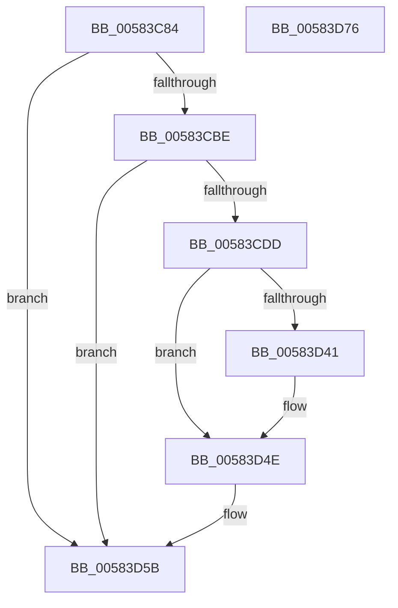

# HvlLogGuestCrashInformation

- RVA: `0x00583C84`–`0x00583D77` (길이 `243` bytes)
- VA: `0x0000000140583C84`
- 실행 섹션: `.text`
- PDB 이름 있음: `예`; PDB Function 태그: `아니요`
- unwind 정보 RVA: `0x0005D7BC`
- 디코드: `61`개 명령, `243/243` bytes 표시
- 미해석 바이트: `0` (있으면 어셈블리에 `.byte`로 보존)

> 이 문서는 커널 이미지의 기계어와 PDB 기호를 분석해 생성했습니다. 4번과 5번은 함수 원형과 자료형을 바이너리 사용 방식에서 추정한 C 해석이며 원본 소스 복구 결과는 아닙니다.

## 1. Dependencies

- 직접 호출 지점: **3**; 고유 호출 대상: **2**
- 직접 호출자로 확인된 함수: **1**
- RIP 상대 이미지 참조: **1**

### Outgoing calls
- `0x00583CC7` → [HvlpGetRegister64](../37/HvlpGetRegister64_function_00379050.md) (function, `0x00379050`)
- `0x00583CE5` → [HvlpSetRegister64](../4D/HvlpSetRegister64_function_004DDA70.md) (function, `0x004DDA70`)
- `0x00583D56` → [HvlpSetRegister64](../4D/HvlpSetRegister64_function_004DDA70.md) (function, `0x004DDA70`)

### Direct callers
- [KeBugCheck2](../5B/KeBugCheck2_function_005B27D0.md) at `0x005B320F`

### Static image references
- `0x00583CA5` → RVA `0x00FC6AB8` (`ALMOSTRO`; read)

## 2. Other-region calls and transfers

- 다른 실행 섹션으로 향하는 call: **0**
- 별도 외부 분기/꼬리 이동을 확인하지 못했습니다.

## 3. Assembly (complete function range)

```asm
00583C84  48 8B C4                        mov rax, rsp
00583C87  48 89 58 08                     mov qword ptr [rax + 8], rbx
00583C8B  48 89 68 10                     mov qword ptr [rax + 0x10], rbp
00583C8F  48 89 70 18                     mov qword ptr [rax + 0x18], rsi
00583C93  48 89 78 20                     mov qword ptr [rax + 0x20], rdi
00583C97  41 56                           push r14
00583C99  48 83 EC 30                     sub rsp, 0x30
00583C9D  48 83 60 E8 00                  and qword ptr [rax - 0x18], 0
00583CA2  49 8B F9                        mov rdi, r9
00583CA5  F7 05 09 2E A4 00 00 20 00 00   test dword ptr [rip + 0xa42e09], 0x2000
00583CAF  49 8B F0                        mov rsi, r8
00583CB2  48 8B EA                        mov rbp, rdx
00583CB5  44 8B F1                        mov r14d, ecx
00583CB8  0F 84 9D 00 00 00               je 0x140583d5b
00583CBE  48 8D 50 E8                     lea rdx, [rax - 0x18]
00583CC2  B9 15 02 00 00                  mov ecx, 0x215
00583CC7  E8 84 53 DF FF                  call 0x140379050
00583CCC  48 BB 00 00 00 00 00 00 00 80   movabs rbx, 0x8000000000000000
00583CD6  48 85 5C 24 20                  test qword ptr [rsp + 0x20], rbx
00583CDB  74 7E                           je 0x140583d5b
00583CDD  41 8B D6                        mov edx, r14d
00583CE0  B9 10 02 00 00                  mov ecx, 0x210
00583CE5  E8 86 9D F5 FF                  call 0x1404dda70
00583CEA  48 8B D5                        mov rdx, rbp
00583CED  48 8B C5                        mov rax, rbp
00583CF0  48 C1 EA 20                     shr rdx, 0x20
00583CF4  B9 01 01 00 40                  mov ecx, 0x40000101
00583CF9  0F 30                           wrmsr
00583CFB  48 8B D6                        mov rdx, rsi
00583CFE  48 8B C6                        mov rax, rsi
00583D01  48 C1 EA 20                     shr rdx, 0x20
00583D05  B9 02 01 00 40                  mov ecx, 0x40000102
00583D0A  0F 30                           wrmsr
00583D0C  48 8B D7                        mov rdx, rdi
00583D0F  48 8B C7                        mov rax, rdi
00583D12  48 C1 EA 20                     shr rdx, 0x20
00583D16  B9 03 01 00 40                  mov ecx, 0x40000103
00583D1B  0F 30                           wrmsr
00583D1D  48 8B 54 24 60                  mov rdx, qword ptr [rsp + 0x60]
00583D22  B9 04 01 00 40                  mov ecx, 0x40000104
00583D27  48 8B C2                        mov rax, rdx
00583D2A  48 C1 EA 20                     shr rdx, 0x20
00583D2E  0F 30                           wrmsr
00583D30  48 B9 00 00 00 00 00 00 00 20   movabs rcx, 0x2000000000000000
00583D3A  48 85 4C 24 20                  test qword ptr [rsp + 0x20], rcx
00583D3F  74 0D                           je 0x140583d4e
00583D41  F7 5C 24 68                     neg dword ptr [rsp + 0x68]
00583D45  48 1B C0                        sbb rax, rax
00583D48  48 23 C1                        and rax, rcx
00583D4B  48 03 D8                        add rbx, rax
00583D4E  48 8B D3                        mov rdx, rbx
00583D51  B9 15 02 00 00                  mov ecx, 0x215
00583D56  E8 15 9D F5 FF                  call 0x1404dda70
00583D5B  48 8B 5C 24 40                  mov rbx, qword ptr [rsp + 0x40]
00583D60  48 8B 6C 24 48                  mov rbp, qword ptr [rsp + 0x48]
00583D65  48 8B 74 24 50                  mov rsi, qword ptr [rsp + 0x50]
00583D6A  48 8B 7C 24 58                  mov rdi, qword ptr [rsp + 0x58]
00583D6F  48 83 C4 30                     add rsp, 0x30
00583D73  41 5E                           pop r14
00583D75  C3                              ret
00583D76  CC                              int3
```

## 4. C-style interpretation (structured pseudocode)

```c
__int64 __fastcall HvlLogGuestCrashInformation(int a1, __int64 a2, __int64 a3, __int64 a4, __int64 a5, unsigned int a6)
{
    __int64 result;
    __int64 v_rbx;
    __int64 v_rsp;
    unsigned __int64 v_stack_m18;
    unsigned __int64 v_stack_p10;
    unsigned __int64 v_stack_p18;
    unsigned __int64 v_stack_p20;
    unsigned __int64 v_stack_p8;

    *(unsigned __int64 *)(v_rsp + 8) = v_rbx;
    *(unsigned __int64 *)(v_rsp + 16) = v_rbp;
    *(unsigned __int64 *)(v_rsp + 24) = v_rsi;
    *(unsigned __int64 *)(v_rsp + 32) = v_rdi;
    v_rsp = (v_rsp) - (48);
    if (((*(unsigned int *)(v_rip + 10759689)) & (0x2000ULL)) == 0) goto loc_00583D5B;
    result = HvlpGetRegister64(533, v_rsp - 24, a3, a4);
    if (((v_stack_m18) & (v_rbx)) == 0) goto loc_00583D5B;
    result = HvlpSetRegister64(528, (unsigned int)((unsigned int)((unsigned int)(a1))), a3, a4);
    a2 = (a2) >> (32);
    a2 = (a3) >> (32);
    a2 = (a4) >> (32);
    a2 = (a5) >> (32);
    result = a5;
    if (((v_stack_m18) & ((unsigned int)(0x40000104ULL))) != 0) {
        result = (a5) & ((unsigned int)(0x40000104ULL));
        v_rbx = (v_rbx) + (result);
    }
    result = HvlpSetRegister64(533, v_rbx, a3, a4);
loc_00583D5B:
    v_rsp = (v_rsp) + (48);
    return result;
}
```

## 5. (Beta) C Style

```c
int64_t HvlLogGuestCrashInformation(int32_t Arg1, int64_t Arg2, int64_t Arg3, int64_t Arg4, int64_t Arg5, uint32_t Arg6)
{
    int64_t result;
    int64_t local_rbx;
    int64_t local_rsp;
    uint64_t v_stack_m18;
    uint64_t v_stack_p10;
    uint64_t v_stack_p18;
    uint64_t v_stack_p20;
    uint64_t v_stack_p8;

    *(uint64_t *)(local_rsp + 0x8) = local_rbx;
    *(uint64_t *)(local_rsp + 0x10) = local_rbp;
    *(uint64_t *)(local_rsp + 0x18) = local_rsi;
    *(uint64_t *)(local_rsp + 0x20) = local_rdi;
    local_rsp = (local_rsp) - (48);
    if (((*(uint32_t *)(v_rip + 0xA42E09)) & (0x2000ULL)) == 0) goto loc_00583D5B;
    result = HvlpGetRegister64(533, local_rsp - 24, Arg3, Arg4);
    if (((v_stack_m18) & (local_rbx)) == 0) goto loc_00583D5B;
    result = HvlpSetRegister64(528, (uint32_t)((uint32_t)((uint32_t)(Arg1))), Arg3, Arg4);
    Arg2 = (Arg2) >> (32);
    Arg2 = (Arg3) >> (32);
    Arg2 = (Arg4) >> (32);
    Arg2 = (Arg5) >> (32);
    result = Arg5;
    if (((v_stack_m18) & ((uint32_t)(0x40000104ULL))) != 0) {
        result = (Arg5) & ((uint32_t)(0x40000104ULL));
        local_rbx = (local_rbx) + (result);
    }
    result = HvlpSetRegister64(533, local_rbx, Arg3, Arg4);
loc_00583D5B:
    local_rsp = (local_rsp) + (48);
    return result;
}
```

## 6. Execution-region graph

[열기: 2D/3D 그래프와 함수 탐색 컨트롤 패널](../../../control-panel.html?section=text&rva=0x00583C84&view=graph)

- 2D 그래프는 위에서 아래로 흐르고, 3D 그래프는 빈 공간을 드래그해 회전합니다. Shift+드래그는 이동, 휠은 확대·축소, 함수 노드 선택은 대상 보고서 이동입니다.

### Static fallback


