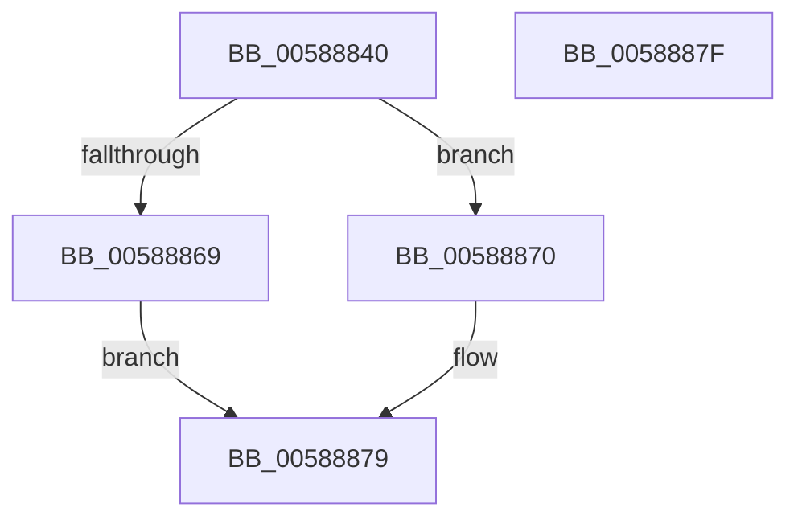

# HvlLpGetLogicalProcessorHwId

- RVA: `0x00588840`–`0x00588880` (길이 `64` bytes)
- VA: `0x0000000140588840`
- 실행 섹션: `.text`
- PDB 이름 있음: `예`; PDB Function 태그: `아니요`
- unwind 정보 RVA: `0x000697A4`
- 디코드: `20`개 명령, `64/64` bytes 표시
- 미해석 바이트: `0` (있으면 어셈블리에 `.byte`로 보존)

> 이 문서는 커널 이미지의 기계어와 PDB 기호를 분석해 생성했습니다. 4번과 5번은 함수 원형과 자료형을 바이너리 사용 방식에서 추정한 C 해석이며 원본 소스 복구 결과는 아닙니다.

## 1. Dependencies

- 직접 호출 지점: **1**; 고유 호출 대상: **1**
- 직접 호출자로 확인된 함수: **0**
- RIP 상대 이미지 참조: **0**

### Outgoing calls
- `0x00588860` → [HvlpGetLogicalProcessorProperty](HvlpGetLogicalProcessorProperty_function_00585774.md) (function, `0x00585774`)

### Direct callers
- 이 함수 시작 RVA로 연결되는 직접 call은 확인되지 않았습니다. 간접 호출은 완전히 역산할 수 없습니다.

### Static image references
- 디코드된 RIP-relative 메모리 참조가 없습니다.

## 2. Other-region calls and transfers

- 다른 실행 섹션으로 향하는 call: **0**
- 별도 외부 분기/꼬리 이동을 확인하지 못했습니다.

## 3. Assembly (complete function range)

```asm
00588840  40 53                           push rbx
00588842  48 83 EC 40                     sub rsp, 0x40
00588846  0F 57 C0                        xorps xmm0, xmm0
00588849  4C 8D 44 24 20                  lea r8, [rsp + 0x20]
0058884E  48 8B DA                        mov rbx, rdx
00588851  BA 03 00 00 00                  mov edx, 3
00588856  0F 11 44 24 20                  movups xmmword ptr [rsp + 0x20], xmm0
0058885B  0F 11 44 24 30                  movups xmmword ptr [rsp + 0x30], xmm0
00588860  E8 0F CF FF FF                  call 0x140585774
00588865  85 C0                           test eax, eax
00588867  79 07                           jns 0x140588870
00588869  B8 01 00 00 C0                  mov eax, 0xc0000001
0058886E  EB 09                           jmp 0x140588879
00588870  8B 44 24 20                     mov eax, dword ptr [rsp + 0x20]
00588874  48 89 03                        mov qword ptr [rbx], rax
00588877  33 C0                           xor eax, eax
00588879  48 83 C4 40                     add rsp, 0x40
0058887D  5B                              pop rbx
0058887E  C3                              ret
0058887F  CC                              int3
```

## 4. C-style interpretation (structured pseudocode)

```c
__int64 __fastcall HvlLpGetLogicalProcessorHwId(__int64 a1, __int64 a2)
{
    __int64 result;
    __int64 v_rsp;
    unsigned __int64 v_stack_m18;
    unsigned __int64 v_stack_m28;

    v_rsp = (v_rsp) - (64);
    v_stack_m28 = v_xmm0;
    v_stack_m18 = v_xmm0;
    result = HvlpGetLogicalProcessorProperty(a1, 3, v_stack_m28, a4);
    if (!sign_flag) goto loc_00588870;
    goto loc_00588879;
loc_00588870:
    *(unsigned __int64 *)(a2) = (unsigned int)(v_stack_m28);
    result = 0;
loc_00588879:
    v_rsp = (v_rsp) + (64);
    return result;
}
```

## 5. (Beta) C Style

```c
int64_t HvlLpGetLogicalProcessorHwId(int64_t Arg1, void *Arg2)
{
    uint8_t *arg2 = (uint8_t *)Arg2;

    int64_t result;
    int64_t local_rsp;
    uint64_t v_stack_m18;
    uint64_t v_stack_m28;

    local_rsp = (local_rsp) - (64);
    v_stack_m28 = v_xmm0;
    v_stack_m18 = v_xmm0;
    result = HvlpGetLogicalProcessorProperty(Arg1, 3, v_stack_m28, a4);
    if (!sign_flag) goto loc_00588870;
    goto loc_00588879;
loc_00588870:
    *(uint64_t *)(arg2) = (uint32_t)(v_stack_m28);
    result = 0;
loc_00588879:
    local_rsp = (local_rsp) + (64);
    return result;
}
```

### 관측된 메모리 오프셋

구조체 형식이 확인되지 않은 접근은 인자 기준의 오프셋으로만 기록했습니다.

| 기준 인자 | 오프셋 표현 | 폭 (bit) | 접근 |
|---|---:|---:|---|
| `Arg2` | `+ 0x0` | `64` | `W` |

## 6. Execution-region graph

[열기: 2D/3D 그래프와 함수 탐색 컨트롤 패널](../../../control-panel.html?section=text&rva=0x00588840&view=graph)

- 2D 그래프는 위에서 아래로 흐르고, 3D 그래프는 빈 공간을 드래그해 회전합니다. Shift+드래그는 이동, 휠은 확대·축소, 함수 노드 선택은 대상 보고서 이동입니다.

### Static fallback


