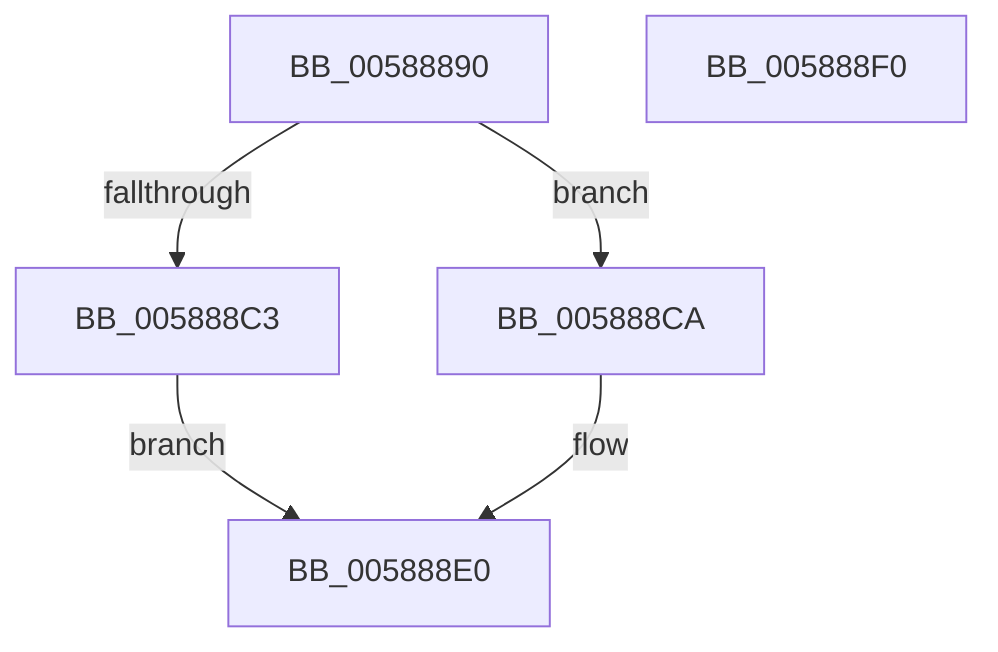

# HvlLpGetMachineCheckContext

- RVA: `0x00588890`–`0x005888F1` (길이 `97` bytes)
- VA: `0x0000000140588890`
- 실행 섹션: `.text`
- PDB 이름 있음: `예`; PDB Function 태그: `아니요`
- unwind 정보 RVA: `0x000718AC`
- 디코드: `31`개 명령, `97/97` bytes 표시
- 미해석 바이트: `0` (있으면 어셈블리에 `.byte`로 보존)

> 이 문서는 커널 이미지의 기계어와 PDB 기호를 분석해 생성했습니다. 4번과 5번은 함수 원형과 자료형을 바이너리 사용 방식에서 추정한 C 해석이며 원본 소스 복구 결과는 아닙니다.

## 1. Dependencies

- 직접 호출 지점: **1**; 고유 호출 대상: **1**
- 직접 호출자로 확인된 함수: **0**
- RIP 상대 이미지 참조: **0**

### Outgoing calls
- `0x005888BA` → [HvlpGetLogicalProcessorProperty](HvlpGetLogicalProcessorProperty_function_00585774.md) (function, `0x00585774`)

### Direct callers
- 이 함수 시작 RVA로 연결되는 직접 call은 확인되지 않았습니다. 간접 호출은 완전히 역산할 수 없습니다.

### Static image references
- 디코드된 RIP-relative 메모리 참조가 없습니다.

## 2. Other-region calls and transfers

- 다른 실행 섹션으로 향하는 call: **0**
- 별도 외부 분기/꼬리 이동을 확인하지 못했습니다.

## 3. Assembly (complete function range)

```asm
00588890  48 8B C4                        mov rax, rsp
00588893  48 89 58 08                     mov qword ptr [rax + 8], rbx
00588897  48 89 70 10                     mov qword ptr [rax + 0x10], rsi
0058889B  57                              push rdi
0058889C  48 83 EC 40                     sub rsp, 0x40
005888A0  0F 57 C0                        xorps xmm0, xmm0
005888A3  49 8B F8                        mov rdi, r8
005888A6  48 8B F2                        mov rsi, rdx
005888A9  4C 8D 40 D8                     lea r8, [rax - 0x28]
005888AD  33 D2                           xor edx, edx
005888AF  49 8B D9                        mov rbx, r9
005888B2  0F 11 40 D8                     movups xmmword ptr [rax - 0x28], xmm0
005888B6  0F 11 40 E8                     movups xmmword ptr [rax - 0x18], xmm0
005888BA  E8 B5 CE FF FF                  call 0x140585774
005888BF  85 C0                           test eax, eax
005888C1  79 07                           jns 0x1405888ca
005888C3  B8 01 00 00 C0                  mov eax, 0xc0000001
005888C8  EB 16                           jmp 0x1405888e0
005888CA  8B 44 24 20                     mov eax, dword ptr [rsp + 0x20]
005888CE  89 06                           mov dword ptr [rsi], eax
005888D0  48 8B 44 24 28                  mov rax, qword ptr [rsp + 0x28]
005888D5  48 89 07                        mov qword ptr [rdi], rax
005888D8  8B 44 24 30                     mov eax, dword ptr [rsp + 0x30]
005888DC  89 03                           mov dword ptr [rbx], eax
005888DE  33 C0                           xor eax, eax
005888E0  48 8B 5C 24 50                  mov rbx, qword ptr [rsp + 0x50]
005888E5  48 8B 74 24 58                  mov rsi, qword ptr [rsp + 0x58]
005888EA  48 83 C4 40                     add rsp, 0x40
005888EE  5F                              pop rdi
005888EF  C3                              ret
005888F0  CC                              int3
```

## 4. C-style interpretation (structured pseudocode)

```c
__int64 __fastcall HvlLpGetMachineCheckContext(__int64 a1, __int64 a2, __int64 a3, __int64 a4)
{
    __int64 result;
    __int64 v_rsp;
    unsigned int v_stack_m18;
    unsigned __int64 v_stack_m20;
    unsigned int v_stack_m28;
    unsigned __int64 v_stack_p10;
    unsigned __int64 v_stack_p8;

    *(unsigned __int64 *)(v_rsp + 8) = v_rbx;
    *(unsigned __int64 *)(v_rsp + 16) = v_rsi;
    v_rsp = (v_rsp) - (64);
    a2 = 0;
    *(unsigned __int64 *)(v_rsp - 40) = v_xmm0;
    *(unsigned __int64 *)(v_rsp - 24) = v_xmm0;
    result = HvlpGetLogicalProcessorProperty(a1, a2, v_rsp - 40, a4);
    if (!sign_flag) goto loc_005888CA;
    goto loc_005888E0;
loc_005888CA:
    *(unsigned int *)(a2) = (unsigned int)((unsigned int)(v_stack_m28));
    *(unsigned __int64 *)(a3) = v_stack_m20;
    *(unsigned int *)(a4) = (unsigned int)((unsigned int)(v_stack_m18));
    result = 0;
loc_005888E0:
    v_rsp = (v_rsp) + (64);
    return result;
}
```

## 5. (Beta) C Style

```c
int64_t HvlLpGetMachineCheckContext(int64_t Arg1, void *Arg2, void *Arg3, void *Arg4)
{
    uint8_t *arg2 = (uint8_t *)Arg2;
    uint8_t *arg3 = (uint8_t *)Arg3;
    uint8_t *arg4 = (uint8_t *)Arg4;

    int64_t result;
    int64_t local_rsp;
    uint32_t v_stack_m18;
    uint64_t v_stack_m20;
    uint32_t v_stack_m28;
    uint64_t v_stack_p10;
    uint64_t v_stack_p8;

    *(uint64_t *)(local_rsp + 0x8) = local_rbx;
    *(uint64_t *)(local_rsp + 0x10) = local_rsi;
    local_rsp = (local_rsp) - (64);
    Arg2 = 0;
    *(uint64_t *)(local_rsp - 0x28) = v_xmm0;
    *(uint64_t *)(local_rsp - 0x18) = v_xmm0;
    result = HvlpGetLogicalProcessorProperty(Arg1, Arg2, local_rsp - 40, Arg4);
    if (!sign_flag) goto loc_005888CA;
    goto loc_005888E0;
loc_005888CA:
    *(uint32_t *)(arg2) = (uint32_t)((uint32_t)(v_stack_m28));
    *(uint64_t *)(arg3) = v_stack_m20;
    *(uint32_t *)(arg4) = (uint32_t)((uint32_t)(v_stack_m18));
    result = 0;
loc_005888E0:
    local_rsp = (local_rsp) + (64);
    return result;
}
```

### 관측된 메모리 오프셋

구조체 형식이 확인되지 않은 접근은 인자 기준의 오프셋으로만 기록했습니다.

| 기준 인자 | 오프셋 표현 | 폭 (bit) | 접근 |
|---|---:|---:|---|
| `Arg2` | `+ 0x0` | `32` | `W` |
| `Arg3` | `+ 0x0` | `64` | `W` |
| `Arg4` | `+ 0x0` | `32` | `W` |

## 6. Execution-region graph

[열기: 2D/3D 그래프와 함수 탐색 컨트롤 패널](../../../control-panel.html?section=text&rva=0x00588890&view=graph)

- 2D 그래프는 위에서 아래로 흐르고, 3D 그래프는 빈 공간을 드래그해 회전합니다. Shift+드래그는 이동, 휠은 확대·축소, 함수 노드 선택은 대상 보고서 이동입니다.

### Static fallback


