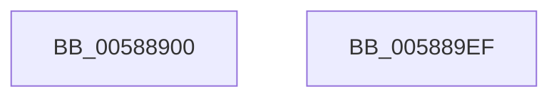

# HvlLpReadCpuid

- RVA: `0x00588900`–`0x005889F0` (길이 `240` bytes)
- VA: `0x0000000140588900`
- 실행 섹션: `.text`
- PDB 이름 있음: `예`; PDB Function 태그: `아니요`
- unwind 정보 RVA: `0x000C6780`
- 디코드: `73`개 명령, `240/240` bytes 표시
- 미해석 바이트: `0` (있으면 어셈블리에 `.byte`로 보존)

> 이 문서는 커널 이미지의 기계어와 PDB 기호를 분석해 생성했습니다. 4번과 5번은 함수 원형과 자료형을 바이너리 사용 방식에서 추정한 C 해석이며 원본 소스 복구 결과는 아닙니다.

## 1. Dependencies

- 직접 호출 지점: **5**; 고유 호출 대상: **3**
- 직접 호출자로 확인된 함수: **0**
- RIP 상대 이미지 참조: **0**

### Outgoing calls
- `0x0058895A` → [HvlpAcquireHypercallPage](../47/HvlpAcquireHypercallPage_function_00471410.md) (function, `0x00471410`)
- `0x0058896F` → [HvlpAcquireHypercallPage](../47/HvlpAcquireHypercallPage_function_00471410.md) (function, `0x00471410`)
- `0x00588994` → [HvcallInitiateHypercall](../31/HvcallInitiateHypercall_function_00313630.md) (function, `0x00313630`)
- `0x005889C6` → [HvlpReleaseHypercallPage](../31/HvlpReleaseHypercallPage_function_00313480.md) (function, `0x00313480`)
- `0x005889CF` → [HvlpReleaseHypercallPage](../31/HvlpReleaseHypercallPage_function_00313480.md) (function, `0x00313480`)

### Direct callers
- 이 함수 시작 RVA로 연결되는 직접 call은 확인되지 않았습니다. 간접 호출은 완전히 역산할 수 없습니다.

### Static image references
- 디코드된 RIP-relative 메모리 참조가 없습니다.

## 2. Other-region calls and transfers

- 다른 실행 섹션으로 향하는 call: **0**
- 별도 외부 분기/꼬리 이동을 확인하지 못했습니다.

## 3. Assembly (complete function range)

```asm
00588900  48 89 5C 24 08                  mov qword ptr [rsp + 8], rbx
00588905  48 89 74 24 10                  mov qword ptr [rsp + 0x10], rsi
0058890A  55                              push rbp
0058890B  57                              push rdi
0058890C  41 54                           push r12
0058890E  41 56                           push r14
00588910  41 57                           push r15
00588912  48 8B EC                        mov rbp, rsp
00588915  48 83 EC 60                     sub rsp, 0x60
00588919  33 C0                           xor eax, eax
0058891B  48 C7 45 40 88 00 00 00         mov qword ptr [rbp + 0x40], 0x88
00588923  0F 57 C0                        xorps xmm0, xmm0
00588926  48 89 45 F0                     mov qword ptr [rbp - 0x10], rax
0058892A  44 8B F2                        mov r14d, edx
0058892D  89 45 F8                        mov dword ptr [rbp - 8], eax
00588930  4D 8B E1                        mov r12, r9
00588933  48 89 45 D0                     mov qword ptr [rbp - 0x30], rax
00588937  8D 78 10                        lea edi, [rax + 0x10]
0058893A  89 45 D8                        mov dword ptr [rbp - 0x28], eax
0058893D  4D 8B F8                        mov r15, r8
00588940  8D 50 01                        lea edx, [rax + 1]
00588943  8B F1                           mov esi, ecx
00588945  89 55 44                        mov dword ptr [rbp + 0x44], edx
00588948  44 8B CF                        mov r9d, edi
0058894B  48 8D 4D E0                     lea rcx, [rbp - 0x20]
0058894F  45 33 C0                        xor r8d, r8d
00588952  0F 11 45 E0                     movups xmmword ptr [rbp - 0x20], xmm0
00588956  0F 11 45 C0                     movups xmmword ptr [rbp - 0x40], xmm0
0058895A  E8 B1 8A EE FF                  call 0x140471410
0058895F  44 8B CF                        mov r9d, edi
00588962  8D 57 F2                        lea edx, [rdi - 0xe]
00588965  45 33 C0                        xor r8d, r8d
00588968  48 8D 4D C0                     lea rcx, [rbp - 0x40]
0058896C  48 8B D8                        mov rbx, rax
0058896F  E8 9C 8A EE FF                  call 0x140471410
00588974  4C 8B 45 D8                     mov r8, qword ptr [rbp - 0x28]
00588978  48 8B F8                        mov rdi, rax
0058897B  48 8B 55 F8                     mov rdx, qword ptr [rbp - 8]
0058897F  48 8B 4D 40                     mov rcx, qword ptr [rbp + 0x40]
00588983  83 63 0C 00                     and dword ptr [rbx + 0xc], 0
00588987  89 33                           mov dword ptr [rbx], esi
00588989  C7 43 04 00 00 01 00            mov dword ptr [rbx + 4], 0x10000
00588990  44 89 73 08                     mov dword ptr [rbx + 8], r14d
00588994  E8 97 AC D8 FF                  call 0x140313630
00588999  8B 0F                           mov ecx, dword ptr [rdi]
0058899B  66 F7 D8                        neg ax
0058899E  41 89 0F                        mov dword ptr [r15], ecx
005889A1  8B 4F 04                        mov ecx, dword ptr [rdi + 4]
005889A4  1B DB                           sbb ebx, ebx
005889A6  41 89 0C 24                     mov dword ptr [r12], ecx
005889AA  81 E3 01 00 00 C0               and ebx, 0xc0000001
005889B0  8B 57 08                        mov edx, dword ptr [rdi + 8]
005889B3  48 8B 4D 50                     mov rcx, qword ptr [rbp + 0x50]
005889B7  89 11                           mov dword ptr [rcx], edx
005889B9  48 8B 4D 58                     mov rcx, qword ptr [rbp + 0x58]
005889BD  8B 57 0C                        mov edx, dword ptr [rdi + 0xc]
005889C0  89 11                           mov dword ptr [rcx], edx
005889C2  48 8D 4D C0                     lea rcx, [rbp - 0x40]
005889C6  E8 B5 AA D8 FF                  call 0x140313480
005889CB  48 8D 4D E0                     lea rcx, [rbp - 0x20]
005889CF  E8 AC AA D8 FF                  call 0x140313480
005889D4  4C 8D 5C 24 60                  lea r11, [rsp + 0x60]
005889D9  8B C3                           mov eax, ebx
005889DB  49 8B 5B 30                     mov rbx, qword ptr [r11 + 0x30]
005889DF  49 8B 73 38                     mov rsi, qword ptr [r11 + 0x38]
005889E3  49 8B E3                        mov rsp, r11
005889E6  41 5F                           pop r15
005889E8  41 5E                           pop r14
005889EA  41 5C                           pop r12
005889EC  5F                              pop rdi
005889ED  5D                              pop rbp
005889EE  C3                              ret
005889EF  CC                              int3
```

## 4. C-style interpretation (structured pseudocode)

```c
__int64 __fastcall HvlLpReadCpuid(int a1, int a2, __int64 a3, __int64 a4, __int64 a5, __int64 a6)
{
    __int64 result;
    __int64 v_rbx;
    __int64 v_rsp;
    unsigned __int64 v_stack_m28;
    unsigned int v_stack_m30;
    unsigned __int64 v_stack_m38;
    unsigned __int64 v_stack_m48;
    unsigned int v_stack_m50;
    unsigned __int64 v_stack_m58;
    unsigned __int64 v_stack_m68;
    unsigned __int64 v_stack_p10;
    unsigned __int64 v_stack_p18;
    unsigned int v_stack_p1C;
    unsigned __int64 v_stack_p8;

    v_stack_p8 = v_rbx;
    v_stack_p10 = v_rsi;
    v_rsp = (v_rsp) - (96);
    result = 0;
    v_stack_p18 = 136;
    v_stack_m38 = 0;
    v_stack_m30 = 0;
    v_stack_m58 = 0;
    v_stack_m50 = 0;
    v_stack_p1C = (unsigned int)(result + 1);
    a3 = 0;
    v_stack_m48 = v_xmm0;
    v_stack_m68 = v_xmm0;
    result = HvlpAcquireHypercallPage(v_stack_m48, result + 1, a3, (unsigned int)((unsigned int)(result + 16)));
    a3 = 0;
    result = HvlpAcquireHypercallPage(v_stack_m68, result + 16 - 14, a3, (unsigned int)((unsigned int)(result + 16)));
    *(unsigned int *)(result) = (unsigned int)((unsigned int)(a1));
    *(unsigned int *)(result + 4) = 0x10000ULL;
    *(unsigned int *)(result + 8) = (unsigned int)((unsigned int)(a2));
    result = HvcallInitiateHypercall(v_stack_p18, v_stack_m30, v_stack_m50, (unsigned int)((unsigned int)(result + 16)));
    result = (unsigned __int16)(-(result));
    *(unsigned int *)(a3) = (unsigned int)((unsigned int)(*(unsigned int *)(result)));
    *(unsigned int *)(a4) = (unsigned int)((unsigned int)(*(unsigned int *)(result + 4)));
    v_rbx = (unsigned int)((result) & (0xC0000001ULL));
    *(unsigned int *)(a5) = (unsigned int)((unsigned int)(*(unsigned int *)(result + 8)));
    *(unsigned int *)(a6) = (unsigned int)((unsigned int)(*(unsigned int *)(result + 12)));
    result = HvlpReleaseHypercallPage(v_stack_m68, (unsigned int)(*(unsigned int *)(result + 12)), v_stack_m50, (unsigned int)((unsigned int)(result + 16)));
    result = HvlpReleaseHypercallPage(v_stack_m48, (unsigned int)(*(unsigned int *)(result + 12)), v_stack_m50, (unsigned int)((unsigned int)(result + 16)));
    return (unsigned int)((unsigned int)(v_rbx));
}
```

## 5. (Beta) C Style

```c
int64_t HvlLpReadCpuid(int32_t Arg1, int32_t Arg2, void *Arg3, void *Arg4, void *Arg5, void *Arg6)
{
    uint8_t *arg3 = (uint8_t *)Arg3;
    uint8_t *arg4 = (uint8_t *)Arg4;
    uint8_t *arg5 = (uint8_t *)Arg5;
    uint8_t *arg6 = (uint8_t *)Arg6;

    int64_t result;
    int64_t local_rbx;
    int64_t local_rsp;
    uint64_t v_stack_m28;
    uint32_t v_stack_m30;
    uint64_t v_stack_m38;
    uint64_t v_stack_m48;
    uint32_t v_stack_m50;
    uint64_t v_stack_m58;
    uint64_t v_stack_m68;
    uint64_t v_stack_p10;
    uint64_t v_stack_p18;
    uint32_t v_stack_p1C;
    uint64_t v_stack_p8;

    v_stack_p8 = local_rbx;
    v_stack_p10 = local_rsi;
    local_rsp = (local_rsp) - (96);
    result = 0;
    v_stack_p18 = 136;
    v_stack_m38 = 0;
    v_stack_m30 = 0;
    v_stack_m58 = 0;
    v_stack_m50 = 0;
    v_stack_p1C = (uint32_t)(result + 1);
    Arg3 = 0;
    v_stack_m48 = v_xmm0;
    v_stack_m68 = v_xmm0;
    result = HvlpAcquireHypercallPage(v_stack_m48, result + 1, Arg3, (uint32_t)((uint32_t)(result + 16)));
    Arg3 = 0;
    result = HvlpAcquireHypercallPage(v_stack_m68, result + 16 - 14, Arg3, (uint32_t)((uint32_t)(result + 16)));
    *(uint32_t *)(result) = (uint32_t)((uint32_t)(Arg1));
    *(uint32_t *)(result + 0x4) = 0x10000ULL;
    *(uint32_t *)(result + 0x8) = (uint32_t)((uint32_t)(Arg2));
    result = HvcallInitiateHypercall(v_stack_p18, v_stack_m30, v_stack_m50, (uint32_t)((uint32_t)(result + 16)));
    result = (uint16_t)(-(result));
    *(uint32_t *)(arg3) = (uint32_t)((uint32_t)(*(uint32_t *)(result)));
    *(uint32_t *)(arg4) = (uint32_t)((uint32_t)(*(uint32_t *)(result + 0x4)));
    local_rbx = (uint32_t)((result) & (0xC0000001ULL));
    *(uint32_t *)(arg5) = (uint32_t)((uint32_t)(*(uint32_t *)(result + 0x8)));
    *(uint32_t *)(arg6) = (uint32_t)((uint32_t)(*(uint32_t *)(result + 0xC)));
    result = HvlpReleaseHypercallPage(v_stack_m68, (uint32_t)(*(uint32_t *)(result + 0xC)), v_stack_m50, (uint32_t)((uint32_t)(result + 16)));
    result = HvlpReleaseHypercallPage(v_stack_m48, (uint32_t)(*(uint32_t *)(result + 0xC)), v_stack_m50, (uint32_t)((uint32_t)(result + 16)));
    return (uint32_t)((uint32_t)(local_rbx));
}
```

### 관측된 메모리 오프셋

구조체 형식이 확인되지 않은 접근은 인자 기준의 오프셋으로만 기록했습니다.

| 기준 인자 | 오프셋 표현 | 폭 (bit) | 접근 |
|---|---:|---:|---|
| `Arg3` | `+ 0x0` | `32` | `W` |
| `Arg4` | `+ 0x0` | `32` | `W` |
| `Arg5` | `+ 0x0` | `32` | `W` |
| `Arg6` | `+ 0x0` | `32` | `W` |

## 6. Execution-region graph

[열기: 2D/3D 그래프와 함수 탐색 컨트롤 패널](../../../control-panel.html?section=text&rva=0x00588900&view=graph)

- 2D 그래프는 위에서 아래로 흐르고, 3D 그래프는 빈 공간을 드래그해 회전합니다. Shift+드래그는 이동, 휠은 확대·축소, 함수 노드 선택은 대상 보고서 이동입니다.

### Static fallback


