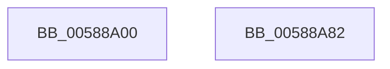

# HvlLpWritebackInvalidate

- RVA: `0x00588A00`–`0x00588A83` (길이 `131` bytes)
- VA: `0x0000000140588A00`
- 실행 섹션: `.text`
- PDB 이름 있음: `예`; PDB Function 태그: `아니요`
- unwind 정보 RVA: `0x000697A4`
- 디코드: `35`개 명령, `131/131` bytes 표시
- 미해석 바이트: `0` (있으면 어셈블리에 `.byte`로 보존)

> 이 문서는 커널 이미지의 기계어와 PDB 기호를 분석해 생성했습니다. 4번과 5번은 함수 원형과 자료형을 바이너리 사용 방식에서 추정한 C 해석이며 원본 소스 복구 결과는 아닙니다.

## 1. Dependencies

- 직접 호출 지점: **3**; 고유 호출 대상: **3**
- 직접 호출자로 확인된 함수: **0**
- RIP 상대 이미지 참조: **0**

### Outgoing calls
- `0x00588A37` → [HvlpAcquireHypercallPage](../47/HvlpAcquireHypercallPage_function_00471410.md) (function, `0x00471410`)
- `0x00588A60` → [HvcallInitiateHypercall](../31/HvcallInitiateHypercall_function_00313630.md) (function, `0x00313630`)
- `0x00588A75` → [HvlpReleaseHypercallPage](../31/HvlpReleaseHypercallPage_function_00313480.md) (function, `0x00313480`)

### Direct callers
- 이 함수 시작 RVA로 연결되는 직접 call은 확인되지 않았습니다. 간접 호출은 완전히 역산할 수 없습니다.

### Static image references
- 디코드된 RIP-relative 메모리 참조가 없습니다.

## 2. Other-region calls and transfers

- 다른 실행 섹션으로 향하는 call: **0**
- 별도 외부 분기/꼬리 이동을 확인하지 못했습니다.

## 3. Assembly (complete function range)

```asm
00588A00  40 53                           push rbx
00588A02  48 83 EC 40                     sub rsp, 0x40
00588A06  33 C0                           xor eax, eax
00588A08  48 C7 44 24 58 89 00 00 00      mov qword ptr [rsp + 0x58], 0x89
00588A11  8B D9                           mov ebx, ecx
00588A13  48 89 44 24 30                  mov qword ptr [rsp + 0x30], rax
00588A18  0F 57 C0                        xorps xmm0, xmm0
00588A1B  89 44 24 38                     mov dword ptr [rsp + 0x38], eax
00588A1F  45 33 C0                        xor r8d, r8d
00588A22  48 8D 4C 24 20                  lea rcx, [rsp + 0x20]
00588A27  8D 50 01                        lea edx, [rax + 1]
00588A2A  44 8D 48 20                     lea r9d, [rax + 0x20]
00588A2E  89 54 24 5C                     mov dword ptr [rsp + 0x5c], edx
00588A32  0F 11 44 24 20                  movups xmmword ptr [rsp + 0x20], xmm0
00588A37  E8 D4 89 EE FF                  call 0x140471410
00588A3C  33 C9                           xor ecx, ecx
00588A3E  45 33 C0                        xor r8d, r8d
00588A41  48 89 48 08                     mov qword ptr [rax + 8], rcx
00588A45  48 89 48 10                     mov qword ptr [rax + 0x10], rcx
00588A49  48 89 48 18                     mov qword ptr [rax + 0x18], rcx
00588A4D  48 8B 54 24 38                  mov rdx, qword ptr [rsp + 0x38]
00588A52  48 8B 4C 24 58                  mov rcx, qword ptr [rsp + 0x58]
00588A57  89 18                           mov dword ptr [rax], ebx
00588A59  C7 40 04 02 00 01 00            mov dword ptr [rax + 4], 0x10002
00588A60  E8 CB AB D8 FF                  call 0x140313630
00588A65  66 F7 D8                        neg ax
00588A68  48 8D 4C 24 20                  lea rcx, [rsp + 0x20]
00588A6D  1B DB                           sbb ebx, ebx
00588A6F  81 E3 01 00 00 C0               and ebx, 0xc0000001
00588A75  E8 06 AA D8 FF                  call 0x140313480
00588A7A  8B C3                           mov eax, ebx
00588A7C  48 83 C4 40                     add rsp, 0x40
00588A80  5B                              pop rbx
00588A81  C3                              ret
00588A82  CC                              int3
```

## 4. C-style interpretation (structured pseudocode)

```c
__int64 __fastcall HvlLpWritebackInvalidate(int a1, __int64 a2, int a3)
{
    __int64 result;
    __int64 v_rbx;
    __int64 v_rsp;
    unsigned int v_stack_m10;
    unsigned __int64 v_stack_m18;
    unsigned __int64 v_stack_m28;
    unsigned __int64 v_stack_p10;
    unsigned int v_stack_p14;

    v_rsp = (v_rsp) - (64);
    result = 0;
    v_stack_p10 = 137;
    v_stack_m18 = 0;
    v_stack_m10 = 0;
    a3 = 0;
    v_stack_p14 = (unsigned int)(result + 1);
    v_stack_m28 = v_xmm0;
    result = HvlpAcquireHypercallPage(v_stack_m28, result + 1, a3, result + 32);
    a1 = 0;
    a3 = 0;
    *(unsigned __int64 *)(result + 8) = 0;
    *(unsigned __int64 *)(result + 16) = 0;
    *(unsigned __int64 *)(result + 24) = 0;
    *(unsigned int *)(result) = (unsigned int)((unsigned int)(a1));
    *(unsigned int *)(result + 4) = 0x10002ULL;
    result = HvcallInitiateHypercall(v_stack_p10, v_stack_m10, a3, result + 32);
    result = (unsigned __int16)(-(result));
    v_rbx = (unsigned int)(((unsigned int)(a1)) & (0xC0000001ULL));
    result = HvlpReleaseHypercallPage(v_stack_m28, v_stack_m10, a3, result + 32);
    v_rsp = (v_rsp) + (64);
    return (unsigned int)((unsigned int)(v_rbx));
}
```

## 5. (Beta) C Style

```c
int64_t HvlLpWritebackInvalidate(int32_t Arg1, int64_t Arg2, int32_t Arg3)
{
    int64_t result;
    int64_t local_rbx;
    int64_t local_rsp;
    uint32_t v_stack_m10;
    uint64_t v_stack_m18;
    uint64_t v_stack_m28;
    uint64_t v_stack_p10;
    uint32_t v_stack_p14;

    local_rsp = (local_rsp) - (64);
    result = 0;
    v_stack_p10 = 137;
    v_stack_m18 = 0;
    v_stack_m10 = 0;
    Arg3 = 0;
    v_stack_p14 = (uint32_t)(result + 1);
    v_stack_m28 = v_xmm0;
    result = HvlpAcquireHypercallPage(v_stack_m28, result + 1, Arg3, result + 32);
    Arg1 = 0;
    Arg3 = 0;
    *(uint64_t *)(result + 0x8) = 0;
    *(uint64_t *)(result + 0x10) = 0;
    *(uint64_t *)(result + 0x18) = 0;
    *(uint32_t *)(result) = (uint32_t)((uint32_t)(Arg1));
    *(uint32_t *)(result + 0x4) = 0x10002ULL;
    result = HvcallInitiateHypercall(v_stack_p10, v_stack_m10, Arg3, result + 32);
    result = (uint16_t)(-(result));
    local_rbx = (uint32_t)(((uint32_t)(Arg1)) & (0xC0000001ULL));
    result = HvlpReleaseHypercallPage(v_stack_m28, v_stack_m10, Arg3, result + 32);
    local_rsp = (local_rsp) + (64);
    return (uint32_t)((uint32_t)(local_rbx));
}
```

## 6. Execution-region graph

[열기: 2D/3D 그래프와 함수 탐색 컨트롤 패널](../../../control-panel.html?section=text&rva=0x00588A00&view=graph)

- 2D 그래프는 위에서 아래로 흐르고, 3D 그래프는 빈 공간을 드래그해 회전합니다. Shift+드래그는 이동, 휠은 확대·축소, 함수 노드 선택은 대상 보고서 이동입니다.

### Static fallback


