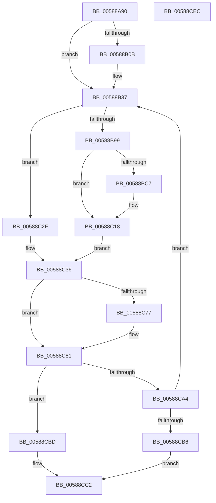

# HvlMapDeviceInterrupt

- RVA: `0x00588A90`–`0x00588CED` (길이 `605` bytes)
- VA: `0x0000000140588A90`
- 실행 섹션: `.text`
- PDB 이름 있음: `예`; PDB Function 태그: `아니요`
- unwind 정보 RVA: `0x000C67C4`
- 디코드: `153`개 명령, `605/605` bytes 표시
- 미해석 바이트: `0` (있으면 어셈블리에 `.byte`로 보존)

> 이 문서는 커널 이미지의 기계어와 PDB 기호를 분석해 생성했습니다. 4번과 5번은 함수 원형과 자료형을 바이너리 사용 방식에서 추정한 C 해석이며 원본 소스 복구 결과는 아닙니다.

## 1. Dependencies

- 직접 호출 지점: **18**; 고유 호출 대상: **10**
- 직접 호출자로 확인된 함수: **0**
- RIP 상대 이미지 참조: **1**

### Outgoing calls
- `0x00588AFA` → [memset](../6C/memset_function_006C6C40.md) (function, `0x006C6C40`)
- `0x00588B21` → [memset](../6C/memset_function_006C6C40.md) (function, `0x006C6C40`)
- `0x00588B32` → [KeAddGroupAffinityEx](../25/KeAddGroupAffinityEx_function_0025B6C0.md) (function, `0x0025B6C0`)
- `0x00588B4D` → [HvlpAcquireHypercallPage](../47/HvlpAcquireHypercallPage_function_00471410.md) (function, `0x00471410`)
- `0x00588B69` → [HvlpAcquireHypercallPage](../47/HvlpAcquireHypercallPage_function_00471410.md) (function, `0x00471410`)
- `0x00588B7A` → [memset](../6C/memset_function_006C6C40.md) (function, `0x006C6C40`)
- `0x00588BBD` → [HvlpAffinityToHvProcessorSet](../30/HvlpAffinityToHvProcessorSet_function_003068F4.md) (function, `0x003068F4`)
- `0x00588BCC` → [HvlpReleaseHypercallPage](../31/HvlpReleaseHypercallPage_function_00313480.md) (function, `0x00313480`)
- `0x00588BE0` → [HvlpAcquireHypercallPage](../47/HvlpAcquireHypercallPage_function_00471410.md) (function, `0x00471410`)
- `0x00588BF1` → [memset](../6C/memset_function_006C6C40.md) (function, `0x006C6C40`)
- `0x00588C13` → [HvlpAffinityToHvProcessorSet](../30/HvlpAffinityToHvProcessorSet_function_003068F4.md) (function, `0x003068F4`)
- `0x00588C68` → [HvcallInitiateHypercall](../31/HvcallInitiateHypercall_function_00313630.md) (function, `0x00313630`)
- `0x00588C86` → [HvlpReleaseHypercallPage](../31/HvlpReleaseHypercallPage_function_00313480.md) (function, `0x00313480`)
- `0x00588C90` → [HvlpReleaseHypercallPage](../31/HvlpReleaseHypercallPage_function_00313480.md) (function, `0x00313480`)
- `0x00588C98` → [HvlpHvStatusIsInsufficientMemory](../30/HvlpHvStatusIsInsufficientMemory_function_00307BB0.md) (function, `0x00307BB0`)
- `0x00588CA4` → [HvlpHandleInsufficientMemory](HvlpHandleInsufficientMemory_function_00584514.md) (function, `0x00584514`)
- `0x00588CBD` → [HvlpHvToNtStatus](../30/HvlpHvToNtStatus_function_00307BD8.md) (function, `0x00307BD8`)
- `0x00588CCC` → [_security_check_cookie](../6A/_security_check_cookie_function_006AC640.md) (function, `0x006AC640`)

### Direct callers
- 이 함수 시작 RVA로 연결되는 직접 call은 확인되지 않았습니다. 간접 호출은 완전히 역산할 수 없습니다.

### Static image references
- `0x00588AAF` → RVA `0x00E0A740` (`.data`; read)

## 2. Other-region calls and transfers

- 다른 실행 섹션으로 향하는 call: **0**
- 별도 외부 분기/꼬리 이동을 확인하지 못했습니다.

## 3. Assembly (complete function range)

```asm
00588A90  48 89 5C 24 08                  mov qword ptr [rsp + 8], rbx
00588A95  55                              push rbp
00588A96  56                              push rsi
00588A97  57                              push rdi
00588A98  41 54                           push r12
00588A9A  41 55                           push r13
00588A9C  41 56                           push r14
00588A9E  41 57                           push r15
00588AA0  48 8D AC 24 E0 FD FF FF         lea rbp, [rsp - 0x220]
00588AA8  48 81 EC 20 03 00 00            sub rsp, 0x320
00588AAF  48 8B 05 8A 1C 88 00            mov rax, qword ptr [rip + 0x881c8a]
00588AB6  48 33 C4                        xor rax, rsp
00588AB9  48 89 85 10 02 00 00            mov qword ptr [rbp + 0x210], rax
00588AC0  33 C0                           xor eax, eax
00588AC2  0F 57 C0                        xorps xmm0, xmm0
00588AC5  49 8B F0                        mov rsi, r8
00588AC8  48 89 44 24 38                  mov qword ptr [rsp + 0x38], rax
00588ACD  4C 8B FA                        mov r15, rdx
00588AD0  89 44 24 40                     mov dword ptr [rsp + 0x40], eax
00588AD4  4C 8B E9                        mov r13, rcx
00588AD7  48 89 44 24 58                  mov qword ptr [rsp + 0x58], rax
00588ADC  33 D2                           xor edx, edx
00588ADE  89 44 24 60                     mov dword ptr [rsp + 0x60], eax
00588AE2  41 B8 08 01 00 00               mov r8d, 0x108
00588AE8  48 8D 4C 24 70                  lea rcx, [rsp + 0x70]
00588AED  0F 11 44 24 28                  movups xmmword ptr [rsp + 0x28], xmm0
00588AF2  4D 8B E1                        mov r12, r9
00588AF5  0F 11 44 24 48                  movups xmmword ptr [rsp + 0x48], xmm0
00588AFA  E8 41 E1 13 00                  call 0x1406c6c40
00588AFF  33 FF                           xor edi, edi
00588B01  BB 01 00 00 00                  mov ebx, 1
00588B06  48 85 F6                        test rsi, rsi
00588B09  74 2C                           je 0x140588b37
00588B0B  33 D2                           xor edx, edx
00588B0D  48 C7 44 24 70 01 00 20 00      mov qword ptr [rsp + 0x70], 0x200001
00588B16  41 B8 00 01 00 00               mov r8d, 0x100
00588B1C  48 8D 4C 24 78                  lea rcx, [rsp + 0x78]
00588B21  E8 1A E1 13 00                  call 0x1406c6c40
00588B26  4C 8B 06                        mov r8, qword ptr [rsi]
00588B29  48 8D 4C 24 70                  lea rcx, [rsp + 0x70]
00588B2E  0F B7 56 08                     movzx edx, word ptr [rsi + 8]
00588B32  E8 89 2B CD FF                  call 0x14025b6c0
00588B37  41 B9 38 00 00 00               mov r9d, 0x38
00588B3D  4C 8D 85 80 00 00 00            lea r8, [rbp + 0x80]
00588B44  48 8D 4C 24 48                  lea rcx, [rsp + 0x48]
00588B49  41 8D 51 CA                     lea edx, [r9 - 0x36]
00588B4D  E8 BE 88 EE FF                  call 0x140471410
00588B52  41 B9 90 00 00 00               mov r9d, 0x90
00588B58  4C 8D 85 F0 00 00 00            lea r8, [rbp + 0xf0]
00588B5F  8B D3                           mov edx, ebx
00588B61  48 8D 4C 24 28                  lea rcx, [rsp + 0x28]
00588B66  4C 8B F0                        mov r14, rax
00588B69  E8 A2 88 EE FF                  call 0x140471410
00588B6E  33 D2                           xor edx, edx
00588B70  48 8B C8                        mov rcx, rax
00588B73  48 8B D8                        mov rbx, rax
00588B76  44 8D 42 48                     lea r8d, [rdx + 0x48]
00588B7A  E8 C1 E0 13 00                  call 0x1406c6c40
00588B7F  41 0F 10 07                     movups xmm0, xmmword ptr [r15]
00588B83  0F 11 43 28                     movups xmmword ptr [rbx + 0x28], xmm0
00588B87  41 0F 10 4F 10                  movups xmm1, xmmword ptr [r15 + 0x10]
00588B8C  0F 11 4B 38                     movups xmmword ptr [rbx + 0x38], xmm1
00588B90  48 85 F6                        test rsi, rsi
00588B93  0F 84 96 00 00 00               je 0x140588c2f
00588B99  8B 4C 24 28                     mov ecx, dword ptr [rsp + 0x28]
00588B9D  48 8D 53 40                     lea rdx, [rbx + 0x40]
00588BA1  80 E1 02                        and cl, 2
00588BA4  BF B0 0F 00 00                  mov edi, 0xfb0
00588BA9  F6 D9                           neg cl
00588BAB  48 8D 4C 24 70                  lea rcx, [rsp + 0x70]
00588BB0  45 1B C0                        sbb r8d, r8d
00588BB3  41 81 E0 90 F0 FF FF            and r8d, 0xfffff090
00588BBA  44 03 C7                        add r8d, edi
00588BBD  E8 32 DD D7 FF                  call 0x1403068f4
00588BC2  83 F8 FF                        cmp eax, -1
00588BC5  75 51                           jne 0x140588c18
00588BC7  48 8D 4C 24 28                  lea rcx, [rsp + 0x28]
00588BCC  E8 AF A8 D8 FF                  call 0x140313480
00588BD1  45 33 C9                        xor r9d, r9d
00588BD4  48 8D 4C 24 28                  lea rcx, [rsp + 0x28]
00588BD9  45 33 C0                        xor r8d, r8d
00588BDC  41 8D 51 01                     lea edx, [r9 + 1]
00588BE0  E8 2B 88 EE FF                  call 0x140471410
00588BE5  33 D2                           xor edx, edx
00588BE7  48 8B C8                        mov rcx, rax
00588BEA  48 8B D8                        mov rbx, rax
00588BED  44 8D 42 48                     lea r8d, [rdx + 0x48]
00588BF1  E8 4A E0 13 00                  call 0x1406c6c40
00588BF6  41 0F 10 07                     movups xmm0, xmmword ptr [r15]
00588BFA  48 8D 53 40                     lea rdx, [rbx + 0x40]
00588BFE  44 8B C7                        mov r8d, edi
00588C01  48 8D 4C 24 70                  lea rcx, [rsp + 0x70]
00588C06  0F 11 43 28                     movups xmmword ptr [rbx + 0x28], xmm0
00588C0A  41 0F 10 4F 10                  movups xmm1, xmmword ptr [r15 + 0x10]
00588C0F  0F 11 4B 38                     movups xmmword ptr [rbx + 0x38], xmm1
00588C13  E8 DC DC D7 FF                  call 0x1403068f4
00588C18  83 4B 3C 02                     or dword ptr [rbx + 0x3c], 2
00588C1C  83 C0 50                        add eax, 0x50
00588C1F  83 F8 48                        cmp eax, 0x48
00588C22  8D 78 B8                        lea edi, [rax - 0x48]
00588C25  B8 00 00 00 00                  mov eax, 0
00588C2A  0F 46 F8                        cmovbe edi, eax
00588C2D  EB 07                           jmp 0x140588c36
00588C2F  0F 57 C0                        xorps xmm0, xmm0
00588C32  0F 11 43 38                     movups xmmword ptr [rbx + 0x38], xmm0
00588C36  4C 8B 44 24 60                  mov r8, qword ptr [rsp + 0x60]
00588C3B  8D 47 07                        lea eax, [rdi + 7]
00588C3E  48 8B 54 24 40                  mov rdx, qword ptr [rsp + 0x40]
00588C43  48 83 0B FF                     or qword ptr [rbx], 0xffffffffffffffff
00588C47  C1 E0 0E                        shl eax, 0xe
00588C4A  25 00 00 FE 03                  and eax, 0x3fe0000
00588C4F  48 C7 44 24 20 7C 00 00 00      mov qword ptr [rsp + 0x20], 0x7c
00588C58  83 C8 7C                        or eax, 0x7c
00588C5B  4C 89 6B 08                     mov qword ptr [rbx + 8], r13
00588C5F  89 44 24 20                     mov dword ptr [rsp + 0x20], eax
00588C63  48 8B 4C 24 20                  mov rcx, qword ptr [rsp + 0x20]
00588C68  E8 C3 A9 D8 FF                  call 0x140313630
00588C6D  33 FF                           xor edi, edi
00588C6F  48 8B D8                        mov rbx, rax
00588C72  66 85 C0                        test ax, ax
00588C75  75 0A                           jne 0x140588c81
00588C77  41 0F 10 06                     movups xmm0, xmmword ptr [r14]
00588C7B  F3 41 0F 7F 04 24               movdqu xmmword ptr [r12], xmm0
00588C81  48 8D 4C 24 28                  lea rcx, [rsp + 0x28]
00588C86  E8 F5 A7 D8 FF                  call 0x140313480
00588C8B  48 8D 4C 24 48                  lea rcx, [rsp + 0x48]
00588C90  E8 EB A7 D8 FF                  call 0x140313480
00588C95  0F B7 CB                        movzx ecx, bx
00588C98  E8 13 EF D7 FF                  call 0x140307bb0
00588C9D  0F B7 CB                        movzx ecx, bx
00588CA0  84 C0                           test al, al
00588CA2  74 19                           je 0x140588cbd
00588CA4  E8 6B B8 FF FF                  call 0x140584514
00588CA9  BB 01 00 00 00                  mov ebx, 1
00588CAE  85 C0                           test eax, eax
00588CB0  0F 89 81 FE FF FF               jns 0x140588b37
00588CB6  B8 9A 00 00 C0                  mov eax, 0xc000009a
00588CBB  EB 05                           jmp 0x140588cc2
00588CBD  E8 16 EF D7 FF                  call 0x140307bd8
00588CC2  48 8B 8D 10 02 00 00            mov rcx, qword ptr [rbp + 0x210]
00588CC9  48 33 CC                        xor rcx, rsp
00588CCC  E8 6F 39 12 00                  call 0x1406ac640
00588CD1  48 8B 9C 24 60 03 00 00         mov rbx, qword ptr [rsp + 0x360]
00588CD9  48 81 C4 20 03 00 00            add rsp, 0x320
00588CE0  41 5F                           pop r15
00588CE2  41 5E                           pop r14
00588CE4  41 5D                           pop r13
00588CE6  41 5C                           pop r12
00588CE8  5F                              pop rdi
00588CE9  5E                              pop rsi
00588CEA  5D                              pop rbp
00588CEB  C3                              ret
00588CEC  CC                              int3
```

## 4. C-style interpretation (structured pseudocode)

```c
__int64 __fastcall HvlMapDeviceInterrupt(__int64 a1, __int64 a2, __int64 a3, __int64 a4)
{
    __int64 result;
    __int64 v_rbx;
    __int64 v_rdi;
    __int64 v_rsp;
    unsigned __int64 v_stack_m168;
    unsigned __int64 v_stack_m1D8;
    unsigned __int64 v_stack_m258;
    unsigned __int64 v_stack_m2E0;
    unsigned __int64 v_stack_m2E8;
    unsigned int v_stack_m2F8;
    unsigned __int64 v_stack_m300;
    unsigned __int64 v_stack_m310;
    unsigned int v_stack_m318;
    unsigned __int64 v_stack_m320;
    unsigned __int64 v_stack_m330;
    unsigned __int64 v_stack_m338;
    unsigned __int64 v_stack_m48;
    unsigned __int64 v_stack_p8;

    v_stack_p8 = v_rbx;
    v_rsp = (v_rsp) - (800);
    result = (*(unsigned __int64 *)(v_rip + 8920202)) ^ (v_rsp);
    v_stack_m48 = result;
    result = 0;
    v_stack_m320 = 0;
    v_stack_m318 = 0;
    v_stack_m300 = 0;
    a2 = 0;
    v_stack_m2F8 = 0;
    v_stack_m330 = v_xmm0;
    v_stack_m310 = v_xmm0;
    result = memset(v_stack_m2E8, a2, 264, a4);
    v_rdi = 0;
    if (a3 != 0) {
        a2 = 0;
        v_stack_m2E8 = 0x200001ULL;
        a3 = 256;
        a1 = v_stack_m2E0;
        result = memset(a1, a2, a3, a4);
        a3 = *(unsigned __int64 *)(a3);
        a1 = v_stack_m2E8;
        a2 = *(unsigned __int16 *)(a3 + 8);
        result = KeAddGroupAffinityEx(a1, a2, a3, a4);
    }
    result = HvlpAcquireHypercallPage(v_stack_m310, 56 - 54, v_stack_m1D8, 56);
    result = HvlpAcquireHypercallPage(v_stack_m330, 1, v_stack_m168, 144);
    a2 = 0;
    result = memset(result, a2, a2 + 72, 144);
    *(unsigned __int64 *)(result + 40) = v_xmm0;
    *(unsigned __int64 *)(result + 56) = v_xmm1;
    if (a3 == 0) goto loc_00588C2F;
    a1 = (unsigned __int8)(((unsigned int)(v_stack_m330)) & (2));
    a1 = (unsigned __int8)(-(a1));
    a3 = (unsigned int)((a2 + 72) & (0xFFFFF090ULL));
    a3 = (unsigned int)((a3) + ((unsigned int)((unsigned int)(0xFB0ULL))));
    result = HvlpAffinityToHvProcessorSet(v_stack_m2E8, result + 64, a3, 144);
    v_rbx = result;
    if (((unsigned int)(result)) == -1) {
        a1 = v_stack_m330;
        result = HvlpReleaseHypercallPage(a1, result + 64, a3, 144);
        a4 = 0;
        a1 = v_stack_m330;
        a3 = 0;
        a2 = a4 + 1;
        result = HvlpAcquireHypercallPage(a1, a2, a3, a4);
        a2 = 0;
        a1 = result;
        v_rbx = result;
        a3 = a2 + 72;
        result = memset(a1, a2, a3, a4);
        a2 = v_rbx + 64;
        a3 = (unsigned int)((unsigned int)(0xFB0ULL));
        a1 = v_stack_m2E8;
        *(unsigned __int64 *)(v_rbx + 40) = v_xmm0;
        *(unsigned __int64 *)(v_rbx + 56) = v_xmm1;
        result = HvlpAffinityToHvProcessorSet(a1, a2, a3, a4);
    }
    result = (unsigned int)((result) + (80));
    v_rdi = result - 72;
    if (((unsigned int)(result)) <= 72) { v_rdi = 0; }
    goto loc_00588C36;
loc_00588C2F:
    *(unsigned __int64 *)(v_rbx + 56) = v_xmm0;
loc_00588C36:
    result = (unsigned int)((v_rdi + 7) << (14));
    result = (unsigned int)((result) & (0x3FE0000ULL));
    v_stack_m338 = 124;
    result = (unsigned int)((result) | (124));
    *(unsigned __int64 *)(v_rbx + 8) = a1;
    v_stack_m338 = (unsigned int)(result);
    result = HvcallInitiateHypercall(v_stack_m338, v_stack_m318, v_stack_m2F8, a4);
    v_rdi = 0;
    if ((unsigned __int16)(result) == 0) {
        *(unsigned __int64 *)(a4) = v_xmm0;
    }
    result = HvlpReleaseHypercallPage(v_stack_m330, v_stack_m318, v_stack_m2F8, a4);
    result = HvlpReleaseHypercallPage(v_stack_m310, v_stack_m318, v_stack_m2F8, a4);
    result = HvlpHvStatusIsInsufficientMemory((unsigned __int16)(result), v_stack_m318, v_stack_m2F8, a4);
    if ((unsigned __int8)(result) == 0) goto loc_00588CBD;
    result = HvlpHandleInsufficientMemory((unsigned __int16)(result), v_stack_m318, v_stack_m2F8, a4);
    if (!sign_flag) goto loc_00588B37;
    goto loc_00588CC2;
loc_00588CBD:
    result = HvlpHvToNtStatus((unsigned __int16)(result), v_stack_m318, v_stack_m2F8, a4);
loc_00588CC2:
    a1 = (v_stack_m48) ^ (v_rsp);
    result = _security_check_cookie(a1, v_stack_m318, v_stack_m2F8, a4);
    v_rsp = (v_rsp) + (800);
    return result;
}
```

## 5. (Beta) C Style

```c
int64_t HvlMapDeviceInterrupt(int64_t Arg1, void *Arg2, int64_t Arg3, void *Arg4)
{
    uint8_t *arg2 = (uint8_t *)Arg2;
    uint8_t *arg4 = (uint8_t *)Arg4;

    int64_t result;
    int64_t local_rbx;
    int64_t local_rdi;
    int64_t local_rsp;
    uint64_t v_stack_m168;
    uint64_t v_stack_m1D8;
    uint64_t v_stack_m258;
    uint64_t v_stack_m2E0;
    uint64_t v_stack_m2E8;
    uint32_t v_stack_m2F8;
    uint64_t v_stack_m300;
    uint64_t v_stack_m310;
    uint32_t v_stack_m318;
    uint64_t v_stack_m320;
    uint64_t v_stack_m330;
    uint64_t v_stack_m338;
    uint64_t v_stack_m48;
    uint64_t v_stack_p8;

    v_stack_p8 = local_rbx;
    local_rsp = (local_rsp) - (800);
    result = (*(uint64_t *)(v_rip + 0x881C8A)) ^ (local_rsp);
    v_stack_m48 = result;
    result = 0;
    v_stack_m320 = 0;
    v_stack_m318 = 0;
    v_stack_m300 = 0;
    Arg2 = 0;
    v_stack_m2F8 = 0;
    v_stack_m330 = v_xmm0;
    v_stack_m310 = v_xmm0;
    result = memset(v_stack_m2E8, Arg2, 264, Arg4);
    local_rdi = 0;
    if (Arg3 != 0) {
        Arg2 = 0;
        v_stack_m2E8 = 0x200001ULL;
        Arg3 = 256;
        Arg1 = v_stack_m2E0;
        result = memset(Arg1, Arg2, Arg3, Arg4);
        Arg3 = *(uint64_t *)(Arg3);
        Arg1 = v_stack_m2E8;
        Arg2 = *(uint16_t *)(Arg3 + 0x8);
        result = KeAddGroupAffinityEx(Arg1, Arg2, Arg3, Arg4);
    }
    result = HvlpAcquireHypercallPage(v_stack_m310, 56 - 54, v_stack_m1D8, 56);
    result = HvlpAcquireHypercallPage(v_stack_m330, 1, v_stack_m168, 144);
    Arg2 = 0;
    result = memset(result, Arg2, Arg2 + 72, 144);
    *(uint64_t *)(result + 0x28) = v_xmm0;
    *(uint64_t *)(result + 0x38) = v_xmm1;
    if (Arg3 == 0) goto loc_00588C2F;
    Arg1 = (uint8_t)(((uint32_t)(v_stack_m330)) & (2));
    Arg1 = (uint8_t)(-(Arg1));
    Arg3 = (uint32_t)((Arg2 + 72) & (0xFFFFF090ULL));
    Arg3 = (uint32_t)((Arg3) + ((uint32_t)((uint32_t)(0xFB0ULL))));
    result = HvlpAffinityToHvProcessorSet(v_stack_m2E8, result + 64, Arg3, 144);
    local_rbx = result;
    if (((uint32_t)(result)) == -1) {
        Arg1 = v_stack_m330;
        result = HvlpReleaseHypercallPage(Arg1, result + 64, Arg3, 144);
        Arg4 = 0;
        Arg1 = v_stack_m330;
        Arg3 = 0;
        Arg2 = Arg4 + 1;
        result = HvlpAcquireHypercallPage(Arg1, Arg2, Arg3, Arg4);
        Arg2 = 0;
        Arg1 = result;
        local_rbx = result;
        Arg3 = Arg2 + 72;
        result = memset(Arg1, Arg2, Arg3, Arg4);
        Arg2 = local_rbx + 64;
        Arg3 = (uint32_t)((uint32_t)(0xFB0ULL));
        Arg1 = v_stack_m2E8;
        *(uint64_t *)(local_rbx + 0x28) = v_xmm0;
        *(uint64_t *)(local_rbx + 0x38) = v_xmm1;
        result = HvlpAffinityToHvProcessorSet(Arg1, Arg2, Arg3, Arg4);
    }
    result = (uint32_t)((result) + (80));
    local_rdi = result - 72;
    if (((uint32_t)(result)) <= 72) { local_rdi = 0; }
    goto loc_00588C36;
loc_00588C2F:
    *(uint64_t *)(local_rbx + 0x38) = v_xmm0;
loc_00588C36:
    result = (uint32_t)((local_rdi + 7) << (14));
    result = (uint32_t)((result) & (0x3FE0000ULL));
    v_stack_m338 = 124;
    result = (uint32_t)((result) | (124));
    *(uint64_t *)(local_rbx + 0x8) = Arg1;
    v_stack_m338 = (uint32_t)(result);
    result = HvcallInitiateHypercall(v_stack_m338, v_stack_m318, v_stack_m2F8, Arg4);
    local_rdi = 0;
    if ((uint16_t)(result) == 0) {
        *(uint64_t *)(arg4) = v_xmm0;
    }
    result = HvlpReleaseHypercallPage(v_stack_m330, v_stack_m318, v_stack_m2F8, Arg4);
    result = HvlpReleaseHypercallPage(v_stack_m310, v_stack_m318, v_stack_m2F8, Arg4);
    result = HvlpHvStatusIsInsufficientMemory((uint16_t)(result), v_stack_m318, v_stack_m2F8, Arg4);
    if ((uint8_t)(result) == 0) goto loc_00588CBD;
    result = HvlpHandleInsufficientMemory((uint16_t)(result), v_stack_m318, v_stack_m2F8, Arg4);
    if (!sign_flag) goto loc_00588B37;
    goto loc_00588CC2;
loc_00588CBD:
    result = HvlpHvToNtStatus((uint16_t)(result), v_stack_m318, v_stack_m2F8, Arg4);
loc_00588CC2:
    Arg1 = (v_stack_m48) ^ (local_rsp);
    result = _security_check_cookie(Arg1, v_stack_m318, v_stack_m2F8, Arg4);
    local_rsp = (local_rsp) + (800);
    return result;
}
```

### 관측된 메모리 오프셋

구조체 형식이 확인되지 않은 접근은 인자 기준의 오프셋으로만 기록했습니다.

| 기준 인자 | 오프셋 표현 | 폭 (bit) | 접근 |
|---|---:|---:|---|
| `Arg2` | `+ 0x0` | `128` | `R` |
| `Arg2` | `+ 0x10` | `128` | `R` |
| `Arg4` | `+ 0x0` | `128` | `W` |

## 6. Execution-region graph

[열기: 2D/3D 그래프와 함수 탐색 컨트롤 패널](../../../control-panel.html?section=text&rva=0x00588A90&view=graph)

- 2D 그래프는 위에서 아래로 흐르고, 3D 그래프는 빈 공간을 드래그해 회전합니다. Shift+드래그는 이동, 휠은 확대·축소, 함수 노드 선택은 대상 보고서 이동입니다.

### Static fallback


