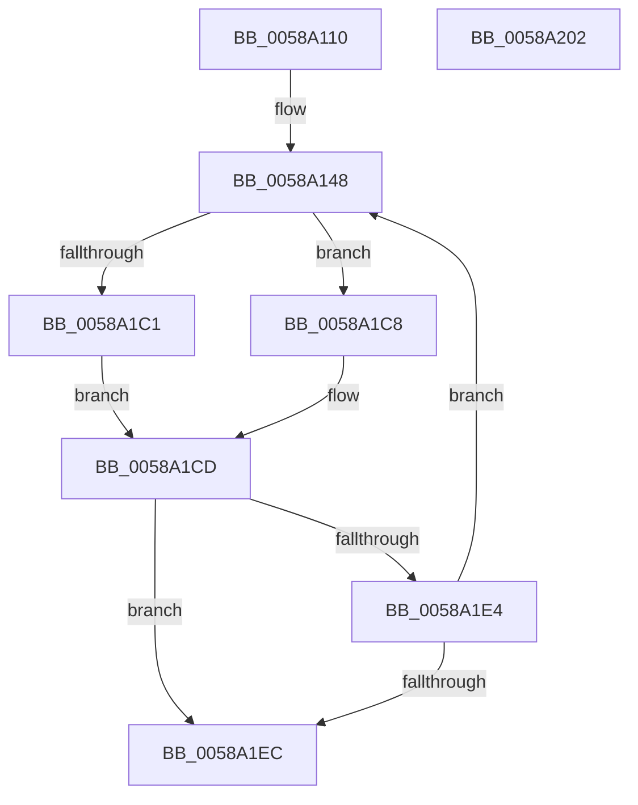

# HvlMapDmaRanges

- RVA: `0x0058A110`–`0x0058A203` (길이 `243` bytes)
- VA: `0x000000014058A110`
- 실행 섹션: `.text`
- PDB 이름 있음: `예`; PDB Function 태그: `아니요`
- unwind 정보 RVA: `0x000C6824`
- 디코드: `69`개 명령, `243/243` bytes 표시
- 미해석 바이트: `0` (있으면 어셈블리에 `.byte`로 보존)

> 이 문서는 커널 이미지의 기계어와 PDB 기호를 분석해 생성했습니다. 4번과 5번은 함수 원형과 자료형을 바이너리 사용 방식에서 추정한 C 해석이며 원본 소스 복구 결과는 아닙니다.

## 1. Dependencies

- 직접 호출 지점: **7**; 고유 호출 대상: **7**
- 직접 호출자로 확인된 함수: **0**
- RIP 상대 이미지 참조: **0**

### Outgoing calls
- `0x0058A157` → [HvlpAcquireHypercallPage](../47/HvlpAcquireHypercallPage_function_00471410.md) (function, `0x00471410`)
- `0x0058A17F` → [memcpy](../6C/memcpy_function_006C6840.md) (function, `0x006C6840`)
- `0x0058A19B` → [HvcallInitiateHypercall](../31/HvcallInitiateHypercall_function_00313630.md) (function, `0x00313630`)
- `0x0058A1AD` → [HvlpReleaseHypercallPage](../31/HvlpReleaseHypercallPage_function_00313480.md) (function, `0x00313480`)
- `0x0058A1B5` → [HvlpHvStatusIsInsufficientMemory](../30/HvlpHvStatusIsInsufficientMemory_function_00307BB0.md) (function, `0x00307BB0`)
- `0x0058A1C1` → [HvlpHvToNtStatus](../30/HvlpHvToNtStatus_function_00307BD8.md) (function, `0x00307BD8`)
- `0x0058A1C8` → [HvlpHandleInsufficientMemory](HvlpHandleInsufficientMemory_function_00584514.md) (function, `0x00584514`)

### Direct callers
- 이 함수 시작 RVA로 연결되는 직접 call은 확인되지 않았습니다. 간접 호출은 완전히 역산할 수 없습니다.

### Static image references
- 디코드된 RIP-relative 메모리 참조가 없습니다.

## 2. Other-region calls and transfers

- 다른 실행 섹션으로 향하는 call: **0**
- 별도 외부 분기/꼬리 이동을 확인하지 못했습니다.

## 3. Assembly (complete function range)

```asm
0058A110  48 89 5C 24 08                  mov qword ptr [rsp + 8], rbx
0058A115  48 89 6C 24 18                  mov qword ptr [rsp + 0x18], rbp
0058A11A  56                              push rsi
0058A11B  57                              push rdi
0058A11C  41 57                           push r15
0058A11E  48 83 EC 40                     sub rsp, 0x40
0058A122  33 C0                           xor eax, eax
0058A124  0F 57 C0                        xorps xmm0, xmm0
0058A127  41 21 00                        and dword ptr [r8], eax
0058A12A  49 8B F8                        mov rdi, r8
0058A12D  0F 11 44 24 20                  movups xmmword ptr [rsp + 0x20], xmm0
0058A132  48 89 44 24 30                  mov qword ptr [rsp + 0x30], rax
0058A137  48 8B EA                        mov rbp, rdx
0058A13A  89 44 24 38                     mov dword ptr [rsp + 0x38], eax
0058A13E  8B F1                           mov esi, ecx
0058A140  8B D9                           mov ebx, ecx
0058A142  41 BF 00 01 00 00               mov r15d, 0x100
0058A148  45 33 C9                        xor r9d, r9d
0058A14B  48 8D 4C 24 20                  lea rcx, [rsp + 0x20]
0058A150  45 33 C0                        xor r8d, r8d
0058A153  41 8D 51 01                     lea edx, [r9 + 1]
0058A157  E8 B4 72 EE FF                  call 0x140471410
0058A15C  8B 17                           mov edx, dword ptr [rdi]
0058A15E  41 3B DF                        cmp ebx, r15d
0058A161  48 8B C8                        mov rcx, rax
0058A164  48 C7 44 24 68 08 01 00 00      mov qword ptr [rsp + 0x68], 0x108
0058A16D  41 0F 43 DF                     cmovae ebx, r15d
0058A171  48 C1 E2 04                     shl rdx, 4
0058A175  44 8B C3                        mov r8d, ebx
0058A178  48 03 D5                        add rdx, rbp
0058A17B  49 C1 E0 04                     shl r8, 4
0058A17F  E8 BC C6 13 00                  call 0x1406c6840
0058A184  48 8B 54 24 38                  mov rdx, qword ptr [rsp + 0x38]
0058A189  81 E3 FF 0F 00 00               and ebx, 0xfff
0058A18F  89 5C 24 6C                     mov dword ptr [rsp + 0x6c], ebx
0058A193  45 33 C0                        xor r8d, r8d
0058A196  48 8B 4C 24 68                  mov rcx, qword ptr [rsp + 0x68]
0058A19B  E8 90 94 D8 FF                  call 0x140313630
0058A1A0  48 8D 4C 24 20                  lea rcx, [rsp + 0x20]
0058A1A5  48 89 44 24 68                  mov qword ptr [rsp + 0x68], rax
0058A1AA  48 8B D8                        mov rbx, rax
0058A1AD  E8 CE 92 D8 FF                  call 0x140313480
0058A1B2  0F B7 CB                        movzx ecx, bx
0058A1B5  E8 F6 D9 D7 FF                  call 0x140307bb0
0058A1BA  0F B7 CB                        movzx ecx, bx
0058A1BD  84 C0                           test al, al
0058A1BF  75 07                           jne 0x14058a1c8
0058A1C1  E8 12 DA D7 FF                  call 0x140307bd8
0058A1C6  EB 05                           jmp 0x14058a1cd
0058A1C8  E8 47 A3 FF FF                  call 0x140584514
0058A1CD  44 8B C0                        mov r8d, eax
0058A1D0  8B DE                           mov ebx, esi
0058A1D2  8B 44 24 6C                     mov eax, dword ptr [rsp + 0x6c]
0058A1D6  25 FF 0F 00 00                  and eax, 0xfff
0058A1DB  01 07                           add dword ptr [rdi], eax
0058A1DD  2B 1F                           sub ebx, dword ptr [rdi]
0058A1DF  45 85 C0                        test r8d, r8d
0058A1E2  78 08                           js 0x14058a1ec
0058A1E4  85 DB                           test ebx, ebx
0058A1E6  0F 85 5C FF FF FF               jne 0x14058a148
0058A1EC  48 8B 5C 24 60                  mov rbx, qword ptr [rsp + 0x60]
0058A1F1  41 8B C0                        mov eax, r8d
0058A1F4  48 8B 6C 24 70                  mov rbp, qword ptr [rsp + 0x70]
0058A1F9  48 83 C4 40                     add rsp, 0x40
0058A1FD  41 5F                           pop r15
0058A1FF  5F                              pop rdi
0058A200  5E                              pop rsi
0058A201  C3                              ret
0058A202  CC                              int3
```

## 4. C-style interpretation (structured pseudocode)

```c
__int64 __fastcall HvlMapDmaRanges(int a1, __int64 a2, __int64 a3, int a4)
{
    __int64 result;
    __int64 v_rbx;
    __int64 v_rsp;
    unsigned int v_stack_m20;
    unsigned __int64 v_stack_m28;
    unsigned __int64 v_stack_m38;
    unsigned __int64 v_stack_p10;
    unsigned int v_stack_p14;
    unsigned __int64 v_stack_p18;
    unsigned __int64 v_stack_p8;

    v_stack_p8 = v_rbx;
    v_stack_p18 = v_rbp;
    v_rsp = (v_rsp) - (64);
    result = 0;
    v_stack_m38 = v_xmm0;
    v_stack_m28 = 0;
    v_stack_m20 = 0;
loc_0058A148:
    a4 = 0;
    a3 = 0;
    result = HvlpAcquireHypercallPage(v_stack_m38, a4 + 1, a3, a4);
    v_stack_p10 = 264;
    v_rbx = (unsigned int)(a1);
    if (((unsigned int)((unsigned int)(a1))) >= 256) { v_rbx = 256; }
    a2 = ((unsigned int)(*(unsigned int *)(a3))) << (4);
    a2 = (a2) + (a2);
    a3 = ((unsigned int)((unsigned int)(v_rbx))) << (4);
    result = memcpy(result, a2, a3, a4);
    v_rbx = (unsigned int)((v_rbx) & (0xFFFULL));
    v_stack_p14 = (unsigned int)(v_rbx);
    a3 = 0;
    result = HvcallInitiateHypercall(v_stack_p10, v_stack_m20, a3, a4);
    v_stack_p10 = result;
    result = HvlpReleaseHypercallPage(v_stack_m38, v_stack_m20, a3, a4);
    result = HvlpHvStatusIsInsufficientMemory((unsigned __int16)(result), v_stack_m20, a3, a4);
    if ((unsigned __int8)(result) != 0) goto loc_0058A1C8;
    result = HvlpHvToNtStatus((unsigned __int16)(result), v_stack_m20, a3, a4);
    goto loc_0058A1CD;
loc_0058A1C8:
    result = HvlpHandleInsufficientMemory((unsigned __int16)(result), v_stack_m20, a3, a4);
loc_0058A1CD:
    result = (unsigned int)(((unsigned int)(v_stack_p14)) & (0xFFFULL));
    v_rbx = (unsigned int)(((unsigned int)((unsigned int)((unsigned int)(a1)))) - (*(unsigned int *)(a3)));
    if (sign_flag) goto loc_0058A1EC;
    if ((unsigned int)(v_rbx) != 0) goto loc_0058A148;
loc_0058A1EC:
    v_rsp = (v_rsp) + (64);
    return (unsigned int)((unsigned int)((unsigned int)((unsigned int)(result))));
}
```

## 5. (Beta) C Style

```c
int64_t HvlMapDmaRanges(int32_t Arg1, int64_t Arg2, void *Arg3, int32_t Arg4)
{
    uint8_t *arg3 = (uint8_t *)Arg3;

    int64_t result;
    int64_t local_rbx;
    int64_t local_rsp;
    uint32_t v_stack_m20;
    uint64_t v_stack_m28;
    uint64_t v_stack_m38;
    uint64_t v_stack_p10;
    uint32_t v_stack_p14;
    uint64_t v_stack_p18;
    uint64_t v_stack_p8;

    v_stack_p8 = local_rbx;
    v_stack_p18 = local_rbp;
    local_rsp = (local_rsp) - (64);
    result = 0;
    v_stack_m38 = v_xmm0;
    v_stack_m28 = 0;
    v_stack_m20 = 0;
loc_0058A148:
    Arg4 = 0;
    Arg3 = 0;
    result = HvlpAcquireHypercallPage(v_stack_m38, Arg4 + 1, Arg3, Arg4);
    v_stack_p10 = 264;
    local_rbx = (uint32_t)(Arg1);
    if (((uint32_t)((uint32_t)(Arg1))) >= 256) { local_rbx = 256; }
    Arg2 = ((uint32_t)(*(uint32_t *)(arg3))) << (4);
    Arg2 = (Arg2) + (Arg2);
    Arg3 = ((uint32_t)((uint32_t)(local_rbx))) << (4);
    result = memcpy(result, Arg2, Arg3, Arg4);
    local_rbx = (uint32_t)((local_rbx) & (0xFFFULL));
    v_stack_p14 = (uint32_t)(local_rbx);
    Arg3 = 0;
    result = HvcallInitiateHypercall(v_stack_p10, v_stack_m20, Arg3, Arg4);
    v_stack_p10 = result;
    result = HvlpReleaseHypercallPage(v_stack_m38, v_stack_m20, Arg3, Arg4);
    result = HvlpHvStatusIsInsufficientMemory((uint16_t)(result), v_stack_m20, Arg3, Arg4);
    if ((uint8_t)(result) != 0) goto loc_0058A1C8;
    result = HvlpHvToNtStatus((uint16_t)(result), v_stack_m20, Arg3, Arg4);
    goto loc_0058A1CD;
loc_0058A1C8:
    result = HvlpHandleInsufficientMemory((uint16_t)(result), v_stack_m20, Arg3, Arg4);
loc_0058A1CD:
    result = (uint32_t)(((uint32_t)(v_stack_p14)) & (0xFFFULL));
    local_rbx = (uint32_t)(((uint32_t)((uint32_t)((uint32_t)(Arg1)))) - (*(uint32_t *)(arg3)));
    if (sign_flag) goto loc_0058A1EC;
    if ((uint32_t)(local_rbx) != 0) goto loc_0058A148;
loc_0058A1EC:
    local_rsp = (local_rsp) + (64);
    return (uint32_t)((uint32_t)((uint32_t)((uint32_t)(result))));
}
```

### 관측된 메모리 오프셋

구조체 형식이 확인되지 않은 접근은 인자 기준의 오프셋으로만 기록했습니다.

| 기준 인자 | 오프셋 표현 | 폭 (bit) | 접근 |
|---|---:|---:|---|
| `Arg3` | `+ 0x0` | `32` | `R` |
| `Arg3` | `+ 0x0` | `32` | `R/W` |

## 6. Execution-region graph

[열기: 2D/3D 그래프와 함수 탐색 컨트롤 패널](../../../control-panel.html?section=text&rva=0x0058A110&view=graph)

- 2D 그래프는 위에서 아래로 흐르고, 3D 그래프는 빈 공간을 드래그해 회전합니다. Shift+드래그는 이동, 휠은 확대·축소, 함수 노드 선택은 대상 보고서 이동입니다.

### Static fallback


