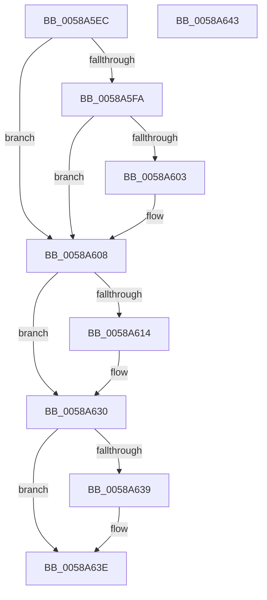

# HvlMarkHiberPhase

- RVA: `0x0058A5EC`–`0x0058A644` (길이 `88` bytes)
- VA: `0x000000014058A5EC`
- 실행 섹션: `.text`
- PDB 이름 있음: `예`; PDB Function 태그: `아니요`
- unwind 정보 RVA: `0x0005D2F4`
- 디코드: `22`개 명령, `88/88` bytes 표시
- 미해석 바이트: `0` (있으면 어셈블리에 `.byte`로 보존)

> 이 문서는 커널 이미지의 기계어와 PDB 기호를 분석해 생성했습니다. 4번과 5번은 함수 원형과 자료형을 바이너리 사용 방식에서 추정한 C 해석이며 원본 소스 복구 결과는 아닙니다.

## 1. Dependencies

- 직접 호출 지점: **3**; 고유 호출 대상: **3**
- 직접 호출자로 확인된 함수: **1**
- RIP 상대 이미지 참조: **5**

### Outgoing calls
- `0x0058A603` → [HvlpMarkHypervisorPagesForHibernation](HvlpMarkHypervisorPagesForHibernation_function_0058AE08.md) (function, `0x0058AE08`)
- `0x0058A62B` → [PoSetHiberRange](../47/PoSetHiberRange_function_0047C580.md) (function, `0x0047C580`)
- `0x0058A639` → [HvlpMarkHvlPagesForHibernation](HvlpMarkHvlPagesForHibernation_function_0058AD34.md) (function, `0x0058AD34`)

### Direct callers
- [PopMarkComponentsBootPhase](../../pagelk/B6/PopMarkComponentsBootPhase_function_00B6E0E4.md) at `0x00B6E27C`

### Static image references
- `0x0058A5F0` → RVA `0x00FC6A90` (`ALMOSTRO`; read)
- `0x0058A5FA` → RVA `0x00FC6A84` (`ALMOSTRO`; read)
- `0x0058A608` → RVA `0x00F8ED88` (`.data`; read)
- `0x0058A614` → RVA `0x00F8ED98` (`.data`; read)
- `0x0058A630` → RVA `0x00FC6A97` (`ALMOSTRO`; read)

## 2. Other-region calls and transfers

- 다른 실행 섹션으로 향하는 call: **0**
- 별도 외부 분기/꼬리 이동을 확인하지 못했습니다.

## 3. Assembly (complete function range)

```asm
0058A5EC  48 83 EC 38                     sub rsp, 0x38
0058A5F0  8B 05 9A C4 A3 00               mov eax, dword ptr [rip + 0xa3c49a]
0058A5F6  A8 02                           test al, 2
0058A5F8  74 0E                           je 0x14058a608
0058A5FA  80 3D 83 C4 A3 00 00            cmp byte ptr [rip + 0xa3c483], 0
0058A601  75 05                           jne 0x14058a608
0058A603  E8 00 08 00 00                  call 0x14058ae08
0058A608  4C 8B 05 79 47 A0 00            mov r8, qword ptr [rip + 0xa04779]
0058A60F  4D 85 C0                        test r8, r8
0058A612  74 1C                           je 0x14058a630
0058A614  44 8B 0D 7D 47 A0 00            mov r9d, dword ptr [rip + 0xa0477d]
0058A61B  BA 00 00 01 00                  mov edx, 0x10000
0058A620  83 64 24 20 00                  and dword ptr [rsp + 0x20], 0
0058A625  33 C9                           xor ecx, ecx
0058A627  41 C1 E1 0C                     shl r9d, 0xc
0058A62B  E8 50 1F EF FF                  call 0x14047c580
0058A630  80 3D 60 C4 A3 00 00            cmp byte ptr [rip + 0xa3c460], 0
0058A637  74 05                           je 0x14058a63e
0058A639  E8 F6 06 00 00                  call 0x14058ad34
0058A63E  48 83 C4 38                     add rsp, 0x38
0058A642  C3                              ret
0058A643  CC                              int3
```

## 4. C-style interpretation (structured pseudocode)

```c
__int64 __fastcall HvlMarkHiberPhase(int a1)
{
    __int64 result;
    __int64 v_rsp;
    unsigned int v_stack_m18;

    v_rsp = (v_rsp) - (56);
    if ((((unsigned __int8)((unsigned int)(*(unsigned int *)(v_rip + 10732698)))) & (2)) == 0) goto loc_0058A608;
    result = (unsigned int)(*(unsigned int *)(v_rip + 10732698));
    if ((*(unsigned __int8 *)(v_rip + 10732675)) == 0) {
        result = HvlpMarkHypervisorPagesForHibernation(a1, a2, a3, a4);
    }
    if (*(unsigned __int64 *)(v_rip + 10504057) != 0) {
        a4 = *(unsigned int *)(v_rip + 10504061);
        a2 = 0x10000ULL;
        a1 = 0;
        a4 = (unsigned int)((a4) << (12));
        result = PoSetHiberRange(a1, a2, *(unsigned __int64 *)(v_rip + 10504057), a4);
    }
    if ((*(unsigned __int8 *)(v_rip + 10732640)) != 0) {
        result = HvlpMarkHvlPagesForHibernation(a1, a2, *(unsigned __int64 *)(v_rip + 10504057), a4);
    }
    v_rsp = (v_rsp) + (56);
    return result;
}
```

## 5. (Beta) C Style

```c
int64_t HvlMarkHiberPhase(int32_t Arg1)
{
    int64_t result;
    int64_t local_rsp;
    uint32_t v_stack_m18;

    local_rsp = (local_rsp) - (56);
    if ((((uint8_t)((uint32_t)(*(uint32_t *)(v_rip + 0xA3C49A)))) & (2)) == 0) goto loc_0058A608;
    result = (uint32_t)(*(uint32_t *)(v_rip + 0xA3C49A));
    if ((*(uint8_t *)(v_rip + 0xA3C483)) == 0) {
        result = HvlpMarkHypervisorPagesForHibernation(Arg1, a2, a3, a4);
    }
    if (*(uint64_t *)(v_rip + 0xA04779) != 0) {
        a4 = *(uint32_t *)(v_rip + 0xA0477D);
        a2 = 0x10000ULL;
        Arg1 = 0;
        a4 = (uint32_t)((a4) << (12));
        result = PoSetHiberRange(Arg1, a2, *(uint64_t *)(v_rip + 0xA04779), a4);
    }
    if ((*(uint8_t *)(v_rip + 0xA3C460)) != 0) {
        result = HvlpMarkHvlPagesForHibernation(Arg1, a2, *(uint64_t *)(v_rip + 0xA04779), a4);
    }
    local_rsp = (local_rsp) + (56);
    return result;
}
```

## 6. Execution-region graph

[열기: 2D/3D 그래프와 함수 탐색 컨트롤 패널](../../../control-panel.html?section=text&rva=0x0058A5EC&view=graph)

- 2D 그래프는 위에서 아래로 흐르고, 3D 그래프는 빈 공간을 드래그해 회전합니다. Shift+드래그는 이동, 휠은 확대·축소, 함수 노드 선택은 대상 보고서 이동입니다.

### Static fallback


