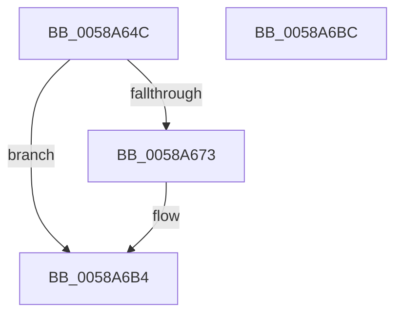

# HvlNotifyAcpiReenabled

- RVA: `0x0058A64C`–`0x0058A6BD` (길이 `113` bytes)
- VA: `0x000000014058A64C`
- 실행 섹션: `.text`
- PDB 이름 있음: `예`; PDB Function 태그: `아니요`
- unwind 정보 RVA: `0x000697A4`
- 디코드: `30`개 명령, `113/113` bytes 표시
- 미해석 바이트: `0` (있으면 어셈블리에 `.byte`로 보존)

> 이 문서는 커널 이미지의 기계어와 PDB 기호를 분석해 생성했습니다. 4번과 5번은 함수 원형과 자료형을 바이너리 사용 방식에서 추정한 C 해석이며 원본 소스 복구 결과는 아닙니다.

## 1. Dependencies

- 직접 호출 지점: **3**; 고유 호출 대상: **3**
- 직접 호출자로 확인된 함수: **1**
- RIP 상대 이미지 참조: **1**

### Outgoing calls
- `0x0058A682` → [HvlpAcquireHypercallPage](../47/HvlpAcquireHypercallPage_function_00471410.md) (function, `0x00471410`)
- `0x0058A69A` → [HvcallInitiateHypercall](../31/HvcallInitiateHypercall_function_00313630.md) (function, `0x00313630`)
- `0x0058A6AF` → [HvlpReleaseHypercallPage](../31/HvlpReleaseHypercallPage_function_00313480.md) (function, `0x00313480`)

### Direct callers
- [PopHiberCheckResume](../../pagelk/B6/PopHiberCheckResume_function_00B6D840.md) at `0x00B6D998`

### Static image references
- `0x0058A656` → RVA `0x00FC6AB8` (`ALMOSTRO`; read)

## 2. Other-region calls and transfers

- 다른 실행 섹션으로 향하는 call: **0**
- 별도 외부 분기/꼬리 이동을 확인하지 못했습니다.

## 3. Assembly (complete function range)

```asm
0058A64C  40 53                           push rbx
0058A64E  48 83 EC 40                     sub rsp, 0x40
0058A652  33 C0                           xor eax, eax
0058A654  33 DB                           xor ebx, ebx
0058A656  F7 05 58 C4 A3 00 00 00 01 00   test dword ptr [rip + 0xa3c458], 0x10000
0058A660  0F 57 C0                        xorps xmm0, xmm0
0058A663  0F 11 44 24 20                  movups xmmword ptr [rsp + 0x20], xmm0
0058A668  48 89 44 24 30                  mov qword ptr [rsp + 0x30], rax
0058A66D  89 44 24 38                     mov dword ptr [rsp + 0x38], eax
0058A671  74 41                           je 0x14058a6b4
0058A673  44 8D 48 08                     lea r9d, [rax + 8]
0058A677  45 33 C0                        xor r8d, r8d
0058A67A  8D 50 01                        lea edx, [rax + 1]
0058A67D  48 8D 4C 24 20                  lea rcx, [rsp + 0x20]
0058A682  E8 89 6D EE FF                  call 0x140471410
0058A687  48 8B 54 24 38                  mov rdx, qword ptr [rsp + 0x38]
0058A68C  45 33 C0                        xor r8d, r8d
0058A68F  B9 87 00 00 00                  mov ecx, 0x87
0058A694  C7 00 03 00 00 00               mov dword ptr [rax], 3
0058A69A  E8 91 8F D8 FF                  call 0x140313630
0058A69F  66 F7 D8                        neg ax
0058A6A2  48 8D 4C 24 20                  lea rcx, [rsp + 0x20]
0058A6A7  1B DB                           sbb ebx, ebx
0058A6A9  81 E3 01 00 00 C0               and ebx, 0xc0000001
0058A6AF  E8 CC 8D D8 FF                  call 0x140313480
0058A6B4  8B C3                           mov eax, ebx
0058A6B6  48 83 C4 40                     add rsp, 0x40
0058A6BA  5B                              pop rbx
0058A6BB  C3                              ret
0058A6BC  CC                              int3
```

## 4. C-style interpretation (structured pseudocode)

```c
__int64 __fastcall HvlNotifyAcpiReenabled(__int64 a1, __int64 a2, int a3)
{
    __int64 result;
    __int64 v_rbx;
    __int64 v_rsp;
    unsigned int v_stack_m10;
    unsigned __int64 v_stack_m18;
    unsigned __int64 v_stack_m28;

    v_rsp = (v_rsp) - (64);
    result = 0;
    v_rbx = 0;
    v_stack_m28 = v_xmm0;
    v_stack_m18 = 0;
    v_stack_m10 = 0;
    if (((*(unsigned int *)(v_rip + 10732632)) & (0x10000ULL)) != 0) {
        a4 = result + 8;
        a3 = 0;
        a2 = result + 1;
        a1 = v_stack_m28;
        result = HvlpAcquireHypercallPage(a1, a2, a3, a4);
        a2 = v_stack_m10;
        a3 = 0;
        a1 = 135;
        *(unsigned int *)(result) = 3;
        result = HvcallInitiateHypercall(a1, a2, a3, a4);
        result = (unsigned __int16)(-(result));
        a1 = v_stack_m28;
        v_rbx = (unsigned int)((v_rbx) & (0xC0000001ULL));
        result = HvlpReleaseHypercallPage(a1, a2, a3, a4);
    }
    v_rsp = (v_rsp) + (64);
    return (unsigned int)((unsigned int)(v_rbx));
}
```

## 5. (Beta) C Style

```c
int64_t HvlNotifyAcpiReenabled(int64_t Arg1, int64_t Arg2, int32_t Arg3)
{
    int64_t result;
    int64_t local_rbx;
    int64_t local_rsp;
    uint32_t v_stack_m10;
    uint64_t v_stack_m18;
    uint64_t v_stack_m28;

    local_rsp = (local_rsp) - (64);
    result = 0;
    local_rbx = 0;
    v_stack_m28 = v_xmm0;
    v_stack_m18 = 0;
    v_stack_m10 = 0;
    if (((*(uint32_t *)(v_rip + 0xA3C458)) & (0x10000ULL)) != 0) {
        a4 = result + 8;
        Arg3 = 0;
        Arg2 = result + 1;
        Arg1 = v_stack_m28;
        result = HvlpAcquireHypercallPage(Arg1, Arg2, Arg3, a4);
        Arg2 = v_stack_m10;
        Arg3 = 0;
        Arg1 = 135;
        *(uint32_t *)(result) = 3;
        result = HvcallInitiateHypercall(Arg1, Arg2, Arg3, a4);
        result = (uint16_t)(-(result));
        Arg1 = v_stack_m28;
        local_rbx = (uint32_t)((local_rbx) & (0xC0000001ULL));
        result = HvlpReleaseHypercallPage(Arg1, Arg2, Arg3, a4);
    }
    local_rsp = (local_rsp) + (64);
    return (uint32_t)((uint32_t)(local_rbx));
}
```

## 6. Execution-region graph

[열기: 2D/3D 그래프와 함수 탐색 컨트롤 패널](../../../control-panel.html?section=text&rva=0x0058A64C&view=graph)

- 2D 그래프는 위에서 아래로 흐르고, 3D 그래프는 빈 공간을 드래그해 회전합니다. Shift+드래그는 이동, 휠은 확대·축소, 함수 노드 선택은 대상 보고서 이동입니다.

### Static fallback


