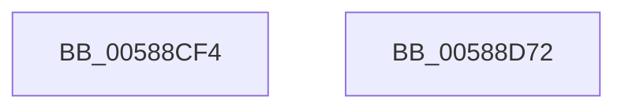

# HvlNotifyAllProcessorsStarted

- RVA: `0x00588CF4`–`0x00588D73` (길이 `127` bytes)
- VA: `0x0000000140588CF4`
- 실행 섹션: `.text`
- PDB 이름 있음: `예`; PDB Function 태그: `아니요`
- unwind 정보 RVA: `0x0005F638`
- 디코드: `32`개 명령, `127/127` bytes 표시
- 미해석 바이트: `0` (있으면 어셈블리에 `.byte`로 보존)

> 이 문서는 커널 이미지의 기계어와 PDB 기호를 분석해 생성했습니다. 4번과 5번은 함수 원형과 자료형을 바이너리 사용 방식에서 추정한 C 해석이며 원본 소스 복구 결과는 아닙니다.

## 1. Dependencies

- 직접 호출 지점: **5**; 고유 호출 대상: **5**
- 직접 호출자로 확인된 함수: **1**
- RIP 상대 이미지 참조: **1**

### Outgoing calls
- `0x00588D2D` → [HvlpAcquireHypercallPage](../47/HvlpAcquireHypercallPage_function_00471410.md) (function, `0x00471410`)
- `0x00588D45` → [HvcallInitiateHypercall](../31/HvcallInitiateHypercall_function_00313630.md) (function, `0x00313630`)
- `0x00588D52` → [HvlpReleaseHypercallPage](../31/HvlpReleaseHypercallPage_function_00313480.md) (function, `0x00313480`)
- `0x00588D5A` → [HvlpHvToNtStatus](../30/HvlpHvToNtStatus_function_00307BD8.md) (function, `0x00307BD8`)
- `0x00588D67` → [_security_check_cookie](../6A/_security_check_cookie_function_006AC640.md) (function, `0x006AC640`)

### Direct callers
- [HvlStartBootLogicalProcessors](HvlStartBootLogicalProcessors_function_00584E18.md) at `0x0058519C`

### Static image references
- `0x00588CFA` → RVA `0x00E0A740` (`.data`; read)

## 2. Other-region calls and transfers

- 다른 실행 섹션으로 향하는 call: **0**
- 별도 외부 분기/꼬리 이동을 확인하지 못했습니다.

## 3. Assembly (complete function range)

```asm
00588CF4  40 53                           push rbx
00588CF6  48 83 EC 60                     sub rsp, 0x60
00588CFA  48 8B 05 3F 1A 88 00            mov rax, qword ptr [rip + 0x881a3f]
00588D01  48 33 C4                        xor rax, rsp
00588D04  48 89 44 24 50                  mov qword ptr [rsp + 0x50], rax
00588D09  33 C0                           xor eax, eax
00588D0B  4C 8D 44 24 40                  lea r8, [rsp + 0x40]
00588D10  0F 57 C0                        xorps xmm0, xmm0
00588D13  48 89 44 24 30                  mov qword ptr [rsp + 0x30], rax
00588D18  48 8D 4C 24 20                  lea rcx, [rsp + 0x20]
00588D1D  89 44 24 38                     mov dword ptr [rsp + 0x38], eax
00588D21  0F 11 44 24 20                  movups xmmword ptr [rsp + 0x20], xmm0
00588D26  44 8D 48 08                     lea r9d, [rax + 8]
00588D2A  8D 50 01                        lea edx, [rax + 1]
00588D2D  E8 DE 86 EE FF                  call 0x140471410
00588D32  48 8B 54 24 38                  mov rdx, qword ptr [rsp + 0x38]
00588D37  45 33 C0                        xor r8d, r8d
00588D3A  B9 87 00 00 00                  mov ecx, 0x87
00588D3F  C7 00 04 00 00 00               mov dword ptr [rax], 4
00588D45  E8 E6 A8 D8 FF                  call 0x140313630
00588D4A  48 8D 4C 24 20                  lea rcx, [rsp + 0x20]
00588D4F  48 8B D8                        mov rbx, rax
00588D52  E8 29 A7 D8 FF                  call 0x140313480
00588D57  0F B7 CB                        movzx ecx, bx
00588D5A  E8 79 EE D7 FF                  call 0x140307bd8
00588D5F  48 8B 4C 24 50                  mov rcx, qword ptr [rsp + 0x50]
00588D64  48 33 CC                        xor rcx, rsp
00588D67  E8 D4 38 12 00                  call 0x1406ac640
00588D6C  48 83 C4 60                     add rsp, 0x60
00588D70  5B                              pop rbx
00588D71  C3                              ret
00588D72  CC                              int3
```

## 4. C-style interpretation (structured pseudocode)

```c
__int64 __fastcall HvlNotifyAllProcessorsStarted(void)
{
    __int64 result;
    __int64 v_rsp;
    unsigned __int64 v_stack_m18;
    unsigned __int64 v_stack_m28;
    unsigned int v_stack_m30;
    unsigned __int64 v_stack_m38;
    unsigned __int64 v_stack_m48;

    v_rsp = (v_rsp) - (96);
    result = (*(unsigned __int64 *)(v_rip + 8919615)) ^ (v_rsp);
    v_stack_m18 = result;
    result = 0;
    v_stack_m38 = 0;
    v_stack_m30 = 0;
    v_stack_m48 = v_xmm0;
    result = HvlpAcquireHypercallPage(v_stack_m48, result + 1, v_stack_m28, result + 8);
    a3 = 0;
    *(unsigned int *)(result) = 4;
    result = HvcallInitiateHypercall(135, v_stack_m30, a3, result + 8);
    result = HvlpReleaseHypercallPage(v_stack_m48, v_stack_m30, a3, result + 8);
    result = HvlpHvToNtStatus((unsigned __int16)(result), v_stack_m30, a3, result + 8);
    a1 = (v_stack_m18) ^ (v_rsp);
    result = _security_check_cookie(a1, v_stack_m30, a3, result + 8);
    v_rsp = (v_rsp) + (96);
    return result;
}
```

## 5. (Beta) C Style

```c
void HvlNotifyAllProcessorsStarted(void)
{
    int64_t result;
    int64_t local_rsp;
    uint64_t v_stack_m18;
    uint64_t v_stack_m28;
    uint32_t v_stack_m30;
    uint64_t v_stack_m38;
    uint64_t v_stack_m48;

    local_rsp = (local_rsp) - (96);
    result = (*(uint64_t *)(v_rip + 0x881A3F)) ^ (local_rsp);
    v_stack_m18 = result;
    result = 0;
    v_stack_m38 = 0;
    v_stack_m30 = 0;
    v_stack_m48 = v_xmm0;
    result = HvlpAcquireHypercallPage(v_stack_m48, result + 1, v_stack_m28, result + 8);
    a3 = 0;
    *(uint32_t *)(result) = 4;
    result = HvcallInitiateHypercall(135, v_stack_m30, a3, result + 8);
    result = HvlpReleaseHypercallPage(v_stack_m48, v_stack_m30, a3, result + 8);
    result = HvlpHvToNtStatus((uint16_t)(result), v_stack_m30, a3, result + 8);
    a1 = (v_stack_m18) ^ (local_rsp);
    result = _security_check_cookie(a1, v_stack_m30, a3, result + 8);
    local_rsp = (local_rsp) + (96);
    return result;
}
```

## 6. Execution-region graph

[열기: 2D/3D 그래프와 함수 탐색 컨트롤 패널](../../../control-panel.html?section=text&rva=0x00588CF4&view=graph)

- 2D 그래프는 위에서 아래로 흐르고, 3D 그래프는 빈 공간을 드래그해 회전합니다. Shift+드래그는 이동, 휠은 확대·축소, 함수 노드 선택은 대상 보고서 이동입니다.

### Static fallback


