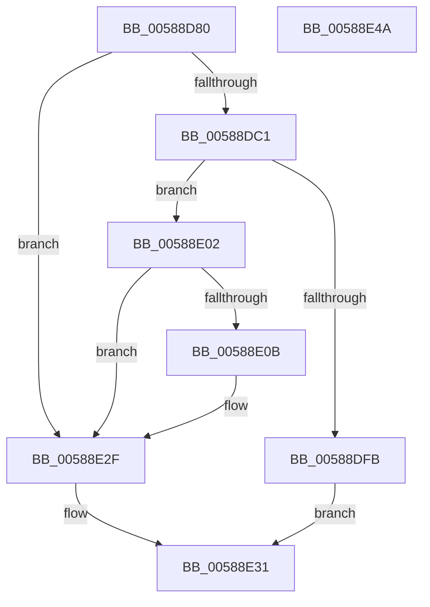

# HvlNotifyDebugDeviceAvailable

- RVA: `0x00588D80`–`0x00588E4B` (길이 `203` bytes)
- VA: `0x0000000140588D80`
- 실행 섹션: `.text`
- PDB 이름 있음: `예`; PDB Function 태그: `아니요`
- unwind 정보 RVA: `0x000C67EC`
- 디코드: `52`개 명령, `203/203` bytes 표시
- 미해석 바이트: `0` (있으면 어셈블리에 `.byte`로 보존)

> 이 문서는 커널 이미지의 기계어와 PDB 기호를 분석해 생성했습니다. 4번과 5번은 함수 원형과 자료형을 바이너리 사용 방식에서 추정한 C 해석이며 원본 소스 복구 결과는 아닙니다.

## 1. Dependencies

- 직접 호출 지점: **6**; 고유 호출 대상: **6**
- 직접 호출자로 확인된 함수: **1**
- RIP 상대 이미지 참조: **3**

### Outgoing calls
- `0x00588DD0` → [HvlpAcquireHypercallPage](../47/HvlpAcquireHypercallPage_function_00471410.md) (function, `0x00471410`)
- `0x00588DE4` → [HvcallInitiateHypercall](../31/HvcallInitiateHypercall_function_00313630.md) (function, `0x00313630`)
- `0x00588DF1` → [HvlpReleaseHypercallPage](../31/HvlpReleaseHypercallPage_function_00313480.md) (function, `0x00313480`)
- `0x00588E16` → [memset](../6C/memset_function_006C6C40.md) (function, `0x006C6C40`)
- `0x00588E2A` → [VslpEnterIumSecureMode](../23/VslpEnterIumSecureMode_function_00235E50.md) (function, `0x00235E50`)
- `0x00588E3C` → [_security_check_cookie](../6A/_security_check_cookie_function_006AC640.md) (function, `0x006AC640`)

### Direct callers
- [PopHiberCheckResume](../../pagelk/B6/PopHiberCheckResume_function_00B6D840.md) at `0x00B6D993`

### Static image references
- `0x00588D8B` → RVA `0x00E0A740` (`.data`; read)
- `0x00588DB0` → RVA `0x00FC6AD8` (`ALMOSTRO`; read)
- `0x00588E02` → RVA `0x00FC6A84` (`ALMOSTRO`; read)

## 2. Other-region calls and transfers

- 다른 실행 섹션으로 향하는 call: **0**
- 별도 외부 분기/꼬리 이동을 확인하지 못했습니다.

## 3. Assembly (complete function range)

```asm
00588D80  4C 8B DC                        mov r11, rsp
00588D83  53                              push rbx
00588D84  48 81 EC D0 00 00 00            sub rsp, 0xd0
00588D8B  48 8B 05 AE 19 88 00            mov rax, qword ptr [rip + 0x8819ae]
00588D92  48 33 C4                        xor rax, rsp
00588D95  48 89 84 24 C0 00 00 00         mov qword ptr [rsp + 0xc0], rax
00588D9D  33 C0                           xor eax, eax
00588D9F  BB 01 00 00 00                  mov ebx, 1
00588DA4  48 89 44 24 30                  mov qword ptr [rsp + 0x30], rax
00588DA9  0F 57 C0                        xorps xmm0, xmm0
00588DAC  89 44 24 38                     mov dword ptr [rsp + 0x38], eax
00588DB0  8B 05 22 DD A3 00               mov eax, dword ptr [rip + 0xa3dd22]
00588DB6  23 C3                           and eax, ebx
00588DB8  0F 11 44 24 20                  movups xmmword ptr [rsp + 0x20], xmm0
00588DBD  84 C0                           test al, al
00588DBF  74 6E                           je 0x140588e2f
00588DC1  44 8D 4B 07                     lea r9d, [rbx + 7]
00588DC5  8B D3                           mov edx, ebx
00588DC7  4D 8D 43 D8                     lea r8, [r11 - 0x28]
00588DCB  48 8D 4C 24 20                  lea rcx, [rsp + 0x20]
00588DD0  E8 3B 86 EE FF                  call 0x140471410
00588DD5  48 8B 54 24 38                  mov rdx, qword ptr [rsp + 0x38]
00588DDA  45 33 C0                        xor r8d, r8d
00588DDD  B9 87 00 00 00                  mov ecx, 0x87
00588DE2  89 18                           mov dword ptr [rax], ebx
00588DE4  E8 47 A8 D8 FF                  call 0x140313630
00588DE9  48 8D 4C 24 20                  lea rcx, [rsp + 0x20]
00588DEE  48 8B D8                        mov rbx, rax
00588DF1  E8 8A A6 D8 FF                  call 0x140313480
00588DF6  66 85 DB                        test bx, bx
00588DF9  74 07                           je 0x140588e02
00588DFB  B8 01 00 00 C0                  mov eax, 0xc0000001
00588E00  EB 2F                           jmp 0x140588e31
00588E02  80 3D 7B DC A3 00 00            cmp byte ptr [rip + 0xa3dc7b], 0
00588E09  74 24                           je 0x140588e2f
00588E0B  33 D2                           xor edx, edx
00588E0D  48 8D 4C 24 40                  lea rcx, [rsp + 0x40]
00588E12  44 8D 42 68                     lea r8d, [rdx + 0x68]
00588E16  E8 25 DE 13 00                  call 0x1406c6c40
00588E1B  BA 0F 01 00 00                  mov edx, 0x10f
00588E20  4C 8D 4C 24 40                  lea r9, [rsp + 0x40]
00588E25  45 33 C0                        xor r8d, r8d
00588E28  B1 02                           mov cl, 2
00588E2A  E8 21 D0 CA FF                  call 0x140235e50
00588E2F  33 C0                           xor eax, eax
00588E31  48 8B 8C 24 C0 00 00 00         mov rcx, qword ptr [rsp + 0xc0]
00588E39  48 33 CC                        xor rcx, rsp
00588E3C  E8 FF 37 12 00                  call 0x1406ac640
00588E41  48 81 C4 D0 00 00 00            add rsp, 0xd0
00588E48  5B                              pop rbx
00588E49  C3                              ret
00588E4A  CC                              int3
```

## 4. C-style interpretation (structured pseudocode)

```c
__int64 __fastcall HvlNotifyDebugDeviceAvailable(void)
{
    __int64 result;
    __int64 v_rsp;
    unsigned __int64 v_stack_m18;
    unsigned __int64 v_stack_m98;
    unsigned int v_stack_mA0;
    unsigned __int64 v_stack_mA8;
    unsigned __int64 v_stack_mB8;

    v_rsp = (v_rsp) - (208);
    result = (*(unsigned __int64 *)(v_rip + 8919470)) ^ (v_rsp);
    v_stack_m18 = result;
    result = 0;
    v_stack_mA8 = 0;
    v_stack_mA0 = 0;
    result = (unsigned int)(((unsigned int)(*(unsigned int *)(v_rip + 10738978))) & (1));
    v_stack_mB8 = v_xmm0;
    if ((unsigned __int8)(result) == 0) goto loc_00588E2F;
    result = HvlpAcquireHypercallPage(v_stack_mB8, 1, v_rsp - 40, 1 + 7);
    a3 = 0;
    *(unsigned int *)(result) = 1;
    result = HvcallInitiateHypercall(135, v_stack_mA0, a3, 1 + 7);
    result = HvlpReleaseHypercallPage(v_stack_mB8, v_stack_mA0, a3, 1 + 7);
    if ((unsigned __int16)(result) == 0) goto loc_00588E02;
    goto loc_00588E31;
loc_00588E02:
    result = (unsigned int)(0xC0000001ULL);
    if ((*(unsigned __int8 *)(v_rip + 10738811)) != 0) {
        a2 = 0;
        a1 = v_stack_m98;
        a3 = a2 + 104;
        result = memset(a1, a2, a3, 1 + 7);
        a2 = 271;
        a4 = v_stack_m98;
        a3 = 0;
        a1 = 2;
        result = VslpEnterIumSecureMode(a1, a2, a3, a4);
    }
    result = 0;
loc_00588E31:
    a1 = (v_stack_m18) ^ (v_rsp);
    result = _security_check_cookie(a1, a2, a3, a4);
    v_rsp = (v_rsp) + (208);
    return result;
}
```

## 5. (Beta) C Style

```c
void HvlNotifyDebugDeviceAvailable(void)
{
    int64_t result;
    int64_t local_rsp;
    uint64_t v_stack_m18;
    uint64_t v_stack_m98;
    uint32_t v_stack_mA0;
    uint64_t v_stack_mA8;
    uint64_t v_stack_mB8;

    local_rsp = (local_rsp) - (208);
    result = (*(uint64_t *)(v_rip + 0x8819AE)) ^ (local_rsp);
    v_stack_m18 = result;
    result = 0;
    v_stack_mA8 = 0;
    v_stack_mA0 = 0;
    result = (uint32_t)(((uint32_t)(*(uint32_t *)(v_rip + 0xA3DD22))) & (1));
    v_stack_mB8 = v_xmm0;
    if ((uint8_t)(result) == 0) goto loc_00588E2F;
    result = HvlpAcquireHypercallPage(v_stack_mB8, 1, local_rsp - 40, 1 + 7);
    a3 = 0;
    *(uint32_t *)(result) = 1;
    result = HvcallInitiateHypercall(135, v_stack_mA0, a3, 1 + 7);
    result = HvlpReleaseHypercallPage(v_stack_mB8, v_stack_mA0, a3, 1 + 7);
    if ((uint16_t)(result) == 0) goto loc_00588E02;
    goto loc_00588E31;
loc_00588E02:
    result = (uint32_t)(0xC0000001ULL);
    if ((*(uint8_t *)(v_rip + 0xA3DC7B)) != 0) {
        a2 = 0;
        a1 = v_stack_m98;
        a3 = a2 + 104;
        result = memset(a1, a2, a3, 1 + 7);
        a2 = 271;
        a4 = v_stack_m98;
        a3 = 0;
        a1 = 2;
        result = VslpEnterIumSecureMode(a1, a2, a3, a4);
    }
    result = 0;
loc_00588E31:
    a1 = (v_stack_m18) ^ (local_rsp);
    result = _security_check_cookie(a1, a2, a3, a4);
    local_rsp = (local_rsp) + (208);
    return result;
}
```

## 6. Execution-region graph

[열기: 2D/3D 그래프와 함수 탐색 컨트롤 패널](../../../control-panel.html?section=text&rva=0x00588D80&view=graph)

- 2D 그래프는 위에서 아래로 흐르고, 3D 그래프는 빈 공간을 드래그해 회전합니다. Shift+드래그는 이동, 휠은 확대·축소, 함수 노드 선택은 대상 보고서 이동입니다.

### Static fallback


