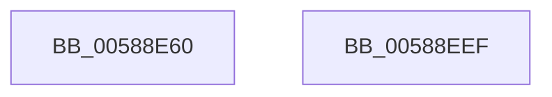

# HvlNotifyHpetEnabled

- RVA: `0x00588E60`–`0x00588EF0` (길이 `144` bytes)
- VA: `0x0000000140588E60`
- 실행 섹션: `.text`
- PDB 이름 있음: `예`; PDB Function 태그: `아니요`
- unwind 정보 RVA: `0x000AF554`
- 디코드: `34`개 명령, `144/144` bytes 표시
- 미해석 바이트: `0` (있으면 어셈블리에 `.byte`로 보존)

> 이 문서는 커널 이미지의 기계어와 PDB 기호를 분석해 생성했습니다. 4번과 5번은 함수 원형과 자료형을 바이너리 사용 방식에서 추정한 C 해석이며 원본 소스 복구 결과는 아닙니다.

## 1. Dependencies

- 직접 호출 지점: **4**; 고유 호출 대상: **4**
- 직접 호출자로 확인된 함수: **0**
- RIP 상대 이미지 참조: **1**

### Outgoing calls
- `0x00588E9F` → [HvlpAcquireHypercallPage](../47/HvlpAcquireHypercallPage_function_00471410.md) (function, `0x00471410`)
- `0x00588EBA` → [HvcallInitiateHypercall](../31/HvcallInitiateHypercall_function_00313630.md) (function, `0x00313630`)
- `0x00588EC7` → [HvlpReleaseHypercallPage](../31/HvlpReleaseHypercallPage_function_00313480.md) (function, `0x00313480`)
- `0x00588EE1` → [_security_check_cookie](../6A/_security_check_cookie_function_006AC640.md) (function, `0x006AC640`)

### Direct callers
- 이 함수 시작 RVA로 연결되는 직접 call은 확인되지 않았습니다. 간접 호출은 완전히 역산할 수 없습니다.

### Static image references
- `0x00588E69` → RVA `0x00E0A740` (`.data`; read)

## 2. Other-region calls and transfers

- 다른 실행 섹션으로 향하는 call: **0**
- 별도 외부 분기/꼬리 이동을 확인하지 못했습니다.

## 3. Assembly (complete function range)

```asm
00588E60  40 53                           push rbx
00588E62  48 81 EC A0 00 00 00            sub rsp, 0xa0
00588E69  48 8B 05 D0 18 88 00            mov rax, qword ptr [rip + 0x8818d0]
00588E70  48 33 C4                        xor rax, rsp
00588E73  48 89 84 24 90 00 00 00         mov qword ptr [rsp + 0x90], rax
00588E7B  33 C0                           xor eax, eax
00588E7D  4C 8D 44 24 40                  lea r8, [rsp + 0x40]
00588E82  0F 57 C0                        xorps xmm0, xmm0
00588E85  48 89 44 24 30                  mov qword ptr [rsp + 0x30], rax
00588E8A  48 8D 4C 24 20                  lea rcx, [rsp + 0x20]
00588E8F  89 44 24 38                     mov dword ptr [rsp + 0x38], eax
00588E93  0F 11 44 24 20                  movups xmmword ptr [rsp + 0x20], xmm0
00588E98  44 8D 48 28                     lea r9d, [rax + 0x28]
00588E9C  8D 50 01                        lea edx, [rax + 1]
00588E9F  E8 6C 85 EE FF                  call 0x140471410
00588EA4  48 8B 54 24 38                  mov rdx, qword ptr [rsp + 0x38]
00588EA9  45 33 C0                        xor r8d, r8d
00588EAC  C7 00 08 00 00 00               mov dword ptr [rax], 8
00588EB2  41 8D 48 6F                     lea ecx, [r8 + 0x6f]
00588EB6  C6 40 08 01                     mov byte ptr [rax + 8], 1
00588EBA  E8 71 A7 D8 FF                  call 0x140313630
00588EBF  48 8D 4C 24 20                  lea rcx, [rsp + 0x20]
00588EC4  48 8B D8                        mov rbx, rax
00588EC7  E8 B4 A5 D8 FF                  call 0x140313480
00588ECC  66 F7 DB                        neg bx
00588ECF  1B C0                           sbb eax, eax
00588ED1  25 01 00 00 C0                  and eax, 0xc0000001
00588ED6  48 8B 8C 24 90 00 00 00         mov rcx, qword ptr [rsp + 0x90]
00588EDE  48 33 CC                        xor rcx, rsp
00588EE1  E8 5A 37 12 00                  call 0x1406ac640
00588EE6  48 81 C4 A0 00 00 00            add rsp, 0xa0
00588EED  5B                              pop rbx
00588EEE  C3                              ret
00588EEF  CC                              int3
```

## 4. C-style interpretation (structured pseudocode)

```c
__int64 __fastcall HvlNotifyHpetEnabled(void)
{
    __int64 result;
    __int64 v_rbx;
    __int64 v_rsp;
    unsigned __int64 v_stack_m18;
    unsigned __int64 v_stack_m68;
    unsigned int v_stack_m70;
    unsigned __int64 v_stack_m78;
    unsigned __int64 v_stack_m88;

    v_rsp = (v_rsp) - (160);
    result = (*(unsigned __int64 *)(v_rip + 8919248)) ^ (v_rsp);
    v_stack_m18 = result;
    result = 0;
    v_stack_m78 = 0;
    v_stack_m70 = 0;
    v_stack_m88 = v_xmm0;
    result = HvlpAcquireHypercallPage(v_stack_m88, result + 1, v_stack_m68, result + 40);
    a3 = 0;
    *(unsigned int *)(result) = 8;
    *(unsigned __int8 *)(result + 8) = 1;
    result = HvcallInitiateHypercall(a3 + 111, v_stack_m70, a3, result + 40);
    result = HvlpReleaseHypercallPage(v_stack_m88, v_stack_m70, a3, result + 40);
    v_rbx = (unsigned __int16)(-(result));
    result = (unsigned int)((result) & (0xC0000001ULL));
    a1 = (v_stack_m18) ^ (v_rsp);
    result = _security_check_cookie(a1, v_stack_m70, a3, result + 40);
    v_rsp = (v_rsp) + (160);
    return result;
}
```

## 5. (Beta) C Style

```c
void HvlNotifyHpetEnabled(void)
{
    int64_t result;
    int64_t local_rbx;
    int64_t local_rsp;
    uint64_t v_stack_m18;
    uint64_t v_stack_m68;
    uint32_t v_stack_m70;
    uint64_t v_stack_m78;
    uint64_t v_stack_m88;

    local_rsp = (local_rsp) - (160);
    result = (*(uint64_t *)(v_rip + 0x8818D0)) ^ (local_rsp);
    v_stack_m18 = result;
    result = 0;
    v_stack_m78 = 0;
    v_stack_m70 = 0;
    v_stack_m88 = v_xmm0;
    result = HvlpAcquireHypercallPage(v_stack_m88, result + 1, v_stack_m68, result + 40);
    a3 = 0;
    *(uint32_t *)(result) = 8;
    *(uint8_t *)(result + 0x8) = 1;
    result = HvcallInitiateHypercall(a3 + 111, v_stack_m70, a3, result + 40);
    result = HvlpReleaseHypercallPage(v_stack_m88, v_stack_m70, a3, result + 40);
    local_rbx = (uint16_t)(-(result));
    result = (uint32_t)((result) & (0xC0000001ULL));
    a1 = (v_stack_m18) ^ (local_rsp);
    result = _security_check_cookie(a1, v_stack_m70, a3, result + 40);
    local_rsp = (local_rsp) + (160);
    return result;
}
```

## 6. Execution-region graph

[열기: 2D/3D 그래프와 함수 탐색 컨트롤 패널](../../../control-panel.html?section=text&rva=0x00588E60&view=graph)

- 2D 그래프는 위에서 아래로 흐르고, 3D 그래프는 빈 공간을 드래그해 회전합니다. Shift+드래그는 이동, 휠은 확대·축소, 함수 노드 선택은 대상 보고서 이동입니다.

### Static fallback


