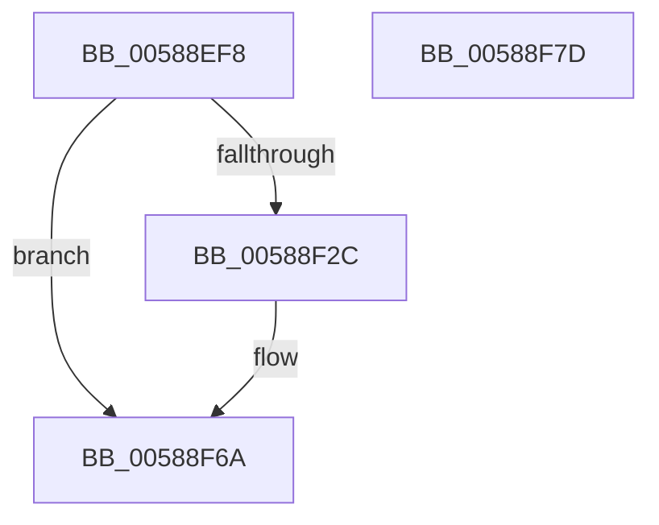

# HvlNotifyRootCrashdump

- RVA: `0x00588EF8`–`0x00588F7E` (길이 `134` bytes)
- VA: `0x0000000140588EF8`
- 실행 섹션: `.text`
- PDB 이름 있음: `예`; PDB Function 태그: `아니요`
- unwind 정보 RVA: `0x0005F638`
- 디코드: `34`개 명령, `134/134` bytes 표시
- 미해석 바이트: `0` (있으면 어셈블리에 `.byte`로 보존)

> 이 문서는 커널 이미지의 기계어와 PDB 기호를 분석해 생성했습니다. 4번과 5번은 함수 원형과 자료형을 바이너리 사용 방식에서 추정한 C 해석이며 원본 소스 복구 결과는 아닙니다.

## 1. Dependencies

- 직접 호출 지점: **4**; 고유 호출 대상: **4**
- 직접 호출자로 확인된 함수: **3**
- RIP 상대 이미지 참조: **2**

### Outgoing calls
- `0x00588F40` → [HvlpAcquireHypercallPage](../47/HvlpAcquireHypercallPage_function_00471410.md) (function, `0x00471410`)
- `0x00588F5B` → [HvcallInitiateHypercall](../31/HvcallInitiateHypercall_function_00313630.md) (function, `0x00313630`)
- `0x00588F65` → [HvlpReleaseHypercallPage](../31/HvlpReleaseHypercallPage_function_00313480.md) (function, `0x00313480`)
- `0x00588F72` → [_security_check_cookie](../6A/_security_check_cookie_function_006AC640.md) (function, `0x006AC640`)

### Direct callers
- [HvlPrepareForRootCrashdump](HvlPrepareForRootCrashdump_function_00588F84.md) at `0x00588FB1`
- [HvlPrepareForRootCrashdump](HvlPrepareForRootCrashdump_function_00588F84.md) at `0x00589018`
- [HvlResumeFromRootCrashdump](HvlResumeFromRootCrashdump_function_005893E0.md) at `0x0058942A`
- [KeBugCheck2](../5B/KeBugCheck2_function_005B27D0.md) at `0x005B28E7`

### Static image references
- `0x00588EFE` → RVA `0x00E0A740` (`.data`; read)
- `0x00588F1D` → RVA `0x00FC6AD8` (`ALMOSTRO`; read)

## 2. Other-region calls and transfers

- 다른 실행 섹션으로 향하는 call: **0**
- 별도 외부 분기/꼬리 이동을 확인하지 못했습니다.

## 3. Assembly (complete function range)

```asm
00588EF8  40 53                           push rbx
00588EFA  48 83 EC 60                     sub rsp, 0x60
00588EFE  48 8B 05 3B 18 88 00            mov rax, qword ptr [rip + 0x88183b]
00588F05  48 33 C4                        xor rax, rsp
00588F08  48 89 44 24 50                  mov qword ptr [rsp + 0x50], rax
00588F0D  33 C0                           xor eax, eax
00588F0F  0F 57 C0                        xorps xmm0, xmm0
00588F12  48 89 44 24 30                  mov qword ptr [rsp + 0x30], rax
00588F17  8B D9                           mov ebx, ecx
00588F19  89 44 24 38                     mov dword ptr [rsp + 0x38], eax
00588F1D  8B 05 B5 DB A3 00               mov eax, dword ptr [rip + 0xa3dbb5]
00588F23  0F 11 44 24 20                  movups xmmword ptr [rsp + 0x20], xmm0
00588F28  A8 04                           test al, 4
00588F2A  74 3E                           je 0x140588f6a
00588F2C  41 B9 08 00 00 00               mov r9d, 8
00588F32  4C 8D 44 24 40                  lea r8, [rsp + 0x40]
00588F37  48 8D 4C 24 20                  lea rcx, [rsp + 0x20]
00588F3C  41 8D 51 F9                     lea edx, [r9 - 7]
00588F40  E8 CB 84 EE FF                  call 0x140471410
00588F45  48 8B 54 24 38                  mov rdx, qword ptr [rsp + 0x38]
00588F4A  45 33 C0                        xor r8d, r8d
00588F4D  B9 87 00 00 00                  mov ecx, 0x87
00588F52  C7 00 02 00 00 00               mov dword ptr [rax], 2
00588F58  89 58 04                        mov dword ptr [rax + 4], ebx
00588F5B  E8 D0 A6 D8 FF                  call 0x140313630
00588F60  48 8D 4C 24 20                  lea rcx, [rsp + 0x20]
00588F65  E8 16 A5 D8 FF                  call 0x140313480
00588F6A  48 8B 4C 24 50                  mov rcx, qword ptr [rsp + 0x50]
00588F6F  48 33 CC                        xor rcx, rsp
00588F72  E8 C9 36 12 00                  call 0x1406ac640
00588F77  48 83 C4 60                     add rsp, 0x60
00588F7B  5B                              pop rbx
00588F7C  C3                              ret
00588F7D  CC                              int3
```

## 4. C-style interpretation (structured pseudocode)

```c
__int64 __fastcall HvlNotifyRootCrashdump(int a1)
{
    __int64 result;
    __int64 v_rsp;
    unsigned __int64 v_stack_m18;
    unsigned __int64 v_stack_m28;
    unsigned int v_stack_m30;
    unsigned __int64 v_stack_m38;
    unsigned __int64 v_stack_m48;

    v_rsp = (v_rsp) - (96);
    result = (*(unsigned __int64 *)(v_rip + 8919099)) ^ (v_rsp);
    v_stack_m18 = result;
    result = 0;
    v_stack_m38 = 0;
    v_stack_m30 = 0;
    v_stack_m48 = v_xmm0;
    result = (unsigned int)(*(unsigned int *)(v_rip + 10738613));
    if ((((unsigned __int8)((unsigned int)(*(unsigned int *)(v_rip + 10738613)))) & (4)) != 0) {
        a4 = 8;
        a3 = v_stack_m28;
        a1 = v_stack_m48;
        a2 = a4 - 7;
        result = HvlpAcquireHypercallPage(a1, a2, a3, a4);
        a2 = v_stack_m30;
        a3 = 0;
        a1 = 135;
        *(unsigned int *)(result) = 2;
        *(unsigned int *)(result + 4) = (unsigned int)((unsigned int)(a1));
        result = HvcallInitiateHypercall(a1, a2, a3, a4);
        a1 = v_stack_m48;
        result = HvlpReleaseHypercallPage(a1, a2, a3, a4);
    }
    a1 = (v_stack_m18) ^ (v_rsp);
    result = _security_check_cookie(a1, a2, a3, a4);
    v_rsp = (v_rsp) + (96);
    return result;
}
```

## 5. (Beta) C Style

```c
int64_t HvlNotifyRootCrashdump(int32_t Arg1)
{
    int64_t result;
    int64_t local_rsp;
    uint64_t v_stack_m18;
    uint64_t v_stack_m28;
    uint32_t v_stack_m30;
    uint64_t v_stack_m38;
    uint64_t v_stack_m48;

    local_rsp = (local_rsp) - (96);
    result = (*(uint64_t *)(v_rip + 0x88183B)) ^ (local_rsp);
    v_stack_m18 = result;
    result = 0;
    v_stack_m38 = 0;
    v_stack_m30 = 0;
    v_stack_m48 = v_xmm0;
    result = (uint32_t)(*(uint32_t *)(v_rip + 0xA3DBB5));
    if ((((uint8_t)((uint32_t)(*(uint32_t *)(v_rip + 0xA3DBB5)))) & (4)) != 0) {
        a4 = 8;
        a3 = v_stack_m28;
        Arg1 = v_stack_m48;
        a2 = a4 - 7;
        result = HvlpAcquireHypercallPage(Arg1, a2, a3, a4);
        a2 = v_stack_m30;
        a3 = 0;
        Arg1 = 135;
        *(uint32_t *)(result) = 2;
        *(uint32_t *)(result + 0x4) = (uint32_t)((uint32_t)(Arg1));
        result = HvcallInitiateHypercall(Arg1, a2, a3, a4);
        Arg1 = v_stack_m48;
        result = HvlpReleaseHypercallPage(Arg1, a2, a3, a4);
    }
    Arg1 = (v_stack_m18) ^ (local_rsp);
    result = _security_check_cookie(Arg1, a2, a3, a4);
    local_rsp = (local_rsp) + (96);
    return result;
}
```

## 6. Execution-region graph

[열기: 2D/3D 그래프와 함수 탐색 컨트롤 패널](../../../control-panel.html?section=text&rva=0x00588EF8&view=graph)

- 2D 그래프는 위에서 아래로 흐르고, 3D 그래프는 빈 공간을 드래그해 회전합니다. Shift+드래그는 이동, 휠은 확대·축소, 함수 노드 선택은 대상 보고서 이동입니다.

### Static fallback


