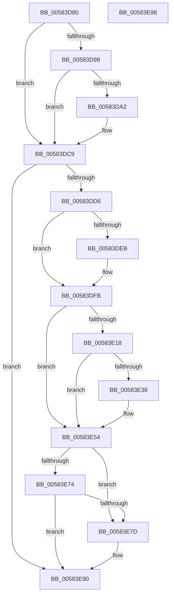

# HvlPhase1Initialize

- RVA: `0x00583D80`–`0x00583E99` (길이 `281` bytes)
- VA: `0x0000000140583D80`
- 실행 섹션: `.text`
- PDB 이름 있음: `예`; PDB Function 태그: `아니요`
- unwind 정보 RVA: `0x00064C80`
- 디코드: `62`개 명령, `281/281` bytes 표시
- 미해석 바이트: `0` (있으면 어셈블리에 `.byte`로 보존)

> 이 문서는 커널 이미지의 기계어와 PDB 기호를 분석해 생성했습니다. 4번과 5번은 함수 원형과 자료형을 바이너리 사용 방식에서 추정한 C 해석이며 원본 소스 복구 결과는 아닙니다.

## 1. Dependencies

- 직접 호출 지점: **10**; 고유 호출 대상: **10**
- 직접 호출자로 확인된 함수: **1**
- RIP 상대 이미지 참조: **11**

### Outgoing calls
- `0x00583D8F` → [HviIsAnyHypervisorPresent](../4A/HviIsAnyHypervisorPresent_function_004ADC50.md) (function, `0x004ADC50`)
- `0x00583DC4` → [KeRegisterBugCheckReasonCallback](../47/KeRegisterBugCheckReasonCallback_function_004720A0.md) (function, `0x004720A0`)
- `0x00583DF6` → [MiMarkRetpolineBits](../../page/AA/MiMarkRetpolineBits_function_00AA0394.md) (function, `0x00AA0394`)
- `0x00583E04` → [HvlpSetupCachedHypercallPages](HvlpSetupCachedHypercallPages_function_00586844.md) (function, `0x00586844`)
- `0x00583E09` → [HvlpInitializePowerStatistics](HvlpInitializePowerStatistics_function_0058AC40.md) (function, `0x0058AC40`)
- `0x00583E2F` → [HvlpMapStatisticsPage](HvlpMapStatisticsPage_function_00585B68.md) (function, `0x00585B68`)
- `0x00583E48` → [MmMapIoSpaceEx](../32/MmMapIoSpaceEx_function_00327830.md) (function, `0x00327830`)
- `0x00583E56` → [HvlConfigureMemoryZeroingOnReset](HvlConfigureMemoryZeroingOnReset_function_00583760.md) (function, `0x00583760`)
- `0x00583E65` → [VslpIumPhase0Initialize](../../init/C2/VslpIumPhase0Initialize_function_00C2A0A4.md) (function, `0x00C2A0A4`)
- `0x00583E8B` → [HvlpInitializeHvCrashdump](HvlpInitializeHvCrashdump_function_0058BCCC.md) (function, `0x0058BCCC`)

### Direct callers
- [InitBootProcessor](../../init/C1/InitBootProcessor_function_00C1B1C8.md) at `0x00C1B9CD`

### Static image references
- `0x00583D98` → RVA `0x00FC6AD8` (`ALMOSTRO`; read)
- `0x00583DA2` → RVA `0x00FC54C0` (`ALMOSTRO`; read)
- `0x00583DA9` → RVA `0x00FC77FC` (`ALMOSTRO`; write)
- `0x00583DB6` → RVA `0x00584560` (`HvlpHvIdentityInfoCallback`; read)
- `0x00583DBD` → RVA `0x00FC77D0` (`ALMOSTRO`; read)
- `0x00583DC9` → RVA `0x00FC6A97` (`ALMOSTRO`; read)
- `0x00583DD6` → RVA `0x00FC6B48` (`ALMOSTRO`; read)
- `0x00583DE2` → RVA `0x01201850` (`CFGRO`; read)
- `0x00583E4D` → RVA `0x00FC5398` (`ALMOSTRO`; write)
- `0x00583E5B` → RVA `0x00FC6A90` (`ALMOSTRO`; read/write)
- `0x00583E74` → RVA `0x00FC6A84` (`ALMOSTRO`; read)

## 2. Other-region calls and transfers

- 다른 실행 섹션으로 향하는 call: **2**
  - `0x00583DF6` → [MiMarkRetpolineBits](../../page/AA/MiMarkRetpolineBits_function_00AA0394.md) (`.text` → `PAGE`)
  - `0x00583E65` → [VslpIumPhase0Initialize](../../init/C2/VslpIumPhase0Initialize_function_00C2A0A4.md) (`.text` → `INIT`)
- 별도 외부 분기/꼬리 이동을 확인하지 못했습니다.

## 3. Assembly (complete function range)

```asm
00583D80  40 53                           push rbx
00583D82  48 83 EC 30                     sub rsp, 0x30
00583D86  48 83 64 24 48 00               and qword ptr [rsp + 0x48], 0
00583D8C  48 8B D9                        mov rbx, rcx
00583D8F  E8 BC 9E F2 FF                  call 0x1404adc50
00583D94  84 C0                           test al, al
00583D96  74 31                           je 0x140583dc9
00583D98  8B 05 3A 2D A4 00               mov eax, dword ptr [rip + 0xa42d3a]
00583D9E  A8 04                           test al, 4
00583DA0  75 27                           jne 0x140583dc9
00583DA2  4C 8D 0D 17 17 A4 00            lea r9, [rip + 0xa41717]
00583DA9  C6 05 4C 3A A4 00 00            mov byte ptr [rip + 0xa43a4c], 0
00583DB0  41 B8 02 00 00 00               mov r8d, 2
00583DB6  48 8D 15 A3 07 00 00            lea rdx, [rip + 0x7a3]
00583DBD  48 8D 0D 0C 3A A4 00            lea rcx, [rip + 0xa43a0c]
00583DC4  E8 D7 E2 EE FF                  call 0x1404720a0
00583DC9  80 3D C7 2C A4 00 00            cmp byte ptr [rip + 0xa42cc7], 0
00583DD0  0F 84 BA 00 00 00               je 0x140583e90
00583DD6  48 8B 05 6B 2D A4 00            mov rax, qword ptr [rip + 0xa42d6b]
00583DDD  48 0F BA E0 29                  bt rax, 0x29
00583DE2  48 8B 0D 67 DA C7 00            mov rcx, qword ptr [rip + 0xc7da67]
00583DE9  73 10                           jae 0x140583dfb
00583DEB  BA 00 10 00 00                  mov edx, 0x1000
00583DF0  41 B8 01 00 00 00               mov r8d, 1
00583DF6  E8 99 C5 51 00                  call 0x140aa0394
00583DFB  65 48 8B 0C 25 20 00 00 00      mov rcx, qword ptr gs:[0x20]
00583E04  E8 3B 2A 00 00                  call 0x140586844
00583E09  E8 32 6E 00 00                  call 0x14058ac40
00583E0E  8B 05 C4 2C A4 00               mov eax, dword ptr [rip + 0xa42cc4]
00583E14  A8 10                           test al, 0x10
00583E16  74 3C                           je 0x140583e54
00583E18  0F 57 C0                        xorps xmm0, xmm0
00583E1B  4C 8D 44 24 48                  lea r8, [rsp + 0x48]
00583E20  48 8D 54 24 20                  lea rdx, [rsp + 0x20]
00583E25  B9 01 00 00 00                  mov ecx, 1
00583E2A  0F 11 44 24 20                  movups xmmword ptr [rsp + 0x20], xmm0
00583E2F  E8 34 1D 00 00                  call 0x140585b68
00583E34  85 C0                           test eax, eax
00583E36  78 1C                           js 0x140583e54
00583E38  48 8B 4C 24 48                  mov rcx, qword ptr [rsp + 0x48]
00583E3D  BA 00 10 00 00                  mov edx, 0x1000
00583E42  41 B8 02 00 00 00               mov r8d, 2
00583E48  E8 E3 39 DA FF                  call 0x140327830
00583E4D  48 89 05 44 15 A4 00            mov qword ptr [rip + 0xa41544], rax
00583E54  B1 01                           mov cl, 1
00583E56  E8 05 F9 FF FF                  call 0x140583760
00583E5B  83 0D 2E 2C A4 00 08            or dword ptr [rip + 0xa42c2e], 8
00583E62  48 8B CB                        mov rcx, rbx
00583E65  E8 3A 62 6A 00                  call 0x140c2a0a4
00583E6A  8B 05 68 2C A4 00               mov eax, dword ptr [rip + 0xa42c68]
00583E70  A8 04                           test al, 4
00583E72  75 09                           jne 0x140583e7d
00583E74  80 3D 09 2C A4 00 00            cmp byte ptr [rip + 0xa42c09], 0
00583E7B  74 13                           je 0x140583e90
00583E7D  48 8B 8B F0 00 00 00            mov rcx, qword ptr [rbx + 0xf0]
00583E84  48 81 C1 C8 09 00 00            add rcx, 0x9c8
00583E8B  E8 3C 7E 00 00                  call 0x14058bccc
00583E90  33 C0                           xor eax, eax
00583E92  48 83 C4 30                     add rsp, 0x30
00583E96  5B                              pop rbx
00583E97  C3                              ret
00583E98  CC                              int3
```

## 4. C-style interpretation (structured pseudocode)

```c
__int64 __fastcall HvlPhase1Initialize(__int64 a1)
{
    __int64 result;
    __int64 v_rsp;
    unsigned __int64 v_stack_m18;
    unsigned __int64 v_stack_p10;

    v_rsp = (v_rsp) - (48);
    result = HviIsAnyHypervisorPresent(a1, a2, a3, a4);
    if ((unsigned __int8)(result) == 0) goto loc_00583DC9;
    result = (unsigned int)(*(unsigned int *)(v_rip + 10759482));
    if ((((unsigned __int8)((unsigned int)(*(unsigned int *)(v_rip + 10759482)))) & (4)) == 0) {
        a4 = v_rip + 10753815;
        *(unsigned __int8 *)(v_rip + 10762828) = 0;
        a3 = 2;
        a2 = v_rip + 1955;
        a1 = v_rip + 10762764;
        result = KeRegisterBugCheckReasonCallback(a1, a2, a3, a4);
    }
    if ((*(unsigned __int8 *)(v_rip + 10759367)) == 0) goto loc_00583E90;
    result = *(unsigned __int64 *)(v_rip + 10759531);
    if ((*(unsigned __int8 *)(v_rip + 10759367)) < 0) {
        a2 = 0x1000ULL;
        a3 = 1;
        result = MiMarkRetpolineBits(*(unsigned __int64 *)(v_rip + 13097575), a2, a3, a4);
    }
    result = HvlpSetupCachedHypercallPages(*(unsigned __int64 *)(gs_base + (0 + 32)), a2, a3, a4);
    result = HvlpInitializePowerStatistics(*(unsigned __int64 *)(gs_base + (0 + 32)), a2, a3, a4);
    if ((((unsigned __int8)((unsigned int)(*(unsigned int *)(v_rip + 10759364)))) & (16)) == 0) goto loc_00583E54;
    v_stack_m18 = v_xmm0;
    result = HvlpMapStatisticsPage(1, v_stack_m18, v_stack_p10, a4);
    if (!(sign_flag)) {
        a1 = v_stack_p10;
        a2 = 0x1000ULL;
        a3 = 2;
        result = MmMapIoSpaceEx(a1, a2, a3, a4);
        *(unsigned __int64 *)(v_rip + 10753348) = result;
    }
    result = HvlConfigureMemoryZeroingOnReset(1, a2, a3, a4);
    result = VslpIumPhase0Initialize(a1, a2, a3, a4);
    if ((((unsigned __int8)((unsigned int)(*(unsigned int *)(v_rip + 10759272)))) & (4)) != 0) goto loc_00583E7D;
    result = (unsigned int)(*(unsigned int *)(v_rip + 10759272));
    if ((*(unsigned __int8 *)(v_rip + 10759177)) != 0) {
        a1 = *(unsigned __int64 *)(a1 + 240);
        a1 = (a1) + (0x9C8ULL);
        result = HvlpInitializeHvCrashdump(a1, a2, a3, a4);
    }
    result = 0;
    v_rsp = (v_rsp) + (48);
    return result;
}
```

## 5. (Beta) C Style

```c
int64_t HvlPhase1Initialize(void *Arg1)
{
    uint8_t *arg1 = (uint8_t *)Arg1;

    int64_t result;
    int64_t local_rsp;
    uint64_t v_stack_m18;
    uint64_t v_stack_p10;

    local_rsp = (local_rsp) - (48);
    result = HviIsAnyHypervisorPresent(Arg1, a2, a3, a4);
    if ((uint8_t)(result) == 0) goto loc_00583DC9;
    result = (uint32_t)(*(uint32_t *)(v_rip + 0xA42D3A));
    if ((((uint8_t)((uint32_t)(*(uint32_t *)(v_rip + 0xA42D3A)))) & (4)) == 0) {
        a4 = v_rip + 10753815;
        *(uint8_t *)(v_rip + 0xA43A4C) = 0;
        a3 = 2;
        a2 = v_rip + 1955;
        Arg1 = v_rip + 10762764;
        result = KeRegisterBugCheckReasonCallback(Arg1, a2, a3, a4);
    }
    if ((*(uint8_t *)(v_rip + 0xA42CC7)) == 0) goto loc_00583E90;
    result = *(uint64_t *)(v_rip + 0xA42D6B);
    if ((*(uint8_t *)(v_rip + 0xA42CC7)) < 0) {
        a2 = 0x1000ULL;
        a3 = 1;
        result = MiMarkRetpolineBits(*(uint64_t *)(v_rip + 0xC7DA67), a2, a3, a4);
    }
    result = HvlpSetupCachedHypercallPages(*(uint64_t *)(gs_base + (0 + 0x20)), a2, a3, a4);
    result = HvlpInitializePowerStatistics(*(uint64_t *)(gs_base + (0 + 0x20)), a2, a3, a4);
    if ((((uint8_t)((uint32_t)(*(uint32_t *)(v_rip + 0xA42CC4)))) & (16)) == 0) goto loc_00583E54;
    v_stack_m18 = v_xmm0;
    result = HvlpMapStatisticsPage(1, v_stack_m18, v_stack_p10, a4);
    if (!(sign_flag)) {
        Arg1 = v_stack_p10;
        a2 = 0x1000ULL;
        a3 = 2;
        result = MmMapIoSpaceEx(Arg1, a2, a3, a4);
        *(uint64_t *)(v_rip + 0xA41544) = result;
    }
    result = HvlConfigureMemoryZeroingOnReset(1, a2, a3, a4);
    result = VslpIumPhase0Initialize(Arg1, a2, a3, a4);
    if ((((uint8_t)((uint32_t)(*(uint32_t *)(v_rip + 0xA42C68)))) & (4)) != 0) goto loc_00583E7D;
    result = (uint32_t)(*(uint32_t *)(v_rip + 0xA42C68));
    if ((*(uint8_t *)(v_rip + 0xA42C09)) != 0) {
        Arg1 = *(uint64_t *)(arg1 + 0xF0);
        Arg1 = (Arg1) + (0x9C8ULL);
        result = HvlpInitializeHvCrashdump(Arg1, a2, a3, a4);
    }
    result = 0;
    local_rsp = (local_rsp) + (48);
    return result;
}
```

### 관측된 메모리 오프셋

구조체 형식이 확인되지 않은 접근은 인자 기준의 오프셋으로만 기록했습니다.

| 기준 인자 | 오프셋 표현 | 폭 (bit) | 접근 |
|---|---:|---:|---|
| `Arg1` | `+ 0xF0` | `64` | `R` |

## 6. Execution-region graph

[열기: 2D/3D 그래프와 함수 탐색 컨트롤 패널](../../../control-panel.html?section=text&rva=0x00583D80&view=graph)

- 2D 그래프는 위에서 아래로 흐르고, 3D 그래프는 빈 공간을 드래그해 회전합니다. Shift+드래그는 이동, 휠은 확대·축소, 함수 노드 선택은 대상 보고서 이동입니다.

### Static fallback


