# HvlPhase2Initialize

- RVA: `0x00583EA0`–`0x00584244` (길이 `932` bytes)
- VA: `0x0000000140583EA0`
- 실행 섹션: `.text`
- PDB 이름 있음: `예`; PDB Function 태그: `아니요`
- unwind 정보 RVA: `0x000C6434`
- 디코드: `205`개 명령, `932/932` bytes 표시
- 미해석 바이트: `0` (있으면 어셈블리에 `.byte`로 보존)

> 이 문서는 커널 이미지의 기계어와 PDB 기호를 분석해 생성했습니다. 4번과 5번은 함수 원형과 자료형을 바이너리 사용 방식에서 추정한 C 해석이며 원본 소스 복구 결과는 아닙니다.

## 1. Dependencies

- 직접 호출 지점: **25**; 고유 호출 대상: **21**
- 직접 호출자로 확인된 함수: **1**
- RIP 상대 이미지 참조: **33**

### Outgoing calls
- `0x00583F2D` → [HvlpEtwRegister](HvlpEtwRegister_function_0058C444.md) (function, `0x0058C444`)
- `0x00583F80` → [HvlpWriteEventLog](HvlpWriteEventLog_function_0058C9E4.md) (function, `0x0058C9E4`)
- `0x00583F8C` → [EtwUnregister](../../page/A7/EtwUnregister_function_00A723D0.md) (function, `0x00A723D0`)
- `0x00583FAF` → [HvlpDiscoverTopologyComplete](../../init/C2/HvlpDiscoverTopologyComplete_function_00C2984C.md) (function, `0x00C2984C`)
- `0x00583FB4` → [HvlpQueryHypervisorSchedulerType](HvlpQueryHypervisorSchedulerType_function_00586FB4.md) (function, `0x00586FB4`)
- `0x00583FD4` → [HvlpInitializeSvmIommuSupport](HvlpInitializeSvmIommuSupport_function_0058C188.md) (function, `0x0058C188`)
- `0x00583FF0` → [HvlpInitializeHvCrashdumpPhase2](HvlpInitializeHvCrashdumpPhase2_function_0058C01C.md) (function, `0x0058C01C`)
- `0x00584003` → [HvlpEtwRegister](HvlpEtwRegister_function_0058C444.md) (function, `0x0058C444`)
- `0x00584014` → [HvlpWriteEventLog](HvlpWriteEventLog_function_0058C9E4.md) (function, `0x0058C9E4`)
- `0x0058403C` → [HvlpWriteEventLog](HvlpWriteEventLog_function_0058C9E4.md) (function, `0x0058C9E4`)
- `0x00584041` → [HvlpCheckTscSync](HvlpCheckTscSync_function_0058C300.md) (function, `0x0058C300`)
- `0x00584046` → [HvlpLogIommuInitStatus](HvlpLogIommuInitStatus_function_0058C724.md) (function, `0x0058C724`)
- `0x0058404B` → [HvlpLogGuestStateScrubbingStatus](HvlpLogGuestStateScrubbingStatus_function_0058C48C.md) (function, `0x0058C48C`)
- `0x00584080` → [HvlpLogProcessorStartupFailure](HvlpLogProcessorStartupFailure_function_0058C91C.md) (function, `0x0058C91C`)
- `0x0058409A` → [HvlpWriteEventLog](HvlpWriteEventLog_function_0058C9E4.md) (function, `0x0058C9E4`)
- `0x005840AB` → [RtlInitUnicodeString](../42/RtlInitUnicodeString_function_0042A780.md) (function, `0x0042A780`)
- `0x005840EB` → [ExCreateCallback](../../page/A7/ExCreateCallback_function_00A7B9D0.md) (function, `0x00A7B9D0`)
- `0x00584106` → [ExRegisterCallback](../4B/ExRegisterCallback_function_004BDFC0.md) (function, `0x004BDFC0`)
- `0x0058411F` → [ExNotifyWithProcessing](../45/ExNotifyWithProcessing_function_004523F4.md) (function, `0x004523F4`)
- `0x00584151` → [PoRegisterPowerSettingCallback](../../page/A8/PoRegisterPowerSettingCallback_function_00A82150.md) (function, `0x00A82150`)
- `0x00584173` → [IoCreateNotificationEvent](../../page/A8/IoCreateNotificationEvent_function_00A80470.md) (function, `0x00A80470`)
- `0x005841B9` → [ExAllocatePool2](../../poolcode/B8/ExAllocatePool2_function_00B820F0.md) (function, `0x00B820F0`)
- `0x00584203` → [memcpy](../6C/memcpy_function_006C6840.md) (function, `0x006C6840`)
- `0x0058420F` → [KeResetEvent](../24/KeResetEvent_function_00248350.md) (function, `0x00248350`)
- `0x0058421D` → [_security_check_cookie](../6A/_security_check_cookie_function_006AC640.md) (function, `0x006AC640`)

### Direct callers
- [IoInitSystemPreDrivers](../../init/C2/IoInitSystemPreDrivers_function_00C2AC3C.md) at `0x00C2B904`

### Static image references
- `0x00583EC3` → RVA `0x00E0A740` (`.data`; read)
- `0x00583EDA` → RVA `0x006C9790` (` ?? ::FNODOBFM::`string'`; read)
- `0x00583F55` → RVA `0x00026948` (`.rdata`; read)
- `0x00583F79` → RVA `0x000269C8` (`.rdata`; read)
- `0x00583F85` → RVA `0x00E65E38` (`.data`; read)
- `0x00583F91` → RVA `0x00E65E38` (`.data`; write)
- `0x00583F98` → RVA `0x00FC6A97` (`ALMOSTRO`; read)
- `0x00583FA5` → RVA `0x00FC6A90` (`ALMOSTRO`; read)
- `0x00583FB9` → RVA `0x00FC6CEC` (`ALMOSTRO`; write)
- `0x00583FC4` → RVA `0x00FC6B45` (`ALMOSTRO`; write)
- `0x00583FCB` → RVA `0x00FC6B45` (`ALMOSTRO`; read)
- `0x00583FF5` → RVA `0x00FC6AD8` (`ALMOSTRO`; read)
- `0x0058400B` → RVA `0x00026978` (`.rdata`; read)
- `0x00584019` → RVA `0x00FC6CEC` (`ALMOSTRO`; read)
- `0x00584035` → RVA `0x00026A18` (`.rdata`; read)
- `0x00584050` → RVA `0x00FC6BA0` (`ALMOSTRO`; read)
- `0x00584056` → RVA `0x00FC6DD8` (`ALMOSTRO`; read)
- `0x00584062` → RVA `0x00FC6C40` (`ALMOSTRO`; read)
- `0x00584085` → RVA `0x00FC6ABD` (`ALMOSTRO`; read)
- `0x00584091` → RVA `0x00026A08` (`.rdata`; read)
- `0x0058409F` → RVA `0x006C97E0` (` ?? ::FNODOBFM::`string'`; read)
- `0x005840FC` → RVA `0x004CFDD0` (`HvlpPowerStateCallback`; read)
- `0x0058410B` → RVA `0x00EFEDB0` (`.data`; read)
- `0x00584124` → RVA `0x00FC6C98` (`ALMOSTRO`; read)
- `0x00584130` → RVA `0x00C82820` (`HvlpPowerSettingList`; read)
- `0x00584140` → RVA `0x0058AE90` (`HvlpPowerPolicySettingCallback`; read)
- `0x00584160` → RVA `0x00F8EE18` (`.data`; read)
- `0x00584167` → RVA `0x00F8EE00` (`.data`; write)
- `0x00584178` → RVA `0x00F8EE10` (`.data`; write)
- `0x00584193` → RVA `0x00F8EE08` (`.data`; write)
- `0x005841BE` → RVA `0x00F8EE20` (`.data`; write)
- `0x005841ED` → RVA `0x00F8EE20` (`.data`; read)
- `0x00584208` → RVA `0x00F8EE10` (`.data`; read)

## 2. Other-region calls and transfers

- 다른 실행 섹션으로 향하는 call: **6**
  - `0x00583F8C` → [EtwUnregister](../../page/A7/EtwUnregister_function_00A723D0.md) (`.text` → `PAGE`)
  - `0x00583FAF` → [HvlpDiscoverTopologyComplete](../../init/C2/HvlpDiscoverTopologyComplete_function_00C2984C.md) (`.text` → `INIT`)
  - `0x005840EB` → [ExCreateCallback](../../page/A7/ExCreateCallback_function_00A7B9D0.md) (`.text` → `PAGE`)
  - `0x00584151` → [PoRegisterPowerSettingCallback](../../page/A8/PoRegisterPowerSettingCallback_function_00A82150.md) (`.text` → `PAGE`)
  - `0x00584173` → [IoCreateNotificationEvent](../../page/A8/IoCreateNotificationEvent_function_00A80470.md) (`.text` → `PAGE`)
  - `0x005841B9` → [ExAllocatePool2](../../poolcode/B8/ExAllocatePool2_function_00B820F0.md) (`.text` → `POOLCODE`)
- 별도 외부 분기/꼬리 이동을 확인하지 못했습니다.

## 3. Assembly (complete function range)

```asm
00583EA0  48 8B C4                        mov rax, rsp
00583EA3  48 89 58 10                     mov qword ptr [rax + 0x10], rbx
00583EA7  48 89 70 18                     mov qword ptr [rax + 0x18], rsi
00583EAB  48 89 78 20                     mov qword ptr [rax + 0x20], rdi
00583EAF  55                              push rbp
00583EB0  41 54                           push r12
00583EB2  41 55                           push r13
00583EB4  41 56                           push r14
00583EB6  41 57                           push r15
00583EB8  48 8D 68 C8                     lea rbp, [rax - 0x38]
00583EBC  48 81 EC 10 01 00 00            sub rsp, 0x110
00583EC3  48 8B 05 76 68 88 00            mov rax, qword ptr [rip + 0x886876]
00583ECA  48 33 C4                        xor rax, rsp
00583ECD  48 89 45 00                     mov qword ptr [rbp], rax
00583ED1  48 C7 44 24 30 42 00 44 00      mov qword ptr [rsp + 0x30], 0x440042
00583EDA  48 8D 05 AF 58 14 00            lea rax, [rip + 0x1458af]
00583EE1  48 89 44 24 38                  mov qword ptr [rsp + 0x38], rax
00583EE6  45 33 ED                        xor r13d, r13d
00583EE9  48 8B 81 F0 00 00 00            mov rax, qword ptr [rcx + 0xf0]
00583EF0  0F 57 C0                        xorps xmm0, xmm0
00583EF3  0F 11 44 24 40                  movups xmmword ptr [rsp + 0x40], xmm0
00583EF8  48 8B F1                        mov rsi, rcx
00583EFB  44 89 6C 24 54                  mov dword ptr [rsp + 0x54], r13d
00583F00  44 89 6C 24 6C                  mov dword ptr [rsp + 0x6c], r13d
00583F05  48 8B 98 E0 09 00 00            mov rbx, qword ptr [rax + 0x9e0]
00583F0C  48 8B B8 E8 09 00 00            mov rdi, qword ptr [rax + 0x9e8]
00583F13  4C 8B B0 F0 09 00 00            mov r14, qword ptr [rax + 0x9f0]
00583F1A  4C 8B B8 F8 09 00 00            mov r15, qword ptr [rax + 0x9f8]
00583F21  4C 8B A0 00 0A 00 00            mov r12, qword ptr [rax + 0xa00]
00583F28  48 85 DB                        test rbx, rbx
00583F2B  74 6B                           je 0x140583f98
00583F2D  E8 12 85 00 00                  call 0x14058c444
00583F32  48 89 5D 80                     mov qword ptr [rbp - 0x80], rbx
00583F36  48 89 7D 88                     mov qword ptr [rbp - 0x78], rdi
00583F3A  4C 89 75 90                     mov qword ptr [rbp - 0x70], r14
00583F3E  4C 89 7D 98                     mov qword ptr [rbp - 0x68], r15
00583F42  4C 89 65 A0                     mov qword ptr [rbp - 0x60], r12
00583F46  48 83 FB 23                     cmp rbx, 0x23
00583F4A  74 14                           je 0x140583f60
00583F4C  48 83 FB 26                     cmp rbx, 0x26
00583F50  75 33                           jne 0x140583f85
00583F52  45 33 C0                        xor r8d, r8d
00583F55  48 8D 0D EC 29 AA FF            lea rcx, [rip - 0x55d614]
00583F5C  33 D2                           xor edx, edx
00583F5E  EB 20                           jmp 0x140583f80
00583F60  48 8D 45 88                     lea rax, [rbp - 0x78]
00583F64  48 C7 45 C8 04 00 00 00         mov qword ptr [rbp - 0x38], 4
00583F6C  48 89 45 C0                     mov qword ptr [rbp - 0x40], rax
00583F70  4C 8D 45 C0                     lea r8, [rbp - 0x40]
00583F74  BA 01 00 00 00                  mov edx, 1
00583F79  48 8D 0D 48 2A AA FF            lea rcx, [rip - 0x55d5b8]
00583F80  E8 5F 8A 00 00                  call 0x14058c9e4
00583F85  48 8B 0D AC 1E 8E 00            mov rcx, qword ptr [rip + 0x8e1eac]
00583F8C  E8 3F E4 4E 00                  call 0x140a723d0
00583F91  4C 89 2D A0 1E 8E 00            mov qword ptr [rip + 0x8e1ea0], r13
00583F98  44 38 2D F8 2A A4 00            cmp byte ptr [rip + 0xa42af8], r13b
00583F9F  0F 84 6F 02 00 00               je 0x140584214
00583FA5  8B 05 E5 2A A4 00               mov eax, dword ptr [rip + 0xa42ae5]
00583FAB  A8 02                           test al, 2
00583FAD  74 41                           je 0x140583ff0
00583FAF  E8 98 58 6A 00                  call 0x140c2984c
00583FB4  E8 FB 2F 00 00                  call 0x140586fb4
00583FB9  89 05 2D 2D A4 00               mov dword ptr [rip + 0xa42d2d], eax
00583FBF  83 F8 04                        cmp eax, 4
00583FC2  75 07                           jne 0x140583fcb
00583FC4  C6 05 7A 2B A4 00 01            mov byte ptr [rip + 0xa42b7a], 1
00583FCB  44 38 2D 73 2B A4 00            cmp byte ptr [rip + 0xa42b73], r13b
00583FD2  74 1C                           je 0x140583ff0
00583FD4  E8 AF 81 00 00                  call 0x14058c188
00583FD9  BA 00 00 00 80                  mov edx, 0x80000000
00583FDE  8D 0C 10                        lea ecx, [rax + rdx]
00583FE1  85 CA                           test edx, ecx
00583FE3  75 0B                           jne 0x140583ff0
00583FE5  3D BB 00 00 C0                  cmp eax, 0xc00000bb
00583FEA  0F 85 26 02 00 00               jne 0x140584216
00583FF0  E8 27 80 00 00                  call 0x14058c01c
00583FF5  8B 05 DD 2A A4 00               mov eax, dword ptr [rip + 0xa42add]
00583FFB  A8 01                           test al, 1
00583FFD  0F 84 08 01 00 00               je 0x14058410b
00584003  E8 3C 84 00 00                  call 0x14058c444
00584008  45 33 C0                        xor r8d, r8d
0058400B  48 8D 0D 66 29 AA FF            lea rcx, [rip - 0x55d69a]
00584012  33 D2                           xor edx, edx
00584014  E8 CB 89 00 00                  call 0x14058c9e4
00584019  48 8D 05 CC 2C A4 00            lea rax, [rip + 0xa42ccc]
00584020  48 C7 45 B8 04 00 00 00         mov qword ptr [rbp - 0x48], 4
00584028  4C 8D 45 B0                     lea r8, [rbp - 0x50]
0058402C  48 89 45 B0                     mov qword ptr [rbp - 0x50], rax
00584030  BA 01 00 00 00                  mov edx, 1
00584035  48 8D 0D DC 29 AA FF            lea rcx, [rip - 0x55d624]
0058403C  E8 A3 89 00 00                  call 0x14058c9e4
00584041  E8 BA 82 00 00                  call 0x14058c300
00584046  E8 D9 86 00 00                  call 0x14058c724
0058404B  E8 3C 84 00 00                  call 0x14058c48c
00584050  8B 05 4A 2B A4 00               mov eax, dword ptr [rip + 0xa42b4a]
00584056  3B 05 7C 2D A4 00               cmp eax, dword ptr [rip + 0xa42d7c]
0058405C  73 27                           jae 0x140584085
0058405E  48 6B C8 68                     imul rcx, rax, 0x68
00584062  48 03 0D D7 2B A4 00            add rcx, qword ptr [rip + 0xa42bd7]
00584069  44 38 29                        cmp byte ptr [rcx], r13b
0058406C  75 17                           jne 0x140584085
0058406E  4C 8D 41 28                     lea r8, [rcx + 0x28]
00584072  41 0F B7 00                     movzx eax, word ptr [r8]
00584076  66 85 C0                        test ax, ax
00584079  74 0A                           je 0x140584085
0058407B  8B 49 08                        mov ecx, dword ptr [rcx + 8]
0058407E  8B D0                           mov edx, eax
00584080  E8 97 88 00 00                  call 0x14058c91c
00584085  44 38 2D 31 2A A4 00            cmp byte ptr [rip + 0xa42a31], r13b
0058408C  74 11                           je 0x14058409f
0058408E  45 33 C0                        xor r8d, r8d
00584091  48 8D 0D 70 29 AA FF            lea rcx, [rip - 0x55d690]
00584098  33 D2                           xor edx, edx
0058409A  E8 45 89 00 00                  call 0x14058c9e4
0058409F  48 8D 15 3A 57 14 00            lea rdx, [rip + 0x14573a]
005840A6  48 8D 4C 24 40                  lea rcx, [rsp + 0x40]
005840AB  E8 D0 66 EA FF                  call 0x14042a780
005840B0  48 8D 44 24 40                  lea rax, [rsp + 0x40]
005840B5  C7 44 24 50 30 00 00 00         mov dword ptr [rsp + 0x50], 0x30
005840BD  0F 57 C0                        xorps xmm0, xmm0
005840C0  48 89 44 24 60                  mov qword ptr [rsp + 0x60], rax
005840C5  41 B1 01                        mov r9b, 1
005840C8  4C 89 6C 24 58                  mov qword ptr [rsp + 0x58], r13
005840CD  45 33 C0                        xor r8d, r8d
005840D0  C7 44 24 68 50 00 00 00         mov dword ptr [rsp + 0x68], 0x50
005840D8  48 8D 54 24 50                  lea rdx, [rsp + 0x50]
005840DD  4C 89 6D B0                     mov qword ptr [rbp - 0x50], r13
005840E1  48 8D 4D B0                     lea rcx, [rbp - 0x50]
005840E5  F3 0F 7F 44 24 70               movdqu xmmword ptr [rsp + 0x70], xmm0
005840EB  E8 E0 78 4F 00                  call 0x140a7b9d0
005840F0  85 C0                           test eax, eax
005840F2  0F 88 1E 01 00 00               js 0x140584216
005840F8  48 8B 4D B0                     mov rcx, qword ptr [rbp - 0x50]
005840FC  48 8D 15 CD BC F4 FF            lea rdx, [rip - 0xb4333]
00584103  45 33 C0                        xor r8d, r8d
00584106  E8 B5 9E F3 FF                  call 0x1404bdfc0
0058410B  48 8B 0D 9E AC 97 00            mov rcx, qword ptr [rip + 0x97ac9e]
00584112  48 85 C9                        test rcx, rcx
00584115  74 0D                           je 0x140584124
00584117  45 33 C9                        xor r9d, r9d
0058411A  45 33 C0                        xor r8d, r8d
0058411D  33 D2                           xor edx, edx
0058411F  E8 D0 E2 EC FF                  call 0x1404523f4
00584124  F7 05 6A 2B A4 00 00 04 00 00   test dword ptr [rip + 0xa42b6a], 0x400
0058412E  74 30                           je 0x140584160
00584130  48 8D 1D E9 E6 6F 00            lea rbx, [rip + 0x6fe6e9]
00584137  BF 06 00 00 00                  mov edi, 6
0058413C  4C 63 4B 08                     movsxd r9, dword ptr [rbx + 8]
00584140  4C 8D 05 49 6D 00 00            lea r8, [rip + 0x6d49]
00584147  48 8B 13                        mov rdx, qword ptr [rbx]
0058414A  33 C9                           xor ecx, ecx
0058414C  4C 89 6C 24 20                  mov qword ptr [rsp + 0x20], r13
00584151  E8 FA DF 4F 00                  call 0x140a82150
00584156  48 8D 5B 10                     lea rbx, [rbx + 0x10]
0058415A  48 83 EF 01                     sub rdi, 1
0058415E  75 DC                           jne 0x14058413c
00584160  48 8D 15 B1 AC A0 00            lea rdx, [rip + 0xa0acb1]
00584167  4C 89 2D 92 AC A0 00            mov qword ptr [rip + 0xa0ac92], r13
0058416E  48 8D 4C 24 30                  lea rcx, [rsp + 0x30]
00584173  E8 F8 C2 4F 00                  call 0x140a80470
00584178  48 89 05 91 AC A0 00            mov qword ptr [rip + 0xa0ac91], rax
0058417F  48 8B 86 F0 00 00 00            mov rax, qword ptr [rsi + 0xf0]
00584186  44 39 A8 F8 09 00 00            cmp dword ptr [rax + 0x9f8], r13d
0058418D  0F 84 81 00 00 00               je 0x140584214
00584193  C6 05 6E AC A0 00 01            mov byte ptr [rip + 0xa0ac6e], 1
0058419A  41 B8 48 56 4C 20               mov r8d, 0x204c5648
005841A0  48 8B 86 F0 00 00 00            mov rax, qword ptr [rsi + 0xf0]
005841A7  8B 88 F8 09 00 00               mov ecx, dword ptr [rax + 0x9f8]
005841AD  8D 14 CD 08 00 00 00            lea edx, [rcx*8 + 8]
005841B4  B9 00 01 00 00                  mov ecx, 0x100
005841B9  E8 32 DF 5F 00                  call 0x140b820f0
005841BE  48 89 05 5B AC A0 00            mov qword ptr [rip + 0xa0ac5b], rax
005841C5  48 8B D0                        mov rdx, rax
005841C8  48 85 C0                        test rax, rax
005841CB  75 07                           jne 0x1405841d4
005841CD  B8 9A 00 00 C0                  mov eax, 0xc000009a
005841D2  EB 42                           jmp 0x140584216
005841D4  48 8B 86 F0 00 00 00            mov rax, qword ptr [rsi + 0xf0]
005841DB  8B 88 F8 09 00 00               mov ecx, dword ptr [rax + 0x9f8]
005841E1  89 0A                           mov dword ptr [rdx], ecx
005841E3  44 8B C1                        mov r8d, ecx
005841E6  48 8B 96 F0 00 00 00            mov rdx, qword ptr [rsi + 0xf0]
005841ED  48 8B 0D 2C AC A0 00            mov rcx, qword ptr [rip + 0xa0ac2c]
005841F4  49 C1 E0 03                     shl r8, 3
005841F8  48 83 C1 08                     add rcx, 8
005841FC  48 8B 92 F0 09 00 00            mov rdx, qword ptr [rdx + 0x9f0]
00584203  E8 38 26 14 00                  call 0x1406c6840
00584208  48 8B 0D 01 AC A0 00            mov rcx, qword ptr [rip + 0xa0ac01]
0058420F  E8 3C 41 CC FF                  call 0x140248350
00584214  33 C0                           xor eax, eax
00584216  48 8B 4D 00                     mov rcx, qword ptr [rbp]
0058421A  48 33 CC                        xor rcx, rsp
0058421D  E8 1E 84 12 00                  call 0x1406ac640
00584222  4C 8D 9C 24 10 01 00 00         lea r11, [rsp + 0x110]
0058422A  49 8B 5B 38                     mov rbx, qword ptr [r11 + 0x38]
0058422E  49 8B 73 40                     mov rsi, qword ptr [r11 + 0x40]
00584232  49 8B 7B 48                     mov rdi, qword ptr [r11 + 0x48]
00584236  49 8B E3                        mov rsp, r11
00584239  41 5F                           pop r15
0058423B  41 5E                           pop r14
0058423D  41 5D                           pop r13
0058423F  41 5C                           pop r12
00584241  5D                              pop rbp
00584242  C3                              ret
00584243  CC                              int3
```

## 4. C-style interpretation (structured pseudocode)

```c
__int64 __fastcall HvlPhase2Initialize(__int64 a1, int a2, int a3)
{
    __int64 result;
    __int64 v_r13;
    __int64 v_rdi;
    __int64 v_rsp;
    unsigned __int64 v_stack_m100;
    unsigned __int64 v_stack_m108;
    unsigned __int64 v_stack_m118;
    unsigned __int64 v_stack_m28;
    unsigned __int64 v_stack_mC8;
    unsigned int v_stack_mCC;
    unsigned int v_stack_mD0;
    unsigned __int64 v_stack_mD8;
    unsigned __int64 v_stack_mE0;
    unsigned int v_stack_mE4;
    unsigned int v_stack_mE8;
    unsigned __int64 v_stack_mF8;

    *(unsigned __int64 *)(v_rsp + 16) = v_rbx;
    *(unsigned __int64 *)(v_rsp + 24) = v_rsi;
    *(unsigned __int64 *)(v_rsp + 32) = v_rdi;
    v_rsp = (v_rsp) - (272);
    result = (*(unsigned __int64 *)(v_rip + 8939638)) ^ (v_rsp);
    *(unsigned __int64 *)(v_rsp - 56) = result;
    v_stack_m108 = 0x440042ULL;
    v_stack_m100 = v_rip + 1333423;
    v_r13 = 0;
    v_stack_mF8 = v_xmm0;
    v_stack_mE4 = 0;
    v_stack_mCC = 0;
    if (*(unsigned __int64 *)(*(unsigned __int64 *)(a1 + 240) + 2528) == 0) goto loc_00583F98;
    result = HvlpEtwRegister(a1, a2, a3, a4);
    *(unsigned __int64 *)(v_rsp - 56 - 128) = *(unsigned __int64 *)(*(unsigned __int64 *)(a1 + 240) + 2528);
    *(unsigned __int64 *)(v_rsp - 56 - 120) = *(unsigned __int64 *)(*(unsigned __int64 *)(a1 + 240) + 2536);
    *(unsigned __int64 *)(v_rsp - 56 - 112) = *(unsigned __int64 *)(*(unsigned __int64 *)(a1 + 240) + 2544);
    *(unsigned __int64 *)(v_rsp - 56 - 104) = *(unsigned __int64 *)(*(unsigned __int64 *)(a1 + 240) + 2552);
    *(unsigned __int64 *)(v_rsp - 56 - 96) = *(unsigned __int64 *)(*(unsigned __int64 *)(a1 + 240) + 2560);
    if ((*(unsigned __int64 *)(*(unsigned __int64 *)(a1 + 240) + 2528)) == 35) goto loc_00583F60;
    if ((*(unsigned __int64 *)(*(unsigned __int64 *)(a1 + 240) + 2528)) != 38) goto loc_00583F85;
    a3 = 0;
    a2 = 0;
    goto loc_00583F80;
loc_00583F60:
    *(unsigned __int64 *)(v_rsp - 56 - 56) = 4;
    *(unsigned __int64 *)(v_rsp - 56 - 64) = v_rsp - 56 - 120;
loc_00583F80:
    result = HvlpWriteEventLog(v_rip - 5625272, 1, v_rsp - 56 - 64, a4);
loc_00583F85:
    result = EtwUnregister(*(unsigned __int64 *)(v_rip + 9313964), 1, v_rsp - 56 - 64, a4);
    *(unsigned __int64 *)(v_rip + 9313952) = 0;
loc_00583F98:
    if ((*(unsigned __int8 *)(v_rip + 10758904)) == 0) goto loc_00584214;
    if ((((unsigned __int8)((unsigned int)(*(unsigned int *)(v_rip + 10758885)))) & (2)) == 0) goto loc_00583FF0;
    result = HvlpDiscoverTopologyComplete(*(unsigned __int64 *)(v_rip + 9313964), 1, v_rsp - 56 - 64, a4);
    result = HvlpQueryHypervisorSchedulerType(*(unsigned __int64 *)(v_rip + 9313964), 1, v_rsp - 56 - 64, a4);
    *(unsigned int *)(v_rip + 10759469) = (unsigned int)(result);
    if (((unsigned int)(result)) == 4) {
        *(unsigned __int8 *)(v_rip + 10759034) = 1;
    }
    if ((*(unsigned __int8 *)(v_rip + 10759027)) == 0) goto loc_00583FF0;
    result = HvlpInitializeSvmIommuSupport(*(unsigned __int64 *)(v_rip + 9313964), 1, v_rsp - 56 - 64, a4);
    if ((((unsigned int)((unsigned int)(0x80000000ULL))) & ((unsigned int)(result + (unsigned int)(0x80000000ULL) * 1))) != 0) goto loc_00583FF0;
    if (((unsigned int)(result)) != 0xC00000BBULL) goto loc_00584216;
loc_00583FF0:
    result = HvlpInitializeHvCrashdumpPhase2(result + (unsigned int)(0x80000000ULL) * 1, (unsigned int)(0x80000000ULL), v_rsp - 56 - 64, a4);
    if ((((unsigned __int8)((unsigned int)(*(unsigned int *)(v_rip + 10758877)))) & (1)) == 0) goto loc_0058410B;
    result = HvlpEtwRegister(result + (unsigned int)(0x80000000ULL) * 1, (unsigned int)(0x80000000ULL), v_rsp - 56 - 64, a4);
    a3 = 0;
    a2 = 0;
    result = HvlpWriteEventLog(v_rip - 5625498, a2, a3, a4);
    *(unsigned __int64 *)(v_rsp - 56 - 72) = 4;
    *(unsigned __int64 *)(v_rsp - 56 - 80) = v_rip + 10759372;
    result = HvlpWriteEventLog(v_rip - 5625380, 1, v_rsp - 56 - 80, a4);
    result = HvlpCheckTscSync(v_rip - 5625380, 1, v_rsp - 56 - 80, a4);
    result = HvlpLogIommuInitStatus(v_rip - 5625380, 1, v_rsp - 56 - 80, a4);
    result = HvlpLogGuestStateScrubbingStatus(v_rip - 5625380, 1, v_rsp - 56 - 80, a4);
    if (((unsigned int)((unsigned int)(*(unsigned int *)(v_rip + 10758986)))) >= (*(unsigned int *)(v_rip + 10759548))) goto loc_00584085;
    a1 = (v_rip - 5625380) * ((unsigned int)(*(unsigned int *)(v_rip + 10758986)));
    a1 = (a1) + (*(unsigned __int64 *)(v_rip + 10759127));
    if ((*(unsigned __int8 *)(a1)) != 0) goto loc_00584085;
    result = *(unsigned __int16 *)(a1 + 40);
    if ((unsigned __int16)(*(unsigned __int16 *)(a1 + 40)) != 0) {
        a1 = *(unsigned int *)(a1 + 8);
        a2 = (unsigned int)(*(unsigned __int16 *)(a1 + 40));
        result = HvlpLogProcessorStartupFailure(a1, a2, a1 + 40, a4);
    }
    if ((*(unsigned __int8 *)(v_rip + 10758705)) != 0) {
        a3 = 0;
        a1 = v_rip - 5625488;
        a2 = 0;
        result = HvlpWriteEventLog(a1, a2, a3, a4);
    }
    result = RtlInitUnicodeString(v_stack_mF8, v_rip + 1333050, a3, a4);
    v_stack_mE8 = 48;
    v_stack_mD8 = v_stack_mF8;
    v_stack_mE0 = 0;
    a3 = 0;
    v_stack_mD0 = 80;
    *(unsigned __int64 *)(v_rsp - 56 - 80) = 0;
    v_stack_mC8 = v_xmm0;
    result = ExCreateCallback(v_rsp - 56 - 80, v_stack_mE8, a3, 1);
    if (sign_flag) goto loc_00584216;
    a3 = 0;
    result = ExRegisterCallback(*(unsigned __int64 *)(v_rsp - 56 - 80), v_rip - 738099, a3, 1);
loc_0058410B:
    if (*(unsigned __int64 *)(v_rip + 9940126) != 0) {
        a4 = 0;
        a3 = 0;
        a2 = 0;
        result = ExNotifyWithProcessing(*(unsigned __int64 *)(v_rip + 9940126), a2, a3, a4);
    }
    if (((*(unsigned int *)(v_rip + 10759018)) & (0x400ULL)) == 0) goto loc_00584160;
loc_0058413C:
    a1 = 0;
    v_stack_m118 = 0;
    result = PoRegisterPowerSettingCallback(a1, *(unsigned __int64 *)(v_rip + 7333609), v_rip + 27977, (int)(*(unsigned int *)(v_rip + 7333609 + 8)));
    v_rdi = (6) - (1);
    if (condition_is_not_equal) goto loc_0058413C;
loc_00584160:
    *(unsigned __int64 *)(v_rip + 10529938) = 0;
    result = IoCreateNotificationEvent(v_stack_m108, v_rip + 10529969, v_rip + 27977, (int)(*(unsigned int *)(v_rip + 7333609 + 8)));
    *(unsigned __int64 *)(v_rip + 10529937) = result;
    if ((*(unsigned int *)(*(unsigned __int64 *)(a1 + 240) + 2552)) == 0) goto loc_00584214;
    *(unsigned __int8 *)(v_rip + 10529902) = 1;
    result = ExAllocatePool2(256, (unsigned int)(*(unsigned int *)(*(unsigned __int64 *)(a1 + 240) + 2552)) * 8 + 8, (unsigned int)(0x204C5648ULL), (int)(*(unsigned int *)(v_rip + 7333609 + 8)));
    *(unsigned __int64 *)(v_rip + 10529883) = result;
    if (result != 0) goto loc_005841D4;
    goto loc_00584216;
loc_005841D4:
    *(unsigned int *)(result) = (unsigned int)((unsigned int)(*(unsigned int *)(*(unsigned __int64 *)(a1 + 240) + 2552)));
    a3 = ((unsigned int)((unsigned int)((unsigned int)(*(unsigned int *)(*(unsigned __int64 *)(a1 + 240) + 2552))))) << (3);
    a1 = (*(unsigned __int64 *)(v_rip + 10529836)) + (8);
    result = memcpy(a1, *(unsigned __int64 *)(*(unsigned __int64 *)(a1 + 240) + 2544), a3, (int)(*(unsigned int *)(v_rip + 7333609 + 8)));
    result = KeResetEvent(*(unsigned __int64 *)(v_rip + 10529793), *(unsigned __int64 *)(*(unsigned __int64 *)(a1 + 240) + 2544), a3, (int)(*(unsigned int *)(v_rip + 7333609 + 8)));
loc_00584214:
    result = 0;
loc_00584216:
    a1 = (*(unsigned __int64 *)(v_rsp - 56)) ^ (v_rsp);
    result = _security_check_cookie(a1, *(unsigned __int64 *)(*(unsigned __int64 *)(a1 + 240) + 2544), a3, (int)(*(unsigned int *)(v_rip + 7333609 + 8)));
    return result;
}
```

## 5. (Beta) C Style

```c
int64_t HvlPhase2Initialize(void *Arg1, int32_t Arg2, int32_t Arg3)
{
    uint8_t *arg1 = (uint8_t *)Arg1;

    int64_t result;
    int64_t local_r13;
    int64_t local_rdi;
    int64_t local_rsp;
    uint64_t v_stack_m100;
    uint64_t v_stack_m108;
    uint64_t v_stack_m118;
    uint64_t v_stack_m28;
    uint64_t v_stack_mC8;
    uint32_t v_stack_mCC;
    uint32_t v_stack_mD0;
    uint64_t v_stack_mD8;
    uint64_t v_stack_mE0;
    uint32_t v_stack_mE4;
    uint32_t v_stack_mE8;
    uint64_t v_stack_mF8;

    *(uint64_t *)(local_rsp + 0x10) = local_rbx;
    *(uint64_t *)(local_rsp + 0x18) = local_rsi;
    *(uint64_t *)(local_rsp + 0x20) = local_rdi;
    local_rsp = (local_rsp) - (272);
    result = (*(uint64_t *)(v_rip + 0x886876)) ^ (local_rsp);
    *(uint64_t *)(local_rsp - 0x38) = result;
    v_stack_m108 = 0x440042ULL;
    v_stack_m100 = v_rip + 1333423;
    local_r13 = 0;
    v_stack_mF8 = v_xmm0;
    v_stack_mE4 = 0;
    v_stack_mCC = 0;
    if (*(uint64_t *)(*(uint64_t *)(arg1 + 0xF0) + 0x9E0) == 0) goto loc_00583F98;
    result = HvlpEtwRegister(Arg1, Arg2, Arg3, a4);
    *(uint64_t *)(local_rsp - 0x38 - 0x80) = *(uint64_t *)(*(uint64_t *)(arg1 + 0xF0) + 0x9E0);
    *(uint64_t *)(local_rsp - 0x38 - 0x78) = *(uint64_t *)(*(uint64_t *)(arg1 + 0xF0) + 0x9E8);
    *(uint64_t *)(local_rsp - 0x38 - 0x70) = *(uint64_t *)(*(uint64_t *)(arg1 + 0xF0) + 0x9F0);
    *(uint64_t *)(local_rsp - 0x38 - 0x68) = *(uint64_t *)(*(uint64_t *)(arg1 + 0xF0) + 0x9F8);
    *(uint64_t *)(local_rsp - 0x38 - 0x60) = *(uint64_t *)(*(uint64_t *)(arg1 + 0xF0) + 0xA00);
    if ((*(uint64_t *)(*(uint64_t *)(arg1 + 0xF0) + 0x9E0)) == 35) goto loc_00583F60;
    if ((*(uint64_t *)(*(uint64_t *)(arg1 + 0xF0) + 0x9E0)) != 38) goto loc_00583F85;
    Arg3 = 0;
    Arg2 = 0;
    goto loc_00583F80;
loc_00583F60:
    *(uint64_t *)(local_rsp - 0x38 - 0x38) = 4;
    *(uint64_t *)(local_rsp - 0x38 - 0x40) = local_rsp - 56 - 120;
loc_00583F80:
    result = HvlpWriteEventLog(v_rip - 5625272, 1, local_rsp - 56 - 64, a4);
loc_00583F85:
    result = EtwUnregister(*(uint64_t *)(v_rip + 0x8E1EAC), 1, local_rsp - 56 - 64, a4);
    *(uint64_t *)(v_rip + 0x8E1EA0) = 0;
loc_00583F98:
    if ((*(uint8_t *)(v_rip + 0xA42AF8)) == 0) goto loc_00584214;
    if ((((uint8_t)((uint32_t)(*(uint32_t *)(v_rip + 0xA42AE5)))) & (2)) == 0) goto loc_00583FF0;
    result = HvlpDiscoverTopologyComplete(*(uint64_t *)(v_rip + 0x8E1EAC), 1, local_rsp - 56 - 64, a4);
    result = HvlpQueryHypervisorSchedulerType(*(uint64_t *)(v_rip + 0x8E1EAC), 1, local_rsp - 56 - 64, a4);
    *(uint32_t *)(v_rip + 0xA42D2D) = (uint32_t)(result);
    if (((uint32_t)(result)) == 4) {
        *(uint8_t *)(v_rip + 0xA42B7A) = 1;
    }
    if ((*(uint8_t *)(v_rip + 0xA42B73)) == 0) goto loc_00583FF0;
    result = HvlpInitializeSvmIommuSupport(*(uint64_t *)(v_rip + 0x8E1EAC), 1, local_rsp - 56 - 64, a4);
    if ((((uint32_t)((uint32_t)(0x80000000ULL))) & ((uint32_t)(result + (uint32_t)(0x80000000ULL) * 1))) != 0) goto loc_00583FF0;
    if (((uint32_t)(result)) != 0xC00000BBULL) goto loc_00584216;
loc_00583FF0:
    result = HvlpInitializeHvCrashdumpPhase2(result + (uint32_t)(0x80000000ULL) * 1, (uint32_t)(0x80000000ULL), local_rsp - 56 - 64, a4);
    if ((((uint8_t)((uint32_t)(*(uint32_t *)(v_rip + 0xA42ADD)))) & (1)) == 0) goto loc_0058410B;
    result = HvlpEtwRegister(result + (uint32_t)(0x80000000ULL) * 1, (uint32_t)(0x80000000ULL), local_rsp - 56 - 64, a4);
    Arg3 = 0;
    Arg2 = 0;
    result = HvlpWriteEventLog(v_rip - 5625498, Arg2, Arg3, a4);
    *(uint64_t *)(local_rsp - 0x38 - 0x48) = 4;
    *(uint64_t *)(local_rsp - 0x38 - 0x50) = v_rip + 10759372;
    result = HvlpWriteEventLog(v_rip - 5625380, 1, local_rsp - 56 - 80, a4);
    result = HvlpCheckTscSync(v_rip - 5625380, 1, local_rsp - 56 - 80, a4);
    result = HvlpLogIommuInitStatus(v_rip - 5625380, 1, local_rsp - 56 - 80, a4);
    result = HvlpLogGuestStateScrubbingStatus(v_rip - 5625380, 1, local_rsp - 56 - 80, a4);
    if (((uint32_t)((uint32_t)(*(uint32_t *)(v_rip + 0xA42B4A)))) >= (*(uint32_t *)(v_rip + 0xA42D7C))) goto loc_00584085;
    Arg1 = (v_rip - 5625380) * ((uint32_t)(*(uint32_t *)(v_rip + 0xA42B4A)));
    Arg1 = (Arg1) + (*(uint64_t *)(v_rip + 0xA42BD7));
    if ((*(uint8_t *)(arg1)) != 0) goto loc_00584085;
    result = *(uint16_t *)(arg1 + 0x28);
    if ((uint16_t)(*(uint16_t *)(arg1 + 0x28)) != 0) {
        Arg1 = *(uint32_t *)(arg1 + 0x8);
        Arg2 = (uint32_t)(*(uint16_t *)(arg1 + 0x28));
        result = HvlpLogProcessorStartupFailure(Arg1, Arg2, Arg1 + 40, a4);
    }
    if ((*(uint8_t *)(v_rip + 0xA42A31)) != 0) {
        Arg3 = 0;
        Arg1 = v_rip - 5625488;
        Arg2 = 0;
        result = HvlpWriteEventLog(Arg1, Arg2, Arg3, a4);
    }
    result = RtlInitUnicodeString(v_stack_mF8, v_rip + 1333050, Arg3, a4);
    v_stack_mE8 = 48;
    v_stack_mD8 = v_stack_mF8;
    v_stack_mE0 = 0;
    Arg3 = 0;
    v_stack_mD0 = 80;
    *(uint64_t *)(local_rsp - 0x38 - 0x50) = 0;
    v_stack_mC8 = v_xmm0;
    result = ExCreateCallback(local_rsp - 56 - 80, v_stack_mE8, Arg3, 1);
    if (sign_flag) goto loc_00584216;
    Arg3 = 0;
    result = ExRegisterCallback(*(uint64_t *)(local_rsp - 0x38 - 0x50), v_rip - 738099, Arg3, 1);
loc_0058410B:
    if (*(uint64_t *)(v_rip + 0x97AC9E) != 0) {
        a4 = 0;
        Arg3 = 0;
        Arg2 = 0;
        result = ExNotifyWithProcessing(*(uint64_t *)(v_rip + 0x97AC9E), Arg2, Arg3, a4);
    }
    if (((*(uint32_t *)(v_rip + 0xA42B6A)) & (0x400ULL)) == 0) goto loc_00584160;
loc_0058413C:
    Arg1 = 0;
    v_stack_m118 = 0;
    result = PoRegisterPowerSettingCallback(Arg1, *(uint64_t *)(v_rip + 0x6FE6E9), v_rip + 27977, (int32_t)(*(uint32_t *)(v_rip + 0x6FE6E9 + 0x8)));
    local_rdi = (6) - (1);
    if (condition_is_not_equal) goto loc_0058413C;
loc_00584160:
    *(uint64_t *)(v_rip + 0xA0AC92) = 0;
    result = IoCreateNotificationEvent(v_stack_m108, v_rip + 10529969, v_rip + 27977, (int32_t)(*(uint32_t *)(v_rip + 0x6FE6E9 + 0x8)));
    *(uint64_t *)(v_rip + 0xA0AC91) = result;
    if ((*(uint32_t *)(*(uint64_t *)(arg1 + 0xF0) + 0x9F8)) == 0) goto loc_00584214;
    *(uint8_t *)(v_rip + 0xA0AC6E) = 1;
    result = ExAllocatePool2(256, (uint32_t)(*(uint32_t *)(*(uint64_t *)(arg1 + 0xF0) + 0x9F8)) * 8 + 8, (uint32_t)(0x204C5648ULL), (int32_t)(*(uint32_t *)(v_rip + 0x6FE6E9 + 0x8)));
    *(uint64_t *)(v_rip + 0xA0AC5B) = result;
    if (result != 0) goto loc_005841D4;
    goto loc_00584216;
loc_005841D4:
    *(uint32_t *)(result) = (uint32_t)((uint32_t)(*(uint32_t *)(*(uint64_t *)(arg1 + 0xF0) + 0x9F8)));
    Arg3 = ((uint32_t)((uint32_t)((uint32_t)(*(uint32_t *)(*(uint64_t *)(arg1 + 0xF0) + 0x9F8))))) << (3);
    Arg1 = (*(uint64_t *)(v_rip + 0xA0AC2C)) + (8);
    result = memcpy(Arg1, *(uint64_t *)(*(uint64_t *)(arg1 + 0xF0) + 0x9F0), Arg3, (int32_t)(*(uint32_t *)(v_rip + 0x6FE6E9 + 0x8)));
    result = KeResetEvent(*(uint64_t *)(v_rip + 0xA0AC01), *(uint64_t *)(*(uint64_t *)(arg1 + 0xF0) + 0x9F0), Arg3, (int32_t)(*(uint32_t *)(v_rip + 0x6FE6E9 + 0x8)));
loc_00584214:
    result = 0;
loc_00584216:
    Arg1 = (*(uint64_t *)(local_rsp - 0x38)) ^ (local_rsp);
    result = _security_check_cookie(Arg1, *(uint64_t *)(*(uint64_t *)(arg1 + 0xF0) + 0x9F0), Arg3, (int32_t)(*(uint32_t *)(v_rip + 0x6FE6E9 + 0x8)));
    return result;
}
```

### 관측된 메모리 오프셋

구조체 형식이 확인되지 않은 접근은 인자 기준의 오프셋으로만 기록했습니다.

| 기준 인자 | 오프셋 표현 | 폭 (bit) | 접근 |
|---|---:|---:|---|
| `Arg1` | `+ 0xF0` | `64` | `R` |

## 6. Execution-region graph

[열기: 2D/3D 그래프와 함수 탐색 컨트롤 패널](../../../control-panel.html?section=text&rva=0x00583EA0&view=graph)

- 2D 그래프는 위에서 아래로 흐르고, 3D 그래프는 빈 공간을 드래그해 회전합니다. Shift+드래그는 이동, 휠은 확대·축소, 함수 노드 선택은 대상 보고서 이동입니다.

### Static fallback

```mermaid
flowchart TD
  bb_00583EA0[BB_00583EA0]
  bb_00583F2D[BB_00583F2D]
  bb_00583F4C[BB_00583F4C]
  bb_00583F52[BB_00583F52]
  bb_00583F60[BB_00583F60]
  bb_00583F80[BB_00583F80]
  bb_00583F85[BB_00583F85]
  bb_00583F98[BB_00583F98]
  bb_00583FA5[BB_00583FA5]
  bb_00583FAF[BB_00583FAF]
  bb_00583FC4[BB_00583FC4]
  bb_00583FCB[BB_00583FCB]
  bb_00583FD4[BB_00583FD4]
  bb_00583FE5[BB_00583FE5]
  bb_00583FF0[BB_00583FF0]
  bb_00584003[BB_00584003]
  bb_0058405E[BB_0058405E]
  bb_0058406E[BB_0058406E]
  bb_0058407B[BB_0058407B]
  bb_00584085[BB_00584085]
  bb_0058408E[BB_0058408E]
  bb_0058409F[BB_0058409F]
  bb_005840F8[BB_005840F8]
  bb_0058410B[BB_0058410B]
  bb_00584117[BB_00584117]
  bb_00584124[BB_00584124]
  bb_00584130[BB_00584130]
  bb_0058413C[BB_0058413C]
  bb_00584160[BB_00584160]
  bb_00584193[BB_00584193]
  bb_005841CD[BB_005841CD]
  bb_005841D4[BB_005841D4]
  bb_00584214[BB_00584214]
  bb_00584216[BB_00584216]
  bb_00584243[BB_00584243]
  bb_00583EA0 -->|branch| bb_00583F98
  bb_00583EA0 -->|fallthrough| bb_00583F2D
  bb_00583F2D -->|branch| bb_00583F60
  bb_00583F2D -->|fallthrough| bb_00583F4C
  bb_00583F4C -->|branch| bb_00583F85
  bb_00583F4C -->|fallthrough| bb_00583F52
  bb_00583F52 -->|branch| bb_00583F80
  bb_00583F60 -->|flow| bb_00583F80
  bb_00583F80 -->|flow| bb_00583F85
  bb_00583F85 -->|flow| bb_00583F98
  bb_00583F98 -->|branch| bb_00584214
  bb_00583F98 -->|fallthrough| bb_00583FA5
  bb_00583FA5 -->|branch| bb_00583FF0
  bb_00583FA5 -->|fallthrough| bb_00583FAF
  bb_00583FAF -->|branch| bb_00583FCB
  bb_00583FAF -->|fallthrough| bb_00583FC4
  bb_00583FC4 -->|flow| bb_00583FCB
  bb_00583FCB -->|branch| bb_00583FF0
  bb_00583FCB -->|fallthrough| bb_00583FD4
  bb_00583FD4 -->|branch| bb_00583FF0
  bb_00583FD4 -->|fallthrough| bb_00583FE5
  bb_00583FE5 -->|branch| bb_00584216
  bb_00583FE5 -->|fallthrough| bb_00583FF0
  bb_00583FF0 -->|branch| bb_0058410B
  bb_00583FF0 -->|fallthrough| bb_00584003
  bb_00584003 -->|branch| bb_00584085
  bb_00584003 -->|fallthrough| bb_0058405E
  bb_0058405E -->|branch| bb_00584085
  bb_0058405E -->|fallthrough| bb_0058406E
  bb_0058406E -->|branch| bb_00584085
  bb_0058406E -->|fallthrough| bb_0058407B
  bb_0058407B -->|flow| bb_00584085
  bb_00584085 -->|branch| bb_0058409F
  bb_00584085 -->|fallthrough| bb_0058408E
  bb_0058408E -->|flow| bb_0058409F
  bb_0058409F -->|branch| bb_00584216
  bb_0058409F -->|fallthrough| bb_005840F8
  bb_005840F8 -->|flow| bb_0058410B
  bb_0058410B -->|branch| bb_00584124
  bb_0058410B -->|fallthrough| bb_00584117
  bb_00584117 -->|flow| bb_00584124
  bb_00584124 -->|branch| bb_00584160
  bb_00584124 -->|fallthrough| bb_00584130
  bb_00584130 -->|flow| bb_0058413C
  bb_0058413C -->|branch| bb_0058413C
  bb_0058413C -->|fallthrough| bb_00584160
  bb_00584160 -->|branch| bb_00584214
  bb_00584160 -->|fallthrough| bb_00584193
  bb_00584193 -->|branch| bb_005841D4
  bb_00584193 -->|fallthrough| bb_005841CD
  bb_005841CD -->|branch| bb_00584216
  bb_005841D4 -->|flow| bb_00584214
  bb_00584214 -->|flow| bb_00584216
```


