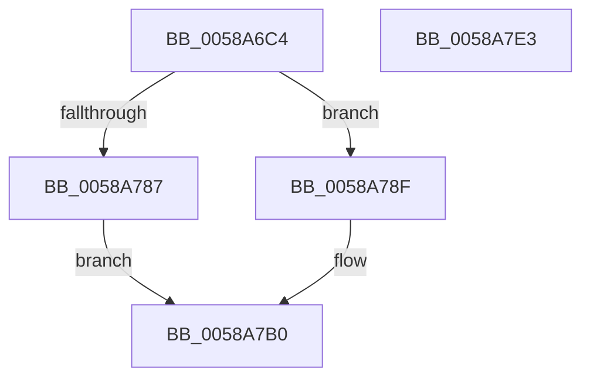

# HvlPrepareForHibernate

- RVA: `0x0058A6C4`–`0x0058A7E4` (길이 `288` bytes)
- VA: `0x000000014058A6C4`
- 실행 섹션: `.text`
- PDB 이름 있음: `예`; PDB Function 태그: `아니요`
- unwind 정보 RVA: `0x000BE68C`
- 디코드: `84`개 명령, `288/288` bytes 표시
- 미해석 바이트: `0` (있으면 어셈블리에 `.byte`로 보존)

> 이 문서는 커널 이미지의 기계어와 PDB 기호를 분석해 생성했습니다. 4번과 5번은 함수 원형과 자료형을 바이너리 사용 방식에서 추정한 C 해석이며 원본 소스 복구 결과는 아닙니다.

## 1. Dependencies

- 직접 호출 지점: **5**; 고유 호출 대상: **3**
- 직접 호출자로 확인된 함수: **1**
- RIP 상대 이미지 참조: **0**

### Outgoing calls
- `0x0058A71B` → [HvlpAcquireHypercallPage](../47/HvlpAcquireHypercallPage_function_00471410.md) (function, `0x00471410`)
- `0x0058A732` → [HvlpAcquireHypercallPage](../47/HvlpAcquireHypercallPage_function_00471410.md) (function, `0x00471410`)
- `0x0058A77D` → [HvcallInitiateHypercall](../31/HvcallInitiateHypercall_function_00313630.md) (function, `0x00313630`)
- `0x0058A7B4` → [HvlpReleaseHypercallPage](../31/HvlpReleaseHypercallPage_function_00313480.md) (function, `0x00313480`)
- `0x0058A7BD` → [HvlpReleaseHypercallPage](../31/HvlpReleaseHypercallPage_function_00313480.md) (function, `0x00313480`)

### Direct callers
- [PopSaveHiberContext](../../pagelk/B6/PopSaveHiberContext_function_00B6F050.md) at `0x00B6F3E3`

### Static image references
- 디코드된 RIP-relative 메모리 참조가 없습니다.

## 2. Other-region calls and transfers

- 다른 실행 섹션으로 향하는 call: **0**
- 별도 외부 분기/꼬리 이동을 확인하지 못했습니다.

## 3. Assembly (complete function range)

```asm
0058A6C4  48 89 5C 24 08                  mov qword ptr [rsp + 8], rbx
0058A6C9  48 89 74 24 10                  mov qword ptr [rsp + 0x10], rsi
0058A6CE  48 89 7C 24 18                  mov qword ptr [rsp + 0x18], rdi
0058A6D3  55                              push rbp
0058A6D4  41 54                           push r12
0058A6D6  41 55                           push r13
0058A6D8  41 56                           push r14
0058A6DA  41 57                           push r15
0058A6DC  48 8B EC                        mov rbp, rsp
0058A6DF  48 83 EC 60                     sub rsp, 0x60
0058A6E3  33 C0                           xor eax, eax
0058A6E5  0F 57 C0                        xorps xmm0, xmm0
0058A6E8  4D 8B F9                        mov r15, r9
0058A6EB  48 89 45 F0                     mov qword ptr [rbp - 0x10], rax
0058A6EF  4D 8B E0                        mov r12, r8
0058A6F2  89 45 F8                        mov dword ptr [rbp - 8], eax
0058A6F5  4C 8B EA                        mov r13, rdx
0058A6F8  48 89 45 D0                     mov qword ptr [rbp - 0x30], rax
0058A6FC  48 8B F9                        mov rdi, rcx
0058A6FF  89 45 D8                        mov dword ptr [rbp - 0x28], eax
0058A702  44 8D 48 58                     lea r9d, [rax + 0x58]
0058A706  45 33 C0                        xor r8d, r8d
0058A709  8D 50 01                        lea edx, [rax + 1]
0058A70C  45 33 F6                        xor r14d, r14d
0058A70F  48 8D 4D E0                     lea rcx, [rbp - 0x20]
0058A713  0F 11 45 E0                     movups xmmword ptr [rbp - 0x20], xmm0
0058A717  0F 11 45 C0                     movups xmmword ptr [rbp - 0x40], xmm0
0058A71B  E8 F0 6C EE FF                  call 0x140471410
0058A720  45 8D 4E 20                     lea r9d, [r14 + 0x20]
0058A724  45 33 C0                        xor r8d, r8d
0058A727  41 8D 56 02                     lea edx, [r14 + 2]
0058A72B  48 8B D8                        mov rbx, rax
0058A72E  48 8D 4D C0                     lea rcx, [rbp - 0x40]
0058A732  E8 D9 6C EE FF                  call 0x140471410
0058A737  0F 28 07                        movaps xmm0, xmmword ptr [rdi]
0058A73A  48 8B F0                        mov rsi, rax
0058A73D  0F 28 4F 10                     movaps xmm1, xmmword ptr [rdi + 0x10]
0058A741  33 C0                           xor eax, eax
0058A743  4C 8B 45 D8                     mov r8, qword ptr [rbp - 0x28]
0058A747  B9 86 00 00 00                  mov ecx, 0x86
0058A74C  48 8B 55 F8                     mov rdx, qword ptr [rbp - 8]
0058A750  89 43 51                        mov dword ptr [rbx + 0x51], eax
0058A753  66 89 43 55                     mov word ptr [rbx + 0x55], ax
0058A757  88 43 57                        mov byte ptr [rbx + 0x57], al
0058A75A  0F 11 03                        movups xmmword ptr [rbx], xmm0
0058A75D  44 88 73 50                     mov byte ptr [rbx + 0x50], r14b
0058A761  0F 28 47 20                     movaps xmm0, xmmword ptr [rdi + 0x20]
0058A765  0F 11 4B 10                     movups xmmword ptr [rbx + 0x10], xmm1
0058A769  0F 28 4F 30                     movaps xmm1, xmmword ptr [rdi + 0x30]
0058A76D  0F 11 43 20                     movups xmmword ptr [rbx + 0x20], xmm0
0058A771  0F 28 47 40                     movaps xmm0, xmmword ptr [rdi + 0x40]
0058A775  0F 11 4B 30                     movups xmmword ptr [rbx + 0x30], xmm1
0058A779  0F 11 43 40                     movups xmmword ptr [rbx + 0x40], xmm0
0058A77D  E8 AE 8E D8 FF                  call 0x140313630
0058A782  66 85 C0                        test ax, ax
0058A785  74 08                           je 0x14058a78f
0058A787  41 BE 01 00 00 C0               mov r14d, 0xc0000001
0058A78D  EB 21                           jmp 0x14058a7b0
0058A78F  48 8B 0E                        mov rcx, qword ptr [rsi]
0058A792  49 89 4D 00                     mov qword ptr [r13], rcx
0058A796  48 8B 4E 08                     mov rcx, qword ptr [rsi + 8]
0058A79A  49 89 0C 24                     mov qword ptr [r12], rcx
0058A79E  48 8B 4E 10                     mov rcx, qword ptr [rsi + 0x10]
0058A7A2  49 89 0F                        mov qword ptr [r15], rcx
0058A7A5  48 8B 4D 50                     mov rcx, qword ptr [rbp + 0x50]
0058A7A9  48 8B 56 18                     mov rdx, qword ptr [rsi + 0x18]
0058A7AD  48 89 11                        mov qword ptr [rcx], rdx
0058A7B0  48 8D 4D C0                     lea rcx, [rbp - 0x40]
0058A7B4  E8 C7 8C D8 FF                  call 0x140313480
0058A7B9  48 8D 4D E0                     lea rcx, [rbp - 0x20]
0058A7BD  E8 BE 8C D8 FF                  call 0x140313480
0058A7C2  4C 8D 5C 24 60                  lea r11, [rsp + 0x60]
0058A7C7  41 8B C6                        mov eax, r14d
0058A7CA  49 8B 5B 30                     mov rbx, qword ptr [r11 + 0x30]
0058A7CE  49 8B 73 38                     mov rsi, qword ptr [r11 + 0x38]
0058A7D2  49 8B 7B 40                     mov rdi, qword ptr [r11 + 0x40]
0058A7D6  49 8B E3                        mov rsp, r11
0058A7D9  41 5F                           pop r15
0058A7DB  41 5E                           pop r14
0058A7DD  41 5D                           pop r13
0058A7DF  41 5C                           pop r12
0058A7E1  5D                              pop rbp
0058A7E2  C3                              ret
0058A7E3  CC                              int3
```

## 4. C-style interpretation (structured pseudocode)

```c
__int64 __fastcall HvlPrepareForHibernate(__int64 a1, __int64 a2, __int64 a3, __int64 a4, __int64 a5)
{
    __int64 result;
    __int64 v_r14;
    __int64 v_rsp;
    unsigned __int64 v_stack_m28;
    unsigned int v_stack_m30;
    unsigned __int64 v_stack_m38;
    unsigned __int64 v_stack_m48;
    unsigned int v_stack_m50;
    unsigned __int64 v_stack_m58;
    unsigned __int64 v_stack_m68;
    unsigned __int64 v_stack_p10;
    unsigned __int64 v_stack_p18;
    unsigned __int64 v_stack_p8;

    v_stack_p8 = v_rbx;
    v_stack_p10 = v_rsi;
    v_stack_p18 = v_rdi;
    v_rsp = (v_rsp) - (96);
    result = 0;
    v_stack_m38 = 0;
    v_stack_m30 = 0;
    v_stack_m58 = 0;
    v_stack_m50 = 0;
    a3 = 0;
    v_r14 = 0;
    v_stack_m48 = v_xmm0;
    v_stack_m68 = v_xmm0;
    result = HvlpAcquireHypercallPage(v_stack_m48, result + 1, a3, result + 88);
    a3 = 0;
    result = HvlpAcquireHypercallPage(v_stack_m68, v_r14 + 2, a3, v_r14 + 32);
    result = 0;
    *(unsigned int *)(result + 81) = 0;
    *(unsigned __int16 *)(result + 85) = 0;
    *(unsigned __int8 *)(result + 87) = 0;
    *(unsigned __int64 *)(result) = v_xmm0;
    *(unsigned __int8 *)(result + 80) = 0;
    *(unsigned __int64 *)(result + 16) = v_xmm1;
    *(unsigned __int64 *)(result + 32) = v_xmm0;
    *(unsigned __int64 *)(result + 48) = v_xmm1;
    *(unsigned __int64 *)(result + 64) = v_xmm0;
    result = HvcallInitiateHypercall(134, v_stack_m30, v_stack_m50, v_r14 + 32);
    if ((unsigned __int16)(result) == 0) goto loc_0058A78F;
    goto loc_0058A7B0;
loc_0058A78F:
    *(unsigned __int64 *)(a2) = *(unsigned __int64 *)(result);
    *(unsigned __int64 *)(a3) = *(unsigned __int64 *)(result + 8);
    *(unsigned __int64 *)(a4) = *(unsigned __int64 *)(result + 16);
    *(unsigned __int64 *)(a5) = *(unsigned __int64 *)(result + 24);
loc_0058A7B0:
    result = HvlpReleaseHypercallPage(v_stack_m68, *(unsigned __int64 *)(result + 24), v_stack_m50, v_r14 + 32);
    result = HvlpReleaseHypercallPage(v_stack_m48, *(unsigned __int64 *)(result + 24), v_stack_m50, v_r14 + 32);
    return (unsigned int)((unsigned int)((unsigned int)(0xC0000001ULL)));
}
```

## 5. (Beta) C Style

```c
int64_t HvlPrepareForHibernate(void *Arg1, void *Arg2, void *Arg3, void *Arg4, void *Arg5)
{
    uint8_t *arg1 = (uint8_t *)Arg1;
    uint8_t *arg2 = (uint8_t *)Arg2;
    uint8_t *arg3 = (uint8_t *)Arg3;
    uint8_t *arg4 = (uint8_t *)Arg4;
    uint8_t *arg5 = (uint8_t *)Arg5;

    int64_t result;
    int64_t local_r14;
    int64_t local_rsp;
    uint64_t v_stack_m28;
    uint32_t v_stack_m30;
    uint64_t v_stack_m38;
    uint64_t v_stack_m48;
    uint32_t v_stack_m50;
    uint64_t v_stack_m58;
    uint64_t v_stack_m68;
    uint64_t v_stack_p10;
    uint64_t v_stack_p18;
    uint64_t v_stack_p8;

    v_stack_p8 = local_rbx;
    v_stack_p10 = local_rsi;
    v_stack_p18 = local_rdi;
    local_rsp = (local_rsp) - (96);
    result = 0;
    v_stack_m38 = 0;
    v_stack_m30 = 0;
    v_stack_m58 = 0;
    v_stack_m50 = 0;
    Arg3 = 0;
    local_r14 = 0;
    v_stack_m48 = v_xmm0;
    v_stack_m68 = v_xmm0;
    result = HvlpAcquireHypercallPage(v_stack_m48, result + 1, Arg3, result + 88);
    Arg3 = 0;
    result = HvlpAcquireHypercallPage(v_stack_m68, local_r14 + 2, Arg3, local_r14 + 32);
    result = 0;
    *(uint32_t *)(result + 0x51) = 0;
    *(uint16_t *)(result + 0x55) = 0;
    *(uint8_t *)(result + 0x57) = 0;
    *(uint64_t *)(result) = v_xmm0;
    *(uint8_t *)(result + 0x50) = 0;
    *(uint64_t *)(result + 0x10) = v_xmm1;
    *(uint64_t *)(result + 0x20) = v_xmm0;
    *(uint64_t *)(result + 0x30) = v_xmm1;
    *(uint64_t *)(result + 0x40) = v_xmm0;
    result = HvcallInitiateHypercall(134, v_stack_m30, v_stack_m50, local_r14 + 32);
    if ((uint16_t)(result) == 0) goto loc_0058A78F;
    goto loc_0058A7B0;
loc_0058A78F:
    *(uint64_t *)(arg2) = *(uint64_t *)(result);
    *(uint64_t *)(arg3) = *(uint64_t *)(result + 0x8);
    *(uint64_t *)(arg4) = *(uint64_t *)(result + 0x10);
    *(uint64_t *)(arg5) = *(uint64_t *)(result + 0x18);
loc_0058A7B0:
    result = HvlpReleaseHypercallPage(v_stack_m68, *(uint64_t *)(result + 0x18), v_stack_m50, local_r14 + 32);
    result = HvlpReleaseHypercallPage(v_stack_m48, *(uint64_t *)(result + 0x18), v_stack_m50, local_r14 + 32);
    return (uint32_t)((uint32_t)((uint32_t)(0xC0000001ULL)));
}
```

### 관측된 메모리 오프셋

구조체 형식이 확인되지 않은 접근은 인자 기준의 오프셋으로만 기록했습니다.

| 기준 인자 | 오프셋 표현 | 폭 (bit) | 접근 |
|---|---:|---:|---|
| `Arg1` | `+ 0x0` | `128` | `R` |
| `Arg1` | `+ 0x10` | `128` | `R` |
| `Arg1` | `+ 0x20` | `128` | `R` |
| `Arg1` | `+ 0x30` | `128` | `R` |
| `Arg1` | `+ 0x40` | `128` | `R` |
| `Arg2` | `+ 0x0` | `64` | `W` |
| `Arg3` | `+ 0x0` | `64` | `W` |
| `Arg4` | `+ 0x0` | `64` | `W` |
| `Arg5` | `+ 0x0` | `64` | `W` |

## 6. Execution-region graph

[열기: 2D/3D 그래프와 함수 탐색 컨트롤 패널](../../../control-panel.html?section=text&rva=0x0058A6C4&view=graph)

- 2D 그래프는 위에서 아래로 흐르고, 3D 그래프는 빈 공간을 드래그해 회전합니다. Shift+드래그는 이동, 휠은 확대·축소, 함수 노드 선택은 대상 보고서 이동입니다.

### Static fallback


