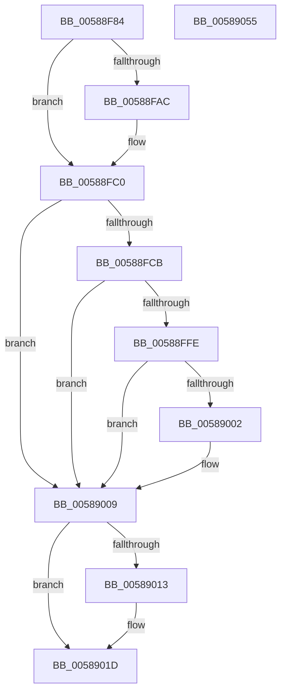

# HvlPrepareForRootCrashdump

- RVA: `0x00588F84`–`0x00589056` (길이 `210` bytes)
- VA: `0x0000000140588F84`
- 실행 섹션: `.text`
- PDB 이름 있음: `예`; PDB Function 태그: `아니요`
- unwind 정보 RVA: `0x000AF554`
- 디코드: `51`개 명령, `210/210` bytes 표시
- 미해석 바이트: `0` (있으면 어셈블리에 `.byte`로 보존)

> 이 문서는 커널 이미지의 기계어와 PDB 기호를 분석해 생성했습니다. 4번과 5번은 함수 원형과 자료형을 바이너리 사용 방식에서 추정한 C 해석이며 원본 소스 복구 결과는 아닙니다.

## 1. Dependencies

- 직접 호출 지점: **9**; 고유 호출 대상: **7**
- 직접 호출자로 확인된 함수: **2**
- RIP 상대 이미지 참조: **5**

### Outgoing calls
- `0x00588FB1` → [HvlNotifyRootCrashdump](HvlNotifyRootCrashdump_function_00588EF8.md) (function, `0x00588EF8`)
- `0x00588FBB` → [KeStallExecutionProcessor](../44/KeStallExecutionProcessor_function_0044F620.md) (function, `0x0044F620`)
- `0x00588FC2` → [HvlQueryVsmConnection](../45/HvlQueryVsmConnection_function_0045D180.md) (function, `0x0045D180`)
- `0x00588FD6` → [memset](../6C/memset_function_006C6C40.md) (function, `0x006C6C40`)
- `0x00588FEF` → [VslpEnterIumSecureMode](../23/VslpEnterIumSecureMode_function_00235E50.md) (function, `0x00235E50`)
- `0x00589018` → [HvlNotifyRootCrashdump](HvlNotifyRootCrashdump_function_00588EF8.md) (function, `0x00588EF8`)
- `0x00589026` → [guard_dispatch_icall](../6B/guard_dispatch_icall_function_006BAAD0.md) (function, `0x006BAAD0`)
- `0x00589037` → [guard_dispatch_icall](../6B/guard_dispatch_icall_function_006BAAD0.md) (function, `0x006BAAD0`)
- `0x00589047` → [_security_check_cookie](../6A/_security_check_cookie_function_006AC640.md) (function, `0x006AC640`)

### Direct callers
- [KeBugCheck2](../5B/KeBugCheck2_function_005B27D0.md) at `0x005B35D6`
- [KiBugCheckRecoveryPrepareForCrashDump](../5C/KiBugCheckRecoveryPrepareForCrashDump_function_005C7410.md) at `0x005C74AD`

### Static image references
- `0x00588F8D` → RVA `0x00E0A740` (`.data`; read)
- `0x00588F9F` → RVA `0x00FC6A90` (`ALMOSTRO`; read)
- `0x00589002` → RVA `0x00F0BD23` (`.data`; write)
- `0x0058901D` → RVA `0x00E00A00` (`.data`; read)
- `0x0058902B` → RVA `0x00E008F8` (`.data`; read)

## 2. Other-region calls and transfers

- 다른 실행 섹션으로 향하는 call: **0**
- 별도 외부 분기/꼬리 이동을 확인하지 못했습니다.

## 3. Assembly (complete function range)

```asm
00588F84  40 53                           push rbx
00588F86  48 81 EC A0 00 00 00            sub rsp, 0xa0
00588F8D  48 8B 05 AC 17 88 00            mov rax, qword ptr [rip + 0x8817ac]
00588F94  48 33 C4                        xor rax, rsp
00588F97  48 89 84 24 90 00 00 00         mov qword ptr [rsp + 0x90], rax
00588F9F  8B 05 EB DA A3 00               mov eax, dword ptr [rip + 0xa3daeb]
00588FA5  0F B6 D9                        movzx ebx, cl
00588FA8  A8 02                           test al, 2
00588FAA  74 14                           je 0x140588fc0
00588FAC  B9 01 00 00 00                  mov ecx, 1
00588FB1  E8 42 FF FF FF                  call 0x140588ef8
00588FB6  B9 50 C3 00 00                  mov ecx, 0xc350
00588FBB  E8 60 66 EC FF                  call 0x14044f620
00588FC0  33 C9                           xor ecx, ecx
00588FC2  E8 B9 41 ED FF                  call 0x14045d180
00588FC7  84 C0                           test al, al
00588FC9  74 3E                           je 0x140589009
00588FCB  44 8D 41 68                     lea r8d, [rcx + 0x68]
00588FCF  33 D2                           xor edx, edx
00588FD1  48 8D 4C 24 20                  lea rcx, [rsp + 0x20]
00588FD6  E8 65 DC 13 00                  call 0x1406c6c40
00588FDB  BA 07 01 00 00                  mov edx, 0x107
00588FE0  48 89 5C 24 28                  mov qword ptr [rsp + 0x28], rbx
00588FE5  4C 8D 4C 24 20                  lea r9, [rsp + 0x20]
00588FEA  45 33 C0                        xor r8d, r8d
00588FED  B1 02                           mov cl, 2
00588FEF  E8 5C CE CA FF                  call 0x140235e50
00588FF4  8B 05 96 DA A3 00               mov eax, dword ptr [rip + 0xa3da96]
00588FFA  A8 02                           test al, 2
00588FFC  74 0B                           je 0x140589009
00588FFE  84 DB                           test bl, bl
00589000  74 07                           je 0x140589009
00589002  C6 05 1A 2D 98 00 01            mov byte ptr [rip + 0x982d1a], 1
00589009  8B 05 81 DA A3 00               mov eax, dword ptr [rip + 0xa3da81]
0058900F  A8 02                           test al, 2
00589011  74 0A                           je 0x14058901d
00589013  B9 02 00 00 00                  mov ecx, 2
00589018  E8 DB FE FF FF                  call 0x140588ef8
0058901D  48 8B 05 DC 79 87 00            mov rax, qword ptr [rip + 0x8779dc]
00589024  B1 01                           mov cl, 1
00589026  E8 A5 1A 13 00                  call 0x1406baad0
0058902B  48 8B 05 C6 78 87 00            mov rax, qword ptr [rip + 0x8778c6]
00589032  B9 01 00 00 00                  mov ecx, 1
00589037  E8 94 1A 13 00                  call 0x1406baad0
0058903C  48 8B 8C 24 90 00 00 00         mov rcx, qword ptr [rsp + 0x90]
00589044  48 33 CC                        xor rcx, rsp
00589047  E8 F4 35 12 00                  call 0x1406ac640
0058904C  48 81 C4 A0 00 00 00            add rsp, 0xa0
00589053  5B                              pop rbx
00589054  C3                              ret
00589055  CC                              int3
```

## 4. C-style interpretation (structured pseudocode)

```c
__int64 __fastcall HvlPrepareForRootCrashdump(unsigned __int8 a1, int a2)
{
    __int64 result;
    __int64 v_rsp;
    unsigned __int64 v_stack_m18;
    unsigned __int64 v_stack_m80;
    unsigned __int64 v_stack_m88;

    v_rsp = (v_rsp) - (160);
    result = (*(unsigned __int64 *)(v_rip + 8918956)) ^ (v_rsp);
    v_stack_m18 = result;
    result = (unsigned int)(*(unsigned int *)(v_rip + 10738411));
    if ((((unsigned __int8)((unsigned int)(*(unsigned int *)(v_rip + 10738411)))) & (2)) != 0) {
        a1 = 1;
        result = HvlNotifyRootCrashdump(a1, a2, a3, a4);
        a1 = 0xC350ULL;
        result = KeStallExecutionProcessor(a1, a2, a3, a4);
    }
    a1 = 0;
    result = HvlQueryVsmConnection(a1, a2, a3, a4);
    if ((unsigned __int8)(result) == 0) goto loc_00589009;
    a2 = 0;
    result = memset(v_stack_m88, a2, a1 + 104, a4);
    v_stack_m80 = 0;
    a3 = 0;
    result = VslpEnterIumSecureMode(2, 263, a3, v_stack_m88);
    if ((((unsigned __int8)((unsigned int)(*(unsigned int *)(v_rip + 10738326)))) & (2)) == 0) goto loc_00589009;
    if (0 != 0) {
        *(unsigned __int8 *)(v_rip + 9973018) = 1;
    }
    result = (unsigned int)(*(unsigned int *)(v_rip + 10738305));
    if ((((unsigned __int8)((unsigned int)(*(unsigned int *)(v_rip + 10738305)))) & (2)) != 0) {
        a1 = 2;
        result = HvlNotifyRootCrashdump(a1, 263, a3, v_stack_m88);
    }
    result = guard_dispatch_icall(1, 263, a3, v_stack_m88);
    result = guard_dispatch_icall(1, 263, a3, v_stack_m88);
    a1 = (v_stack_m18) ^ (v_rsp);
    result = _security_check_cookie(a1, 263, a3, v_stack_m88);
    v_rsp = (v_rsp) + (160);
    return result;
}
```

## 5. (Beta) C Style

```c
int64_t HvlPrepareForRootCrashdump(uint8_t Arg1, int32_t Arg2)
{
    int64_t result;
    int64_t local_rsp;
    uint64_t v_stack_m18;
    uint64_t v_stack_m80;
    uint64_t v_stack_m88;

    local_rsp = (local_rsp) - (160);
    result = (*(uint64_t *)(v_rip + 0x8817AC)) ^ (local_rsp);
    v_stack_m18 = result;
    result = (uint32_t)(*(uint32_t *)(v_rip + 0xA3DAEB));
    if ((((uint8_t)((uint32_t)(*(uint32_t *)(v_rip + 0xA3DAEB)))) & (2)) != 0) {
        Arg1 = 1;
        result = HvlNotifyRootCrashdump(Arg1, Arg2, a3, a4);
        Arg1 = 0xC350ULL;
        result = KeStallExecutionProcessor(Arg1, Arg2, a3, a4);
    }
    Arg1 = 0;
    result = HvlQueryVsmConnection(Arg1, Arg2, a3, a4);
    if ((uint8_t)(result) == 0) goto loc_00589009;
    Arg2 = 0;
    result = memset(v_stack_m88, Arg2, Arg1 + 104, a4);
    v_stack_m80 = 0;
    a3 = 0;
    result = VslpEnterIumSecureMode(2, 263, a3, v_stack_m88);
    if ((((uint8_t)((uint32_t)(*(uint32_t *)(v_rip + 0xA3DA96)))) & (2)) == 0) goto loc_00589009;
    if (0 != 0) {
        *(uint8_t *)(v_rip + 0x982D1A) = 1;
    }
    result = (uint32_t)(*(uint32_t *)(v_rip + 0xA3DA81));
    if ((((uint8_t)((uint32_t)(*(uint32_t *)(v_rip + 0xA3DA81)))) & (2)) != 0) {
        Arg1 = 2;
        result = HvlNotifyRootCrashdump(Arg1, 263, a3, v_stack_m88);
    }
    result = guard_dispatch_icall(1, 263, a3, v_stack_m88);
    result = guard_dispatch_icall(1, 263, a3, v_stack_m88);
    Arg1 = (v_stack_m18) ^ (local_rsp);
    result = _security_check_cookie(Arg1, 263, a3, v_stack_m88);
    local_rsp = (local_rsp) + (160);
    return result;
}
```

## 6. Execution-region graph

[열기: 2D/3D 그래프와 함수 탐색 컨트롤 패널](../../../control-panel.html?section=text&rva=0x00588F84&view=graph)

- 2D 그래프는 위에서 아래로 흐르고, 3D 그래프는 빈 공간을 드래그해 회전합니다. Shift+드래그는 이동, 휠은 확대·축소, 함수 노드 선택은 대상 보고서 이동입니다.

### Static fallback


