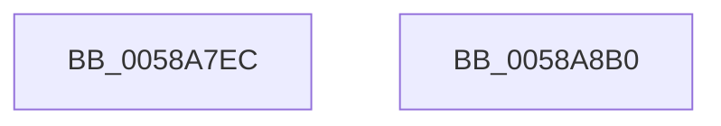

# HvlPrepareForSecureHibernate

- RVA: `0x0058A7EC`–`0x0058A8B1` (길이 `197` bytes)
- VA: `0x000000014058A7EC`
- 실행 섹션: `.text`
- PDB 이름 있음: `예`; PDB Function 태그: `아니요`
- unwind 정보 RVA: `0x000C6868`
- 디코드: `49`개 명령, `197/197` bytes 표시
- 미해석 바이트: `0` (있으면 어셈블리에 `.byte`로 보존)

> 이 문서는 커널 이미지의 기계어와 PDB 기호를 분석해 생성했습니다. 4번과 5번은 함수 원형과 자료형을 바이너리 사용 방식에서 추정한 C 해석이며 원본 소스 복구 결과는 아닙니다.

## 1. Dependencies

- 직접 호출 지점: **5**; 고유 호출 대상: **5**
- 직접 호출자로 확인된 함수: **1**
- RIP 상대 이미지 참조: **1**

### Outgoing calls
- `0x0058A82C` → [HvlpAcquireHypercallPage](../47/HvlpAcquireHypercallPage_function_00471410.md) (function, `0x00471410`)
- `0x0058A862` → [memset](../6C/memset_function_006C6C40.md) (function, `0x006C6C40`)
- `0x0058A884` → [VslpEnterIumSecureMode](../23/VslpEnterIumSecureMode_function_00235E50.md) (function, `0x00235E50`)
- `0x0058A890` → [HvlpReleaseHypercallPage](../31/HvlpReleaseHypercallPage_function_00313480.md) (function, `0x00313480`)
- `0x0058A8A2` → [_security_check_cookie](../6A/_security_check_cookie_function_006AC640.md) (function, `0x006AC640`)

### Direct callers
- [PopSaveHiberContext](../../pagelk/B6/PopSaveHiberContext_function_00B6F050.md) at `0x00B6F397`

### Static image references
- `0x0058A7F5` → RVA `0x00E0A740` (`.data`; read)

## 2. Other-region calls and transfers

- 다른 실행 섹션으로 향하는 call: **0**
- 별도 외부 분기/꼬리 이동을 확인하지 못했습니다.

## 3. Assembly (complete function range)

```asm
0058A7EC  40 53                           push rbx
0058A7EE  48 81 EC C0 00 00 00            sub rsp, 0xc0
0058A7F5  48 8B 05 44 FF 87 00            mov rax, qword ptr [rip + 0x87ff44]
0058A7FC  48 33 C4                        xor rax, rsp
0058A7FF  48 89 84 24 B0 00 00 00         mov qword ptr [rsp + 0xb0], rax
0058A807  33 C0                           xor eax, eax
0058A809  48 8B D9                        mov rbx, rcx
0058A80C  0F 57 C0                        xorps xmm0, xmm0
0058A80F  48 89 44 24 30                  mov qword ptr [rsp + 0x30], rax
0058A814  45 33 C0                        xor r8d, r8d
0058A817  89 44 24 38                     mov dword ptr [rsp + 0x38], eax
0058A81B  48 8D 4C 24 20                  lea rcx, [rsp + 0x20]
0058A820  44 8D 48 58                     lea r9d, [rax + 0x58]
0058A824  8D 50 01                        lea edx, [rax + 1]
0058A827  0F 11 44 24 20                  movups xmmword ptr [rsp + 0x20], xmm0
0058A82C  E8 DF 6B EE FF                  call 0x140471410
0058A831  0F 28 03                        movaps xmm0, xmmword ptr [rbx]
0058A834  48 8D 4C 24 40                  lea rcx, [rsp + 0x40]
0058A839  0F 28 4B 10                     movaps xmm1, xmmword ptr [rbx + 0x10]
0058A83D  33 D2                           xor edx, edx
0058A83F  0F 11 00                        movups xmmword ptr [rax], xmm0
0058A842  0F 28 43 20                     movaps xmm0, xmmword ptr [rbx + 0x20]
0058A846  44 8D 42 68                     lea r8d, [rdx + 0x68]
0058A84A  0F 11 48 10                     movups xmmword ptr [rax + 0x10], xmm1
0058A84E  0F 28 4B 30                     movaps xmm1, xmmword ptr [rbx + 0x30]
0058A852  0F 11 40 20                     movups xmmword ptr [rax + 0x20], xmm0
0058A856  0F 28 43 40                     movaps xmm0, xmmword ptr [rbx + 0x40]
0058A85A  0F 11 48 30                     movups xmmword ptr [rax + 0x30], xmm1
0058A85E  0F 11 40 40                     movups xmmword ptr [rax + 0x40], xmm0
0058A862  E8 D9 C3 13 00                  call 0x1406c6c40
0058A867  48 8B 44 24 38                  mov rax, qword ptr [rsp + 0x38]
0058A86C  4C 8D 4C 24 40                  lea r9, [rsp + 0x40]
0058A871  48 C1 E8 0C                     shr rax, 0xc
0058A875  BA 06 01 00 00                  mov edx, 0x106
0058A87A  45 33 C0                        xor r8d, r8d
0058A87D  48 89 44 24 48                  mov qword ptr [rsp + 0x48], rax
0058A882  B1 02                           mov cl, 2
0058A884  E8 C7 B5 CA FF                  call 0x140235e50
0058A889  48 8D 4C 24 20                  lea rcx, [rsp + 0x20]
0058A88E  8B D8                           mov ebx, eax
0058A890  E8 EB 8B D8 FF                  call 0x140313480
0058A895  8B C3                           mov eax, ebx
0058A897  48 8B 8C 24 B0 00 00 00         mov rcx, qword ptr [rsp + 0xb0]
0058A89F  48 33 CC                        xor rcx, rsp
0058A8A2  E8 99 1D 12 00                  call 0x1406ac640
0058A8A7  48 81 C4 C0 00 00 00            add rsp, 0xc0
0058A8AE  5B                              pop rbx
0058A8AF  C3                              ret
0058A8B0  CC                              int3
```

## 4. C-style interpretation (structured pseudocode)

```c
__int64 __fastcall HvlPrepareForSecureHibernate(__int64 a1, __int64 a2, int a3)
{
    __int64 result;
    __int64 v_rsp;
    unsigned __int64 v_stack_m18;
    unsigned __int64 v_stack_m80;
    unsigned __int64 v_stack_m88;
    unsigned int v_stack_m90;
    unsigned __int64 v_stack_m98;
    unsigned __int64 v_stack_mA8;

    v_rsp = (v_rsp) - (192);
    result = (*(unsigned __int64 *)(v_rip + 8912708)) ^ (v_rsp);
    v_stack_m18 = result;
    result = 0;
    v_stack_m98 = 0;
    a3 = 0;
    v_stack_m90 = 0;
    v_stack_mA8 = v_xmm0;
    result = HvlpAcquireHypercallPage(v_stack_mA8, result + 1, a3, result + 88);
    a2 = 0;
    *(unsigned __int64 *)(result) = v_xmm0;
    *(unsigned __int64 *)(result + 16) = v_xmm1;
    *(unsigned __int64 *)(result + 32) = v_xmm0;
    *(unsigned __int64 *)(result + 48) = v_xmm1;
    *(unsigned __int64 *)(result + 64) = v_xmm0;
    result = memset(v_stack_m88, a2, a2 + 104, result + 88);
    result = (v_stack_m90) >> (12);
    a3 = 0;
    v_stack_m80 = result;
    result = VslpEnterIumSecureMode(2, 262, a3, v_stack_m88);
    result = HvlpReleaseHypercallPage(v_stack_mA8, 262, a3, v_stack_m88);
    a1 = (v_stack_m18) ^ (v_rsp);
    result = _security_check_cookie(a1, 262, a3, v_stack_m88);
    v_rsp = (v_rsp) + (192);
    return result;
}
```

## 5. (Beta) C Style

```c
int64_t HvlPrepareForSecureHibernate(void *Arg1, int64_t Arg2, int32_t Arg3)
{
    uint8_t *arg1 = (uint8_t *)Arg1;

    int64_t result;
    int64_t local_rsp;
    uint64_t v_stack_m18;
    uint64_t v_stack_m80;
    uint64_t v_stack_m88;
    uint32_t v_stack_m90;
    uint64_t v_stack_m98;
    uint64_t v_stack_mA8;

    local_rsp = (local_rsp) - (192);
    result = (*(uint64_t *)(v_rip + 0x87FF44)) ^ (local_rsp);
    v_stack_m18 = result;
    result = 0;
    v_stack_m98 = 0;
    Arg3 = 0;
    v_stack_m90 = 0;
    v_stack_mA8 = v_xmm0;
    result = HvlpAcquireHypercallPage(v_stack_mA8, result + 1, Arg3, result + 88);
    Arg2 = 0;
    *(uint64_t *)(result) = v_xmm0;
    *(uint64_t *)(result + 0x10) = v_xmm1;
    *(uint64_t *)(result + 0x20) = v_xmm0;
    *(uint64_t *)(result + 0x30) = v_xmm1;
    *(uint64_t *)(result + 0x40) = v_xmm0;
    result = memset(v_stack_m88, Arg2, Arg2 + 104, result + 88);
    result = (v_stack_m90) >> (12);
    Arg3 = 0;
    v_stack_m80 = result;
    result = VslpEnterIumSecureMode(2, 262, Arg3, v_stack_m88);
    result = HvlpReleaseHypercallPage(v_stack_mA8, 262, Arg3, v_stack_m88);
    Arg1 = (v_stack_m18) ^ (local_rsp);
    result = _security_check_cookie(Arg1, 262, Arg3, v_stack_m88);
    local_rsp = (local_rsp) + (192);
    return result;
}
```

### 관측된 메모리 오프셋

구조체 형식이 확인되지 않은 접근은 인자 기준의 오프셋으로만 기록했습니다.

| 기준 인자 | 오프셋 표현 | 폭 (bit) | 접근 |
|---|---:|---:|---|
| `Arg1` | `+ 0x0` | `128` | `R` |
| `Arg1` | `+ 0x10` | `128` | `R` |
| `Arg1` | `+ 0x20` | `128` | `R` |
| `Arg1` | `+ 0x30` | `128` | `R` |
| `Arg1` | `+ 0x40` | `128` | `R` |

## 6. Execution-region graph

[열기: 2D/3D 그래프와 함수 탐색 컨트롤 패널](../../../control-panel.html?section=text&rva=0x0058A7EC&view=graph)

- 2D 그래프는 위에서 아래로 흐르고, 3D 그래프는 빈 공간을 드래그해 회전합니다. Shift+드래그는 이동, 휠은 확대·축소, 함수 노드 선택은 대상 보고서 이동입니다.

### Static fallback


