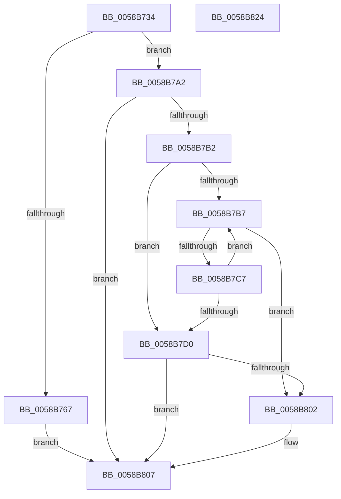

# HvlPrepareLivedumpDescriptor

- RVA: `0x0058B734`–`0x0058B825` (길이 `241` bytes)
- VA: `0x000000014058B734`
- 실행 섹션: `.text`
- PDB 이름 있음: `예`; PDB Function 태그: `아니요`
- unwind 정보 RVA: `0x00060130`
- 디코드: `63`개 명령, `241/241` bytes 표시
- 미해석 바이트: `0` (있으면 어셈블리에 `.byte`로 보존)

> 이 문서는 커널 이미지의 기계어와 PDB 기호를 분석해 생성했습니다. 4번과 5번은 함수 원형과 자료형을 바이너리 사용 방식에서 추정한 C 해석이며 원본 소스 복구 결과는 아닙니다.

## 1. Dependencies

- 직접 호출 지점: **5**; 고유 호출 대상: **5**
- 직접 호출자로 확인된 함수: **1**
- RIP 상대 이미지 참조: **2**

### Outgoing calls
- `0x0058B799` → [HvlSetupLiveDumpBuffer](HvlSetupLiveDumpBuffer_function_0058DA4C.md) (function, `0x0058DA4C`)
- `0x0058B7A7` → [VslpLiveDumpStart](VslpLiveDumpStart_function_0058FC58.md) (function, `0x0058FC58`)
- `0x0058B7BC` → [VslpAddLiveDumpBufferChunk](VslpAddLiveDumpBufferChunk_function_0058FA30.md) (function, `0x0058FA30`)
- `0x0058B7F7` → [VslpSetupLiveDumpBuffer](VslpSetupLiveDumpBuffer_function_0058FCE4.md) (function, `0x0058FCE4`)
- `0x0058B802` → [VslAbortLiveDump](VslAbortLiveDump_function_0058DE64.md) (function, `0x0058DE64`)

### Direct callers
- [IopLiveDumpAllocateExtraBuffers](../59/IopLiveDumpAllocateExtraBuffers_function_00599A9C.md) at `0x00599B92`

### Static image references
- `0x0058B74D` → RVA `0x00FC6A84` (`ALMOSTRO`; read)
- `0x0058B757` → RVA `0x00E0A9D4` (`.data`; read)

## 2. Other-region calls and transfers

- 다른 실행 섹션으로 향하는 call: **0**
- 별도 외부 분기/꼬리 이동을 확인하지 못했습니다.

## 3. Assembly (complete function range)

```asm
0058B734  4C 8B DC                        mov r11, rsp
0058B737  49 89 5B 08                     mov qword ptr [r11 + 8], rbx
0058B73B  49 89 6B 10                     mov qword ptr [r11 + 0x10], rbp
0058B73F  49 89 73 18                     mov qword ptr [r11 + 0x18], rsi
0058B743  49 89 7B 20                     mov qword ptr [r11 + 0x20], rdi
0058B747  41 56                           push r14
0058B749  48 83 EC 40                     sub rsp, 0x40
0058B74D  80 3D 30 B3 A3 00 00            cmp byte ptr [rip + 0xa3b330], 0
0058B754  45 8B F0                        mov r14d, r8d
0058B757  8B 2D 77 F2 87 00               mov ebp, dword ptr [rip + 0x87f277]
0058B75D  8B FA                           mov edi, edx
0058B75F  44 8B C5                        mov r8d, ebp
0058B762  48 8B F1                        mov rsi, rcx
0058B765  75 3B                           jne 0x14058b7a2
0058B767  48 8B 84 24 80 00 00 00         mov rax, qword ptr [rsp + 0x80]
0058B76F  4C 8B 4C 24 70                  mov r9, qword ptr [rsp + 0x70]
0058B774  48 83 20 00                     and qword ptr [rax], 0
0058B778  48 8B 84 24 88 00 00 00         mov rax, qword ptr [rsp + 0x88]
0058B780  48 83 20 00                     and qword ptr [rax], 0
0058B784  48 8B 84 24 90 00 00 00         mov rax, qword ptr [rsp + 0x90]
0058B78C  49 89 43 E0                     mov qword ptr [r11 - 0x20], rax
0058B790  48 8B 44 24 78                  mov rax, qword ptr [rsp + 0x78]
0058B795  49 89 43 D8                     mov qword ptr [r11 - 0x28], rax
0058B799  E8 AE 22 00 00                  call 0x14058da4c
0058B79E  8B D8                           mov ebx, eax
0058B7A0  EB 65                           jmp 0x14058b807
0058B7A2  41 8B D6                        mov edx, r14d
0058B7A5  8B CF                           mov ecx, edi
0058B7A7  E8 AC 44 00 00                  call 0x14058fc58
0058B7AC  8B D8                           mov ebx, eax
0058B7AE  85 C0                           test eax, eax
0058B7B0  78 55                           js 0x14058b807
0058B7B2  41 03 FE                        add edi, r14d
0058B7B5  74 19                           je 0x14058b7d0
0058B7B7  48 8B 0E                        mov rcx, qword ptr [rsi]
0058B7BA  8B D5                           mov edx, ebp
0058B7BC  E8 6F 42 00 00                  call 0x14058fa30
0058B7C1  8B D8                           mov ebx, eax
0058B7C3  85 C0                           test eax, eax
0058B7C5  78 3B                           js 0x14058b802
0058B7C7  48 83 C6 08                     add rsi, 8
0058B7CB  83 C7 FF                        add edi, -1
0058B7CE  75 E7                           jne 0x14058b7b7
0058B7D0  48 8B 84 24 90 00 00 00         mov rax, qword ptr [rsp + 0x90]
0058B7D8  4C 8B 8C 24 88 00 00 00         mov r9, qword ptr [rsp + 0x88]
0058B7E0  4C 8B 84 24 80 00 00 00         mov r8, qword ptr [rsp + 0x80]
0058B7E8  48 8B 54 24 78                  mov rdx, qword ptr [rsp + 0x78]
0058B7ED  48 8B 4C 24 70                  mov rcx, qword ptr [rsp + 0x70]
0058B7F2  48 89 44 24 20                  mov qword ptr [rsp + 0x20], rax
0058B7F7  E8 E8 44 00 00                  call 0x14058fce4
0058B7FC  8B D8                           mov ebx, eax
0058B7FE  85 C0                           test eax, eax
0058B800  79 05                           jns 0x14058b807
0058B802  E8 5D 26 00 00                  call 0x14058de64
0058B807  48 8B 6C 24 58                  mov rbp, qword ptr [rsp + 0x58]
0058B80C  8B C3                           mov eax, ebx
0058B80E  48 8B 5C 24 50                  mov rbx, qword ptr [rsp + 0x50]
0058B813  48 8B 74 24 60                  mov rsi, qword ptr [rsp + 0x60]
0058B818  48 8B 7C 24 68                  mov rdi, qword ptr [rsp + 0x68]
0058B81D  48 83 C4 40                     add rsp, 0x40
0058B821  41 5E                           pop r14
0058B823  C3                              ret
0058B824  CC                              int3
```

## 4. C-style interpretation (structured pseudocode)

```c
__int64 __fastcall HvlPrepareLivedumpDescriptor(__int64 a1, int a2, int a3, __int64 a4, __int64 a5, __int64 a6, __int64 a7, __int64 a8, __int64 a9)
{
    __int64 result;
    __int64 v_rdi;
    __int64 v_rsi;
    __int64 v_rsp;
    unsigned __int64 v_stack_m28;
    unsigned __int64 v_stack_p10;
    unsigned __int64 v_stack_p18;
    unsigned __int64 v_stack_p20;
    unsigned __int64 v_stack_p8;

    *(unsigned __int64 *)(v_rsp + 8) = v_rbx;
    *(unsigned __int64 *)(v_rsp + 16) = v_rbp;
    *(unsigned __int64 *)(v_rsp + 24) = v_rsi;
    *(unsigned __int64 *)(v_rsp + 32) = v_rdi;
    v_rsp = (v_rsp) - (64);
    if ((*(unsigned __int8 *)(v_rip + 10728240)) != 0) goto loc_0058B7A2;
    *(unsigned __int64 *)(v_rsp - 32) = a9;
    *(unsigned __int64 *)(v_rsp - 40) = a6;
    result = HvlSetupLiveDumpBuffer(a1, a2, (unsigned int)((unsigned int)((unsigned int)(*(unsigned int *)(v_rip + 8909431)))), a5);
    goto loc_0058B807;
loc_0058B7A2:
    result = VslpLiveDumpStart((unsigned int)((unsigned int)((unsigned int)(a2))), (unsigned int)((unsigned int)((unsigned int)(a3))), (unsigned int)((unsigned int)((unsigned int)(*(unsigned int *)(v_rip + 8909431)))), a5);
    if (sign_flag) goto loc_0058B807;
    v_rdi = (unsigned int)(((unsigned int)(a2)) + ((unsigned int)((unsigned int)(a3))));
    if (condition_is_equal) goto loc_0058B7D0;
loc_0058B7B7:
    result = VslpAddLiveDumpBufferChunk(*(unsigned __int64 *)(a1), (unsigned int)((unsigned int)((unsigned int)(*(unsigned int *)(v_rip + 8909431)))), (unsigned int)((unsigned int)((unsigned int)(*(unsigned int *)(v_rip + 8909431)))), a5);
    if (sign_flag) goto loc_0058B802;
    v_rsi = (a1) + (8);
    v_rdi = (unsigned int)((v_rdi) + (-1));
    if (condition_is_not_equal) goto loc_0058B7B7;
loc_0058B7D0:
    v_stack_m28 = a9;
    result = VslpSetupLiveDumpBuffer(a5, a6, a7, a8);
    if (sign_flag) {
        result = VslAbortLiveDump(a5, a6, a7, a8);
    }
    v_rsp = (v_rsp) + (64);
    return (unsigned int)((unsigned int)((unsigned int)((unsigned int)(result))));
}
```

## 5. (Beta) C Style

```c
int64_t HvlPrepareLivedumpDescriptor(void *Arg1, int32_t Arg2, int32_t Arg3, int64_t Arg4, int64_t Arg5, int64_t Arg6, void *Arg7, void *Arg8, int64_t Arg9)
{
    uint8_t *arg1 = (uint8_t *)Arg1;
    uint8_t *arg7 = (uint8_t *)Arg7;
    uint8_t *arg8 = (uint8_t *)Arg8;

    int64_t result;
    int64_t local_rdi;
    int64_t local_rsi;
    int64_t local_rsp;
    uint64_t v_stack_m28;
    uint64_t v_stack_p10;
    uint64_t v_stack_p18;
    uint64_t v_stack_p20;
    uint64_t v_stack_p8;

    *(uint64_t *)(local_rsp + 0x8) = local_rbx;
    *(uint64_t *)(local_rsp + 0x10) = local_rbp;
    *(uint64_t *)(local_rsp + 0x18) = local_rsi;
    *(uint64_t *)(local_rsp + 0x20) = local_rdi;
    local_rsp = (local_rsp) - (64);
    if ((*(uint8_t *)(v_rip + 0xA3B330)) != 0) goto loc_0058B7A2;
    *(uint64_t *)(local_rsp - 0x20) = Arg9;
    *(uint64_t *)(local_rsp - 0x28) = Arg6;
    result = HvlSetupLiveDumpBuffer(Arg1, Arg2, (uint32_t)((uint32_t)((uint32_t)(*(uint32_t *)(v_rip + 0x87F277)))), Arg5);
    goto loc_0058B807;
loc_0058B7A2:
    result = VslpLiveDumpStart((uint32_t)((uint32_t)((uint32_t)(Arg2))), (uint32_t)((uint32_t)((uint32_t)(Arg3))), (uint32_t)((uint32_t)((uint32_t)(*(uint32_t *)(v_rip + 0x87F277)))), Arg5);
    if (sign_flag) goto loc_0058B807;
    local_rdi = (uint32_t)(((uint32_t)(Arg2)) + ((uint32_t)((uint32_t)(Arg3))));
    if (condition_is_equal) goto loc_0058B7D0;
loc_0058B7B7:
    result = VslpAddLiveDumpBufferChunk(*(uint64_t *)(arg1), (uint32_t)((uint32_t)((uint32_t)(*(uint32_t *)(v_rip + 0x87F277)))), (uint32_t)((uint32_t)((uint32_t)(*(uint32_t *)(v_rip + 0x87F277)))), Arg5);
    if (sign_flag) goto loc_0058B802;
    local_rsi = (Arg1) + (8);
    local_rdi = (uint32_t)((local_rdi) + (-1));
    if (condition_is_not_equal) goto loc_0058B7B7;
loc_0058B7D0:
    v_stack_m28 = Arg9;
    result = VslpSetupLiveDumpBuffer(Arg5, Arg6, Arg7, Arg8);
    if (sign_flag) {
        result = VslAbortLiveDump(Arg5, Arg6, Arg7, Arg8);
    }
    local_rsp = (local_rsp) + (64);
    return (uint32_t)((uint32_t)((uint32_t)((uint32_t)(result))));
}
```

### 관측된 메모리 오프셋

구조체 형식이 확인되지 않은 접근은 인자 기준의 오프셋으로만 기록했습니다.

| 기준 인자 | 오프셋 표현 | 폭 (bit) | 접근 |
|---|---:|---:|---|
| `Arg1` | `+ 0x0` | `64` | `R` |
| `Arg7` | `+ 0x0` | `64` | `R/W` |
| `Arg8` | `+ 0x0` | `64` | `R/W` |

## 6. Execution-region graph

[열기: 2D/3D 그래프와 함수 탐색 컨트롤 패널](../../../control-panel.html?section=text&rva=0x0058B734&view=graph)

- 2D 그래프는 위에서 아래로 흐르고, 3D 그래프는 빈 공간을 드래그해 회전합니다. Shift+드래그는 이동, 휠은 확대·축소, 함수 노드 선택은 대상 보고서 이동입니다.

### Static fallback


