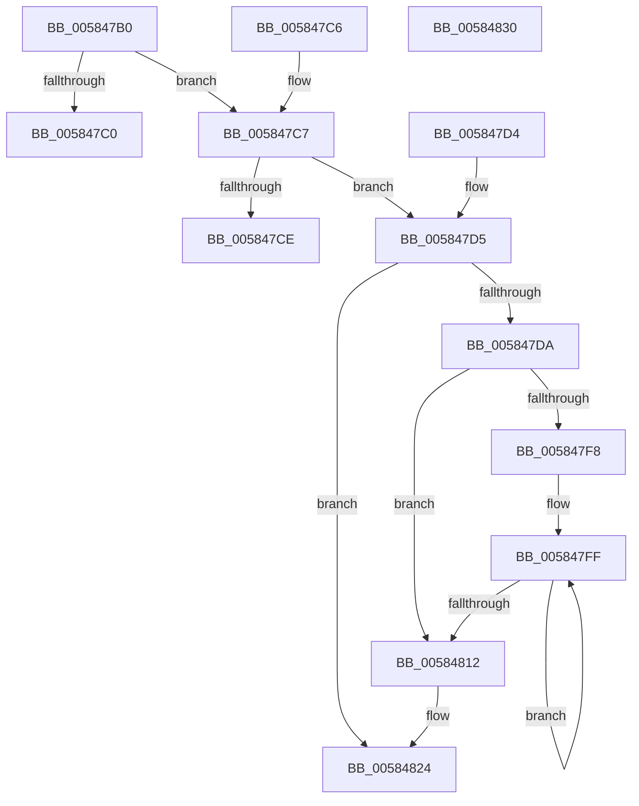

# HvlQueryActiveProcessors

- RVA: `0x005847B0`–`0x00584831` (길이 `129` bytes)
- VA: `0x00000001405847B0`
- 실행 섹션: `.text`
- PDB 이름 있음: `예`; PDB Function 태그: `아니요`
- unwind 정보 RVA: `0x000DB714`
- 디코드: `40`개 명령, `129/129` bytes 표시
- 미해석 바이트: `0` (있으면 어셈블리에 `.byte`로 보존)

> 이 문서는 커널 이미지의 기계어와 PDB 기호를 분석해 생성했습니다. 4번과 5번은 함수 원형과 자료형을 바이너리 사용 방식에서 추정한 C 해석이며 원본 소스 복구 결과는 아닙니다.

## 1. Dependencies

- 직접 호출 지점: **0**; 고유 호출 대상: **0**
- 직접 호출자로 확인된 함수: **1**
- RIP 상대 이미지 참조: **3**

### Outgoing calls
- 직접 디코드된 call 명령이 없습니다.

### Direct callers
- [ExpQuerySystemInformation](../../page/A5/ExpQuerySystemInformation_function_00A57858.md) at `0x00A59C5C`

### Static image references
- `0x005847B0` → RVA `0x00FC6A90` (`ALMOSTRO`; read)
- `0x005847DD` → RVA `0x00FC6C74` (`ALMOSTRO`; read)
- `0x005847E4` → RVA `0x00FC6C40` (`ALMOSTRO`; read)

## 2. Other-region calls and transfers

- 다른 실행 섹션으로 향하는 call: **0**
- 별도 외부 분기/꼬리 이동을 확인하지 못했습니다.

## 3. Assembly (complete function range)

```asm
005847B0  8B 05 DA 22 A4 00               mov eax, dword ptr [rip + 0xa422da]
005847B6  4C 8B C2                        mov r8, rdx
005847B9  4C 8B C9                        mov r9, rcx
005847BC  A8 02                           test al, 2
005847BE  75 07                           jne 0x1405847c7
005847C0  B8 22 00 00 C0                  mov eax, 0xc0000022
005847C5  C3                              ret
005847C6  CC                              int3
005847C7  33 D2                           xor edx, edx
005847C9  4D 85 C9                        test r9, r9
005847CC  75 07                           jne 0x1405847d5
005847CE  B8 0D 00 00 C0                  mov eax, 0xc000000d
005847D3  C3                              ret
005847D4  CC                              int3
005847D5  4D 85 C0                        test r8, r8
005847D8  74 4A                           je 0x140584824
005847DA  44 8B 11                        mov r10d, dword ptr [rcx]
005847DD  44 39 15 90 24 A4 00            cmp dword ptr [rip + 0xa42490], r10d
005847E4  48 8B 0D 55 24 A4 00            mov rcx, qword ptr [rip + 0xa42455]
005847EB  44 0F 42 15 81 24 A4 00         cmovb r10d, dword ptr [rip + 0xa42481]
005847F3  45 85 D2                        test r10d, r10d
005847F6  74 1A                           je 0x140584812
005847F8  48 83 C1 04                     add rcx, 4
005847FC  41 8B D2                        mov edx, r10d
005847FF  8B 01                           mov eax, dword ptr [rcx]
00584801  48 8D 49 68                     lea rcx, [rcx + 0x68]
00584805  41 89 00                        mov dword ptr [r8], eax
00584808  4D 8D 40 04                     lea r8, [r8 + 4]
0058480C  48 83 EA 01                     sub rdx, 1
00584810  75 ED                           jne 0x1405847ff
00584812  8B 05 5C 24 A4 00               mov eax, dword ptr [rip + 0xa4245c]
00584818  41 39 01                        cmp dword ptr [r9], eax
0058481B  1B C0                           sbb eax, eax
0058481D  25 23 00 00 C0                  and eax, 0xc0000023
00584822  8B D0                           mov edx, eax
00584824  8B 0D 4A 24 A4 00               mov ecx, dword ptr [rip + 0xa4244a]
0058482A  8B C2                           mov eax, edx
0058482C  41 89 09                        mov dword ptr [r9], ecx
0058482F  C3                              ret
00584830  CC                              int3
```

## 4. C-style interpretation (structured pseudocode)

```c
__int64 __fastcall HvlQueryActiveProcessors(__int64 a1, __int64 a2)
{
    __int64 result;
    __int64 v_r10;

    if ((((unsigned __int8)((unsigned int)(*(unsigned int *)(v_rip + 10756826)))) & (2)) != 0) goto loc_005847C7;
    return (unsigned int)(0xC0000022ULL);
loc_005847C7:
    a2 = 0;
    if (a1 != 0) goto loc_005847D5;
    return (unsigned int)(0xC000000DULL);
loc_005847D5:
    if (0 == 0) goto loc_00584824;
    v_r10 = (unsigned int)(*(unsigned int *)(a1));
    if ((*(unsigned int *)(v_rip + 10757264)) < ((unsigned int)((unsigned int)(*(unsigned int *)(a1))))) { v_r10 = *(unsigned int *)(v_rip + 10757249); }
    if ((unsigned int)(v_r10) == 0) goto loc_00584812;
    a1 = (*(unsigned __int64 *)(v_rip + 10757205)) + (4);
loc_005847FF:
    *(unsigned int *)(a2) = (unsigned int)((unsigned int)(*(unsigned int *)(a1)));
    a2 = ((unsigned int)((unsigned int)(v_r10))) - (1);
    if (condition_is_not_equal) goto loc_005847FF;
loc_00584812:
    result = (unsigned int)(((unsigned int)(*(unsigned int *)(v_rip + 10757212))) & (0xC0000023ULL));
loc_00584824:
    *(unsigned int *)(a1) = (unsigned int)((unsigned int)(*(unsigned int *)(v_rip + 10757194)));
    return (unsigned int)((unsigned int)((unsigned int)((unsigned int)(result))));
}
```

## 5. (Beta) C Style

```c
int64_t HvlQueryActiveProcessors(void *Arg1, int64_t Arg2)
{
    uint8_t *arg1 = (uint8_t *)Arg1;

    int64_t result;
    int64_t local_r10;

    if ((((uint8_t)((uint32_t)(*(uint32_t *)(v_rip + 0xA422DA)))) & (2)) != 0) goto loc_005847C7;
    return (uint32_t)(0xC0000022ULL);
loc_005847C7:
    Arg2 = 0;
    if (Arg1 != NULL) goto loc_005847D5;
    return (uint32_t)(0xC000000DULL);
loc_005847D5:
    if (0 == 0) goto loc_00584824;
    local_r10 = (uint32_t)(*(uint32_t *)(arg1));
    if ((*(uint32_t *)(v_rip + 0xA42490)) < ((uint32_t)((uint32_t)(*(uint32_t *)(arg1))))) { local_r10 = *(uint32_t *)(v_rip + 0xA42481); }
    if ((uint32_t)(local_r10) == 0) goto loc_00584812;
    Arg1 = (*(uint64_t *)(v_rip + 0xA42455)) + (4);
loc_005847FF:
    *(uint32_t *)(Arg2) = (uint32_t)((uint32_t)(*(uint32_t *)(arg1)));
    Arg2 = ((uint32_t)((uint32_t)(local_r10))) - (1);
    if (condition_is_not_equal) goto loc_005847FF;
loc_00584812:
    result = (uint32_t)(((uint32_t)(*(uint32_t *)(v_rip + 0xA4245C))) & (0xC0000023ULL));
loc_00584824:
    *(uint32_t *)(arg1) = (uint32_t)((uint32_t)(*(uint32_t *)(v_rip + 0xA4244A)));
    return (uint32_t)((uint32_t)((uint32_t)((uint32_t)(result))));
}
```

### 관측된 메모리 오프셋

구조체 형식이 확인되지 않은 접근은 인자 기준의 오프셋으로만 기록했습니다.

| 기준 인자 | 오프셋 표현 | 폭 (bit) | 접근 |
|---|---:|---:|---|
| `Arg1` | `+ 0x0` | `32` | `R` |

## 6. Execution-region graph

[열기: 2D/3D 그래프와 함수 탐색 컨트롤 패널](../../../control-panel.html?section=text&rva=0x005847B0&view=graph)

- 2D 그래프는 위에서 아래로 흐르고, 3D 그래프는 빈 공간을 드래그해 회전합니다. Shift+드래그는 이동, 휠은 확대·축소, 함수 노드 선택은 대상 보고서 이동입니다.

### Static fallback


