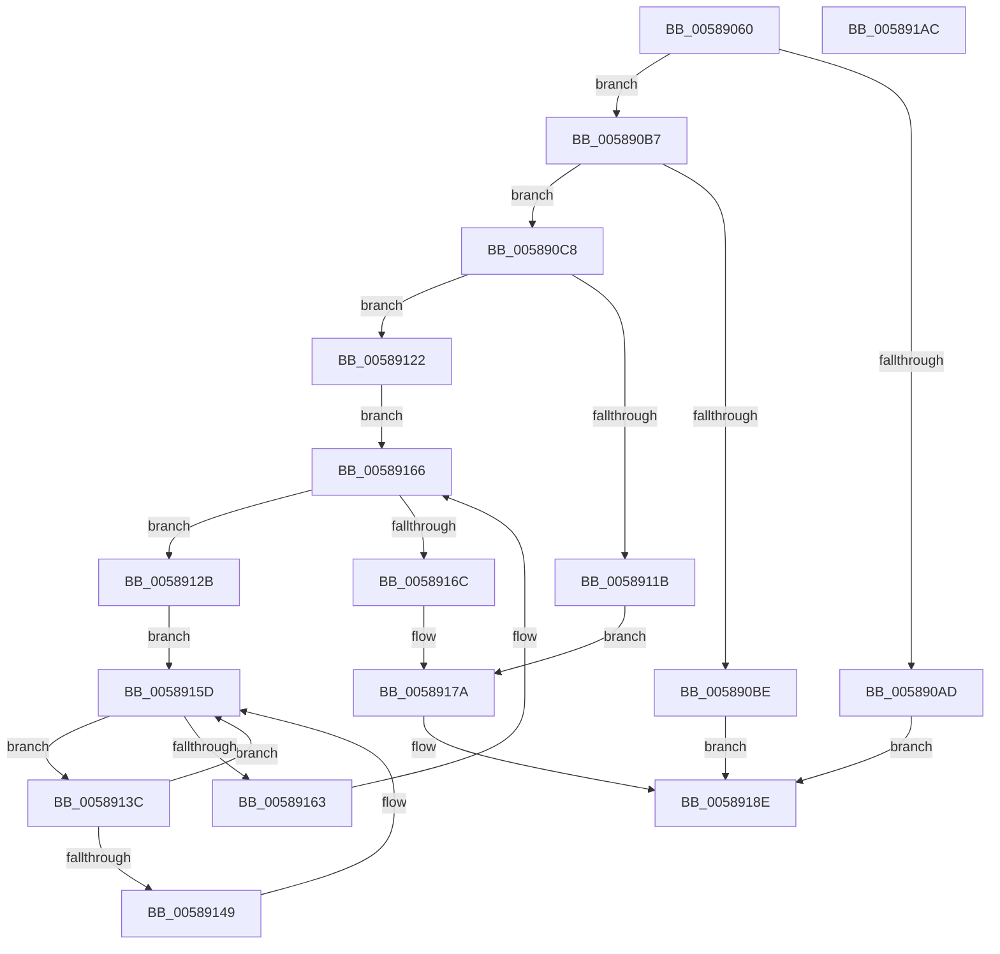

# HvlQueryAssociatedProcessors

- RVA: `0x00589060`–`0x005891AD` (길이 `333` bytes)
- VA: `0x0000000140589060`
- 실행 섹션: `.text`
- PDB 이름 있음: `예`; PDB Function 태그: `아니요`
- unwind 정보 RVA: `0x000BE68C`
- 디코드: `101`개 명령, `333/333` bytes 표시
- 미해석 바이트: `0` (있으면 어셈블리에 `.byte`로 보존)

> 이 문서는 커널 이미지의 기계어와 PDB 기호를 분석해 생성했습니다. 4번과 5번은 함수 원형과 자료형을 바이너리 사용 방식에서 추정한 C 해석이며 원본 소스 복구 결과는 아닙니다.

## 1. Dependencies

- 직접 호출 지점: **5**; 고유 호출 대상: **3**
- 직접 호출자로 확인된 함수: **0**
- RIP 상대 이미지 참조: **1**

### Outgoing calls
- `0x005890DE` → [HvlpAcquireHypercallPage](../47/HvlpAcquireHypercallPage_function_00471410.md) (function, `0x00471410`)
- `0x005890F7` → [HvlpAcquireHypercallPage](../47/HvlpAcquireHypercallPage_function_00471410.md) (function, `0x00471410`)
- `0x0058910F` → [HvcallInitiateHypercall](../31/HvcallInitiateHypercall_function_00313630.md) (function, `0x00313630`)
- `0x0058917E` → [HvlpReleaseHypercallPage](../31/HvlpReleaseHypercallPage_function_00313480.md) (function, `0x00313480`)
- `0x00589187` → [HvlpReleaseHypercallPage](../31/HvlpReleaseHypercallPage_function_00313480.md) (function, `0x00313480`)

### Direct callers
- 이 함수 시작 RVA로 연결되는 직접 call은 확인되지 않았습니다. 간접 호출은 완전히 역산할 수 없습니다.

### Static image references
- `0x0058909B` → RVA `0x00FC6A90` (`ALMOSTRO`; read)

## 2. Other-region calls and transfers

- 다른 실행 섹션으로 향하는 call: **0**
- 별도 외부 분기/꼬리 이동을 확인하지 못했습니다.

## 3. Assembly (complete function range)

```asm
00589060  48 89 5C 24 08                  mov qword ptr [rsp + 8], rbx
00589065  48 89 74 24 10                  mov qword ptr [rsp + 0x10], rsi
0058906A  48 89 7C 24 18                  mov qword ptr [rsp + 0x18], rdi
0058906F  55                              push rbp
00589070  41 54                           push r12
00589072  41 55                           push r13
00589074  41 56                           push r14
00589076  41 57                           push r15
00589078  48 8B EC                        mov rbp, rsp
0058907B  48 83 EC 60                     sub rsp, 0x60
0058907F  33 C0                           xor eax, eax
00589081  0F 57 C0                        xorps xmm0, xmm0
00589084  48 89 45 F0                     mov qword ptr [rbp - 0x10], rax
00589088  4D 8B E8                        mov r13, r8
0058908B  89 45 F8                        mov dword ptr [rbp - 8], eax
0058908E  48 8B FA                        mov rdi, rdx
00589091  48 89 45 D0                     mov qword ptr [rbp - 0x30], rax
00589095  44 8B E1                        mov r12d, ecx
00589098  89 45 D8                        mov dword ptr [rbp - 0x28], eax
0058909B  8B 05 EF D9 A3 00               mov eax, dword ptr [rip + 0xa3d9ef]
005890A1  0F 11 45 E0                     movups xmmword ptr [rbp - 0x20], xmm0
005890A5  0F 11 45 C0                     movups xmmword ptr [rbp - 0x40], xmm0
005890A9  A8 02                           test al, 2
005890AB  75 0A                           jne 0x1405890b7
005890AD  B8 22 00 00 C0                  mov eax, 0xc0000022
005890B2  E9 D7 00 00 00                  jmp 0x14058918e
005890B7  33 C0                           xor eax, eax
005890B9  48 85 FF                        test rdi, rdi
005890BC  75 0A                           jne 0x1405890c8
005890BE  B8 0D 00 00 C0                  mov eax, 0xc000000d
005890C3  E9 C6 00 00 00                  jmp 0x14058918e
005890C8  41 B9 08 00 00 00               mov r9d, 8
005890CE  48 8D 4D E0                     lea rcx, [rbp - 0x20]
005890D2  45 33 C0                        xor r8d, r8d
005890D5  8B F0                           mov esi, eax
005890D7  44 8B F0                        mov r14d, eax
005890DA  41 8D 51 F9                     lea edx, [r9 - 7]
005890DE  E8 2D 83 EE FF                  call 0x140471410
005890E3  45 33 C0                        xor r8d, r8d
005890E6  48 8D 4D C0                     lea rcx, [rbp - 0x40]
005890EA  41 B9 10 01 00 00               mov r9d, 0x110
005890F0  48 8B D8                        mov rbx, rax
005890F3  41 8D 50 02                     lea edx, [r8 + 2]
005890F7  E8 14 83 EE FF                  call 0x140471410
005890FC  4C 8B 45 D8                     mov r8, qword ptr [rbp - 0x28]
00589100  B9 04 01 00 00                  mov ecx, 0x104
00589105  48 8B 55 F8                     mov rdx, qword ptr [rbp - 8]
00589109  4C 8B F8                        mov r15, rax
0058910C  44 89 23                        mov dword ptr [rbx], r12d
0058910F  E8 1C A5 D8 FF                  call 0x140313630
00589114  33 DB                           xor ebx, ebx
00589116  66 85 C0                        test ax, ax
00589119  74 07                           je 0x140589122
0058911B  BB 01 00 00 C0                  mov ebx, 0xc0000001
00589120  EB 58                           jmp 0x14058917a
00589122  49 8B 57 08                     mov rdx, qword ptr [r15 + 8]
00589126  44 8B CB                        mov r9d, ebx
00589129  EB 3B                           jmp 0x140589166
0058912B  41 8B C2                        mov eax, r10d
0058912E  48 0F BB C2                     btc rdx, rax
00589132  41 8B C1                        mov eax, r9d
00589135  4D 8B 44 C7 10                  mov r8, qword ptr [r15 + rax*8 + 0x10]
0058913A  EB 21                           jmp 0x14058915d
0058913C  41 8B C3                        mov eax, r11d
0058913F  FF C6                           inc esi
00589141  49 0F BB C0                     btc r8, rax
00589145  39 37                           cmp dword ptr [rdi], esi
00589147  72 14                           jb 0x14058915d
00589149  41 8B C6                        mov eax, r14d
0058914C  41 8B CA                        mov ecx, r10d
0058914F  C1 E1 06                        shl ecx, 6
00589152  41 03 CB                        add ecx, r11d
00589155  41 FF C6                        inc r14d
00589158  41 89 4C 85 00                  mov dword ptr [r13 + rax*4], ecx
0058915D  4D 0F BC D8                     bsf r11, r8
00589161  75 D9                           jne 0x14058913c
00589163  41 FF C1                        inc r9d
00589166  4C 0F BC D2                     bsf r10, rdx
0058916A  75 BF                           jne 0x14058912b
0058916C  8B 07                           mov eax, dword ptr [rdi]
0058916E  3B C6                           cmp eax, esi
00589170  89 37                           mov dword ptr [rdi], esi
00589172  1B DB                           sbb ebx, ebx
00589174  81 E3 23 00 00 C0               and ebx, 0xc0000023
0058917A  48 8D 4D C0                     lea rcx, [rbp - 0x40]
0058917E  E8 FD A2 D8 FF                  call 0x140313480
00589183  48 8D 4D E0                     lea rcx, [rbp - 0x20]
00589187  E8 F4 A2 D8 FF                  call 0x140313480
0058918C  8B C3                           mov eax, ebx
0058918E  4C 8D 5C 24 60                  lea r11, [rsp + 0x60]
00589193  49 8B 5B 30                     mov rbx, qword ptr [r11 + 0x30]
00589197  49 8B 73 38                     mov rsi, qword ptr [r11 + 0x38]
0058919B  49 8B 7B 40                     mov rdi, qword ptr [r11 + 0x40]
0058919F  49 8B E3                        mov rsp, r11
005891A2  41 5F                           pop r15
005891A4  41 5E                           pop r14
005891A6  41 5D                           pop r13
005891A8  41 5C                           pop r12
005891AA  5D                              pop rbp
005891AB  C3                              ret
005891AC  CC                              int3
```

## 4. C-style interpretation (structured pseudocode)

```c
__int64 __fastcall HvlQueryAssociatedProcessors(int a1, __int64 a2, __int64 a3)
{
    __int64 result;
    __int64 v_r14;
    __int64 v_rbx;
    __int64 v_rsi;
    __int64 v_rsp;
    unsigned __int64 v_stack_m28;
    unsigned int v_stack_m30;
    unsigned __int64 v_stack_m38;
    unsigned __int64 v_stack_m48;
    unsigned int v_stack_m50;
    unsigned __int64 v_stack_m58;
    unsigned __int64 v_stack_m68;
    unsigned __int64 v_stack_p10;
    unsigned __int64 v_stack_p18;
    unsigned __int64 v_stack_p8;

    v_stack_p8 = v_rbx;
    v_stack_p10 = v_rsi;
    v_stack_p18 = v_rdi;
    v_rsp = (v_rsp) - (96);
    result = 0;
    v_stack_m38 = 0;
    v_stack_m30 = 0;
    v_stack_m58 = 0;
    v_stack_m50 = 0;
    v_stack_m48 = v_xmm0;
    v_stack_m68 = v_xmm0;
    if ((((unsigned __int8)((unsigned int)(*(unsigned int *)(v_rip + 10738159)))) & (2)) != 0) goto loc_005890B7;
    goto loc_0058918E;
loc_005890B7:
    result = 0;
    if (a2 != 0) goto loc_005890C8;
    goto loc_0058918E;
loc_005890C8:
    a3 = 0;
    result = HvlpAcquireHypercallPage(v_stack_m48, 8 - 7, a3, 8);
    a3 = 0;
    result = HvlpAcquireHypercallPage(v_stack_m68, a3 + 2, a3, 272);
    *(unsigned int *)(result) = (unsigned int)((unsigned int)(a1));
    result = HvcallInitiateHypercall(260, v_stack_m30, v_stack_m50, 272);
    v_rbx = 0;
    if ((unsigned __int16)(result) == 0) goto loc_00589122;
    goto loc_0058917A;
loc_00589122:
    goto loc_00589166;
loc_0058912B:
    goto loc_0058915D;
loc_0058913C:
    v_rsi = (unsigned int)(((unsigned int)((unsigned int)((unsigned int)(0xC000000DULL)))) + 1);
    result = (unsigned int)((unsigned int)(v_r11));
    v_r14 = (unsigned int)((unsigned int)((unsigned int)(0xC000000DULL)));
    if ((*(unsigned int *)(a2)) >= ((unsigned int)(v_rsi))) {
        result = (unsigned int)((unsigned int)((unsigned int)((unsigned int)(0xC000000DULL))));
        a1 = (unsigned int)(v_r10);
        a1 = (unsigned int)((a1) << (6));
        a1 = (unsigned int)((a1) + ((unsigned int)(v_r11)));
        v_r14 = (unsigned int)(((unsigned int)((unsigned int)((unsigned int)(0xC000000DULL)))) + 1);
        *(unsigned int *)(a3 + result * 4) = a1;
    }
    if (condition_is_not_equal) goto loc_0058913C;
    a4 = (unsigned int)(((unsigned int)((unsigned int)((unsigned int)(0xC0000001ULL)))) + 1);
loc_00589166:
    if (condition_is_not_equal) goto loc_0058912B;
    *(unsigned int *)(a2) = (unsigned int)(v_rsi);
    v_rbx = (unsigned int)(((unsigned int)(0xC0000001ULL)) & (0xC0000023ULL));
loc_0058917A:
    result = HvlpReleaseHypercallPage(v_stack_m68, *(unsigned __int64 *)(result + 8), *(unsigned __int64 *)(result + (unsigned int)((unsigned int)((unsigned int)((unsigned int)((unsigned int)(0xC0000001ULL))))) * 8 + 16), a4);
    result = HvlpReleaseHypercallPage(v_stack_m48, *(unsigned __int64 *)(result + 8), *(unsigned __int64 *)(result + (unsigned int)((unsigned int)((unsigned int)((unsigned int)((unsigned int)(0xC0000001ULL))))) * 8 + 16), a4);
loc_0058918E:
    return (unsigned int)((unsigned int)(v_rbx));
}
```

## 5. (Beta) C Style

```c
int64_t HvlQueryAssociatedProcessors(int32_t Arg1, int64_t Arg2, void *Arg3)
{
    uint8_t *arg3 = (uint8_t *)Arg3;

    int64_t result;
    int64_t local_r14;
    int64_t local_rbx;
    int64_t local_rsi;
    int64_t local_rsp;
    uint64_t v_stack_m28;
    uint32_t v_stack_m30;
    uint64_t v_stack_m38;
    uint64_t v_stack_m48;
    uint32_t v_stack_m50;
    uint64_t v_stack_m58;
    uint64_t v_stack_m68;
    uint64_t v_stack_p10;
    uint64_t v_stack_p18;
    uint64_t v_stack_p8;

    v_stack_p8 = local_rbx;
    v_stack_p10 = local_rsi;
    v_stack_p18 = local_rdi;
    local_rsp = (local_rsp) - (96);
    result = 0;
    v_stack_m38 = 0;
    v_stack_m30 = 0;
    v_stack_m58 = 0;
    v_stack_m50 = 0;
    v_stack_m48 = v_xmm0;
    v_stack_m68 = v_xmm0;
    if ((((uint8_t)((uint32_t)(*(uint32_t *)(v_rip + 0xA3D9EF)))) & (2)) != 0) goto loc_005890B7;
    goto loc_0058918E;
loc_005890B7:
    result = 0;
    if (Arg2 != 0) goto loc_005890C8;
    goto loc_0058918E;
loc_005890C8:
    Arg3 = 0;
    result = HvlpAcquireHypercallPage(v_stack_m48, 8 - 7, Arg3, 8);
    Arg3 = 0;
    result = HvlpAcquireHypercallPage(v_stack_m68, Arg3 + 2, Arg3, 272);
    *(uint32_t *)(result) = (uint32_t)((uint32_t)(Arg1));
    result = HvcallInitiateHypercall(260, v_stack_m30, v_stack_m50, 272);
    local_rbx = 0;
    if ((uint16_t)(result) == 0) goto loc_00589122;
    goto loc_0058917A;
loc_00589122:
    goto loc_00589166;
loc_0058912B:
    goto loc_0058915D;
loc_0058913C:
    local_rsi = (uint32_t)(((uint32_t)((uint32_t)((uint32_t)(0xC000000DULL)))) + 1);
    result = (uint32_t)((uint32_t)(local_r11));
    local_r14 = (uint32_t)((uint32_t)((uint32_t)(0xC000000DULL)));
    if ((*(uint32_t *)(Arg2)) >= ((uint32_t)(local_rsi))) {
        result = (uint32_t)((uint32_t)((uint32_t)((uint32_t)(0xC000000DULL))));
        Arg1 = (uint32_t)(local_r10);
        Arg1 = (uint32_t)((Arg1) << (6));
        Arg1 = (uint32_t)((Arg1) + ((uint32_t)(local_r11)));
        local_r14 = (uint32_t)(((uint32_t)((uint32_t)((uint32_t)(0xC000000DULL)))) + 1);
        *(uint32_t *)(arg3 + result * 4) = Arg1;
    }
    if (condition_is_not_equal) goto loc_0058913C;
    a4 = (uint32_t)(((uint32_t)((uint32_t)((uint32_t)(0xC0000001ULL)))) + 1);
loc_00589166:
    if (condition_is_not_equal) goto loc_0058912B;
    *(uint32_t *)(Arg2) = (uint32_t)(local_rsi);
    local_rbx = (uint32_t)(((uint32_t)(0xC0000001ULL)) & (0xC0000023ULL));
loc_0058917A:
    result = HvlpReleaseHypercallPage(v_stack_m68, *(uint64_t *)(result + 0x8), *(uint64_t *)(result + (uint32_t)((uint32_t)((uint32_t)((uint32_t)((uint32_t)(0xC0000001ULL))))) * 8 + 0x10), a4);
    result = HvlpReleaseHypercallPage(v_stack_m48, *(uint64_t *)(result + 0x8), *(uint64_t *)(result + (uint32_t)((uint32_t)((uint32_t)((uint32_t)((uint32_t)(0xC0000001ULL))))) * 8 + 0x10), a4);
loc_0058918E:
    return (uint32_t)((uint32_t)(local_rbx));
}
```

### 관측된 메모리 오프셋

구조체 형식이 확인되지 않은 접근은 인자 기준의 오프셋으로만 기록했습니다.

| 기준 인자 | 오프셋 표현 | 폭 (bit) | 접근 |
|---|---:|---:|---|
| `Arg3` | `+ 0x0 + rax*4` | `32` | `W` |

## 6. Execution-region graph

[열기: 2D/3D 그래프와 함수 탐색 컨트롤 패널](../../../control-panel.html?section=text&rva=0x00589060&view=graph)

- 2D 그래프는 위에서 아래로 흐르고, 3D 그래프는 빈 공간을 드래그해 회전합니다. Shift+드래그는 이동, 휠은 확대·축소, 함수 노드 선택은 대상 보고서 이동입니다.

### Static fallback


