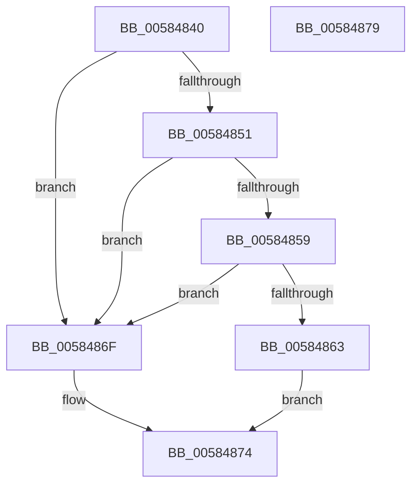

# HvlQueryHypervisorProcessorNodeNumber

- RVA: `0x00584840`–`0x0058487A` (길이 `58` bytes)
- VA: `0x0000000140584840`
- 실행 섹션: `.text`
- PDB 이름 있음: `예`; PDB Function 태그: `아니요`
- unwind 정보 RVA: `0x0005C788`
- 디코드: `18`개 명령, `58/58` bytes 표시
- 미해석 바이트: `0` (있으면 어셈블리에 `.byte`로 보존)

> 이 문서는 커널 이미지의 기계어와 PDB 기호를 분석해 생성했습니다. 4번과 5번은 함수 원형과 자료형을 바이너리 사용 방식에서 추정한 C 해석이며 원본 소스 복구 결과는 아닙니다.

## 1. Dependencies

- 직접 호출 지점: **1**; 고유 호출 대상: **1**
- 직접 호출자로 확인된 함수: **0**
- RIP 상대 이미지 참조: **1**

### Outgoing calls
- `0x00584859` → [HvlpGetLpcbByLpIndex](../44/HvlpGetLpcbByLpIndex_function_0044FFA0.md) (function, `0x0044FFA0`)

### Direct callers
- 이 함수 시작 RVA로 연결되는 직접 call은 확인되지 않았습니다. 간접 호출은 완전히 역산할 수 없습니다.

### Static image references
- `0x00584844` → RVA `0x00FC6A90` (`ALMOSTRO`; read)

## 2. Other-region calls and transfers

- 다른 실행 섹션으로 향하는 call: **0**
- 별도 외부 분기/꼬리 이동을 확인하지 못했습니다.

## 3. Assembly (complete function range)

```asm
00584840  48 83 EC 28                     sub rsp, 0x28
00584844  8B 05 46 22 A4 00               mov eax, dword ptr [rip + 0xa42246]
0058484A  4C 8B D2                        mov r10, rdx
0058484D  A8 02                           test al, 2
0058484F  74 1E                           je 0x14058486f
00584851  81 F9 00 08 00 00               cmp ecx, 0x800
00584857  73 16                           jae 0x14058486f
00584859  E8 42 B7 EC FF                  call 0x14044ffa0
0058485E  48 85 C0                        test rax, rax
00584861  74 0C                           je 0x14058486f
00584863  0F B7 40 60                     movzx eax, word ptr [rax + 0x60]
00584867  66 41 89 02                     mov word ptr [r10], ax
0058486B  33 C0                           xor eax, eax
0058486D  EB 05                           jmp 0x140584874
0058486F  B8 01 00 00 C0                  mov eax, 0xc0000001
00584874  48 83 C4 28                     add rsp, 0x28
00584878  C3                              ret
00584879  CC                              int3
```

## 4. C-style interpretation (structured pseudocode)

```c
__int64 __fastcall HvlQueryHypervisorProcessorNodeNumber(int a1, __int64 a2)
{
    __int64 result;
    __int64 v_rsp;

    v_rsp = (v_rsp) - (40);
    if ((((unsigned __int8)((unsigned int)(*(unsigned int *)(v_rip + 10756678)))) & (2)) == 0) goto loc_0058486F;
    if (a1 >= 0x800ULL) goto loc_0058486F;
    result = HvlpGetLpcbByLpIndex(a1, a2, a3, a4);
    if (result == 0) goto loc_0058486F;
    *(unsigned __int16 *)(a2) = (unsigned __int16)(*(unsigned __int16 *)(result + 96));
    result = 0;
    goto loc_00584874;
loc_0058486F:
loc_00584874:
    v_rsp = (v_rsp) + (40);
    return (unsigned int)(0xC0000001ULL);
}
```

## 5. (Beta) C Style

```c
int64_t HvlQueryHypervisorProcessorNodeNumber(int32_t Arg1, int64_t Arg2)
{
    int64_t result;
    int64_t local_rsp;

    local_rsp = (local_rsp) - (40);
    if ((((uint8_t)((uint32_t)(*(uint32_t *)(v_rip + 0xA42246)))) & (2)) == 0) goto loc_0058486F;
    if (Arg1 >= 0x800ULL) goto loc_0058486F;
    result = HvlpGetLpcbByLpIndex(Arg1, Arg2, a3, a4);
    if (result == 0) goto loc_0058486F;
    *(uint16_t *)(Arg2) = (uint16_t)(*(uint16_t *)(result + 0x60));
    result = 0;
    goto loc_00584874;
loc_0058486F:
loc_00584874:
    local_rsp = (local_rsp) + (40);
    return (uint32_t)(0xC0000001ULL);
}
```

## 6. Execution-region graph

[열기: 2D/3D 그래프와 함수 탐색 컨트롤 패널](../../../control-panel.html?section=text&rva=0x00584840&view=graph)

- 2D 그래프는 위에서 아래로 흐르고, 3D 그래프는 빈 공간을 드래그해 회전합니다. Shift+드래그는 이동, 휠은 확대·축소, 함수 노드 선택은 대상 보고서 이동입니다.

### Static fallback


