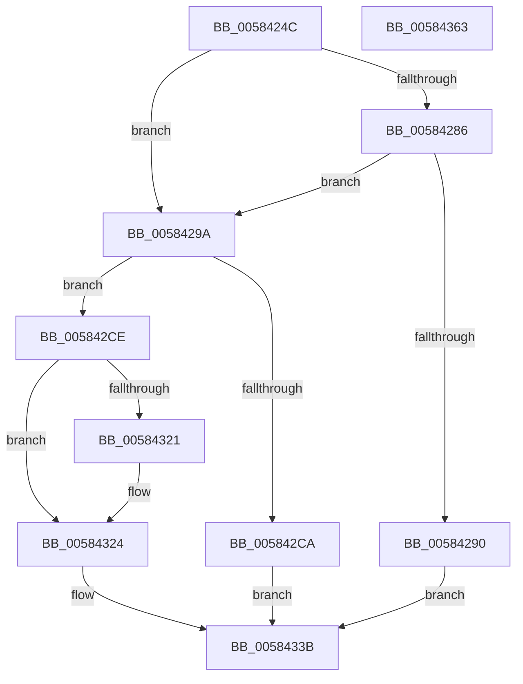

# HvlQueryHypervisorTscAdjustment

- RVA: `0x0058424C`–`0x00584364` (길이 `280` bytes)
- VA: `0x000000014058424C`
- 실행 섹션: `.text`
- PDB 이름 있음: `예`; PDB Function 태그: `아니요`
- unwind 정보 RVA: `0x000C6410`
- 디코드: `67`개 명령, `280/280` bytes 표시
- 미해석 바이트: `0` (있으면 어셈블리에 `.byte`로 보존)

> 이 문서는 커널 이미지의 기계어와 PDB 기호를 분석해 생성했습니다. 4번과 5번은 함수 원형과 자료형을 바이너리 사용 방식에서 추정한 C 해석이며 원본 소스 복구 결과는 아닙니다.

## 1. Dependencies

- 직접 호출 지점: **7**; 고유 호출 대상: **5**
- 직접 호출자로 확인된 함수: **1**
- RIP 상대 이미지 참조: **4**

### Outgoing calls
- `0x00584290` → [VslQueryTscAdjustment](VslQueryTscAdjustment_function_0058EFE8.md) (function, `0x0058EFE8`)
- `0x005842DE` → [HvlpAcquireHypercallPage](../47/HvlpAcquireHypercallPage_function_00471410.md) (function, `0x00471410`)
- `0x005842FA` → [HvlpAcquireHypercallPage](../47/HvlpAcquireHypercallPage_function_00471410.md) (function, `0x00471410`)
- `0x00584317` → [HvcallInitiateHypercall](../31/HvcallInitiateHypercall_function_00313630.md) (function, `0x00313630`)
- `0x00584329` → [HvlpReleaseHypercallPage](../31/HvlpReleaseHypercallPage_function_00313480.md) (function, `0x00313480`)
- `0x00584333` → [HvlpReleaseHypercallPage](../31/HvlpReleaseHypercallPage_function_00313480.md) (function, `0x00313480`)
- `0x00584345` → [_security_check_cookie](../6A/_security_check_cookie_function_006AC640.md) (function, `0x006AC640`)

### Direct callers
- [PopSstDiagInitializeResumeTimer](../../pagelk/B7/PopSstDiagInitializeResumeTimer_function_00B776FC.md) at `0x00B77792`

### Static image references
- `0x0058426A` → RVA `0x00E0A740` (`.data`; read)
- `0x0058427D` → RVA `0x00FC6A84` (`ALMOSTRO`; read)
- `0x00584286` → RVA `0x00FC6A90` (`ALMOSTRO`; read)
- `0x005842B6` → RVA `0x00FC6AD8` (`ALMOSTRO`; read)

## 2. Other-region calls and transfers

- 다른 실행 섹션으로 향하는 call: **0**
- 별도 외부 분기/꼬리 이동을 확인하지 못했습니다.

## 3. Assembly (complete function range)

```asm
0058424C  48 8B C4                        mov rax, rsp
0058424F  48 89 58 08                     mov qword ptr [rax + 8], rbx
00584253  48 89 70 10                     mov qword ptr [rax + 0x10], rsi
00584257  48 89 78 18                     mov qword ptr [rax + 0x18], rdi
0058425B  55                              push rbp
0058425C  48 8D A8 58 F8 FF FF            lea rbp, [rax - 0x7a8]
00584263  48 81 EC A0 08 00 00            sub rsp, 0x8a0
0058426A  48 8B 05 CF 64 88 00            mov rax, qword ptr [rip + 0x8864cf]
00584271  48 33 C4                        xor rax, rsp
00584274  48 89 85 90 07 00 00            mov qword ptr [rbp + 0x790], rax
0058427B  33 FF                           xor edi, edi
0058427D  40 38 3D 00 28 A4 00            cmp byte ptr [rip + 0xa42800], dil
00584284  74 14                           je 0x14058429a
00584286  8B 05 04 28 A4 00               mov eax, dword ptr [rip + 0xa42804]
0058428C  A8 02                           test al, 2
0058428E  75 0A                           jne 0x14058429a
00584290  E8 53 AD 00 00                  call 0x14058efe8
00584295  E9 A1 00 00 00                  jmp 0x14058433b
0058429A  33 C0                           xor eax, eax
0058429C  0F 57 C0                        xorps xmm0, xmm0
0058429F  48 89 44 24 50                  mov qword ptr [rsp + 0x50], rax
005842A4  BA 01 00 00 00                  mov edx, 1
005842A9  89 44 24 58                     mov dword ptr [rsp + 0x58], eax
005842AD  48 89 44 24 30                  mov qword ptr [rsp + 0x30], rax
005842B2  89 44 24 38                     mov dword ptr [rsp + 0x38], eax
005842B6  8B 05 1C 28 A4 00               mov eax, dword ptr [rip + 0xa4281c]
005842BC  0F 11 44 24 40                  movups xmmword ptr [rsp + 0x40], xmm0
005842C1  0F 11 44 24 20                  movups xmmword ptr [rsp + 0x20], xmm0
005842C6  84 C2                           test dl, al
005842C8  75 04                           jne 0x1405842ce
005842CA  33 C0                           xor eax, eax
005842CC  EB 6D                           jmp 0x14058433b
005842CE  41 B9 10 00 00 00               mov r9d, 0x10
005842D4  4C 8D 44 24 60                  lea r8, [rsp + 0x60]
005842D9  48 8D 4C 24 40                  lea rcx, [rsp + 0x40]
005842DE  E8 2D D1 EE FF                  call 0x140471410
005842E3  41 B9 08 04 00 00               mov r9d, 0x408
005842E9  4C 8D 45 80                     lea r8, [rbp - 0x80]
005842ED  BA 02 00 00 00                  mov edx, 2
005842F2  48 8D 4C 24 20                  lea rcx, [rsp + 0x20]
005842F7  48 8B D8                        mov rbx, rax
005842FA  E8 11 D1 EE FF                  call 0x140471410
005842FF  4C 8B 44 24 38                  mov r8, qword ptr [rsp + 0x38]
00584304  B9 7B 00 00 00                  mov ecx, 0x7b
00584309  48 8B 54 24 58                  mov rdx, qword ptr [rsp + 0x58]
0058430E  48 8B F0                        mov rsi, rax
00584311  C7 03 09 00 00 00               mov dword ptr [rbx], 9
00584317  E8 14 F3 D8 FF                  call 0x140313630
0058431C  66 85 C0                        test ax, ax
0058431F  75 03                           jne 0x140584324
00584321  48 8B 3E                        mov rdi, qword ptr [rsi]
00584324  48 8D 4C 24 20                  lea rcx, [rsp + 0x20]
00584329  E8 52 F1 D8 FF                  call 0x140313480
0058432E  48 8D 4C 24 40                  lea rcx, [rsp + 0x40]
00584333  E8 48 F1 D8 FF                  call 0x140313480
00584338  48 8B C7                        mov rax, rdi
0058433B  48 8B 8D 90 07 00 00            mov rcx, qword ptr [rbp + 0x790]
00584342  48 33 CC                        xor rcx, rsp
00584345  E8 F6 82 12 00                  call 0x1406ac640
0058434A  4C 8D 9C 24 A0 08 00 00         lea r11, [rsp + 0x8a0]
00584352  49 8B 5B 10                     mov rbx, qword ptr [r11 + 0x10]
00584356  49 8B 73 18                     mov rsi, qword ptr [r11 + 0x18]
0058435A  49 8B 7B 20                     mov rdi, qword ptr [r11 + 0x20]
0058435E  49 8B E3                        mov rsp, r11
00584361  5D                              pop rbp
00584362  C3                              ret
00584363  CC                              int3
```

## 4. C-style interpretation (structured pseudocode)

```c
__int64 __fastcall HvlQueryHypervisorTscAdjustment(void)
{
    __int64 result;
    __int64 v_rdi;
    __int64 v_rsp;
    unsigned __int64 v_stack_m8;
    unsigned __int64 v_stack_m848;
    unsigned int v_stack_m850;
    unsigned __int64 v_stack_m858;
    unsigned __int64 v_stack_m868;
    unsigned int v_stack_m870;
    unsigned __int64 v_stack_m878;
    unsigned __int64 v_stack_m888;

    *(unsigned __int64 *)(v_rsp + 8) = v_rbx;
    *(unsigned __int64 *)(v_rsp + 16) = v_rsi;
    *(unsigned __int64 *)(v_rsp + 24) = v_rdi;
    v_rsp = (v_rsp) - (0x8A0ULL);
    result = (*(unsigned __int64 *)(v_rip + 8938703)) ^ (v_rsp);
    *(unsigned __int64 *)(v_rsp - 1960 + 1936) = result;
    v_rdi = 0;
    if ((*(unsigned __int8 *)(v_rip + 10758144)) == 0) goto loc_0058429A;
    if ((((unsigned __int8)((unsigned int)(*(unsigned int *)(v_rip + 10758148)))) & (2)) != 0) goto loc_0058429A;
    result = VslQueryTscAdjustment(a1, a2, a3, a4);
    goto loc_0058433B;
loc_0058429A:
    result = 0;
    v_stack_m858 = 0;
    v_stack_m850 = 0;
    v_stack_m878 = 0;
    v_stack_m870 = 0;
    v_stack_m868 = v_xmm0;
    v_stack_m888 = v_xmm0;
    if (((1) & ((unsigned __int8)((unsigned int)(*(unsigned int *)(v_rip + 10758172))))) != 0) goto loc_005842CE;
    result = 0;
    goto loc_0058433B;
loc_005842CE:
    result = HvlpAcquireHypercallPage(v_stack_m868, 1, v_stack_m848, 16);
    result = HvlpAcquireHypercallPage(v_stack_m888, 2, v_rsp - 1960 - 128, (unsigned int)(0x408ULL));
    *(unsigned int *)(result) = 9;
    result = HvcallInitiateHypercall(123, v_stack_m850, v_stack_m870, (unsigned int)(0x408ULL));
    if ((unsigned __int16)(result) == 0) {
        v_rdi = *(unsigned __int64 *)(result);
    }
    result = HvlpReleaseHypercallPage(v_stack_m888, v_stack_m850, v_stack_m870, (unsigned int)(0x408ULL));
    result = HvlpReleaseHypercallPage(v_stack_m868, v_stack_m850, v_stack_m870, (unsigned int)(0x408ULL));
loc_0058433B:
    a1 = (*(unsigned __int64 *)(v_rsp - 1960 + 1936)) ^ (v_rsp);
    result = _security_check_cookie(a1, v_stack_m850, v_stack_m870, (unsigned int)(0x408ULL));
    return result;
}
```

## 5. (Beta) C Style

```c
void HvlQueryHypervisorTscAdjustment(void)
{
    int64_t result;
    int64_t local_rdi;
    int64_t local_rsp;
    uint64_t v_stack_m8;
    uint64_t v_stack_m848;
    uint32_t v_stack_m850;
    uint64_t v_stack_m858;
    uint64_t v_stack_m868;
    uint32_t v_stack_m870;
    uint64_t v_stack_m878;
    uint64_t v_stack_m888;

    *(uint64_t *)(local_rsp + 0x8) = local_rbx;
    *(uint64_t *)(local_rsp + 0x10) = local_rsi;
    *(uint64_t *)(local_rsp + 0x18) = local_rdi;
    local_rsp = (local_rsp) - (0x8A0ULL);
    result = (*(uint64_t *)(v_rip + 0x8864CF)) ^ (local_rsp);
    *(uint64_t *)(local_rsp - 0x7A8 + 0x790) = result;
    local_rdi = 0;
    if ((*(uint8_t *)(v_rip + 0xA42800)) == 0) goto loc_0058429A;
    if ((((uint8_t)((uint32_t)(*(uint32_t *)(v_rip + 0xA42804)))) & (2)) != 0) goto loc_0058429A;
    result = VslQueryTscAdjustment(a1, a2, a3, a4);
    goto loc_0058433B;
loc_0058429A:
    result = 0;
    v_stack_m858 = 0;
    v_stack_m850 = 0;
    v_stack_m878 = 0;
    v_stack_m870 = 0;
    v_stack_m868 = v_xmm0;
    v_stack_m888 = v_xmm0;
    if (((1) & ((uint8_t)((uint32_t)(*(uint32_t *)(v_rip + 0xA4281C))))) != 0) goto loc_005842CE;
    result = 0;
    goto loc_0058433B;
loc_005842CE:
    result = HvlpAcquireHypercallPage(v_stack_m868, 1, v_stack_m848, 16);
    result = HvlpAcquireHypercallPage(v_stack_m888, 2, local_rsp - 1960 - 128, (uint32_t)(0x408ULL));
    *(uint32_t *)(result) = 9;
    result = HvcallInitiateHypercall(123, v_stack_m850, v_stack_m870, (uint32_t)(0x408ULL));
    if ((uint16_t)(result) == 0) {
        local_rdi = *(uint64_t *)(result);
    }
    result = HvlpReleaseHypercallPage(v_stack_m888, v_stack_m850, v_stack_m870, (uint32_t)(0x408ULL));
    result = HvlpReleaseHypercallPage(v_stack_m868, v_stack_m850, v_stack_m870, (uint32_t)(0x408ULL));
loc_0058433B:
    a1 = (*(uint64_t *)(local_rsp - 0x7A8 + 0x790)) ^ (local_rsp);
    result = _security_check_cookie(a1, v_stack_m850, v_stack_m870, (uint32_t)(0x408ULL));
    return result;
}
```

## 6. Execution-region graph

[열기: 2D/3D 그래프와 함수 탐색 컨트롤 패널](../../../control-panel.html?section=text&rva=0x0058424C&view=graph)

- 2D 그래프는 위에서 아래로 흐르고, 3D 그래프는 빈 공간을 드래그해 회전합니다. Shift+드래그는 이동, 휠은 확대·축소, 함수 노드 선택은 대상 보고서 이동입니다.

### Static fallback


