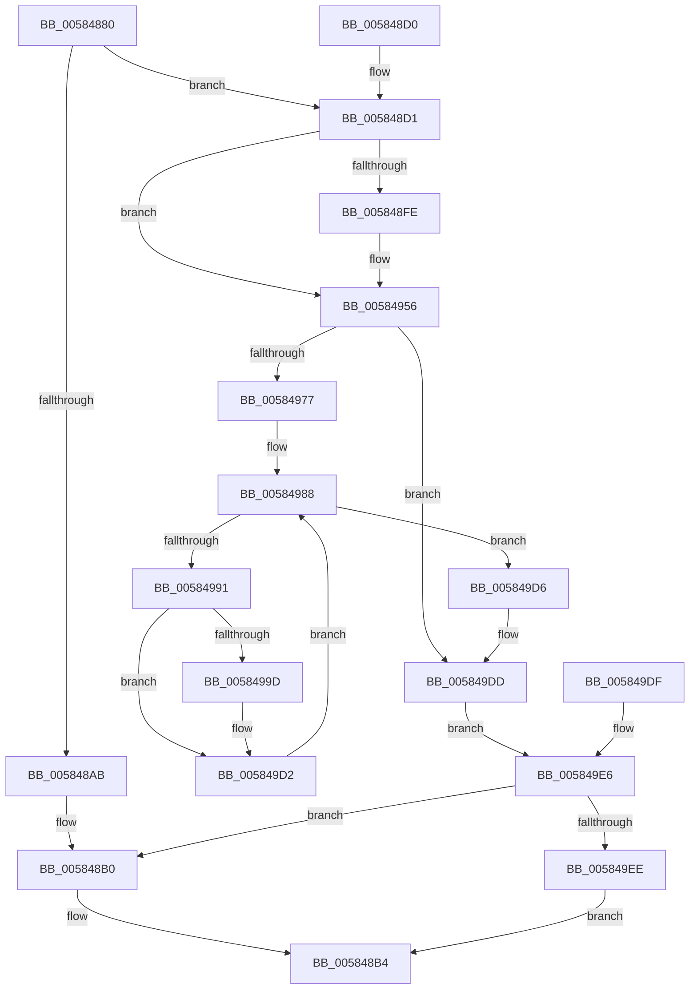

# HvlQueryMinrootInfo

- RVA: `0x00584880`–`0x005849FA` (길이 `378` bytes)
- VA: `0x0000000140584880`
- 실행 섹션: `.text`
- PDB 이름 있음: `예`; PDB Function 태그: `아니요`
- unwind 정보 RVA: `0x000C653C`
- 디코드: `91`개 명령, `378/378` bytes 표시
- 미해석 바이트: `0` (있으면 어셈블리에 `.byte`로 보존)

> 이 문서는 커널 이미지의 기계어와 PDB 기호를 분석해 생성했습니다. 4번과 5번은 함수 원형과 자료형을 바이너리 사용 방식에서 추정한 C 해석이며 원본 소스 복구 결과는 아닙니다.

## 1. Dependencies

- 직접 호출 지점: **2**; 고유 호출 대상: **2**
- 직접 호출자로 확인된 함수: **1**
- RIP 상대 이미지 참조: **15**

### Outgoing calls
- `0x005848DB` → [memset](../6C/memset_function_006C6C40.md) (function, `0x006C6C40`)
- `0x005849C5` → [memcpy](../6C/memcpy_function_006C6840.md) (function, `0x006C6840`)

### Direct callers
- [ExpQuerySystemInformation](../../page/A5/ExpQuerySystemInformation_function_00A57858.md) at `0x00A5B499`

### Static image references
- `0x005848E0` → RVA `0x00FC6D54` (`ALMOSTRO`; read)
- `0x005848E8` → RVA `0x00FC6BC0` (`ALMOSTRO`; read)
- `0x005848F1` → RVA `0x00FC6B90` (`ALMOSTRO`; read)
- `0x005848FE` → RVA `0x00FC7690` (`ALMOSTRO`; read)
- `0x00584909` → RVA `0x00FC76A0` (`ALMOSTRO`; read)
- `0x00584914` → RVA `0x00FC76B0` (`ALMOSTRO`; read)
- `0x0058491F` → RVA `0x00FC76C0` (`ALMOSTRO`; read)
- `0x0058492A` → RVA `0x00FC76D0` (`ALMOSTRO`; read)
- `0x00584935` → RVA `0x00FC76E0` (`ALMOSTRO`; read)
- `0x00584940` → RVA `0x00FC76F0` (`ALMOSTRO`; read)
- `0x0058494B` → RVA `0x00FC7700` (`ALMOSTRO`; read)
- `0x00584956` → RVA `0x00FC6C8C` (`ALMOSTRO`; read)
- `0x00584962` → RVA `0x00FC6C90` (`ALMOSTRO`; read)
- `0x0058496E` → RVA `0x00FC6AA7` (`ALMOSTRO`; read)
- `0x00584981` → RVA `0x00FCCC40` (`ALMOSTRO`; read)

## 2. Other-region calls and transfers

- 다른 실행 섹션으로 향하는 call: **0**
- 별도 외부 분기/꼬리 이동을 확인하지 못했습니다.

## 3. Assembly (complete function range)

```asm
00584880  48 8B C4                        mov rax, rsp
00584883  48 89 58 08                     mov qword ptr [rax + 8], rbx
00584887  48 89 70 10                     mov qword ptr [rax + 0x10], rsi
0058488B  48 89 78 20                     mov qword ptr [rax + 0x20], rdi
0058488F  4C 89 40 18                     mov qword ptr [rax + 0x18], r8
00584893  41 54                           push r12
00584895  41 56                           push r14
00584897  41 57                           push r15
00584899  48 83 EC 30                     sub rsp, 0x30
0058489D  4D 8B F0                        mov r14, r8
005848A0  48 8B D9                        mov rbx, rcx
005848A3  81 FA 98 42 00 00               cmp edx, 0x4298
005848A9  73 26                           jae 0x1405848d1
005848AB  BE F0 00 00 C0                  mov esi, 0xc00000f0
005848B0  41 83 26 00                     and dword ptr [r14], 0
005848B4  8B C6                           mov eax, esi
005848B6  48 8B 5C 24 50                  mov rbx, qword ptr [rsp + 0x50]
005848BB  48 8B 74 24 58                  mov rsi, qword ptr [rsp + 0x58]
005848C0  48 8B 7C 24 68                  mov rdi, qword ptr [rsp + 0x68]
005848C5  48 83 C4 30                     add rsp, 0x30
005848C9  41 5F                           pop r15
005848CB  41 5E                           pop r14
005848CD  41 5C                           pop r12
005848CF  C3                              ret
005848D0  CC                              int3
005848D1  33 F6                           xor esi, esi
005848D3  33 D2                           xor edx, edx
005848D5  41 B8 98 42 00 00               mov r8d, 0x4298
005848DB  E8 60 23 14 00                  call 0x1406c6c40
005848E0  8B 05 6E 24 A4 00               mov eax, dword ptr [rip + 0xa4246e]
005848E6  89 03                           mov dword ptr [rbx], eax
005848E8  8B 05 D2 22 A4 00               mov eax, dword ptr [rip + 0xa422d2]
005848EE  89 43 04                        mov dword ptr [rbx + 4], eax
005848F1  8B 05 99 22 A4 00               mov eax, dword ptr [rip + 0xa42299]
005848F7  89 43 08                        mov dword ptr [rbx + 8], eax
005848FA  85 C0                           test eax, eax
005848FC  74 58                           je 0x140584956
005848FE  0F 10 05 8B 2D A4 00            movups xmm0, xmmword ptr [rip + 0xa42d8b]
00584905  0F 11 43 0C                     movups xmmword ptr [rbx + 0xc], xmm0
00584909  0F 10 0D 90 2D A4 00            movups xmm1, xmmword ptr [rip + 0xa42d90]
00584910  0F 11 4B 1C                     movups xmmword ptr [rbx + 0x1c], xmm1
00584914  0F 10 05 95 2D A4 00            movups xmm0, xmmword ptr [rip + 0xa42d95]
0058491B  0F 11 43 2C                     movups xmmword ptr [rbx + 0x2c], xmm0
0058491F  0F 10 0D 9A 2D A4 00            movups xmm1, xmmword ptr [rip + 0xa42d9a]
00584926  0F 11 4B 3C                     movups xmmword ptr [rbx + 0x3c], xmm1
0058492A  0F 10 05 9F 2D A4 00            movups xmm0, xmmword ptr [rip + 0xa42d9f]
00584931  0F 11 43 4C                     movups xmmword ptr [rbx + 0x4c], xmm0
00584935  0F 10 0D A4 2D A4 00            movups xmm1, xmmword ptr [rip + 0xa42da4]
0058493C  0F 11 4B 5C                     movups xmmword ptr [rbx + 0x5c], xmm1
00584940  0F 10 05 A9 2D A4 00            movups xmm0, xmmword ptr [rip + 0xa42da9]
00584947  0F 11 43 6C                     movups xmmword ptr [rbx + 0x6c], xmm0
0058494B  0F 10 0D AE 2D A4 00            movups xmm1, xmmword ptr [rip + 0xa42dae]
00584952  0F 11 4B 7C                     movups xmmword ptr [rbx + 0x7c], xmm1
00584956  8B 05 30 23 A4 00               mov eax, dword ptr [rip + 0xa42330]
0058495C  89 83 8C 00 00 00               mov dword ptr [rbx + 0x8c], eax
00584962  8B 05 28 23 A4 00               mov eax, dword ptr [rip + 0xa42328]
00584968  89 83 90 00 00 00               mov dword ptr [rbx + 0x90], eax
0058496E  80 3D 32 21 A4 00 00            cmp byte ptr [rip + 0xa42132], 0
00584975  74 66                           je 0x1405849dd
00584977  45 33 FF                        xor r15d, r15d
0058497A  44 89 7C 24 20                  mov dword ptr [rsp + 0x20], r15d
0058497F  33 FF                           xor edi, edi
00584981  4C 8D 25 B8 82 A4 00            lea r12, [rip + 0xa482b8]
00584988  89 7C 24 24                     mov dword ptr [rsp + 0x24], edi
0058498C  83 FF 40                        cmp edi, 0x40
0058498F  73 45                           jae 0x1405849d6
00584991  8B D7                           mov edx, edi
00584993  48 03 D2                        add rdx, rdx
00584996  49 83 3C D4 00                  cmp qword ptr [r12 + rdx*8], 0
0058499B  76 35                           jbe 0x1405849d2
0058499D  41 8B C7                        mov eax, r15d
005849A0  48 69 C8 08 01 00 00            imul rcx, rax, 0x108
005849A7  89 BC 19 98 00 00 00            mov dword ptr [rcx + rbx + 0x98], edi
005849AE  4D 8B 04 D4                     mov r8, qword ptr [r12 + rdx*8]
005849B2  49 C1 E8 03                     shr r8, 3
005849B6  48 81 C1 A0 00 00 00            add rcx, 0xa0
005849BD  48 03 CB                        add rcx, rbx
005849C0  49 8B 54 D4 08                  mov rdx, qword ptr [r12 + rdx*8 + 8]
005849C5  E8 76 1E 14 00                  call 0x1406c6840
005849CA  41 FF C7                        inc r15d
005849CD  44 89 7C 24 20                  mov dword ptr [rsp + 0x20], r15d
005849D2  FF C7                           inc edi
005849D4  EB B2                           jmp 0x140584988
005849D6  44 89 BB 94 00 00 00            mov dword ptr [rbx + 0x94], r15d
005849DD  EB 07                           jmp 0x1405849e6
005849DF  8B F0                           mov esi, eax
005849E1  4C 8B 74 24 60                  mov r14, qword ptr [rsp + 0x60]
005849E6  85 F6                           test esi, esi
005849E8  0F 88 C2 FE FF FF               js 0x1405848b0
005849EE  41 C7 06 98 42 00 00            mov dword ptr [r14], 0x4298
005849F5  E9 BA FE FF FF                  jmp 0x1405848b4
```

## 4. C-style interpretation (structured pseudocode)

```c
__int64 __fastcall HvlQueryMinrootInfo(__int64 a1, int a2, __int64 a3)
{
    __int64 result;
    __int64 v_r15;
    __int64 v_rdi;
    __int64 v_rsi;
    __int64 v_rsp;
    unsigned __int64 v_stack_p10;
    unsigned __int64 v_stack_p20;
    unsigned int v_stack_p24;
    unsigned __int64 v_stack_p60;
    unsigned __int64 v_stack_p8;

    *(unsigned __int64 *)(v_rsp + 8) = v_rbx;
    *(unsigned __int64 *)(v_rsp + 16) = v_rsi;
    *(unsigned __int64 *)(v_rsp + 32) = v_rdi;
    *(unsigned __int64 *)(v_rsp + 24) = a3;
    v_rsp = (v_rsp) - (48);
    if (a2 >= 0x4298ULL) goto loc_005848D1;
loc_005848B0:
loc_005848B4:
    v_rsp = (v_rsp) + (48);
    return (unsigned int)((unsigned int)((unsigned int)(0xC00000F0ULL)));
loc_005848D1:
    v_rsi = 0;
    a2 = 0;
    result = memset(a1, a2, (unsigned int)(0x4298ULL), a4);
    *(unsigned int *)(v_stack_p8) = (unsigned int)((unsigned int)(*(unsigned int *)(v_rip + 10757230)));
    *(unsigned int *)(v_stack_p8 + 4) = (unsigned int)((unsigned int)(*(unsigned int *)(v_rip + 10756818)));
    *(unsigned int *)(v_stack_p8 + 8) = (unsigned int)((unsigned int)(*(unsigned int *)(v_rip + 10756761)));
    if ((unsigned int)((unsigned int)(*(unsigned int *)(v_rip + 10756761))) != 0) {
        *(unsigned __int64 *)(v_stack_p8 + 12) = v_xmm0;
        *(unsigned __int64 *)(v_stack_p8 + 28) = v_xmm1;
        *(unsigned __int64 *)(v_stack_p8 + 44) = v_xmm0;
        *(unsigned __int64 *)(v_stack_p8 + 60) = v_xmm1;
        *(unsigned __int64 *)(v_stack_p8 + 76) = v_xmm0;
        *(unsigned __int64 *)(v_stack_p8 + 92) = v_xmm1;
        *(unsigned __int64 *)(v_stack_p8 + 108) = v_xmm0;
        *(unsigned __int64 *)(v_stack_p8 + 124) = v_xmm1;
    }
    *(unsigned int *)(v_stack_p8 + 140) = (unsigned int)((unsigned int)(*(unsigned int *)(v_rip + 10756912)));
    *(unsigned int *)(v_stack_p8 + 144) = (unsigned int)((unsigned int)(*(unsigned int *)(v_rip + 10756904)));
    if ((*(unsigned __int8 *)(v_rip + 10756402)) == 0) goto loc_005849DD;
    v_r15 = 0;
    v_stack_p20 = 0;
    v_rdi = 0;
loc_00584988:
    v_stack_p24 = 0;
    if (0 >= 64) goto loc_005849D6;
    a2 = (0) + (0);
    result = (unsigned int)(*(unsigned int *)(v_rip + 10756904));
    if ((*(unsigned __int64 *)(v_rip + 10781368 + a2 * 8)) >= = 0) {
        result = 0;
        a1 = (a1) * (result);
        *(unsigned int *)(a1 + v_stack_p8 * 1 + 152) = 0;
        a3 = *(unsigned __int64 *)(v_rip + 10781368 + a2 * 8);
        a3 = (a3) >> (3);
        a1 = (a1) + (160);
        a1 = (a1) + (v_stack_p8);
        a2 = *(unsigned __int64 *)(v_rip + 10781368 + a2 * 8 + 8);
        result = memcpy(a1, a2, a3, a4);
        v_r15 = (unsigned int)((v_r15) + 1);
        v_stack_p20 = (unsigned int)(v_r15);
    }
    v_rdi = (unsigned int)((v_rdi) + 1);
    goto loc_00584988;
loc_005849D6:
    *(unsigned int *)(v_stack_p8 + 148) = (unsigned int)(v_r15);
loc_005849DD:
    goto loc_005849E6;
loc_005849E6:
    if (sign_flag) goto loc_005848B0;
    *(unsigned int *)(a3) = 0x4298ULL;
    goto loc_005848B4;
}
```

## 5. (Beta) C Style

```c
int64_t HvlQueryMinrootInfo(void *Arg1, int32_t Arg2, void *Arg3)
{
    uint8_t *arg1 = (uint8_t *)Arg1;
    uint8_t *arg3 = (uint8_t *)Arg3;

    int64_t result;
    int64_t local_r15;
    int64_t local_rdi;
    int64_t local_rsi;
    int64_t local_rsp;
    uint64_t v_stack_p10;
    uint64_t v_stack_p20;
    uint32_t v_stack_p24;
    uint64_t v_stack_p60;
    uint64_t v_stack_p8;

    *(uint64_t *)(local_rsp + 0x8) = local_rbx;
    *(uint64_t *)(local_rsp + 0x10) = local_rsi;
    *(uint64_t *)(local_rsp + 0x20) = local_rdi;
    *(void **)(local_rsp + 0x18) = Arg3;
    local_rsp = (local_rsp) - (48);
    if (Arg2 >= 0x4298ULL) goto loc_005848D1;
loc_005848B0:
loc_005848B4:
    local_rsp = (local_rsp) + (48);
    return (uint32_t)((uint32_t)((uint32_t)(0xC00000F0ULL)));
loc_005848D1:
    local_rsi = 0;
    Arg2 = 0;
    result = memset(Arg1, Arg2, (uint32_t)(0x4298ULL), a4);
    *(uint32_t *)(v_stack_p8) = (uint32_t)((uint32_t)(*(uint32_t *)(v_rip + 0xA4246E)));
    *(uint32_t *)(v_stack_p8 + 0x4) = (uint32_t)((uint32_t)(*(uint32_t *)(v_rip + 0xA422D2)));
    *(uint32_t *)(v_stack_p8 + 0x8) = (uint32_t)((uint32_t)(*(uint32_t *)(v_rip + 0xA42299)));
    if ((uint32_t)((uint32_t)(*(uint32_t *)(v_rip + 0xA42299))) != 0) {
        *(uint64_t *)(v_stack_p8 + 0xC) = v_xmm0;
        *(uint64_t *)(v_stack_p8 + 0x1C) = v_xmm1;
        *(uint64_t *)(v_stack_p8 + 0x2C) = v_xmm0;
        *(uint64_t *)(v_stack_p8 + 0x3C) = v_xmm1;
        *(uint64_t *)(v_stack_p8 + 0x4C) = v_xmm0;
        *(uint64_t *)(v_stack_p8 + 0x5C) = v_xmm1;
        *(uint64_t *)(v_stack_p8 + 0x6C) = v_xmm0;
        *(uint64_t *)(v_stack_p8 + 0x7C) = v_xmm1;
    }
    *(uint32_t *)(v_stack_p8 + 0x8C) = (uint32_t)((uint32_t)(*(uint32_t *)(v_rip + 0xA42330)));
    *(uint32_t *)(v_stack_p8 + 0x90) = (uint32_t)((uint32_t)(*(uint32_t *)(v_rip + 0xA42328)));
    if ((*(uint8_t *)(v_rip + 0xA42132)) == 0) goto loc_005849DD;
    local_r15 = 0;
    v_stack_p20 = 0;
    local_rdi = 0;
loc_00584988:
    v_stack_p24 = 0;
    if (0 >= 64) goto loc_005849D6;
    Arg2 = (0) + (0);
    result = (uint32_t)(*(uint32_t *)(v_rip + 0xA42328));
    if ((*(uint64_t *)(v_rip + 0xA482B8 + Arg2 * 8)) >= = 0) {
        result = 0;
        Arg1 = (Arg1) * (result);
        *(uint32_t *)(arg1 + v_stack_p8 * 1 + 0x98) = 0;
        Arg3 = *(uint64_t *)(v_rip + 0xA482B8 + Arg2 * 8);
        Arg3 = (Arg3) >> (3);
        Arg1 = (Arg1) + (160);
        Arg1 = (Arg1) + (v_stack_p8);
        Arg2 = *(uint64_t *)(v_rip + 0xA482B8 + Arg2 * 8 + 0x8);
        result = memcpy(Arg1, Arg2, Arg3, a4);
        local_r15 = (uint32_t)((local_r15) + 1);
        v_stack_p20 = (uint32_t)(local_r15);
    }
    local_rdi = (uint32_t)((local_rdi) + 1);
    goto loc_00584988;
loc_005849D6:
    *(uint32_t *)(v_stack_p8 + 0x94) = (uint32_t)(local_r15);
loc_005849DD:
    goto loc_005849E6;
loc_005849E6:
    if (sign_flag) goto loc_005848B0;
    *(uint32_t *)(arg3) = 0x4298ULL;
    goto loc_005848B4;
}
```

### 관측된 메모리 오프셋

구조체 형식이 확인되지 않은 접근은 인자 기준의 오프셋으로만 기록했습니다.

| 기준 인자 | 오프셋 표현 | 폭 (bit) | 접근 |
|---|---:|---:|---|
| `Arg1` | `+ 0x0` | `32` | `W` |
| `Arg1` | `+ 0x4` | `32` | `W` |
| `Arg1` | `+ 0x8` | `32` | `W` |
| `Arg1` | `+ 0xC` | `128` | `R` |
| `Arg1` | `+ 0x1C` | `128` | `R` |
| `Arg1` | `+ 0x2C` | `128` | `R` |
| `Arg1` | `+ 0x3C` | `128` | `R` |
| `Arg1` | `+ 0x4C` | `128` | `R` |
| `Arg1` | `+ 0x5C` | `128` | `R` |
| `Arg1` | `+ 0x6C` | `128` | `R` |
| `Arg1` | `+ 0x7C` | `128` | `R` |
| `Arg1` | `+ 0x8C` | `32` | `W` |
| `Arg1` | `+ 0x90` | `32` | `W` |
| `Arg1` | `+ 0x94` | `32` | `W` |
| `Arg3` | `+ 0x0` | `32` | `R/W` |
| `Arg3` | `+ 0x0` | `32` | `W` |

## 6. Execution-region graph

[열기: 2D/3D 그래프와 함수 탐색 컨트롤 패널](../../../control-panel.html?section=text&rva=0x00584880&view=graph)

- 2D 그래프는 위에서 아래로 흐르고, 3D 그래프는 빈 공간을 드래그해 회전합니다. Shift+드래그는 이동, 휠은 확대·축소, 함수 노드 선택은 대상 보고서 이동입니다.

### Static fallback


