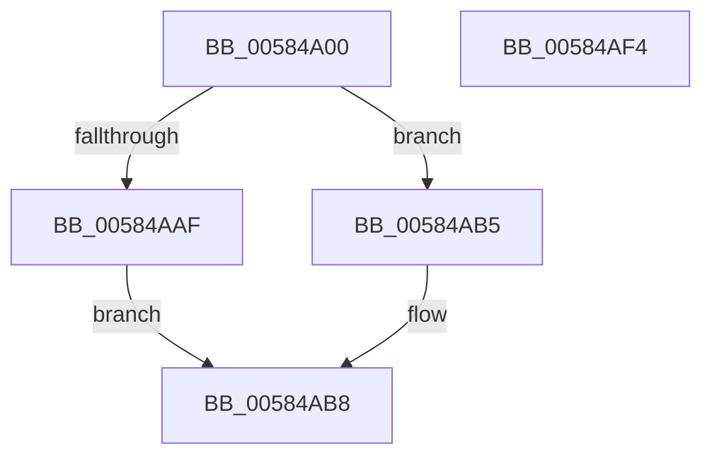

# HvlQueryNumaDistance

- RVA: `0x00584A00`–`0x00584AF5` (길이 `245` bytes)
- VA: `0x0000000140584A00`
- 실행 섹션: `.text`
- PDB 이름 있음: `예`; PDB Function 태그: `아니요`
- unwind 정보 RVA: `0x000991EC`
- 디코드: `71`개 명령, `245/245` bytes 표시
- 미해석 바이트: `0` (있으면 어셈블리에 `.byte`로 보존)

> 이 문서는 커널 이미지의 기계어와 PDB 기호를 분석해 생성했습니다. 4번과 5번은 함수 원형과 자료형을 바이너리 사용 방식에서 추정한 C 해석이며 원본 소스 복구 결과는 아닙니다.

## 1. Dependencies

- 직접 호출 지점: **5**; 고유 호출 대상: **3**
- 직접 호출자로 확인된 함수: **1**
- RIP 상대 이미지 참조: **1**

### Outgoing calls
- `0x00584A50` → [HvlpAcquireHypercallPage](../47/HvlpAcquireHypercallPage_function_00471410.md) (function, `0x00471410`)
- `0x00584A66` → [HvlpAcquireHypercallPage](../47/HvlpAcquireHypercallPage_function_00471410.md) (function, `0x00471410`)
- `0x00584AA5` → [HvcallInitiateHypercall](../31/HvcallInitiateHypercall_function_00313630.md) (function, `0x00313630`)
- `0x00584ACA` → [HvlpReleaseHypercallPage](../31/HvlpReleaseHypercallPage_function_00313480.md) (function, `0x00313480`)
- `0x00584AD3` → [HvlpReleaseHypercallPage](../31/HvlpReleaseHypercallPage_function_00313480.md) (function, `0x00313480`)

### Direct callers
- [KiComputeNumaCosts](../../init/C3/KiComputeNumaCosts_function_00C37AD4.md) at `0x00C37BE7`

### Static image references
- `0x00584A6B` → RVA `0x00FCF6C0` (`CACHEALI`; read)

## 2. Other-region calls and transfers

- 다른 실행 섹션으로 향하는 call: **0**
- 별도 외부 분기/꼬리 이동을 확인하지 못했습니다.

## 3. Assembly (complete function range)

```asm
00584A00  48 89 5C 24 08                  mov qword ptr [rsp + 8], rbx
00584A05  48 89 74 24 10                  mov qword ptr [rsp + 0x10], rsi
00584A0A  48 89 7C 24 18                  mov qword ptr [rsp + 0x18], rdi
00584A0F  55                              push rbp
00584A10  41 56                           push r14
00584A12  41 57                           push r15
00584A14  48 8B EC                        mov rbp, rsp
00584A17  48 83 EC 60                     sub rsp, 0x60
00584A1B  33 C0                           xor eax, eax
00584A1D  0F B7 F2                        movzx esi, dx
00584A20  0F 57 C0                        xorps xmm0, xmm0
00584A23  0F B7 F9                        movzx edi, cx
00584A26  4D 8B F8                        mov r15, r8
00584A29  48 89 45 F0                     mov qword ptr [rbp - 0x10], rax
00584A2D  45 33 C0                        xor r8d, r8d
00584A30  89 45 F8                        mov dword ptr [rbp - 8], eax
00584A33  44 8D 70 08                     lea r14d, [rax + 8]
00584A37  48 89 45 D0                     mov qword ptr [rbp - 0x30], rax
00584A3B  45 8B CE                        mov r9d, r14d
00584A3E  89 45 D8                        mov dword ptr [rbp - 0x28], eax
00584A41  8D 50 01                        lea edx, [rax + 1]
00584A44  48 8D 4D E0                     lea rcx, [rbp - 0x20]
00584A48  0F 11 45 E0                     movups xmmword ptr [rbp - 0x20], xmm0
00584A4C  0F 11 45 C0                     movups xmmword ptr [rbp - 0x40], xmm0
00584A50  E8 BB C9 EE FF                  call 0x140471410
00584A55  45 8B CE                        mov r9d, r14d
00584A58  41 8D 56 FA                     lea edx, [r14 - 6]
00584A5C  45 33 C0                        xor r8d, r8d
00584A5F  48 8D 4D C0                     lea rcx, [rbp - 0x40]
00584A63  48 8B D8                        mov rbx, rax
00584A66  E8 A5 C9 EE FF                  call 0x140471410
00584A6B  4C 8D 05 4E AC A4 00            lea r8, [rip + 0xa4ac4e]
00584A72  4C 8B F0                        mov r14, rax
00584A75  49 8B 0C F8                     mov rcx, qword ptr [r8 + rdi*8]
00584A79  0F B7 49 02                     movzx ecx, word ptr [rcx + 2]
00584A7D  49 8B 0C C8                     mov rcx, qword ptr [r8 + rcx*8]
00584A81  8B 51 04                        mov edx, dword ptr [rcx + 4]
00584A84  49 8B 0C F0                     mov rcx, qword ptr [r8 + rsi*8]
00584A88  89 13                           mov dword ptr [rbx], edx
00584A8A  48 8B 55 F8                     mov rdx, qword ptr [rbp - 8]
00584A8E  0F B7 41 02                     movzx eax, word ptr [rcx + 2]
00584A92  49 8B 04 C0                     mov rax, qword ptr [r8 + rax*8]
00584A96  4C 8B 45 D8                     mov r8, qword ptr [rbp - 0x28]
00584A9A  8B 48 04                        mov ecx, dword ptr [rax + 4]
00584A9D  89 4B 04                        mov dword ptr [rbx + 4], ecx
00584AA0  B9 78 00 00 00                  mov ecx, 0x78
00584AA5  E8 86 EB D8 FF                  call 0x140313630
00584AAA  66 85 C0                        test ax, ax
00584AAD  74 06                           je 0x140584ab5
00584AAF  48 83 C9 FF                     or rcx, 0xffffffffffffffff
00584AB3  EB 03                           jmp 0x140584ab8
00584AB5  49 8B 0E                        mov rcx, qword ptr [r14]
00584AB8  66 F7 D8                        neg ax
00584ABB  49 89 0F                        mov qword ptr [r15], rcx
00584ABE  48 8D 4D C0                     lea rcx, [rbp - 0x40]
00584AC2  1B DB                           sbb ebx, ebx
00584AC4  81 E3 01 00 00 C0               and ebx, 0xc0000001
00584ACA  E8 B1 E9 D8 FF                  call 0x140313480
00584ACF  48 8D 4D E0                     lea rcx, [rbp - 0x20]
00584AD3  E8 A8 E9 D8 FF                  call 0x140313480
00584AD8  4C 8D 5C 24 60                  lea r11, [rsp + 0x60]
00584ADD  8B C3                           mov eax, ebx
00584ADF  49 8B 5B 20                     mov rbx, qword ptr [r11 + 0x20]
00584AE3  49 8B 73 28                     mov rsi, qword ptr [r11 + 0x28]
00584AE7  49 8B 7B 30                     mov rdi, qword ptr [r11 + 0x30]
00584AEB  49 8B E3                        mov rsp, r11
00584AEE  41 5F                           pop r15
00584AF0  41 5E                           pop r14
00584AF2  5D                              pop rbp
00584AF3  C3                              ret
00584AF4  CC                              int3
```

## 4. C-style interpretation (structured pseudocode)

```c
__int64 __fastcall HvlQueryNumaDistance(unsigned __int16 a1, unsigned __int16 a2, __int64 a3)
{
    __int64 result;
    __int64 v_rbx;
    __int64 v_rsp;
    unsigned __int64 v_stack_m18;
    unsigned int v_stack_m20;
    unsigned __int64 v_stack_m28;
    unsigned __int64 v_stack_m38;
    unsigned int v_stack_m40;
    unsigned __int64 v_stack_m48;
    unsigned __int64 v_stack_m58;
    unsigned __int64 v_stack_p10;
    unsigned __int64 v_stack_p18;
    unsigned __int64 v_stack_p8;

    v_stack_p8 = v_rbx;
    v_stack_p10 = v_rsi;
    v_stack_p18 = v_rdi;
    v_rsp = (v_rsp) - (96);
    result = 0;
    v_stack_m28 = 0;
    a3 = 0;
    v_stack_m20 = 0;
    v_stack_m48 = 0;
    v_stack_m40 = 0;
    v_stack_m38 = v_xmm0;
    v_stack_m58 = v_xmm0;
    result = HvlpAcquireHypercallPage(v_stack_m38, result + 1, a3, (unsigned int)((unsigned int)(result + 8)));
    a3 = 0;
    result = HvlpAcquireHypercallPage(v_stack_m58, result + 8 - 6, a3, (unsigned int)((unsigned int)(result + 8)));
    *(unsigned int *)(result) = (unsigned int)((unsigned int)(*(unsigned int *)(*(unsigned __int64 *)(v_rip + 10792014 + *(unsigned __int16 *)(*(unsigned __int64 *)(v_rip + 10792014 + a1 * 8) + 2) * 8) + 4)));
    *(unsigned int *)(result + 4) = (unsigned int)((unsigned int)(*(unsigned int *)(*(unsigned __int64 *)(v_rip + 10792014 + *(unsigned __int16 *)(*(unsigned __int64 *)(v_rip + 10792014 + a2 * 8) + 2) * 8) + 4)));
    result = HvcallInitiateHypercall(120, v_stack_m20, v_stack_m40, (unsigned int)((unsigned int)(result + 8)));
    if ((unsigned __int16)(result) == 0) goto loc_00584AB5;
    a1 = (120) | (-1);
    goto loc_00584AB8;
loc_00584AB5:
loc_00584AB8:
    result = (unsigned __int16)(-(result));
    *(unsigned __int64 *)(a3) = *(unsigned __int64 *)(result);
    v_rbx = (unsigned int)((result) & (0xC0000001ULL));
    result = HvlpReleaseHypercallPage(v_stack_m58, v_stack_m20, v_stack_m40, (unsigned int)((unsigned int)(result + 8)));
    result = HvlpReleaseHypercallPage(v_stack_m38, v_stack_m20, v_stack_m40, (unsigned int)((unsigned int)(result + 8)));
    return (unsigned int)((unsigned int)(v_rbx));
}
```

## 5. (Beta) C Style

```c
int64_t HvlQueryNumaDistance(uint16_t Arg1, uint16_t Arg2, void *Arg3)
{
    uint8_t *arg3 = (uint8_t *)Arg3;

    int64_t result;
    int64_t local_rbx;
    int64_t local_rsp;
    uint64_t v_stack_m18;
    uint32_t v_stack_m20;
    uint64_t v_stack_m28;
    uint64_t v_stack_m38;
    uint32_t v_stack_m40;
    uint64_t v_stack_m48;
    uint64_t v_stack_m58;
    uint64_t v_stack_p10;
    uint64_t v_stack_p18;
    uint64_t v_stack_p8;

    v_stack_p8 = local_rbx;
    v_stack_p10 = local_rsi;
    v_stack_p18 = local_rdi;
    local_rsp = (local_rsp) - (96);
    result = 0;
    v_stack_m28 = 0;
    Arg3 = 0;
    v_stack_m20 = 0;
    v_stack_m48 = 0;
    v_stack_m40 = 0;
    v_stack_m38 = v_xmm0;
    v_stack_m58 = v_xmm0;
    result = HvlpAcquireHypercallPage(v_stack_m38, result + 1, Arg3, (uint32_t)((uint32_t)(result + 8)));
    Arg3 = 0;
    result = HvlpAcquireHypercallPage(v_stack_m58, result + 8 - 6, Arg3, (uint32_t)((uint32_t)(result + 8)));
    *(uint32_t *)(result) = (uint32_t)((uint32_t)(*(uint32_t *)(*(uint64_t *)(v_rip + 0xA4AC4E + *(uint16_t *)(*(uint64_t *)(v_rip + 0xA4AC4E + Arg1 * 8) + 0x2) * 8) + 0x4)));
    *(uint32_t *)(result + 0x4) = (uint32_t)((uint32_t)(*(uint32_t *)(*(uint64_t *)(v_rip + 0xA4AC4E + *(uint16_t *)(*(uint64_t *)(v_rip + 0xA4AC4E + Arg2 * 8) + 0x2) * 8) + 0x4)));
    result = HvcallInitiateHypercall(120, v_stack_m20, v_stack_m40, (uint32_t)((uint32_t)(result + 8)));
    if ((uint16_t)(result) == 0) goto loc_00584AB5;
    Arg1 = (120) | (-1);
    goto loc_00584AB8;
loc_00584AB5:
loc_00584AB8:
    result = (uint16_t)(-(result));
    *(uint64_t *)(arg3) = *(uint64_t *)(result);
    local_rbx = (uint32_t)((result) & (0xC0000001ULL));
    result = HvlpReleaseHypercallPage(v_stack_m58, v_stack_m20, v_stack_m40, (uint32_t)((uint32_t)(result + 8)));
    result = HvlpReleaseHypercallPage(v_stack_m38, v_stack_m20, v_stack_m40, (uint32_t)((uint32_t)(result + 8)));
    return (uint32_t)((uint32_t)(local_rbx));
}
```

### 관측된 메모리 오프셋

구조체 형식이 확인되지 않은 접근은 인자 기준의 오프셋으로만 기록했습니다.

| 기준 인자 | 오프셋 표현 | 폭 (bit) | 접근 |
|---|---:|---:|---|
| `Arg3` | `+ 0x0` | `64` | `W` |

## 6. Execution-region graph

[열기: 2D/3D 그래프와 함수 탐색 컨트롤 패널](../../../control-panel.html?section=text&rva=0x00584A00&view=graph)

- 2D 그래프는 위에서 아래로 흐르고, 3D 그래프는 빈 공간을 드래그해 회전합니다. Shift+드래그는 이동, 휠은 확대·축소, 함수 노드 선택은 대상 보고서 이동입니다.

### Static fallback


