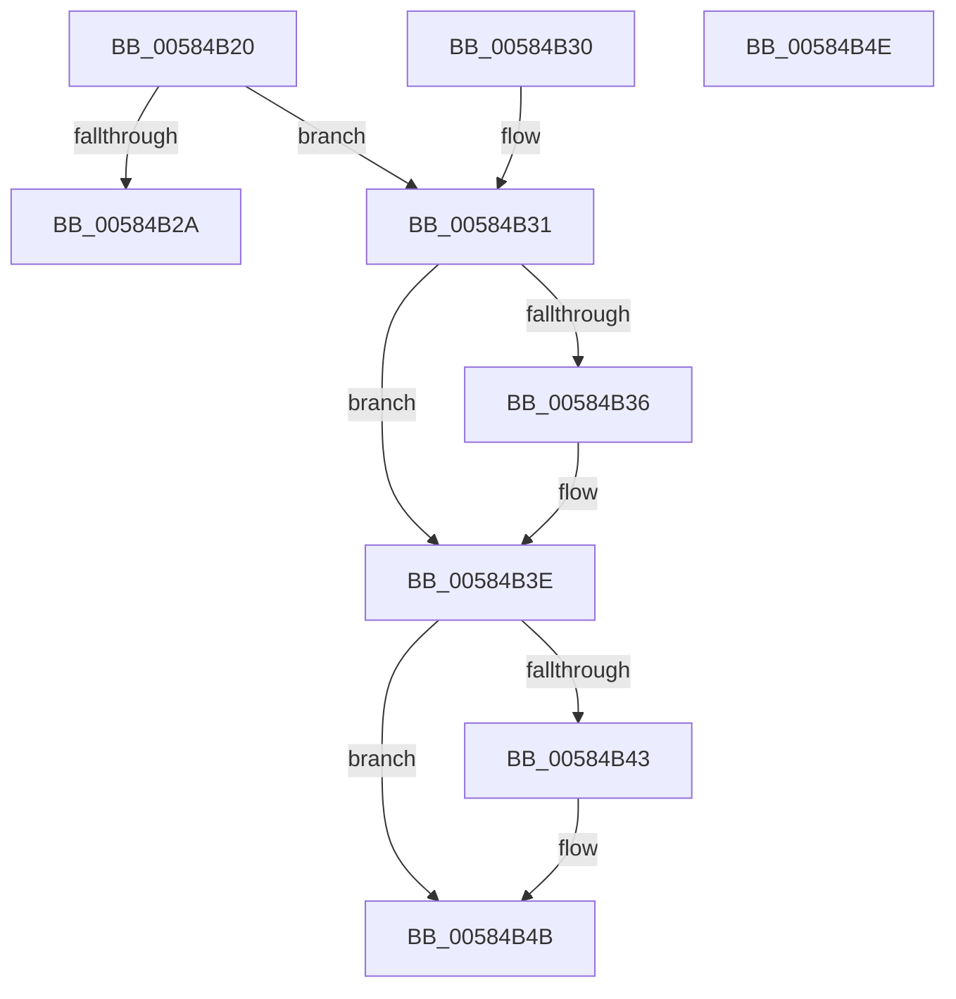

# HvlQueryProcessorTopologyCount

- RVA: `0x00584B20`–`0x00584B4F` (길이 `47` bytes)
- VA: `0x0000000140584B20`
- 실행 섹션: `.text`
- PDB 이름 있음: `예`; PDB Function 태그: `아니요`
- unwind 정보 RVA: `0x000DB714`
- 디코드: `17`개 명령, `47/47` bytes 표시
- 미해석 바이트: `0` (있으면 어셈블리에 `.byte`로 보존)

> 이 문서는 커널 이미지의 기계어와 PDB 기호를 분석해 생성했습니다. 4번과 5번은 함수 원형과 자료형을 바이너리 사용 방식에서 추정한 C 해석이며 원본 소스 복구 결과는 아닙니다.

## 1. Dependencies

- 직접 호출 지점: **0**; 고유 호출 대상: **0**
- 직접 호출자로 확인된 함수: **1**
- RIP 상대 이미지 참조: **3**

### Outgoing calls
- 직접 디코드된 call 명령이 없습니다.

### Direct callers
- [ExpQuerySystemInformation](../../page/A5/ExpQuerySystemInformation_function_00A57858.md) at `0x00A59C73`

### Static image references
- `0x00584B20` → RVA `0x00FC6A90` (`ALMOSTRO`; read)
- `0x00584B36` → RVA `0x00FC7004` (`ALMOSTRO`; read)
- `0x00584B43` → RVA `0x00FC7000` (`ALMOSTRO`; read)

## 2. Other-region calls and transfers

- 다른 실행 섹션으로 향하는 call: **0**
- 별도 외부 분기/꼬리 이동을 확인하지 못했습니다.

## 3. Assembly (complete function range)

```asm
00584B20  8B 05 6A 1F A4 00               mov eax, dword ptr [rip + 0xa41f6a]
00584B26  A8 02                           test al, 2
00584B28  75 07                           jne 0x140584b31
00584B2A  B8 22 00 00 C0                  mov eax, 0xc0000022
00584B2F  C3                              ret
00584B30  CC                              int3
00584B31  48 85 C9                        test rcx, rcx
00584B34  74 08                           je 0x140584b3e
00584B36  8B 05 C8 24 A4 00               mov eax, dword ptr [rip + 0xa424c8]
00584B3C  89 01                           mov dword ptr [rcx], eax
00584B3E  48 85 D2                        test rdx, rdx
00584B41  74 08                           je 0x140584b4b
00584B43  8B 05 B7 24 A4 00               mov eax, dword ptr [rip + 0xa424b7]
00584B49  89 02                           mov dword ptr [rdx], eax
00584B4B  33 C0                           xor eax, eax
00584B4D  C3                              ret
00584B4E  CC                              int3
```

## 4. C-style interpretation (structured pseudocode)

```c
__int64 __fastcall HvlQueryProcessorTopologyCount(__int64 a1, __int64 a2)
{
    __int64 result;

    if ((((unsigned __int8)((unsigned int)(*(unsigned int *)(v_rip + 10755946)))) & (2)) != 0) goto loc_00584B31;
    return (unsigned int)(0xC0000022ULL);
loc_00584B31:
    result = (unsigned int)(0xC0000022ULL);
    if (a1 != 0) {
        result = *(unsigned int *)(v_rip + 10757320);
        *(unsigned int *)(a1) = (unsigned int)(result);
    }
    if (a2 != 0) {
        result = *(unsigned int *)(v_rip + 10757303);
        *(unsigned int *)(a2) = (unsigned int)(result);
    }
    result = 0;
    return result;
}
```

## 5. (Beta) C Style

```c
int64_t HvlQueryProcessorTopologyCount(int64_t Arg1, int64_t Arg2)
{
    int64_t result;

    if ((((uint8_t)((uint32_t)(*(uint32_t *)(v_rip + 0xA41F6A)))) & (2)) != 0) goto loc_00584B31;
    return (uint32_t)(0xC0000022ULL);
loc_00584B31:
    result = (uint32_t)(0xC0000022ULL);
    if (Arg1 != 0) {
        result = *(uint32_t *)(v_rip + 0xA424C8);
        *(uint32_t *)(Arg1) = (uint32_t)(result);
    }
    if (Arg2 != 0) {
        result = *(uint32_t *)(v_rip + 0xA424B7);
        *(uint32_t *)(Arg2) = (uint32_t)(result);
    }
    result = 0;
    return result;
}
```

## 6. Execution-region graph

[열기: 2D/3D 그래프와 함수 탐색 컨트롤 패널](../../../control-panel.html?section=text&rva=0x00584B20&view=graph)

- 2D 그래프는 위에서 아래로 흐르고, 3D 그래프는 빈 공간을 드래그해 회전합니다. Shift+드래그는 이동, 휠은 확대·축소, 함수 노드 선택은 대상 보고서 이동입니다.

### Static fallback


