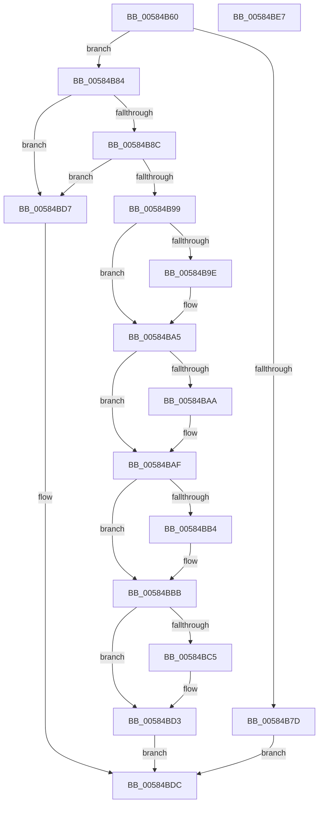

# HvlQueryProcessorTopologyEx

- RVA: `0x00584B60`–`0x00584BE8` (길이 `136` bytes)
- VA: `0x0000000140584B60`
- 실행 섹션: `.text`
- PDB 이름 있음: `예`; PDB Function 태그: `아니요`
- unwind 정보 RVA: `0x0005CAAC`
- 디코드: `45`개 명령, `136/136` bytes 표시
- 미해석 바이트: `0` (있으면 어셈블리에 `.byte`로 보존)

> 이 문서는 커널 이미지의 기계어와 PDB 기호를 분석해 생성했습니다. 4번과 5번은 함수 원형과 자료형을 바이너리 사용 방식에서 추정한 C 해석이며 원본 소스 복구 결과는 아닙니다.

## 1. Dependencies

- 직접 호출 지점: **1**; 고유 호출 대상: **1**
- 직접 호출자로 확인된 함수: **1**
- RIP 상대 이미지 참조: **2**

### Outgoing calls
- `0x00584B8C` → [HvlpGetLpcbByLpIndex](../44/HvlpGetLpcbByLpIndex_function_0044FFA0.md) (function, `0x0044FFA0`)

### Direct callers
- [HvlQueryProcessorTopology](HvlQueryProcessorTopology_function_00584B00.md) at `0x00584B0A`

### Static image references
- `0x00584B6A` → RVA `0x00FC6A90` (`ALMOSTRO`; read)
- `0x00584B84` → RVA `0x00FC6DD8` (`ALMOSTRO`; read)

## 2. Other-region calls and transfers

- 다른 실행 섹션으로 향하는 call: **0**
- 별도 외부 분기/꼬리 이동을 확인하지 못했습니다.

## 3. Assembly (complete function range)

```asm
00584B60  48 89 5C 24 08                  mov qword ptr [rsp + 8], rbx
00584B65  57                              push rdi
00584B66  48 83 EC 20                     sub rsp, 0x20
00584B6A  8B 05 20 1F A4 00               mov eax, dword ptr [rip + 0xa41f20]
00584B70  4D 8B D9                        mov r11, r9
00584B73  49 8B D8                        mov rbx, r8
00584B76  48 8B FA                        mov rdi, rdx
00584B79  A8 02                           test al, 2
00584B7B  75 07                           jne 0x140584b84
00584B7D  B8 22 00 00 C0                  mov eax, 0xc0000022
00584B82  EB 58                           jmp 0x140584bdc
00584B84  3B 0D 4E 22 A4 00               cmp ecx, dword ptr [rip + 0xa4224e]
00584B8A  73 4B                           jae 0x140584bd7
00584B8C  E8 0F B4 EC FF                  call 0x14044ffa0
00584B91  4C 8B D0                        mov r10, rax
00584B94  48 85 C0                        test rax, rax
00584B97  74 3E                           je 0x140584bd7
00584B99  48 85 FF                        test rdi, rdi
00584B9C  74 07                           je 0x140584ba5
00584B9E  0F B7 48 60                     movzx ecx, word ptr [rax + 0x60]
00584BA2  66 89 0F                        mov word ptr [rdi], cx
00584BA5  48 85 DB                        test rbx, rbx
00584BA8  74 05                           je 0x140584baf
00584BAA  8B 40 0C                        mov eax, dword ptr [rax + 0xc]
00584BAD  89 03                           mov dword ptr [rbx], eax
00584BAF  4D 85 DB                        test r11, r11
00584BB2  74 07                           je 0x140584bbb
00584BB4  41 8B 42 10                     mov eax, dword ptr [r10 + 0x10]
00584BB8  41 89 03                        mov dword ptr [r11], eax
00584BBB  48 8B 54 24 50                  mov rdx, qword ptr [rsp + 0x50]
00584BC0  48 85 D2                        test rdx, rdx
00584BC3  74 0E                           je 0x140584bd3
00584BC5  41 8B 4A 14                     mov ecx, dword ptr [r10 + 0x14]
00584BC9  83 C8 FF                        or eax, 0xffffffff
00584BCC  3B C8                           cmp ecx, eax
00584BCE  0F 45 C1                        cmovne eax, ecx
00584BD1  89 02                           mov dword ptr [rdx], eax
00584BD3  33 C0                           xor eax, eax
00584BD5  EB 05                           jmp 0x140584bdc
00584BD7  B8 0D 00 00 C0                  mov eax, 0xc000000d
00584BDC  48 8B 5C 24 30                  mov rbx, qword ptr [rsp + 0x30]
00584BE1  48 83 C4 20                     add rsp, 0x20
00584BE5  5F                              pop rdi
00584BE6  C3                              ret
00584BE7  CC                              int3
```

## 4. C-style interpretation (structured pseudocode)

```c
__int64 __fastcall HvlQueryProcessorTopologyEx(int a1, __int64 a2, __int64 a3, __int64 a4, __int64 a5)
{
    __int64 result;
    __int64 v_rsp;
    unsigned __int64 v_stack_p8;

    v_stack_p8 = v_rbx;
    v_rsp = (v_rsp) - (32);
    if ((((unsigned __int8)((unsigned int)(*(unsigned int *)(v_rip + 10755872)))) & (2)) != 0) goto loc_00584B84;
    goto loc_00584BDC;
loc_00584B84:
    if (a1 >= (*(unsigned int *)(v_rip + 10756686))) goto loc_00584BD7;
    result = HvlpGetLpcbByLpIndex(a1, a2, a3, a4);
    if (result == 0) goto loc_00584BD7;
    if (a2 != 0) {
        a1 = *(unsigned __int16 *)(result + 96);
        *(unsigned __int16 *)(a2) = (unsigned __int16)(a1);
    }
    if (a3 != 0) {
        result = *(unsigned int *)(result + 12);
        *(unsigned int *)(a3) = (unsigned int)(result);
    }
    if (a4 != 0) {
        result = *(unsigned int *)(result + 16);
        *(unsigned int *)(a4) = (unsigned int)(result);
    }
    if (a5 != 0) {
        a1 = *(unsigned int *)(result + 20);
        result = (unsigned int)((result) | (0xFFFFFFFFULL));
        if (a1 != ((unsigned int)(result))) { result = a1; }
        *(unsigned int *)(a5) = (unsigned int)(result);
    }
    result = 0;
    goto loc_00584BDC;
loc_00584BD7:
loc_00584BDC:
    v_rsp = (v_rsp) + (32);
    return (unsigned int)(0xC000000DULL);
}
```

## 5. (Beta) C Style

```c
int64_t HvlQueryProcessorTopologyEx(int32_t Arg1, int64_t Arg2, int64_t Arg3, int64_t Arg4, int64_t Arg5)
{
    int64_t result;
    int64_t local_rsp;
    uint64_t v_stack_p8;

    v_stack_p8 = local_rbx;
    local_rsp = (local_rsp) - (32);
    if ((((uint8_t)((uint32_t)(*(uint32_t *)(v_rip + 0xA41F20)))) & (2)) != 0) goto loc_00584B84;
    goto loc_00584BDC;
loc_00584B84:
    if (Arg1 >= (*(uint32_t *)(v_rip + 0xA4224E))) goto loc_00584BD7;
    result = HvlpGetLpcbByLpIndex(Arg1, Arg2, Arg3, Arg4);
    if (result == 0) goto loc_00584BD7;
    if (Arg2 != 0) {
        Arg1 = *(uint16_t *)(result + 0x60);
        *(uint16_t *)(Arg2) = (uint16_t)(Arg1);
    }
    if (Arg3 != 0) {
        result = *(uint32_t *)(result + 0xC);
        *(uint32_t *)(Arg3) = (uint32_t)(result);
    }
    if (Arg4 != 0) {
        result = *(uint32_t *)(result + 0x10);
        *(uint32_t *)(Arg4) = (uint32_t)(result);
    }
    if (Arg5 != 0) {
        Arg1 = *(uint32_t *)(result + 0x14);
        result = (uint32_t)((result) | (0xFFFFFFFFULL));
        if (Arg1 != ((uint32_t)(result))) { result = Arg1; }
        *(uint32_t *)(Arg5) = (uint32_t)(result);
    }
    result = 0;
    goto loc_00584BDC;
loc_00584BD7:
loc_00584BDC:
    local_rsp = (local_rsp) + (32);
    return (uint32_t)(0xC000000DULL);
}
```

## 6. Execution-region graph

[열기: 2D/3D 그래프와 함수 탐색 컨트롤 패널](../../../control-panel.html?section=text&rva=0x00584B60&view=graph)

- 2D 그래프는 위에서 아래로 흐르고, 3D 그래프는 빈 공간을 드래그해 회전합니다. Shift+드래그는 이동, 휠은 확대·축소, 함수 노드 선택은 대상 보고서 이동입니다.

### Static fallback


