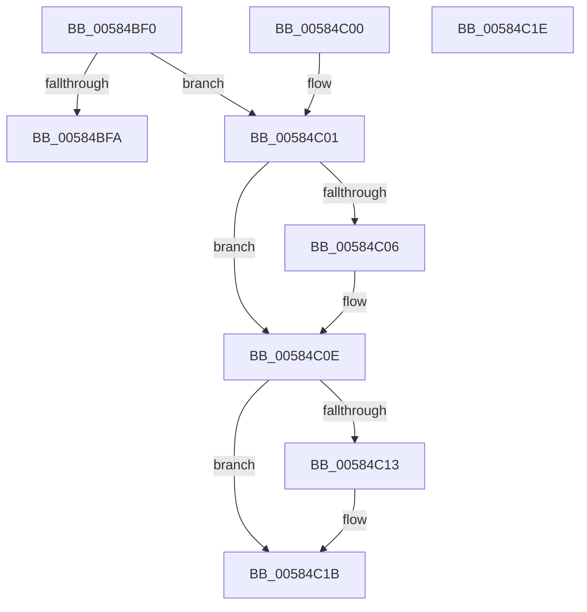

# HvlQueryProcessorTopologyHighestId

- RVA: `0x00584BF0`–`0x00584C1F` (길이 `47` bytes)
- VA: `0x0000000140584BF0`
- 실행 섹션: `.text`
- PDB 이름 있음: `예`; PDB Function 태그: `아니요`
- unwind 정보 RVA: `0x000DB714`
- 디코드: `17`개 명령, `47/47` bytes 표시
- 미해석 바이트: `0` (있으면 어셈블리에 `.byte`로 보존)

> 이 문서는 커널 이미지의 기계어와 PDB 기호를 분석해 생성했습니다. 4번과 5번은 함수 원형과 자료형을 바이너리 사용 방식에서 추정한 C 해석이며 원본 소스 복구 결과는 아닙니다.

## 1. Dependencies

- 직접 호출 지점: **0**; 고유 호출 대상: **0**
- 직접 호출자로 확인된 함수: **0**
- RIP 상대 이미지 참조: **3**

### Outgoing calls
- 직접 디코드된 call 명령이 없습니다.

### Direct callers
- 이 함수 시작 RVA로 연결되는 직접 call은 확인되지 않았습니다. 간접 호출은 완전히 역산할 수 없습니다.

### Static image references
- `0x00584BF0` → RVA `0x00FC6A90` (`ALMOSTRO`; read)
- `0x00584C06` → RVA `0x00E3EDC8` (`.data`; read)
- `0x00584C13` → RVA `0x00E3EDCC` (`.data`; read)

## 2. Other-region calls and transfers

- 다른 실행 섹션으로 향하는 call: **0**
- 별도 외부 분기/꼬리 이동을 확인하지 못했습니다.

## 3. Assembly (complete function range)

```asm
00584BF0  8B 05 9A 1E A4 00               mov eax, dword ptr [rip + 0xa41e9a]
00584BF6  A8 02                           test al, 2
00584BF8  75 07                           jne 0x140584c01
00584BFA  B8 22 00 00 C0                  mov eax, 0xc0000022
00584BFF  C3                              ret
00584C00  CC                              int3
00584C01  48 85 C9                        test rcx, rcx
00584C04  74 08                           je 0x140584c0e
00584C06  8B 05 BC A1 8B 00               mov eax, dword ptr [rip + 0x8ba1bc]
00584C0C  89 01                           mov dword ptr [rcx], eax
00584C0E  48 85 D2                        test rdx, rdx
00584C11  74 08                           je 0x140584c1b
00584C13  8B 05 B3 A1 8B 00               mov eax, dword ptr [rip + 0x8ba1b3]
00584C19  89 02                           mov dword ptr [rdx], eax
00584C1B  33 C0                           xor eax, eax
00584C1D  C3                              ret
00584C1E  CC                              int3
```

## 4. C-style interpretation (structured pseudocode)

```c
__int64 __fastcall HvlQueryProcessorTopologyHighestId(__int64 a1, __int64 a2)
{
    __int64 result;

    if ((((unsigned __int8)((unsigned int)(*(unsigned int *)(v_rip + 10755738)))) & (2)) != 0) goto loc_00584C01;
    return (unsigned int)(0xC0000022ULL);
loc_00584C01:
    result = (unsigned int)(0xC0000022ULL);
    if (a1 != 0) {
        result = *(unsigned int *)(v_rip + 9150908);
        *(unsigned int *)(a1) = (unsigned int)(result);
    }
    if (a2 != 0) {
        result = *(unsigned int *)(v_rip + 9150899);
        *(unsigned int *)(a2) = (unsigned int)(result);
    }
    result = 0;
    return result;
}
```

## 5. (Beta) C Style

```c
int64_t HvlQueryProcessorTopologyHighestId(int64_t Arg1, int64_t Arg2)
{
    int64_t result;

    if ((((uint8_t)((uint32_t)(*(uint32_t *)(v_rip + 0xA41E9A)))) & (2)) != 0) goto loc_00584C01;
    return (uint32_t)(0xC0000022ULL);
loc_00584C01:
    result = (uint32_t)(0xC0000022ULL);
    if (Arg1 != 0) {
        result = *(uint32_t *)(v_rip + 0x8BA1BC);
        *(uint32_t *)(Arg1) = (uint32_t)(result);
    }
    if (Arg2 != 0) {
        result = *(uint32_t *)(v_rip + 0x8BA1B3);
        *(uint32_t *)(Arg2) = (uint32_t)(result);
    }
    result = 0;
    return result;
}
```

## 6. Execution-region graph

[열기: 2D/3D 그래프와 함수 탐색 컨트롤 패널](../../../control-panel.html?section=text&rva=0x00584BF0&view=graph)

- 2D 그래프는 위에서 아래로 흐르고, 3D 그래프는 빈 공간을 드래그해 회전합니다. Shift+드래그는 이동, 휠은 확대·축소, 함수 노드 선택은 대상 보고서 이동입니다.

### Static fallback


