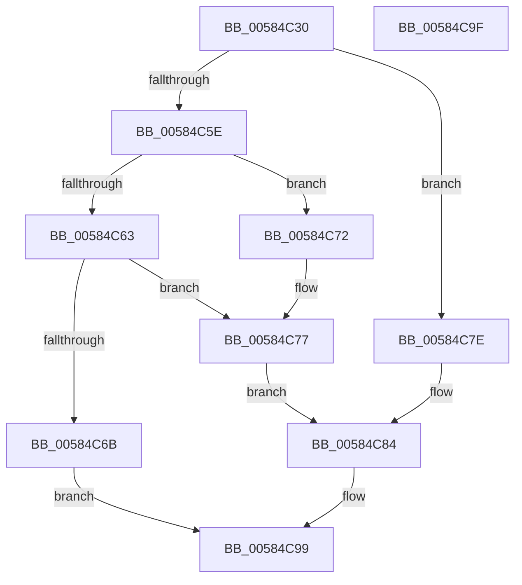

# HvlReadPerfIoPort

- RVA: `0x00584C30`–`0x00584CA0` (길이 `112` bytes)
- VA: `0x0000000140584C30`
- 실행 섹션: `.text`
- PDB 이름 있음: `예`; PDB Function 태그: `아니요`
- unwind 정보 RVA: `0x00064C80`
- 디코드: `31`개 명령, `112/112` bytes 표시
- 미해석 바이트: `0` (있으면 어셈블리에 `.byte`로 보존)

> 이 문서는 커널 이미지의 기계어와 PDB 기호를 분석해 생성했습니다. 4번과 5번은 함수 원형과 자료형을 바이너리 사용 방식에서 추정한 C 해석이며 원본 소스 복구 결과는 아닙니다.

## 1. Dependencies

- 직접 호출 지점: **1**; 고유 호출 대상: **1**
- 직접 호출자로 확인된 함수: **0**
- RIP 상대 이미지 참조: **0**

### Outgoing calls
- `0x00584C8E` → [HvlpReadPerfRegister](HvlpReadPerfRegister_function_00585CBC.md) (function, `0x00585CBC`)

### Direct callers
- 이 함수 시작 RVA로 연결되는 직접 call은 확인되지 않았습니다. 간접 호출은 완전히 역산할 수 없습니다.

### Static image references
- 디코드된 RIP-relative 메모리 참조가 없습니다.

## 2. Other-region calls and transfers

- 다른 실행 섹션으로 향하는 call: **0**
- 별도 외부 분기/꼬리 이동을 확인하지 못했습니다.

## 3. Assembly (complete function range)

```asm
00584C30  40 53                           push rbx
00584C32  48 83 EC 30                     sub rsp, 0x30
00584C36  48 B8 00 00 00 00 00 00 20 00   movabs rax, 0x20000000000000
00584C40  49 8B D9                        mov rbx, r9
00584C43  45 33 C9                        xor r9d, r9d
00584C46  48 89 44 24 20                  mov qword ptr [rsp + 0x20], rax
00584C4B  66 89 54 24 20                  mov word ptr [rsp + 0x20], dx
00584C50  41 0F B7 D0                     movzx edx, r8w
00584C54  4C 89 4C 24 28                  mov qword ptr [rsp + 0x28], r9
00584C59  83 EA 01                        sub edx, 1
00584C5C  74 20                           je 0x140584c7e
00584C5E  83 EA 01                        sub edx, 1
00584C61  74 0F                           je 0x140584c72
00584C63  41 8D 41 02                     lea eax, [r9 + 2]
00584C67  3B D0                           cmp edx, eax
00584C69  74 0C                           je 0x140584c77
00584C6B  B8 0D 00 00 C0                  mov eax, 0xc000000d
00584C70  EB 27                           jmp 0x140584c99
00584C72  B8 01 00 00 00                  mov eax, 1
00584C77  66 89 44 24 22                  mov word ptr [rsp + 0x22], ax
00584C7C  EB 06                           jmp 0x140584c84
00584C7E  66 44 89 4C 24 22               mov word ptr [rsp + 0x22], r9w
00584C84  48 8B 54 24 20                  mov rdx, qword ptr [rsp + 0x20]
00584C89  4C 8D 44 24 28                  lea r8, [rsp + 0x28]
00584C8E  E8 29 10 00 00                  call 0x140585cbc
00584C93  8B 4C 24 28                     mov ecx, dword ptr [rsp + 0x28]
00584C97  89 0B                           mov dword ptr [rbx], ecx
00584C99  48 83 C4 30                     add rsp, 0x30
00584C9D  5B                              pop rbx
00584C9E  C3                              ret
00584C9F  CC                              int3
```

## 4. C-style interpretation (structured pseudocode)

```c
__int64 __fastcall HvlReadPerfIoPort(__int64 a1, unsigned __int16 a2, unsigned __int16 a3, __int64 a4)
{
    __int64 result;
    __int64 v_rsp;
    unsigned __int64 v_stack_m10;
    unsigned __int16 v_stack_m16;
    unsigned __int64 v_stack_m18;

    v_rsp = (v_rsp) - (48);
    a4 = 0;
    v_stack_m18 = result;
    v_stack_m18 = a2;
    v_stack_m10 = 0;
    a2 = (unsigned int)((a3) - (1));
    if (condition_is_equal) goto loc_00584C7E;
    a2 = (unsigned int)((a2) - (1));
    if (condition_is_equal) goto loc_00584C72;
    if (a2 == ((unsigned int)(a4 + 2))) goto loc_00584C77;
    goto loc_00584C99;
loc_00584C72:
loc_00584C77:
    v_stack_m16 = 1;
    goto loc_00584C84;
loc_00584C7E:
    v_stack_m16 = 0;
loc_00584C84:
    result = HvlpReadPerfRegister(a1, v_stack_m18, v_stack_m10, a4);
    *(unsigned int *)(a4) = (unsigned int)((unsigned int)(v_stack_m10));
loc_00584C99:
    v_rsp = (v_rsp) + (48);
    return result;
}
```

## 5. (Beta) C Style

```c
int64_t HvlReadPerfIoPort(int64_t Arg1, uint16_t Arg2, uint16_t Arg3, void *Arg4)
{
    uint8_t *arg4 = (uint8_t *)Arg4;

    int64_t result;
    int64_t local_rsp;
    uint64_t v_stack_m10;
    uint16_t v_stack_m16;
    uint64_t v_stack_m18;

    local_rsp = (local_rsp) - (48);
    Arg4 = 0;
    v_stack_m18 = result;
    v_stack_m18 = Arg2;
    v_stack_m10 = 0;
    Arg2 = (uint32_t)((Arg3) - (1));
    if (condition_is_equal) goto loc_00584C7E;
    Arg2 = (uint32_t)((Arg2) - (1));
    if (condition_is_equal) goto loc_00584C72;
    if (Arg2 == ((uint32_t)(Arg4 + 2))) goto loc_00584C77;
    goto loc_00584C99;
loc_00584C72:
loc_00584C77:
    v_stack_m16 = 1;
    goto loc_00584C84;
loc_00584C7E:
    v_stack_m16 = 0;
loc_00584C84:
    result = HvlpReadPerfRegister(Arg1, v_stack_m18, v_stack_m10, Arg4);
    *(uint32_t *)(arg4) = (uint32_t)((uint32_t)(v_stack_m10));
loc_00584C99:
    local_rsp = (local_rsp) + (48);
    return result;
}
```

### 관측된 메모리 오프셋

구조체 형식이 확인되지 않은 접근은 인자 기준의 오프셋으로만 기록했습니다.

| 기준 인자 | 오프셋 표현 | 폭 (bit) | 접근 |
|---|---:|---:|---|
| `Arg4` | `+ 0x0` | `32` | `W` |

## 6. Execution-region graph

[열기: 2D/3D 그래프와 함수 탐색 컨트롤 패널](../../../control-panel.html?section=text&rva=0x00584C30&view=graph)

- 2D 그래프는 위에서 아래로 흐르고, 3D 그래프는 빈 공간을 드래그해 회전합니다. Shift+드래그는 이동, 휠은 확대·축소, 함수 노드 선택은 대상 보고서 이동입니다.

### Static fallback


