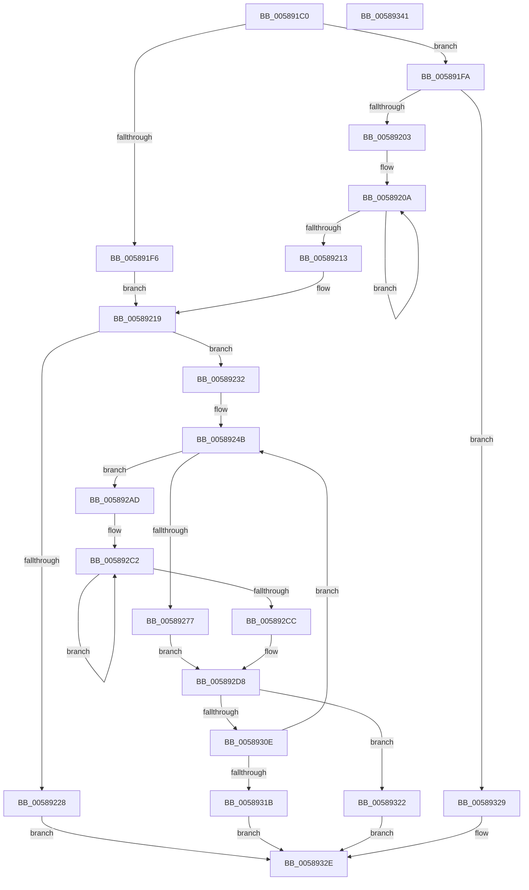

# HvlRegisterDeviceId

- RVA: `0x005891C0`–`0x00589342` (길이 `386` bytes)
- VA: `0x00000001405891C0`
- 실행 섹션: `.text`
- PDB 이름 있음: `예`; PDB Function 태그: `아니요`
- unwind 정보 RVA: `0x0009CA28`
- 디코드: `106`개 명령, `386/386` bytes 표시
- 미해석 바이트: `0` (있으면 어셈블리에 `.byte`로 보존)

> 이 문서는 커널 이미지의 기계어와 PDB 기호를 분석해 생성했습니다. 4번과 5번은 함수 원형과 자료형을 바이너리 사용 방식에서 추정한 C 해석이며 원본 소스 복구 결과는 아닙니다.

## 1. Dependencies

- 직접 호출 지점: **8**; 고유 호출 대상: **8**
- 직접 호출자로 확인된 함수: **0**
- RIP 상대 이미지 참조: **0**

### Outgoing calls
- `0x0058925A` → [HvlpAcquireHypercallPage](../47/HvlpAcquireHypercallPage_function_00471410.md) (function, `0x00471410`)
- `0x0058926A` → [memset](../6C/memset_function_006C6C40.md) (function, `0x006C6C40`)
- `0x005892D3` → [memcpy](../6C/memcpy_function_006C6840.md) (function, `0x006C6840`)
- `0x005892ED` → [HvcallInitiateHypercall](../31/HvcallInitiateHypercall_function_00313630.md) (function, `0x00313630`)
- `0x005892FA` → [HvlpReleaseHypercallPage](../31/HvlpReleaseHypercallPage_function_00313480.md) (function, `0x00313480`)
- `0x00589302` → [HvlpHvStatusIsInsufficientMemory](../30/HvlpHvStatusIsInsufficientMemory_function_00307BB0.md) (function, `0x00307BB0`)
- `0x0058930E` → [HvlpHandleInsufficientMemory](HvlpHandleInsufficientMemory_function_00584514.md) (function, `0x00584514`)
- `0x00589322` → [HvlpHvToNtStatus](../30/HvlpHvToNtStatus_function_00307BD8.md) (function, `0x00307BD8`)

### Direct callers
- 이 함수 시작 RVA로 연결되는 직접 call은 확인되지 않았습니다. 간접 호출은 완전히 역산할 수 없습니다.

### Static image references
- 디코드된 RIP-relative 메모리 참조가 없습니다.

## 2. Other-region calls and transfers

- 다른 실행 섹션으로 향하는 call: **0**
- 별도 외부 분기/꼬리 이동을 확인하지 못했습니다.

## 3. Assembly (complete function range)

```asm
005891C0  48 89 5C 24 10                  mov qword ptr [rsp + 0x10], rbx
005891C5  48 89 6C 24 18                  mov qword ptr [rsp + 0x18], rbp
005891CA  56                              push rsi
005891CB  57                              push rdi
005891CC  41 56                           push r14
005891CE  48 83 EC 40                     sub rsp, 0x40
005891D2  33 C0                           xor eax, eax
005891D4  49 83 CE FF                     or r14, 0xffffffffffffffff
005891D8  48 89 44 24 30                  mov qword ptr [rsp + 0x30], rax
005891DD  0F 57 C0                        xorps xmm0, xmm0
005891E0  89 44 24 38                     mov dword ptr [rsp + 0x38], eax
005891E4  48 8B EA                        mov rbp, rdx
005891E7  8B 01                           mov eax, dword ptr [rcx]
005891E9  48 8B F9                        mov rdi, rcx
005891EC  0F 11 44 24 20                  movups xmmword ptr [rsp + 0x20], xmm0
005891F1  83 F8 01                        cmp eax, 1
005891F4  75 04                           jne 0x1405891fa
005891F6  33 C9                           xor ecx, ecx
005891F8  EB 1F                           jmp 0x140589219
005891FA  83 F8 02                        cmp eax, 2
005891FD  0F 85 26 01 00 00               jne 0x140589329
00589203  48 8B 41 08                     mov rax, qword ptr [rcx + 8]
00589207  49 8B CE                        mov rcx, r14
0058920A  48 FF C1                        inc rcx
0058920D  80 3C 08 00                     cmp byte ptr [rax + rcx], 0
00589211  75 F7                           jne 0x14058920a
00589213  83 C1 08                        add ecx, 8
00589216  83 E1 F8                        and ecx, 0xfffffff8
00589219  8B F1                           mov esi, ecx
0058921B  48 83 C6 28                     add rsi, 0x28
0058921F  48 81 FE 00 10 00 00            cmp rsi, 0x1000
00589226  76 0A                           jbe 0x140589232
00589228  B8 0D 00 00 C0                  mov eax, 0xc000000d
0058922D  E9 FC 00 00 00                  jmp 0x14058932e
00589232  C1 E1 0E                        shl ecx, 0xe
00589235  B8 82 00 00 00                  mov eax, 0x82
0058923A  81 E1 00 00 FE 03               and ecx, 0x3fe0000
00589240  48 89 44 24 60                  mov qword ptr [rsp + 0x60], rax
00589245  0B C8                           or ecx, eax
00589247  89 4C 24 60                     mov dword ptr [rsp + 0x60], ecx
0058924B  45 33 C9                        xor r9d, r9d
0058924E  48 8D 4C 24 20                  lea rcx, [rsp + 0x20]
00589253  45 33 C0                        xor r8d, r8d
00589256  41 8D 51 01                     lea edx, [r9 + 1]
0058925A  E8 B1 81 EE FF                  call 0x140471410
0058925F  4C 8B C6                        mov r8, rsi
00589262  33 D2                           xor edx, edx
00589264  48 8B C8                        mov rcx, rax
00589267  48 8B D8                        mov rbx, rax
0058926A  E8 D1 D9 13 00                  call 0x1406c6c40
0058926F  4C 89 33                        mov qword ptr [rbx], r14
00589272  83 3F 01                        cmp dword ptr [rdi], 1
00589275  75 36                           jne 0x1405892ad
00589277  48 B8 00 00 00 00 00 00 00 40   movabs rax, 0x4000000000000000
00589281  48 89 43 08                     mov qword ptr [rbx + 8], rax
00589285  0F B7 4F 08                     movzx ecx, word ptr [rdi + 8]
00589289  66 89 4B 0A                     mov word ptr [rbx + 0xa], cx
0058928D  0F B7 47 0C                     movzx eax, word ptr [rdi + 0xc]
00589291  66 89 43 08                     mov word ptr [rbx + 8], ax
00589295  0F B7 43 0E                     movzx eax, word ptr [rbx + 0xe]
00589299  0F B7 C8                        movzx ecx, ax
0058929C  66 33 4F 0A                     xor cx, word ptr [rdi + 0xa]
005892A0  66 83 E1 03                     and cx, 3
005892A4  66 33 C8                        xor cx, ax
005892A7  66 89 4B 0E                     mov word ptr [rbx + 0xe], cx
005892AB  EB 2B                           jmp 0x1405892d8
005892AD  48 B9 00 00 00 00 00 00 00 C0   movabs rcx, 0xc000000000000000
005892B7  4D 8B C6                        mov r8, r14
005892BA  48 09 4B 08                     or qword ptr [rbx + 8], rcx
005892BE  48 8B 57 08                     mov rdx, qword ptr [rdi + 8]
005892C2  49 FF C0                        inc r8
005892C5  42 80 3C 02 00                  cmp byte ptr [rdx + r8], 0
005892CA  75 F6                           jne 0x1405892c2
005892CC  49 FF C0                        inc r8
005892CF  48 8D 4B 28                     lea rcx, [rbx + 0x28]
005892D3  E8 68 D5 13 00                  call 0x1406c6840
005892D8  48 8B 54 24 38                  mov rdx, qword ptr [rsp + 0x38]
005892DD  45 33 C0                        xor r8d, r8d
005892E0  48 8B 4C 24 60                  mov rcx, qword ptr [rsp + 0x60]
005892E5  83 4B 10 01                     or dword ptr [rbx + 0x10], 1
005892E9  48 89 6B 18                     mov qword ptr [rbx + 0x18], rbp
005892ED  E8 3E A3 D8 FF                  call 0x140313630
005892F2  48 8D 4C 24 20                  lea rcx, [rsp + 0x20]
005892F7  48 8B D8                        mov rbx, rax
005892FA  E8 81 A1 D8 FF                  call 0x140313480
005892FF  0F B7 CB                        movzx ecx, bx
00589302  E8 A9 E8 D7 FF                  call 0x140307bb0
00589307  0F B7 CB                        movzx ecx, bx
0058930A  84 C0                           test al, al
0058930C  74 14                           je 0x140589322
0058930E  E8 01 B2 FF FF                  call 0x140584514
00589313  85 C0                           test eax, eax
00589315  0F 89 30 FF FF FF               jns 0x14058924b
0058931B  B8 9A 00 00 C0                  mov eax, 0xc000009a
00589320  EB 0C                           jmp 0x14058932e
00589322  E8 B1 E8 D7 FF                  call 0x140307bd8
00589327  EB 05                           jmp 0x14058932e
00589329  B8 BB 00 00 C0                  mov eax, 0xc00000bb
0058932E  48 8B 5C 24 68                  mov rbx, qword ptr [rsp + 0x68]
00589333  48 8B 6C 24 70                  mov rbp, qword ptr [rsp + 0x70]
00589338  48 83 C4 40                     add rsp, 0x40
0058933C  41 5E                           pop r14
0058933E  5F                              pop rdi
0058933F  5E                              pop rsi
00589340  C3                              ret
00589341  CC                              int3
```

## 4. C-style interpretation (structured pseudocode)

```c
__int64 __fastcall HvlRegisterDeviceId(__int64 a1, __int64 a2, int a3, int a4)
{
    __int64 result;
    __int64 v_r14;
    __int64 v_rsi;
    __int64 v_rsp;
    unsigned int v_stack_m20;
    unsigned __int64 v_stack_m28;
    unsigned __int64 v_stack_m38;
    unsigned __int64 v_stack_p10;
    unsigned __int64 v_stack_p18;
    unsigned __int64 v_stack_p8;

    v_stack_p10 = v_rbx;
    v_stack_p18 = v_rbp;
    v_rsp = (v_rsp) - (64);
    result = 0;
    v_r14 = (v_r14) | (-1);
    v_stack_m28 = 0;
    v_stack_m20 = 0;
    v_stack_m38 = v_xmm0;
    if (((unsigned int)((unsigned int)(*(unsigned int *)(a1)))) != 1) goto loc_005891FA;
    a1 = 0;
    goto loc_00589219;
loc_005891FA:
    if (((unsigned int)((unsigned int)(*(unsigned int *)(a1)))) != 2) goto loc_00589329;
loc_0058920A:
    a1 = (v_r14) + 1;
    if ((*(unsigned __int8 *)(*(unsigned __int64 *)(a1 + 8) + a1 * 1)) != 0) goto loc_0058920A;
    a1 = (unsigned int)((a1) + (8));
    a1 = (unsigned int)((a1) & (0xFFFFFFF8ULL));
loc_00589219:
    v_rsi = ((unsigned int)((unsigned int)(a1))) + (40);
    if (v_rsi <= 0x1000ULL) goto loc_00589232;
    goto loc_0058932E;
loc_00589232:
    a1 = (unsigned int)((a1) << (14));
    a1 = (unsigned int)((a1) & (0x3FE0000ULL));
    v_stack_p8 = 130;
    a1 = (unsigned int)((a1) | (130));
    v_stack_p8 = (unsigned int)(a1);
loc_0058924B:
    a4 = 0;
    a3 = 0;
    result = HvlpAcquireHypercallPage(v_stack_m38, a4 + 1, a3, a4);
    a2 = 0;
    result = memset(result, a2, v_rsi, a4);
    *(unsigned __int64 *)(result) = v_r14;
    if ((*(unsigned int *)(a1)) != 1) goto loc_005892AD;
    *(unsigned __int64 *)(result + 8) = result;
    *(unsigned __int16 *)(result + 10) = (unsigned __int16)(*(unsigned __int16 *)(a1 + 8));
    *(unsigned __int16 *)(result + 8) = (unsigned __int16)(*(unsigned __int16 *)(a1 + 12));
    a1 = (unsigned __int16)(((unsigned __int16)(*(unsigned __int16 *)(result + 14))) ^ (*(unsigned __int16 *)(a1 + 10)));
    a1 = (unsigned __int16)((a1) & (3));
    a1 = (unsigned __int16)((a1) ^ ((unsigned __int16)(*(unsigned __int16 *)(result + 14))));
    *(unsigned __int16 *)(result + 14) = (unsigned __int16)(a1);
    goto loc_005892D8;
loc_005892AD:
loc_005892C2:
    a3 = (v_r14) + 1;
    if ((*(unsigned __int8 *)(*(unsigned __int64 *)(a1 + 8) + a3 * 1)) != 0) goto loc_005892C2;
    a3 = (a3) + 1;
    result = memcpy(result + 40, *(unsigned __int64 *)(a1 + 8), a3, a4);
loc_005892D8:
    a3 = 0;
    *(unsigned __int64 *)(result + 24) = 0;
    result = HvcallInitiateHypercall(v_stack_p8, v_stack_m20, a3, a4);
    result = HvlpReleaseHypercallPage(v_stack_m38, v_stack_m20, a3, a4);
    result = HvlpHvStatusIsInsufficientMemory((unsigned __int16)(result), v_stack_m20, a3, a4);
    if ((unsigned __int8)(result) == 0) goto loc_00589322;
    result = HvlpHandleInsufficientMemory((unsigned __int16)(result), v_stack_m20, a3, a4);
    if (!sign_flag) goto loc_0058924B;
    goto loc_0058932E;
loc_00589322:
    result = HvlpHvToNtStatus((unsigned __int16)(result), v_stack_m20, a3, a4);
    goto loc_0058932E;
loc_00589329:
loc_0058932E:
    v_rsp = (v_rsp) + (64);
    return (unsigned int)(0xC00000BBULL);
}
```

## 5. (Beta) C Style

```c
int64_t HvlRegisterDeviceId(void *Arg1, int64_t Arg2, int32_t Arg3, int32_t Arg4)
{
    uint8_t *arg1 = (uint8_t *)Arg1;

    int64_t result;
    int64_t local_r14;
    int64_t local_rsi;
    int64_t local_rsp;
    uint32_t v_stack_m20;
    uint64_t v_stack_m28;
    uint64_t v_stack_m38;
    uint64_t v_stack_p10;
    uint64_t v_stack_p18;
    uint64_t v_stack_p8;

    v_stack_p10 = local_rbx;
    v_stack_p18 = local_rbp;
    local_rsp = (local_rsp) - (64);
    result = 0;
    local_r14 = (local_r14) | (-1);
    v_stack_m28 = 0;
    v_stack_m20 = 0;
    v_stack_m38 = v_xmm0;
    if (((uint32_t)((uint32_t)(*(uint32_t *)(arg1)))) != 1) goto loc_005891FA;
    Arg1 = 0;
    goto loc_00589219;
loc_005891FA:
    if (((uint32_t)((uint32_t)(*(uint32_t *)(arg1)))) != 2) goto loc_00589329;
loc_0058920A:
    Arg1 = (local_r14) + 1;
    if ((*(uint8_t *)(*(uint64_t *)(arg1 + 0x8) + arg1 * 1)) != 0) goto loc_0058920A;
    Arg1 = (uint32_t)((Arg1) + (8));
    Arg1 = (uint32_t)((Arg1) & (0xFFFFFFF8ULL));
loc_00589219:
    local_rsi = ((uint32_t)((uint32_t)(Arg1))) + (40);
    if (local_rsi <= 0x1000ULL) goto loc_00589232;
    goto loc_0058932E;
loc_00589232:
    Arg1 = (uint32_t)((Arg1) << (14));
    Arg1 = (uint32_t)((Arg1) & (0x3FE0000ULL));
    v_stack_p8 = 130;
    Arg1 = (uint32_t)((Arg1) | (130));
    v_stack_p8 = (uint32_t)(Arg1);
loc_0058924B:
    Arg4 = 0;
    Arg3 = 0;
    result = HvlpAcquireHypercallPage(v_stack_m38, Arg4 + 1, Arg3, Arg4);
    Arg2 = 0;
    result = memset(result, Arg2, local_rsi, Arg4);
    *(uint64_t *)(result) = local_r14;
    if ((*(uint32_t *)(arg1)) != 1) goto loc_005892AD;
    *(uint64_t *)(result + 0x8) = result;
    *(uint16_t *)(result + 0xA) = (uint16_t)(*(uint16_t *)(arg1 + 0x8));
    *(uint16_t *)(result + 0x8) = (uint16_t)(*(uint16_t *)(arg1 + 0xC));
    Arg1 = (uint16_t)(((uint16_t)(*(uint16_t *)(result + 0xE))) ^ (*(uint16_t *)(arg1 + 0xA)));
    Arg1 = (uint16_t)((Arg1) & (3));
    Arg1 = (uint16_t)((Arg1) ^ ((uint16_t)(*(uint16_t *)(result + 0xE))));
    *(uint16_t *)(result + 0xE) = (uint16_t)(Arg1);
    goto loc_005892D8;
loc_005892AD:
loc_005892C2:
    Arg3 = (local_r14) + 1;
    if ((*(uint8_t *)(*(uint64_t *)(arg1 + 0x8) + Arg3 * 1)) != 0) goto loc_005892C2;
    Arg3 = (Arg3) + 1;
    result = memcpy(result + 40, *(uint64_t *)(arg1 + 0x8), Arg3, Arg4);
loc_005892D8:
    Arg3 = 0;
    *(uint64_t *)(result + 0x18) = 0;
    result = HvcallInitiateHypercall(v_stack_p8, v_stack_m20, Arg3, Arg4);
    result = HvlpReleaseHypercallPage(v_stack_m38, v_stack_m20, Arg3, Arg4);
    result = HvlpHvStatusIsInsufficientMemory((uint16_t)(result), v_stack_m20, Arg3, Arg4);
    if ((uint8_t)(result) == 0) goto loc_00589322;
    result = HvlpHandleInsufficientMemory((uint16_t)(result), v_stack_m20, Arg3, Arg4);
    if (!sign_flag) goto loc_0058924B;
    goto loc_0058932E;
loc_00589322:
    result = HvlpHvToNtStatus((uint16_t)(result), v_stack_m20, Arg3, Arg4);
    goto loc_0058932E;
loc_00589329:
loc_0058932E:
    local_rsp = (local_rsp) + (64);
    return (uint32_t)(0xC00000BBULL);
}
```

### 관측된 메모리 오프셋

구조체 형식이 확인되지 않은 접근은 인자 기준의 오프셋으로만 기록했습니다.

| 기준 인자 | 오프셋 표현 | 폭 (bit) | 접근 |
|---|---:|---:|---|
| `Arg1` | `+ 0x0` | `32` | `R` |
| `Arg1` | `+ 0x8` | `16` | `R` |
| `Arg1` | `+ 0x8` | `64` | `R` |
| `Arg1` | `+ 0xA` | `16` | `R` |
| `Arg1` | `+ 0xC` | `16` | `R` |

## 6. Execution-region graph

[열기: 2D/3D 그래프와 함수 탐색 컨트롤 패널](../../../control-panel.html?section=text&rva=0x005891C0&view=graph)

- 2D 그래프는 위에서 아래로 흐르고, 3D 그래프는 빈 공간을 드래그해 회전합니다. Shift+드래그는 이동, 휠은 확대·축소, 함수 노드 선택은 대상 보고서 이동입니다.

### Static fallback


