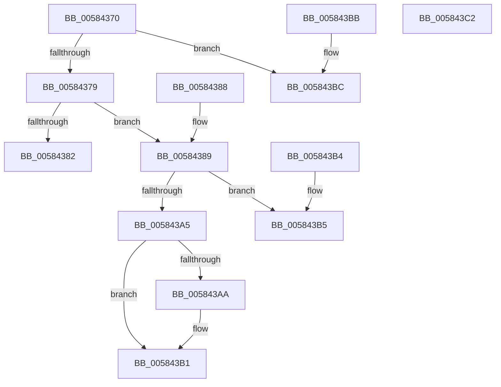

# HvlRegisterInterruptCallback

- RVA: `0x00584370`–`0x005843C3` (길이 `83` bytes)
- VA: `0x0000000140584370`
- 실행 섹션: `.text`
- PDB 이름 있음: `예`; PDB Function 태그: `아니요`
- unwind 정보 RVA: `0x000DB714`
- 디코드: `27`개 명령, `83/83` bytes 표시
- 미해석 바이트: `0` (있으면 어셈블리에 `.byte`로 보존)

> 이 문서는 커널 이미지의 기계어와 PDB 기호를 분석해 생성했습니다. 4번과 5번은 함수 원형과 자료형을 바이너리 사용 방식에서 추정한 C 해석이며 원본 소스 복구 결과는 아닙니다.

## 1. Dependencies

- 직접 호출 지점: **0**; 고유 호출 대상: **0**
- 직접 호출자로 확인된 함수: **0**
- RIP 상대 이미지 참조: **3**

### Outgoing calls
- 직접 디코드된 call 명령이 없습니다.

### Direct callers
- 이 함수 시작 RVA로 연결되는 직접 call은 확인되지 않았습니다. 간접 호출은 완전히 역산할 수 없습니다.

### Static image references
- `0x00584379` → RVA `0x00FC6A97` (`ALMOSTRO`; read)
- `0x00584389` → RVA `0x00583B20` (`HvlDummyInterruptCallback`; read)
- `0x00584393` → RVA `0x00FC5608` (`ALMOSTRO`; read)

## 2. Other-region calls and transfers

- 다른 실행 섹션으로 향하는 call: **0**
- 별도 외부 분기/꼬리 이동을 확인하지 못했습니다.

## 3. Assembly (complete function range)

```asm
00584370  4C 63 C9                        movsxd r9, ecx
00584373  41 83 F9 04                     cmp r9d, 4
00584377  77 43                           ja 0x1405843bc
00584379  80 3D 17 27 A4 00 00            cmp byte ptr [rip + 0xa42717], 0
00584380  75 07                           jne 0x140584389
00584382  B8 BB 00 00 C0                  mov eax, 0xc00000bb
00584387  C3                              ret
00584388  CC                              int3
00584389  4C 8D 1D 90 F7 FF FF            lea r11, [rip - 0x870]
00584390  49 8B C3                        mov rax, r11
00584393  4C 8D 15 6E 12 A4 00            lea r10, [rip + 0xa4126e]
0058439A  F0 4B 0F B1 14 CA               lock cmpxchg qword ptr [r10 + r9*8], rdx
005843A0  49 3B C3                        cmp rax, r11
005843A3  75 10                           jne 0x1405843b5
005843A5  4D 85 C0                        test r8, r8
005843A8  74 07                           je 0x1405843b1
005843AA  41 8D 41 30                     lea eax, [r9 + 0x30]
005843AE  41 89 00                        mov dword ptr [r8], eax
005843B1  33 C0                           xor eax, eax
005843B3  C3                              ret
005843B4  CC                              int3
005843B5  B8 01 00 00 C0                  mov eax, 0xc0000001
005843BA  C3                              ret
005843BB  CC                              int3
005843BC  B8 0D 00 00 C0                  mov eax, 0xc000000d
005843C1  C3                              ret
005843C2  CC                              int3
```

## 4. C-style interpretation (structured pseudocode)

```c
__int64 __fastcall HvlRegisterInterruptCallback(int a1, __int64 a2, __int64 a3)
{
    __int64 result;

    if (((unsigned int)((int)(a1))) > 4) goto loc_005843BC;
    if ((*(unsigned __int8 *)(v_rip + 10757911)) != 0) goto loc_00584389;
    return (unsigned int)(0xC00000BBULL);
loc_00584389:
    if ((v_rip - 2160) != (v_rip - 2160)) goto loc_005843B5;
    result = v_rip - 2160;
    if (a3 != 0) {
        result = (int)(a1) + 48;
        *(unsigned int *)(a3) = (unsigned int)(result);
    }
    result = 0;
    return result;
loc_005843B5:
    return (unsigned int)(0xC0000001ULL);
loc_005843BC:
    return (unsigned int)(0xC000000DULL);
}
```

## 5. (Beta) C Style

```c
int64_t HvlRegisterInterruptCallback(int32_t Arg1, int64_t Arg2, int64_t Arg3)
{
    int64_t result;

    if (((uint32_t)((int32_t)(Arg1))) > 4) goto loc_005843BC;
    if ((*(uint8_t *)(v_rip + 0xA42717)) != 0) goto loc_00584389;
    return (uint32_t)(0xC00000BBULL);
loc_00584389:
    if ((v_rip - 2160) != (v_rip - 2160)) goto loc_005843B5;
    result = v_rip - 2160;
    if (Arg3 != 0) {
        result = (int32_t)(Arg1) + 48;
        *(uint32_t *)(Arg3) = (uint32_t)(result);
    }
    result = 0;
    return result;
loc_005843B5:
    return (uint32_t)(0xC0000001ULL);
loc_005843BC:
    return (uint32_t)(0xC000000DULL);
}
```

## 6. Execution-region graph

[열기: 2D/3D 그래프와 함수 탐색 컨트롤 패널](../../../control-panel.html?section=text&rva=0x00584370&view=graph)

- 2D 그래프는 위에서 아래로 흐르고, 3D 그래프는 빈 공간을 드래그해 회전합니다. Shift+드래그는 이동, 휠은 확대·축소, 함수 노드 선택은 대상 보고서 이동입니다.

### Static fallback


