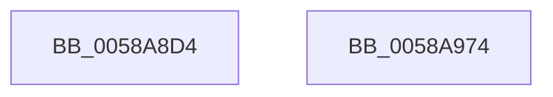

# HvlRegisterPerfFeedbackCounters

- RVA: `0x0058A8D4`–`0x0058A975` (길이 `161` bytes)
- VA: `0x000000014058A8D4`
- 실행 섹션: `.text`
- PDB 이름 있음: `예`; PDB Function 태그: `아니요`
- unwind 정보 RVA: `0x000C68A8`
- 디코드: `38`개 명령, `161/161` bytes 표시
- 미해석 바이트: `0` (있으면 어셈블리에 `.byte`로 보존)

> 이 문서는 커널 이미지의 기계어와 PDB 기호를 분석해 생성했습니다. 4번과 5번은 함수 원형과 자료형을 바이너리 사용 방식에서 추정한 C 해석이며 원본 소스 복구 결과는 아닙니다.

## 1. Dependencies

- 직접 호출 지점: **2**; 고유 호출 대상: **2**
- 직접 호출자로 확인된 함수: **1**
- RIP 상대 이미지 참조: **0**

### Outgoing calls
- `0x0058A906` → [memset](../6C/memset_function_006C6C40.md) (function, `0x006C6C40`)
- `0x0058A95A` → [HvlpSetPowerProperty](../4C/HvlpSetPowerProperty_function_004C9124.md) (function, `0x004C9124`)

### Direct callers
- [PpmPerfRegisterHvPerfStateCounters](../../page/77/PpmPerfRegisterHvPerfStateCounters_function_00770C40.md) at `0x00770CE7`

### Static image references
- 디코드된 RIP-relative 메모리 참조가 없습니다.

## 2. Other-region calls and transfers

- 다른 실행 섹션으로 향하는 call: **0**
- 별도 외부 분기/꼬리 이동을 확인하지 못했습니다.

## 3. Assembly (complete function range)

```asm
0058A8D4  48 89 5C 24 08                  mov qword ptr [rsp + 8], rbx
0058A8D9  48 89 7C 24 10                  mov qword ptr [rsp + 0x10], rdi
0058A8DE  55                              push rbp
0058A8DF  48 8D AC 24 C0 FE FF FF         lea rbp, [rsp - 0x140]
0058A8E7  48 81 EC 40 02 00 00            sub rsp, 0x240
0058A8EE  48 8B FA                        mov rdi, rdx
0058A8F1  8B D9                           mov ebx, ecx
0058A8F3  33 C0                           xor eax, eax
0058A8F5  48 8D 4C 24 20                  lea rcx, [rsp + 0x20]
0058A8FA  33 D2                           xor edx, edx
0058A8FC  89 44 24 24                     mov dword ptr [rsp + 0x24], eax
0058A900  41 B8 14 02 00 00               mov r8d, 0x214
0058A906  E8 35 C3 13 00                  call 0x1406c6c40
0058A90B  0F 10 07                        movups xmm0, xmmword ptr [rdi]
0058A90E  48 8D 4C 24 20                  lea rcx, [rsp + 0x20]
0058A913  C7 44 24 20 01 00 00 00         mov dword ptr [rsp + 0x20], 1
0058A91B  0F 10 4F 10                     movups xmm1, xmmword ptr [rdi + 0x10]
0058A91F  89 5C 24 28                     mov dword ptr [rsp + 0x28], ebx
0058A923  0F 11 44 24 30                  movups xmmword ptr [rsp + 0x30], xmm0
0058A928  0F 10 47 20                     movups xmm0, xmmword ptr [rdi + 0x20]
0058A92C  0F 11 4C 24 40                  movups xmmword ptr [rsp + 0x40], xmm1
0058A931  0F 10 4F 30                     movups xmm1, xmmword ptr [rdi + 0x30]
0058A935  0F 11 44 24 50                  movups xmmword ptr [rsp + 0x50], xmm0
0058A93A  0F 10 47 40                     movups xmm0, xmmword ptr [rdi + 0x40]
0058A93E  0F 11 4C 24 60                  movups xmmword ptr [rsp + 0x60], xmm1
0058A943  0F 10 4F 50                     movups xmm1, xmmword ptr [rdi + 0x50]
0058A947  0F 11 44 24 70                  movups xmmword ptr [rsp + 0x70], xmm0
0058A94C  F2 0F 10 47 60                  movsd xmm0, qword ptr [rdi + 0x60]
0058A951  F2 0F 11 45 90                  movsd qword ptr [rbp - 0x70], xmm0
0058A956  0F 11 4D 80                     movups xmmword ptr [rbp - 0x80], xmm1
0058A95A  E8 C5 E7 F3 FF                  call 0x1404c9124
0058A95F  4C 8D 9C 24 40 02 00 00         lea r11, [rsp + 0x240]
0058A967  49 8B 5B 10                     mov rbx, qword ptr [r11 + 0x10]
0058A96B  49 8B 7B 18                     mov rdi, qword ptr [r11 + 0x18]
0058A96F  49 8B E3                        mov rsp, r11
0058A972  5D                              pop rbp
0058A973  C3                              ret
0058A974  CC                              int3
```

## 4. C-style interpretation (structured pseudocode)

```c
__int64 __fastcall HvlRegisterPerfFeedbackCounters(int a1, __int64 a2)
{
    __int64 result;
    __int64 v_rsp;
    unsigned __int64 v_stack_m148;
    unsigned __int64 v_stack_m1B8;
    unsigned __int64 v_stack_m1C8;
    unsigned __int64 v_stack_m1D8;
    unsigned __int64 v_stack_m1E8;
    unsigned __int64 v_stack_m1F8;
    unsigned __int64 v_stack_m208;
    unsigned __int64 v_stack_m218;
    unsigned int v_stack_m220;
    unsigned int v_stack_m224;
    unsigned __int64 v_stack_m228;
    unsigned __int64 v_stack_m8;
    unsigned __int64 v_stack_p10;
    unsigned __int64 v_stack_p8;

    v_stack_p8 = v_rbx;
    v_stack_p10 = v_rdi;
    v_rsp = (v_rsp) - (576);
    result = 0;
    a2 = 0;
    v_stack_m224 = 0;
    result = memset(v_stack_m228, a2, 532, a4);
    v_stack_m228 = 1;
    v_stack_m220 = (unsigned int)((unsigned int)(a1));
    v_stack_m218 = v_xmm0;
    v_stack_m208 = v_xmm1;
    v_stack_m1F8 = v_xmm0;
    v_stack_m1E8 = v_xmm1;
    v_stack_m1D8 = v_xmm0;
    v_stack_m1B8 = v_xmm0;
    v_stack_m1C8 = v_xmm1;
    result = HvlpSetPowerProperty(v_stack_m228, a2, 532, a4);
    return result;
}
```

## 5. (Beta) C Style

```c
int64_t HvlRegisterPerfFeedbackCounters(int32_t Arg1, void *Arg2)
{
    uint8_t *arg2 = (uint8_t *)Arg2;

    int64_t result;
    int64_t local_rsp;
    uint64_t v_stack_m148;
    uint64_t v_stack_m1B8;
    uint64_t v_stack_m1C8;
    uint64_t v_stack_m1D8;
    uint64_t v_stack_m1E8;
    uint64_t v_stack_m1F8;
    uint64_t v_stack_m208;
    uint64_t v_stack_m218;
    uint32_t v_stack_m220;
    uint32_t v_stack_m224;
    uint64_t v_stack_m228;
    uint64_t v_stack_m8;
    uint64_t v_stack_p10;
    uint64_t v_stack_p8;

    v_stack_p8 = local_rbx;
    v_stack_p10 = local_rdi;
    local_rsp = (local_rsp) - (576);
    result = 0;
    Arg2 = 0;
    v_stack_m224 = 0;
    result = memset(v_stack_m228, Arg2, 532, a4);
    v_stack_m228 = 1;
    v_stack_m220 = (uint32_t)((uint32_t)(Arg1));
    v_stack_m218 = v_xmm0;
    v_stack_m208 = v_xmm1;
    v_stack_m1F8 = v_xmm0;
    v_stack_m1E8 = v_xmm1;
    v_stack_m1D8 = v_xmm0;
    v_stack_m1B8 = v_xmm0;
    v_stack_m1C8 = v_xmm1;
    result = HvlpSetPowerProperty(v_stack_m228, Arg2, 532, a4);
    return result;
}
```

### 관측된 메모리 오프셋

구조체 형식이 확인되지 않은 접근은 인자 기준의 오프셋으로만 기록했습니다.

| 기준 인자 | 오프셋 표현 | 폭 (bit) | 접근 |
|---|---:|---:|---|
| `Arg2` | `+ 0x0` | `128` | `R` |
| `Arg2` | `+ 0x10` | `128` | `R` |
| `Arg2` | `+ 0x20` | `128` | `R` |
| `Arg2` | `+ 0x30` | `128` | `R` |
| `Arg2` | `+ 0x40` | `128` | `R` |
| `Arg2` | `+ 0x50` | `128` | `R` |
| `Arg2` | `+ 0x60` | `64` | `R` |

## 6. Execution-region graph

[열기: 2D/3D 그래프와 함수 탐색 컨트롤 패널](../../../control-panel.html?section=text&rva=0x0058A8D4&view=graph)

- 2D 그래프는 위에서 아래로 흐르고, 3D 그래프는 빈 공간을 드래그해 회전합니다. Shift+드래그는 이동, 휠은 확대·축소, 함수 노드 선택은 대상 보고서 이동입니다.

### Static fallback


