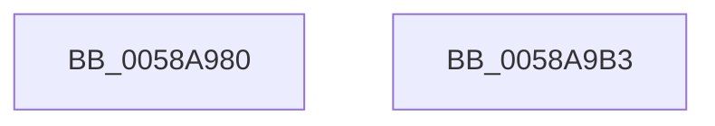

# HvlRequestProcessorHalt

- RVA: `0x0058A980`–`0x0058A9B4` (길이 `52` bytes)
- VA: `0x000000014058A980`
- 실행 섹션: `.text`
- PDB 이름 있음: `예`; PDB Function 태그: `아니요`
- unwind 정보 RVA: `0x0005C788`
- 디코드: `12`개 명령, `52/52` bytes 표시
- 미해석 바이트: `0` (있으면 어셈블리에 `.byte`로 보존)

> 이 문서는 커널 이미지의 기계어와 PDB 기호를 분석해 생성했습니다. 4번과 5번은 함수 원형과 자료형을 바이너리 사용 방식에서 추정한 C 해석이며 원본 소스 복구 결과는 아닙니다.

## 1. Dependencies

- 직접 호출 지점: **2**; 고유 호출 대상: **2**
- 직접 호출자로 확인된 함수: **0**
- RIP 상대 이미지 참조: **0**

### Outgoing calls
- `0x0058A9A1` → [HvcallInitiateHypercall](../31/HvcallInitiateHypercall_function_00313630.md) (function, `0x00313630`)
- `0x0058A9A9` → [HvlpHvToNtStatus](../30/HvlpHvToNtStatus_function_00307BD8.md) (function, `0x00307BD8`)

### Direct callers
- 이 함수 시작 RVA로 연결되는 직접 call은 확인되지 않았습니다. 간접 호출은 완전히 역산할 수 없습니다.

### Static image references
- 디코드된 RIP-relative 메모리 참조가 없습니다.

## 2. Other-region calls and transfers

- 다른 실행 섹션으로 향하는 call: **0**
- 별도 외부 분기/꼬리 이동을 확인하지 못했습니다.

## 3. Assembly (complete function range)

```asm
0058A980  48 83 EC 28                     sub rsp, 0x28
0058A984  4C 8B 41 08                     mov r8, qword ptr [rcx + 8]
0058A988  48 8B 11                        mov rdx, qword ptr [rcx]
0058A98B  48 C7 44 24 30 DE 00 00 00      mov qword ptr [rsp + 0x30], 0xde
0058A994  C7 44 24 30 DE 00 01 00         mov dword ptr [rsp + 0x30], 0x100de
0058A99C  48 8B 4C 24 30                  mov rcx, qword ptr [rsp + 0x30]
0058A9A1  E8 8A 8C D8 FF                  call 0x140313630
0058A9A6  48 8B C8                        mov rcx, rax
0058A9A9  E8 2A D2 D7 FF                  call 0x140307bd8
0058A9AE  48 83 C4 28                     add rsp, 0x28
0058A9B2  C3                              ret
0058A9B3  CC                              int3
```

## 4. C-style interpretation (structured pseudocode)

```c
__int64 __fastcall HvlRequestProcessorHalt(__int64 a1)
{
    __int64 result;
    __int64 v_rsp;
    unsigned __int64 v_stack_p8;

    v_rsp = (v_rsp) - (40);
    v_stack_p8 = 222;
    v_stack_p8 = 0x100DEULL;
    result = HvcallInitiateHypercall(v_stack_p8, *(unsigned __int64 *)(a1), *(unsigned __int64 *)(a1 + 8), a4);
    result = HvlpHvToNtStatus(result, *(unsigned __int64 *)(a1), *(unsigned __int64 *)(a1 + 8), a4);
    v_rsp = (v_rsp) + (40);
    return result;
}
```

## 5. (Beta) C Style

```c
int64_t HvlRequestProcessorHalt(void *Arg1)
{
    uint8_t *arg1 = (uint8_t *)Arg1;

    int64_t result;
    int64_t local_rsp;
    uint64_t v_stack_p8;

    local_rsp = (local_rsp) - (40);
    v_stack_p8 = 222;
    v_stack_p8 = 0x100DEULL;
    result = HvcallInitiateHypercall(v_stack_p8, *(uint64_t *)(arg1), *(uint64_t *)(arg1 + 0x8), a4);
    result = HvlpHvToNtStatus(result, *(uint64_t *)(arg1), *(uint64_t *)(arg1 + 0x8), a4);
    local_rsp = (local_rsp) + (40);
    return result;
}
```

### 관측된 메모리 오프셋

구조체 형식이 확인되지 않은 접근은 인자 기준의 오프셋으로만 기록했습니다.

| 기준 인자 | 오프셋 표현 | 폭 (bit) | 접근 |
|---|---:|---:|---|
| `Arg1` | `+ 0x0` | `64` | `R` |
| `Arg1` | `+ 0x8` | `64` | `R` |

## 6. Execution-region graph

[열기: 2D/3D 그래프와 함수 탐색 컨트롤 패널](../../../control-panel.html?section=text&rva=0x0058A980&view=graph)

- 2D 그래프는 위에서 아래로 흐르고, 3D 그래프는 빈 공간을 드래그해 회전합니다. Shift+드래그는 이동, 휠은 확대·축소, 함수 노드 선택은 대상 보고서 이동입니다.

### Static fallback


