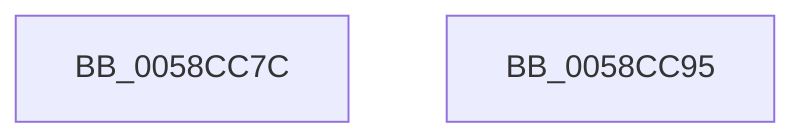

# HvlRescindEnlightenments

- RVA: `0x0058CC7C`–`0x0058CC96` (길이 `26` bytes)
- VA: `0x000000014058CC7C`
- 실행 섹션: `.text`
- PDB 이름 있음: `예`; PDB Function 태그: `아니요`
- unwind 정보 RVA: `0x000DB714`
- 디코드: `5`개 명령, `26/26` bytes 표시
- 미해석 바이트: `0` (있으면 어셈블리에 `.byte`로 보존)

> 이 문서는 커널 이미지의 기계어와 PDB 기호를 분석해 생성했습니다. 4번과 5번은 함수 원형과 자료형을 바이너리 사용 방식에서 추정한 C 해석이며 원본 소스 복구 결과는 아닙니다.

## 1. Dependencies

- 직접 호출 지점: **0**; 고유 호출 대상: **0**
- 직접 호출자로 확인된 함수: **1**
- RIP 상대 이미지 참조: **3**

### Outgoing calls
- 직접 디코드된 call 명령이 없습니다.

### Direct callers
- [KiEnableKvaShadowing](../../pagelk/B6/KiEnableKvaShadowing_function_00B6ACBC.md) at `0x00B6ADE0`

### Static image references
- `0x0058CC7C` → RVA `0x00FC6FFC` (`ALMOSTRO`; read/write)
- `0x0058CC84` → RVA `0x00FC6AB8` (`ALMOSTRO`; read/write)
- `0x0058CC8C` → RVA `0x00FC6C98` (`ALMOSTRO`; read/write)

## 2. Other-region calls and transfers

- 다른 실행 섹션으로 향하는 call: **0**
- 별도 외부 분기/꼬리 이동을 확인하지 못했습니다.

## 3. Assembly (complete function range)

```asm
0058CC7C  F0 83 0D 78 A3 A3 00 01         lock or dword ptr [rip + 0xa3a378], 1
0058CC84  F0 83 25 2C 9E A3 00 FE         lock and dword ptr [rip + 0xa39e2c], 0xfffffffe
0058CC8C  F0 83 25 04 A0 A3 00 FE         lock and dword ptr [rip + 0xa3a004], 0xfffffffe
0058CC94  C3                              ret
0058CC95  CC                              int3
```

## 4. C-style interpretation (structured pseudocode)

```c
void __fastcall HvlRescindEnlightenments(void)
{
    return;
}
```

## 5. (Beta) C Style

```c
void HvlRescindEnlightenments(void)
{
    return;
}
```

## 6. Execution-region graph

[열기: 2D/3D 그래프와 함수 탐색 컨트롤 패널](../../../control-panel.html?section=text&rva=0x0058CC7C&view=graph)

- 2D 그래프는 위에서 아래로 흐르고, 3D 그래프는 빈 공간을 드래그해 회전합니다. Shift+드래그는 이동, 휠은 확대·축소, 함수 노드 선택은 대상 보고서 이동입니다.

### Static fallback


