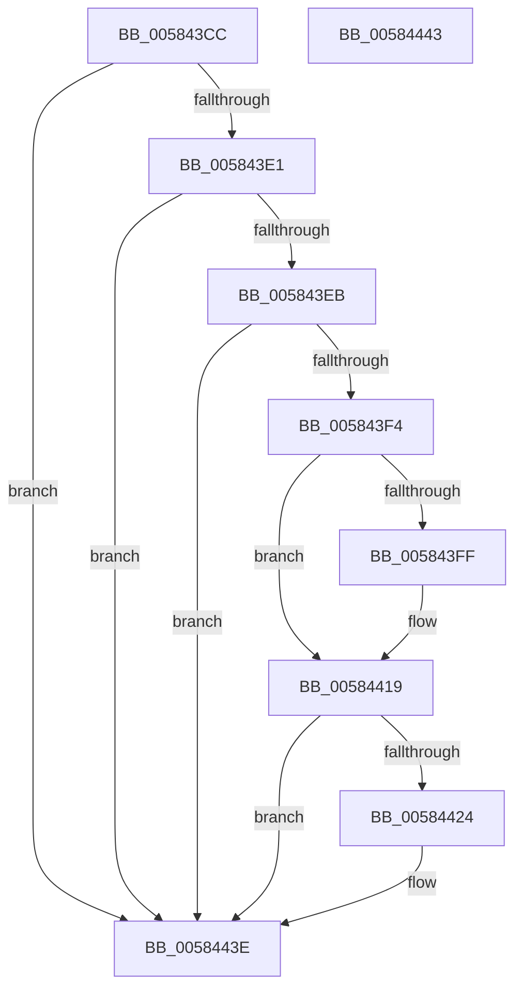

# HvlRestoreEnlightenment

- RVA: `0x005843CC`–`0x00584444` (길이 `120` bytes)
- VA: `0x00000001405843CC`
- 실행 섹션: `.text`
- PDB 이름 있음: `예`; PDB Function 태그: `아니요`
- unwind 정보 RVA: `0x0005D2F4`
- 디코드: `35`개 명령, `120/120` bytes 표시
- 미해석 바이트: `0` (있으면 어셈블리에 `.byte`로 보존)

> 이 문서는 커널 이미지의 기계어와 PDB 기호를 분석해 생성했습니다. 4번과 5번은 함수 원형과 자료형을 바이너리 사용 방식에서 추정한 C 해석이며 원본 소스 복구 결과는 아닙니다.

## 1. Dependencies

- 직접 호출 지점: **4**; 고유 호출 대상: **3**
- 직접 호출자로 확인된 함수: **1**
- RIP 상대 이미지 참조: **4**

### Outgoing calls
- `0x005843F6` → [HvlpTryConfigureInterface](HvlpTryConfigureInterface_function_0058CABC.md) (function, `0x0058CABC`)
- `0x00584413` → [KeBugCheckEx](../4F/KeBugCheckEx_function_004FD660.md) (function, `0x004FD660`)
- `0x0058441B` → [HvlpPhase0Enlightenments](HvlpPhase0Enlightenments_function_0058D1B8.md) (function, `0x0058D1B8`)
- `0x00584438` → [KeBugCheckEx](../4F/KeBugCheckEx_function_004FD660.md) (function, `0x004FD660`)

### Direct callers
- [PopHiberCheckResume](../../pagelk/B6/PopHiberCheckResume_function_00B6D840.md) at `0x00B6D8F4`

### Static image references
- `0x005843D0` → RVA `0x00FC6C98` (`ALMOSTRO`; read)
- `0x005843D6` → RVA `0x00FC6AB8` (`ALMOSTRO`; write)
- `0x005843E1` → RVA `0x00FC6A90` (`ALMOSTRO`; read)
- `0x005843EB` → RVA `0x00FC6A84` (`ALMOSTRO`; read)

## 2. Other-region calls and transfers

- 다른 실행 섹션으로 향하는 call: **0**
- 별도 외부 분기/꼬리 이동을 확인하지 못했습니다.

## 3. Assembly (complete function range)

```asm
005843CC  48 83 EC 38                     sub rsp, 0x38
005843D0  8B 05 C2 28 A4 00               mov eax, dword ptr [rip + 0xa428c2]
005843D6  89 05 DC 26 A4 00               mov dword ptr [rip + 0xa426dc], eax
005843DC  80 F9 01                        cmp cl, 1
005843DF  75 5D                           jne 0x14058443e
005843E1  8B 05 A9 26 A4 00               mov eax, dword ptr [rip + 0xa426a9]
005843E7  A8 02                           test al, 2
005843E9  75 53                           jne 0x14058443e
005843EB  80 3D 92 26 A4 00 00            cmp byte ptr [rip + 0xa42692], 0
005843F2  75 4A                           jne 0x14058443e
005843F4  33 C9                           xor ecx, ecx
005843F6  E8 C1 86 00 00                  call 0x14058cabc
005843FB  85 C0                           test eax, eax
005843FD  79 1A                           jns 0x140584419
005843FF  48 83 64 24 20 00               and qword ptr [rsp + 0x20], 0
00584405  45 33 C9                        xor r9d, r9d
00584408  48 63 D0                        movsxd rdx, eax
0058440B  45 33 C0                        xor r8d, r8d
0058440E  B9 01 00 02 00                  mov ecx, 0x20001
00584413  E8 48 92 F7 FF                  call 0x1404fd660
00584418  CC                              int3
00584419  33 C9                           xor ecx, ecx
0058441B  E8 98 8D 00 00                  call 0x14058d1b8
00584420  85 C0                           test eax, eax
00584422  79 1A                           jns 0x14058443e
00584424  48 83 64 24 20 00               and qword ptr [rsp + 0x20], 0
0058442A  45 33 C9                        xor r9d, r9d
0058442D  48 63 D0                        movsxd rdx, eax
00584430  45 33 C0                        xor r8d, r8d
00584433  B9 01 00 02 00                  mov ecx, 0x20001
00584438  E8 23 92 F7 FF                  call 0x1404fd660
0058443D  CC                              int3
0058443E  48 83 C4 38                     add rsp, 0x38
00584442  C3                              ret
00584443  CC                              int3
```

## 4. C-style interpretation (structured pseudocode)

```c
__int64 __fastcall HvlRestoreEnlightenment(int a1, __int64 a2, int a3, int a4)
{
    __int64 result;
    __int64 v_rsp;
    unsigned __int64 v_stack_m18;

    v_rsp = (v_rsp) - (56);
    *(unsigned int *)(v_rip + 10757852) = (unsigned int)((unsigned int)(*(unsigned int *)(v_rip + 10758338)));
    if (((unsigned __int8)(a1)) != 1) goto loc_0058443E;
    if ((((unsigned __int8)((unsigned int)(*(unsigned int *)(v_rip + 10757801)))) & (2)) != 0) goto loc_0058443E;
    if ((*(unsigned __int8 *)(v_rip + 10757778)) != 0) goto loc_0058443E;
    a1 = 0;
    result = HvlpTryConfigureInterface(a1, a2, a3, a4);
    if (sign_flag) {
        a4 = 0;
        a2 = (int)((unsigned int)(result));
        a3 = 0;
        a1 = 0x20001ULL;
        result = KeBugCheckEx(a1, a2, a3, a4);
    }
    a1 = 0;
    result = HvlpPhase0Enlightenments(a1, a2, a3, a4);
    if (sign_flag) {
        a4 = 0;
        a2 = (int)((unsigned int)(result));
        a3 = 0;
        a1 = 0x20001ULL;
        result = KeBugCheckEx(a1, a2, a3, a4);
    }
    v_rsp = (v_rsp) + (56);
    return result;
}
```

## 5. (Beta) C Style

```c
int64_t HvlRestoreEnlightenment(int32_t Arg1, int64_t Arg2, int32_t Arg3, int32_t Arg4)
{
    int64_t result;
    int64_t local_rsp;
    uint64_t v_stack_m18;

    local_rsp = (local_rsp) - (56);
    *(uint32_t *)(v_rip + 0xA426DC) = (uint32_t)((uint32_t)(*(uint32_t *)(v_rip + 0xA428C2)));
    if (((uint8_t)(Arg1)) != 1) goto loc_0058443E;
    if ((((uint8_t)((uint32_t)(*(uint32_t *)(v_rip + 0xA426A9)))) & (2)) != 0) goto loc_0058443E;
    if ((*(uint8_t *)(v_rip + 0xA42692)) != 0) goto loc_0058443E;
    Arg1 = 0;
    result = HvlpTryConfigureInterface(Arg1, Arg2, Arg3, Arg4);
    if (sign_flag) {
        Arg4 = 0;
        Arg2 = (int32_t)((uint32_t)(result));
        Arg3 = 0;
        Arg1 = 0x20001ULL;
        result = KeBugCheckEx(Arg1, Arg2, Arg3, Arg4);
    }
    Arg1 = 0;
    result = HvlpPhase0Enlightenments(Arg1, Arg2, Arg3, Arg4);
    if (sign_flag) {
        Arg4 = 0;
        Arg2 = (int32_t)((uint32_t)(result));
        Arg3 = 0;
        Arg1 = 0x20001ULL;
        result = KeBugCheckEx(Arg1, Arg2, Arg3, Arg4);
    }
    local_rsp = (local_rsp) + (56);
    return result;
}
```

## 6. Execution-region graph

[열기: 2D/3D 그래프와 함수 탐색 컨트롤 패널](../../../control-panel.html?section=text&rva=0x005843CC&view=graph)

- 2D 그래프는 위에서 아래로 흐르고, 3D 그래프는 빈 공간을 드래그해 회전합니다. Shift+드래그는 이동, 휠은 확대·축소, 함수 노드 선택은 대상 보고서 이동입니다.

### Static fallback


