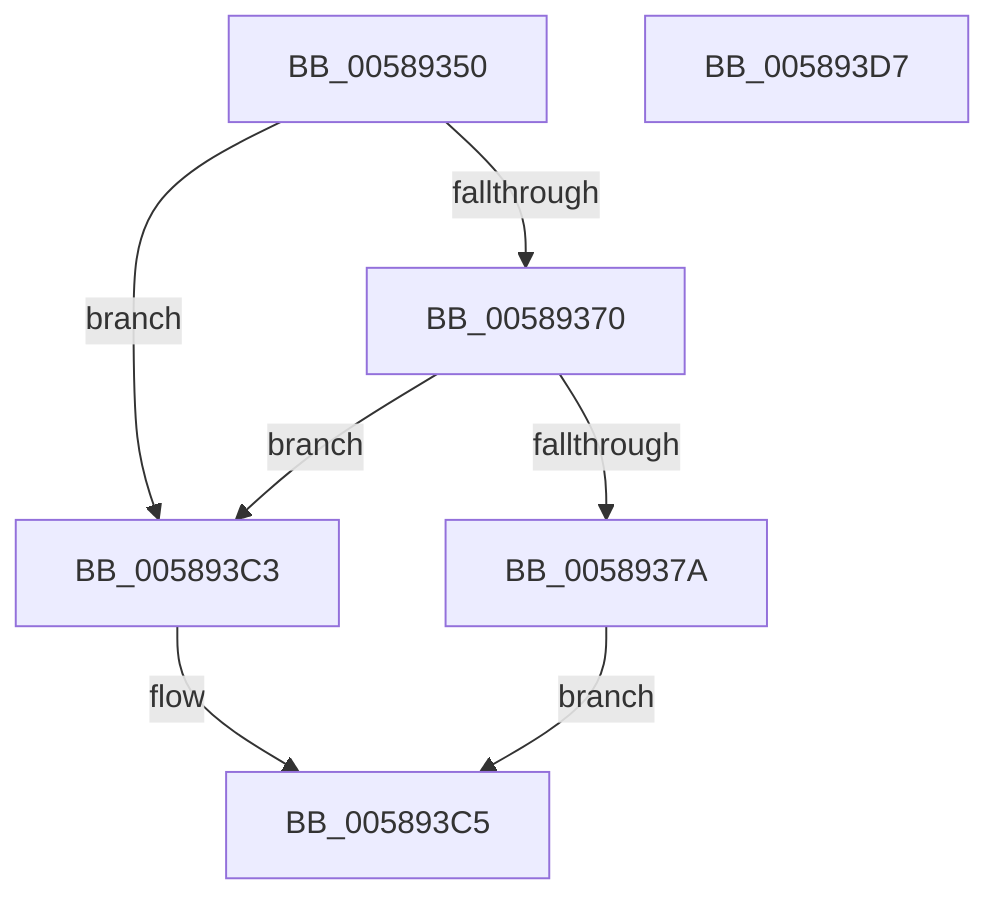

# HvlRestoreTime

- RVA: `0x00589350`–`0x005893D8` (길이 `136` bytes)
- VA: `0x0000000140589350`
- 실행 섹션: `.text`
- PDB 이름 있음: `예`; PDB Function 태그: `아니요`
- unwind 정보 RVA: `0x000AF370`
- 디코드: `34`개 명령, `136/136` bytes 표시
- 미해석 바이트: `0` (있으면 어셈블리에 `.byte`로 보존)

> 이 문서는 커널 이미지의 기계어와 PDB 기호를 분석해 생성했습니다. 4번과 5번은 함수 원형과 자료형을 바이너리 사용 방식에서 추정한 C 해석이며 원본 소스 복구 결과는 아닙니다.

## 1. Dependencies

- 직접 호출 지점: **3**; 고유 호출 대상: **3**
- 직접 호출자로 확인된 함수: **0**
- RIP 상대 이미지 참조: **3**

### Outgoing calls
- `0x005893B4` → [HvcallFastExtended](../31/HvcallFastExtended_function_003130E0.md) (function, `0x003130E0`)
- `0x005893BC` → [HvlpHvToNtStatus](../30/HvlpHvToNtStatus_function_00307BD8.md) (function, `0x00307BD8`)
- `0x005893CD` → [_security_check_cookie](../6A/_security_check_cookie_function_006AC640.md) (function, `0x006AC640`)

### Direct callers
- 이 함수 시작 RVA로 연결되는 직접 call은 확인되지 않았습니다. 간접 호출은 완전히 역산할 수 없습니다.

### Static image references
- `0x00589357` → RVA `0x00E0A740` (`.data`; read)
- `0x00589366` → RVA `0x00FC6A90` (`ALMOSTRO`; read)
- `0x00589372` → RVA `0x00FC6A84` (`ALMOSTRO`; read)

## 2. Other-region calls and transfers

- 다른 실행 섹션으로 향하는 call: **0**
- 별도 외부 분기/꼬리 이동을 확인하지 못했습니다.

## 3. Assembly (complete function range)

```asm
00589350  4C 8B DC                        mov r11, rsp
00589353  48 83 EC 78                     sub rsp, 0x78
00589357  48 8B 05 E2 13 88 00            mov rax, qword ptr [rip + 0x8813e2]
0058935E  48 33 C4                        xor rax, rsp
00589361  48 89 44 24 60                  mov qword ptr [rsp + 0x60], rax
00589366  8B 05 24 D7 A3 00               mov eax, dword ptr [rip + 0xa3d724]
0058936C  A8 02                           test al, 2
0058936E  75 53                           jne 0x1405893c3
00589370  33 C0                           xor eax, eax
00589372  38 05 0C D7 A3 00               cmp byte ptr [rip + 0xa3d70c], al
00589378  75 49                           jne 0x1405893c3
0058937A  89 44 24 4C                     mov dword ptr [rsp + 0x4c], eax
0058937E  45 33 C9                        xor r9d, r9d
00589381  49 83 4B C8 FF                  or qword ptr [r11 - 0x38], 0xffffffffffffffff
00589386  89 4C 24 48                     mov dword ptr [rsp + 0x48], ecx
0058938A  48 C7 44 24 30 03 01 00 00      mov qword ptr [rsp + 0x30], 0x103
00589393  49 89 53 D8                     mov qword ptr [r11 - 0x28], rdx
00589397  49 8D 53 C8                     lea rdx, [r11 - 0x38]
0058939B  4D 89 43 E0                     mov qword ptr [r11 - 0x20], r8
0058939F  44 8D 40 20                     lea r8d, [rax + 0x20]
005893A3  C7 44 24 30 03 01 01 00         mov dword ptr [rsp + 0x30], 0x10103
005893AB  48 8B 4C 24 30                  mov rcx, qword ptr [rsp + 0x30]
005893B0  89 44 24 20                     mov dword ptr [rsp + 0x20], eax
005893B4  E8 27 9D D8 FF                  call 0x1403130e0
005893B9  48 8B C8                        mov rcx, rax
005893BC  E8 17 E8 D7 FF                  call 0x140307bd8
005893C1  EB 02                           jmp 0x1405893c5
005893C3  33 C0                           xor eax, eax
005893C5  48 8B 4C 24 60                  mov rcx, qword ptr [rsp + 0x60]
005893CA  48 33 CC                        xor rcx, rsp
005893CD  E8 6E 32 12 00                  call 0x1406ac640
005893D2  48 83 C4 78                     add rsp, 0x78
005893D6  C3                              ret
005893D7  CC                              int3
```

## 4. C-style interpretation (structured pseudocode)

```c
__int64 __fastcall HvlRestoreTime(int a1, __int64 a2, __int64 a3, int a4)
{
    __int64 result;
    __int64 v_rsp;
    unsigned __int64 v_stack_m18;
    unsigned int v_stack_m2C;
    unsigned int v_stack_m30;
    unsigned __int64 v_stack_m48;
    unsigned int v_stack_m58;

    v_rsp = (v_rsp) - (120);
    result = (*(unsigned __int64 *)(v_rip + 8917986)) ^ (v_rsp);
    v_stack_m18 = result;
    if ((((unsigned __int8)((unsigned int)(*(unsigned int *)(v_rip + 10737444)))) & (2)) != 0) goto loc_005893C3;
    result = 0;
    if ((*(unsigned __int8 *)(v_rip + 10737420)) != 0) goto loc_005893C3;
    v_stack_m2C = 0;
    a4 = 0;
    v_stack_m30 = a1;
    v_stack_m48 = 259;
    *(unsigned __int64 *)(v_rsp - 40) = a2;
    *(unsigned __int64 *)(v_rsp - 32) = a3;
    v_stack_m48 = 0x10103ULL;
    v_stack_m58 = 0;
    result = HvcallFastExtended(v_stack_m48, v_rsp - 56, result + 32, a4);
    result = HvlpHvToNtStatus(result, v_rsp - 56, result + 32, a4);
    goto loc_005893C5;
loc_005893C3:
    result = 0;
loc_005893C5:
    a1 = (v_stack_m18) ^ (v_rsp);
    result = _security_check_cookie(a1, v_rsp - 56, result + 32, a4);
    v_rsp = (v_rsp) + (120);
    return result;
}
```

## 5. (Beta) C Style

```c
int64_t HvlRestoreTime(int32_t Arg1, int64_t Arg2, int64_t Arg3, int32_t Arg4)
{
    int64_t result;
    int64_t local_rsp;
    uint64_t v_stack_m18;
    uint32_t v_stack_m2C;
    uint32_t v_stack_m30;
    uint64_t v_stack_m48;
    uint32_t v_stack_m58;

    local_rsp = (local_rsp) - (120);
    result = (*(uint64_t *)(v_rip + 0x8813E2)) ^ (local_rsp);
    v_stack_m18 = result;
    if ((((uint8_t)((uint32_t)(*(uint32_t *)(v_rip + 0xA3D724)))) & (2)) != 0) goto loc_005893C3;
    result = 0;
    if ((*(uint8_t *)(v_rip + 0xA3D70C)) != 0) goto loc_005893C3;
    v_stack_m2C = 0;
    Arg4 = 0;
    v_stack_m30 = Arg1;
    v_stack_m48 = 259;
    *(uint64_t *)(local_rsp - 0x28) = Arg2;
    *(uint64_t *)(local_rsp - 0x20) = Arg3;
    v_stack_m48 = 0x10103ULL;
    v_stack_m58 = 0;
    result = HvcallFastExtended(v_stack_m48, local_rsp - 56, result + 32, Arg4);
    result = HvlpHvToNtStatus(result, local_rsp - 56, result + 32, Arg4);
    goto loc_005893C5;
loc_005893C3:
    result = 0;
loc_005893C5:
    Arg1 = (v_stack_m18) ^ (local_rsp);
    result = _security_check_cookie(Arg1, local_rsp - 56, result + 32, Arg4);
    local_rsp = (local_rsp) + (120);
    return result;
}
```

## 6. Execution-region graph

[열기: 2D/3D 그래프와 함수 탐색 컨트롤 패널](../../../control-panel.html?section=text&rva=0x00589350&view=graph)

- 2D 그래프는 위에서 아래로 흐르고, 3D 그래프는 빈 공간을 드래그해 회전합니다. Shift+드래그는 이동, 휠은 확대·축소, 함수 노드 선택은 대상 보고서 이동입니다.

### Static fallback


